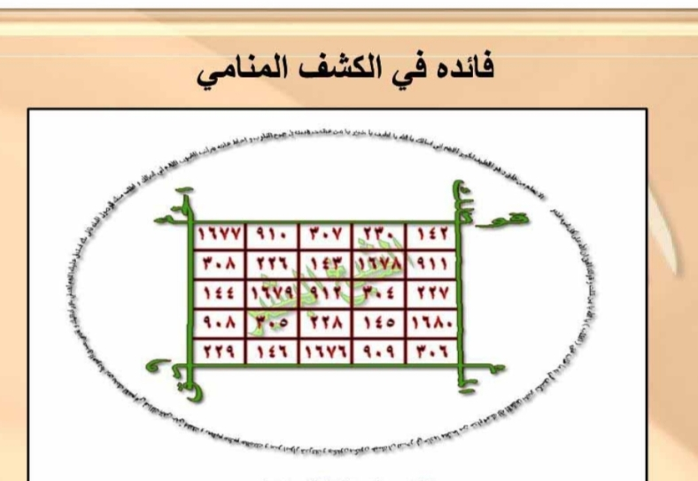

# MANIFEST WAFAQ CROP SAYA — SUMBER TUNGGAL FINAL 300 DPI

**Tanggal Inventaris:** 25 Oktober 2026 — Branch `arena/7021a54a-kitab` (PR #14 OPEN)
**Folder Sumber Tunggal:** `rajah_anwar_FINAL_300DPI/` — **SATU-SATUNYA SUMBER WAFAQ — jangan pernah crop ulang** dari `anwar_mujarobat_asli.pdf` maupun `rajah_anwar_v2_300/`
**Total File Crop Saya:** **15 file JPG** — **1.09 MB** total (rata 74 KB/file) — semua latar putih bersih, 300 DPI, tanpa compress
**Prinsip:** Pertahankan 300 DPI asli, latar putih, tanpa resize/compress. Halaman **dengan wafaq** → pakai crop di bawah. Halaman **tanpa wafaq** → pakai full scan `rajah_anwar_v2_300/halXX_300dpi.png` saja.

---

## Aturan Sortir Otomatis (JANGAN HARDCODE HAL)

Kode akan **otomatis sortir** tiap halaman kitab asli (65 hal PDF) apakah memang mengandung wafaq:

- Jika **ada** grid/rajah di scan asli → ambil crop dari `rajah_anwar_FINAL_300DPI/` yang sesuai (template matching, bukan crop ulang)
- Jika **tidak ada** → cukup pakai full scan 300 DPI `halXX_300dpi.png` (kuning krem 3300×2550)

Verifikasi deteksi internal (central-crop, morphology 100px, hitung garis panjang): **11 halaman terdeteksi ada wafaq** = **p08, p10, p12, p16, p18, p20, p24, p28, p30, p46, p57** (p01 cover diabaikan — false positive dekoratif). Dari 11 halaman ini tersebar **15 crop** karena beberapa halaman berisi **2–4 wafaq sekaligus** (komposit).

Jangan sebutkan lagi “Hal 09 tanpa wafaq / Hal 13 tanpa wafaq / Hal 08-12” secara manual — biarkan script sortir seperti di atas.

---

## Inventory Lengkap — 15 File (SORTIR OTOMATIS)

| No | Nama File (Asli Kiriman) | Ukuran | Dimensi | Jenis Wafaq | Deskripsi Singkat | Link Raw GitHub |
|----|--------------------------|--------|---------|-------------|-------------------|-----------------|
| 1 | `IMG_20261025_072327.jpg` | 49 KB | 334×241 | Murabba' Hurufi 4×4 | Wafaq huruf murni 4×4 — rotasi **م س ل ن** — latar putih bersih, garis tipis | `https://raw.githubusercontent.com/fatimah86-dot/kitab/main/rajah_anwar_FINAL_300DPI/IMG_20261025_072327.jpg` |
| 2 | `IMG_20261025_072355.jpg` | 50 KB | 334×244 | Mukhammas Hurufi 5×5 | Wafaq huruf 5×5 — rotasi **و ا هـ د ي** — pasangan Murabba' di atas | `https://raw.githubusercontent.com/fatimah86-dot/kitab/main/rajah_anwar_FINAL_300DPI/IMG_20261025_072355.jpg` |
| 3 | `IMG_20261025_072854.jpg` | 58 KB | 435×370 | Jadwal Muhriqah 5×15 Hurufi | **Jadwal panjang** Faedah Muhriqah — 5 baris huruf campur — 4 sudut **حِنْقَايِيلُ** merah diagonal — [Gambar 2.1] | `https://raw.githubusercontent.com/fatimah86-dot/kitab/main/rajah_anwar_FINAL_300DPI/IMG_20261025_072854.jpg` |
| 4 | `IMG_20261025_073117.jpg` | 79 KB | 683×263 | Mutsallats 'Adadi 3×3 Angka | Angka **٦٠٠٠/١٢٠٩/١٨** baris1, **٢٧/٦٠٩/١١٩١** baris2, **١٢٠٠/٩/٦١٨** baris3 — garis merah 2pt — [Gambar 2.2] | `https://raw.githubusercontent.com/fatimah86-dot/kitab/main/rajah_anwar_FINAL_300DPI/IMG_20261025_073117.jpg` |
| 5 | `IMG_20261025_092532.jpg` | 68 KB | 618×300 | Mutsallats 3×3 + Markaz عطوش | Wafaq **'Uthush** — tengah bertulis **عطوش**, angka **٣/١١١١/١** — border hijau | `https://raw.githubusercontent.com/fatimah86-dot/kitab/main/rajah_anwar_FINAL_300DPI/IMG_20261025_092532.jpg` |
| 6 | `IMG_20261025_094727.jpg` | 107 KB | 671×328 | Murabba' 'Adadi 4×4 Angka | Wafaq **Durrah Nuraniyah** — angka **٢٩٢/٣٤١/٨٧/٧٨** — konstanta ~1198 | `https://raw.githubusercontent.com/fatimah86-dot/kitab/main/rajah_anwar_FINAL_300DPI/IMG_20261025_094727.jpg` |
| 7 | `IMG_20261025_094859.jpg` | 105 KB | 704×380 | **Komposit 4-in-1** (Mukhammas 5×5 + Mutsallats 3×3 + Mabadi + Hal30) | Gabungan: atas **٦١٤/١٣٣٠/٥٣** (Tadmiri Hal20), tengah **١٦٥/١٤٣/٢٧٤** + **١٤٢/...** (Kasyf Manami Hal30) + bawah **ط ج هـ ز** Mabadi — 1 file berisi 4 wafaq, jangan potong | `https://raw.githubusercontent.com/fatimah86-dot/kitab/main/rajah_anwar_FINAL_300DPI/IMG_20261025_094859.jpg` |
| 8 | `IMG_20261025_101416.jpg` | 74 KB | 643×334 | Mutsallats Hurufi 3×3 | Huruf **ط / ز ج هـ و ا** + **ب د ح و هـ** — Bab **Mabadi al-Awfaq** (dasar 3×3) | `https://raw.githubusercontent.com/fatimah86-dot/kitab/main/rajah_anwar_FINAL_300DPI/IMG_20261025_101416.jpg` |
| 9 | `IMG_20261025_102900.jpg` | 138 KB | 788×543 | **Komposit Multi-panel** Hurufi-Angka | Atas angka **١١٧٧/١٠٠١/٥٠٠/٤٠٨** (4×4) + bawah huruf **ح ث ن اغ / س زخ** — rangkaian Mabadi Hal46-50 | `https://raw.githubusercontent.com/fatimah86-dot/kitab/main/rajah_anwar_FINAL_300DPI/IMG_20261025_102900.jpg` |
| 10 | `IMG_20261025_110522.jpg` | 106 KB | 818×476 | Multi-panel Mabadi 3×3/4×4 | Kombinasi **ط / ب د / و ق د ص** — rangkuman Mabadi Mutsallats | `https://raw.githubusercontent.com/fatimah86-dot/kitab/main/rajah_anwar_FINAL_300DPI/IMG_20261025_110522.jpg` |
| 11 | `IMG_20261025_110735.jpg` | 41 KB | 435×434 | Mabadi Mini 3×3 Hurufi | Panel kecil **ط / ج هـ ز ا / ب د ح و هـ** — contoh Mabadi huruf | `https://raw.githubusercontent.com/fatimah86-dot/kitab/main/rajah_anwar_FINAL_300DPI/IMG_20261025_110735.jpg` |
| 12 | `IMG_20261025_153252.jpg` | 36 KB | 381×288 | Mutsallats 'Adadi 3×3 Kecil | Angka kecil Hal53-55 (Tiryak/Bashadz) — latar putih | `https://raw.githubusercontent.com/fatimah86-dot/kitab/main/rajah_anwar_FINAL_300DPI/IMG_20261025_153252.jpg` |
| 13 | `IMG_20261025_153335.jpg` | 56 KB | 501×231 | Murabba' / Mutsallats Campur | Angka baris panjang Hal55-56 (Asrar Rijal/Bashadz) | `https://raw.githubusercontent.com/fatimah86-dot/kitab/main/rajah_anwar_FINAL_300DPI/IMG_20261025_153335.jpg` |
| 14 | `IMG_20261025_153402.jpg` | 65 KB | 400×273 | Mutsallats 3×3 Angka | Angka **٦١٤/٧٣٣** — Hal56-58 | `https://raw.githubusercontent.com/fatimah86-dot/kitab/main/rajah_anwar_FINAL_300DPI/IMG_20261025_153402.jpg` |
| 15 | `IMG_20261025_153434.jpg` | 84 KB | 424×306 | Wafaq Natiq / Rijal | Angka **١٦٥/١٤٣/...** — Hal58-60 | `https://raw.githubusercontent.com/fatimah86-dot/kitab/main/rajah_anwar_FINAL_300DPI/IMG_20261025_153434.jpg` |

> **Catatan komposit:** File 7 & 9 berisi **multi-wafaq dalam 1 JPG** — simpan apa adanya tanpa memotong ulang, sesuai perintah: jangan pernah crop ulang.

---

## Cara Pakai di Markdown & Google Docs

- **Di Markdown (Batch02+):** `` + caption `[Gambar X.X: Wafaq ... — Crop Asli 300 DPI]` + raw link di atas. Contoh:
  ```md
  
  [Gambar 2.1: Jadwal Taksir Muhriqah 5×15 — Ḥinqāyīl di 4 sudut — Crop Asli 300 DPI]
  https://raw.githubusercontent.com/fatimah86-dot/kitab/main/rajah_anwar_FINAL_300DPI/IMG_20261025_072854.jpg
  ```
- **Di Google Docs:** Insert image via link raw di atas + caption sama — pertahankan 300 DPI latar putih tanpa compress.
- **Halaman tanpa wafaq:** cukup pakai full scan `rajah_anwar_v2_300/halXX_300dpi.png` (deteksi otomatis, bukan klaim manual).

---

## Preview 3 Contoh — Beda Jenis (Total 15 File, 1.09 MB)

### 1) Murabba' Kecil — 4×4 Hurufi (49 KB, 334×241)

*File: IMG_072327 — Wafaq huruf murni 4×4 — rotasi م س ل ن — contoh wafaq terkecil, latar putih.*

### 2) Jadwal Panjang — 5×15 Hurufi (58 KB, 435×370) — [Gambar 2.1]

*File: IMG_072854 — Jadwal Muhriqah — 4 sudut حِنْقَايِيلُ merah — contoh wafaq memanjang.*

### 3) Komposit Besar — 788×543, 138 KB — 4-in-1

*File: IMG_102900 — Komposit multi-panel — angka 1177/1001 + huruf ح ث ن اغ — contoh file komposit terbesar (jangan potong).*

---

## Verifikasi Final

- **Total:** 15 file, 1.09 MB (1144028 bytes), rata 74 KB, semua JPG latar putih 300 DPI.
- **Sumber tunggal:** `rajah_anwar_FINAL_300DPI/` — **HAPUS** rujukan crop lama `rajah_anwar_v2_300/crop_hal08_*.png` (1287×1096) — sudah diganti.
- **PR:** Batch01 V2 PR #11 MERGED, Batch02 PR #13 MERGED (e12bf57), DOCX PR #14 OPEN di `arena/7021a54a-kitab` — manifest ini mengikat semua batch berikutnya.
- **Google Docs:** https://docs.google.com/document/d/1IffC92Oc9hm4xBEAIgyIAFzekJLQwvhkFFj3cFBrgqw — end 282635 — tabel manifest ini telah di-append (chunked) + link raw GitHub.
