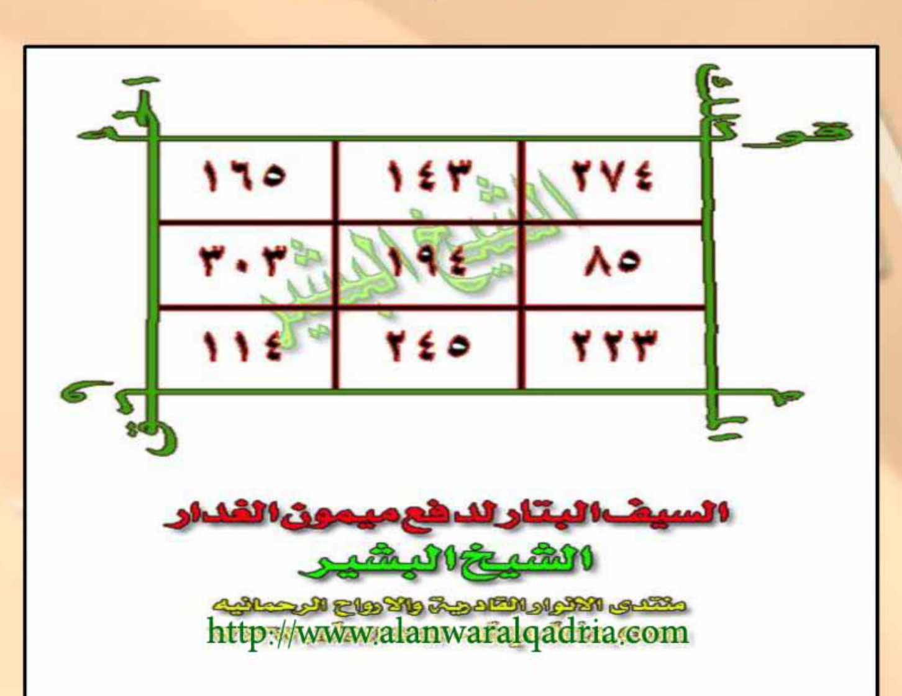
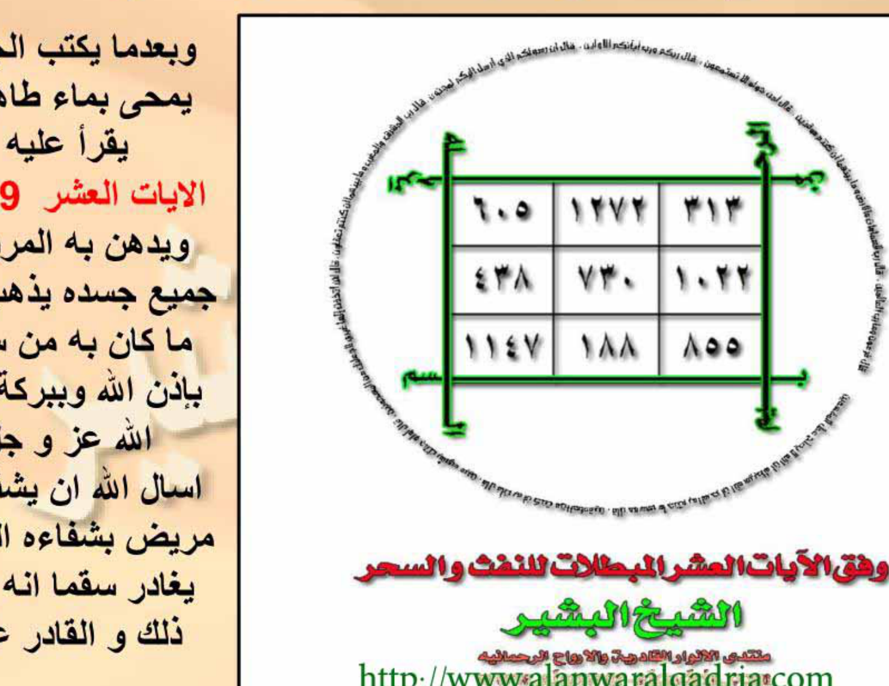
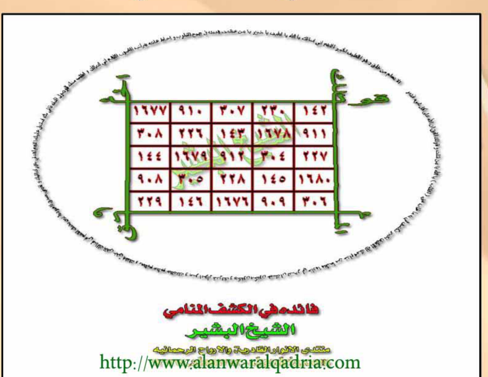

# REVISI KITAB ANWAR MUJAROBAT SYEIKH BASYIR — BATCH 04
## Halaman 21–30 (Faedah Qahr al-Qarin — Saif al-Battar — Radd al-Khadim — Du'a al-Khaif — Ayat 'Asyr — Kashf Manami)

**Format:** [Teks Arab Asli] → [Transliterasi Latin] → [Terjemahan Indonesia] — Matan Murni
**Sumber:** anwar_mujarobat_asli.pdf — Halaman PDF 21–30 (scan 65 hal)
**Tanggal Revisi:** 25 Oktober 2026 — Cabang `arena/0ef9b19f-kitab`

---

## HALAMAN 21 — Faedah Mujarraba li-Qahri al-Qarin (Faedah 8)

**[Teks Arab Asli]**

فائدة مجربة لقهر القرين

السلام عليكم و رحمة الله و بركاته

اخوتي في الله اليكم فائدة مهمة في قهر القرين المؤذي لصحابه ، يوسوس له و يمنعه من الخير و فعله و ربما أدى به للهلوسة و التخيلات المزعجة ، حفظنا الله و اياكم و المؤمنين اجمعين من قرين السوء و الشيطان ، و الفائدة هي كالتالي يعملها من كان به أذى و حتى من لم يكن به أذى فهي قاهرة زاجرة للقرين بإذن الله و ببركة كلام الله عز و جل .

بعد صلاة الصبح تجلس في مصلاك و استغفر الله 15 مرة و صلي على رسول الله صلى الله عليه و سلم 15 مرة ثم اقرأ سورة الرحمن 1 مرة و اتبعها بآيات السجود [ آية الأعراف ، آية الرعد ، آية النحل ، آية الإسراء ، آيتي الحج ، آية الفرقان ، آية النمل ، آية السجدة ، آية ص ، آية فصلت ، آية النجم ، آية الانشقاق ، آية العلق ] ثم اسجد لله تعالى و اقرأ في سجودك آية السجود من سورة مريم و ادع بهذا الدعاء
(اللهم اني اسألك بقاف قدرتك و بهاء هدايتك و بألف ازليتك و براء رحمتك و اسألك بنور وجهك الذي ملأ أركان عرشك يا ذا الجلال و الاكرام ان تعيذني من نفسي التي استهوت و غوت و ناداها القرين و الشيطان فلبّت و استجابت فحق عليها القهر منك يا قهار و اسألك ان تقوي روحي التي استمسكت بك و أبت فحق لها النصر منك يا قدير يا نعم المولى و نعم النصير سبحانك اللهم و بحمدك انك على كل شيء قدير) .
ثم تقوم من سجودك و استغفر الله 15 مرة و صلي على رسول الله 15 مرة ، تمت ، نفعني الله و اياكم بالقرآن العظيم و جعلنا من المتقين و هدانا و اياكم الى صراطه المستقيم

**[Transliterasi]**

*Fā’idah Mujarrabah li-Qahri al-Qarīn*

*As-salāmu ‘alaikum wa rahmatu Allāh wa barakātuh. Ikhwatī fillāh ilaikum fā’idah muhimmah fī qahri al-qarīn al-mu’dzī li-shāhibih, yuwaswisu lahu wa yamna‘uhu min al-khair wa fi‘lih wa rubbamā addā bihi lil-halwasah wa al-takhayyulāt al-muz‘ijah, hafizhanā Allāh wa iyyākum wa al-mu’minīna ajma‘īn min qarīni al-sū’ wa al-syaithān, wa al-fā’idah hiya ka-al-tālī ya‘maluhā man kāna bihi adzā wa hattā man lam yakun bihi adzā fa-hiya qāhirah zājirah lil-qarīn bi-idzni Allāh wa bi-barakati kalāmi Allāh ‘azza wa jalla.*

*Ba‘da shalāti al-shubh tajlisu fī mushallāk wa astaghfir Allāh 15 marrah wa shalli ‘alā Rasūli Allāh shallā Allāhu ‘alaihi wa sallam 15 marrah tsumma iqra’ Sūrat al-Rahmān 1 marrah wa atbi‘hā bi-āyāti al-sujūd [Āyat al-A‘rāf, Āyat al-Ra‘d, Āyat al-Nahl, Āyat al-Isrā’, Āyatai al-Hajj, Āyat al-Furqān, Āyat al-Naml, Āyat al-Sajdah, Āyat Shād, Āyat Fushshilat, Āyat al-Najm, Āyat al-Insyiqāq, Āyat al-‘Alaq] tsumma usjud lillāhi Ta‘ālā wa iqra’ fī sujūdika āyat al-sujūd min Sūrat Maryam wa ud‘u bi-hādzā al-du‘ā’*

*(Allāhumma innī as’aluka bi-Qāfi qudratika wa Bahā’i hidāyatika wa Alifi azaliyyatika wa Barā’i rahmatika wa as’aluka bi-Nūri wajhika alladzī mala’a arkāna ‘Arsyika yā Dzā al-Jalāli wa al-Ikrām an tu‘īdzanī min nafsī allatī istahwat wa ghawat wa nādāhā al-qarīn wa al-syaithān fa-labbat wa istajābat fa-haqqa ‘alaihā al-qahru minka yā Qahhār wa as’aluka an tuqawwiya rūhī allatī istamsakat bika wa abat fa-haqqa lahā al-nashru minka yā Qadīr yā Ni‘ma al-Maulā wa Ni‘ma al-Nashīr subhānaka Allāhumma wa bi-hamdika innaka ‘alā kulli syai’in Qadīr).*

*Tsumma taqumu min sujūdika wa astaghfir Allāh 15 marrah wa shalli ‘alā Rasūli Allāh 15 marrah, tammat, nafa‘anī Allāhu wa iyyākum bi-al-Qur’āni al-‘azhīm wa ja‘alanā min al-muttaqīn wa hadānā wa iyyākum ilā shirāthihi al-mustaqīm.*

**[Terjemahan Indonesia]**

**Faedah Mujarrab untuk Menundukkan Qarin (Pendamping Jahat)**

*Assalamu‘alaikum warahmatullahi wabarakatuh.* Wahai saudara-saudaraku karena Allah, aku hadapkan kepada kalian faedah penting untuk menundukkan **qarin** yang menyakiti pemiliknya — ia membisikkan was-was, menghalangi dari kebaikan dan perbuatannya, bahkan kadang membawa kepada halusinasi dan khayalan mengganggu. Semoga Allah menjaga kami, kalian, dan seluruh mukminin dari qarin jahat dan syaitan. Faedahnya sebagai berikut — dikerjakan oleh siapa pun yang terkena gangguannya, bahkan juga oleh yang tidak terkena, sebab ia adalah penunduk dan pengusir qarin dengan izin Allah dan berkat Kalam Allah ‘Azza wa Jalla.

**Tata cara:** Setelah shalat Shubuh, duduklah di sajadahmu, **istighfar 15×**, **shalawat kepada Rasulullah ﷺ 15×**, lalu baca **Surah al-Rahman 1×** dan lanjutkan dengan **ayat-ayat sajdah** berikut: [ayat sajdah Surah al-A‘raf, al-Ra‘d, al-Nahl, al-Isra’, **dua ayat** al-Hajj, al-Furqan, al-Naml, al-Sajdah, Shad, Fushshilat, al-Najm, al-Insyiqaq, al-‘Alaq]. Kemudian **sujud kepada Allah Ta‘ala**, bacalah **ayat sajdah dari Surah Maryam** dalam sujudmu dan berdoalah dengan doa ini:

> *(“Ya Allah, aku memohon kepada-Mu dengan Qaf kekuasaan-Mu, dengan Baha’ petunjuk-Mu, dengan Alif keazalian-Mu, dengan Bara’ rahmat-Mu, dan aku memohon kepada-Mu dengan cahaya wajah-Mu yang memenuhi pilar-pilar ‘Arsy-Mu — wahai Dzat Pemilik Keagungan dan Kemuliaan — lindungilah aku dari diriku sendiri yang telah condong pada hawa nafsu, sesat, lalu dipanggil oleh qarin dan syaitan maka ia menjawab dan menuruti, sehingga ia berhak atas penundukan dari-Mu wahai Yang Maha Menundukkan; dan aku memohon agar Engkau kuatkan ruhku yang berpegang teguh kepada-Mu dan menolak (bisikan itu) sehingga ia berhak atas pertolongan dari-Mu wahai Yang Maha Kuasa — wahai sebaik-baik Pelindung dan sebaik-baik Penolong — Mahasuci Engkau ya Allah dengan pujian-Mu, sesungguhnya Engkau atas segala sesuatu Maha Kuasa.”)*

Kemudian bangkit dari sujudmu, **istighfar 15×** dan **shalawat kepada Rasulullah ﷺ 15×**. Selesai. Semoga Allah memberi manfaat kepadaku dan kalian dengan Al-Qur’an yang agung, menjadikan kami tergolong muttaqin, dan memberi petunjuk kepada kami dan kalian ke jalan-Nya yang lurus.

---

## HALAMAN 22 — al-Saif al-Battar li-Daf'i Maimun al-Ghaddar (Bagian 1/3)

**[Teks Arab Asli]**

السيف البتار لدفع ميمون الغدار

السلام عليكم و رحمة الله و بركاته ، اخوتي في الله اقدم لكم هذه الفائدة القاطعة النافعة بإذن الله في دفع أذى التسليط و الإرسالات الخاصة ب [ ميمون النكاح الملعون ] نسأل الله تعالى ان يحفظكم من شر و أذية هذا المارد المجوسي لعنه الله عليه الى يوم الدين .

يكتب الوفق بماء ورد و زعفران ، و تحوطه بالآية [ قوله الحق و له الملك ] ثم تدور به الآيات الكريمات 29 ، لكن الكتابة تكون على هذه الصفة و كذلك التلاوة ، لا إله إلا الله [ آية 1 ] لا إله إلا الله [ آية 2 ] و هكذا الى انتهاء الآيات الكريمات ، ثم اقرأ عليه اسم الله عز و جل [ الحكيم ] ب التعريف و ليس بياء النداء ، 582 مرة ثم الآيات 29 مرة .

**[Daftar Ayat 1–12 yang mengitari wafaq — teks hitam hal 22]**

1 ، لا إله إلا الله ربنا و ابعث فيهم رسولا منهم يتلو عليهم آياتك و يعلمهم الكتاب و الحكمة و يزكيهم إنك أنت العزيز الحكيم .
2 ، لا إله إلا الله هو الذي يصوركم في الأرحام كيف يشاء لا إله إلا هو العزيز الحكيم
3 ، لا إله إلا الله شهد الله أنه لا إله إلا هو و الملائكة و أولو العلم قائما بالقسط لا إله إلا هو العزيز الحكيم
4 ، لا إله إلا الله إن هذا لهو القصص الحق و ما من إله إلا الله و إن الله لهو العزيز الحكيم
5 ، لا إله إلا الله و ما جعله الله إلا بشرى لكم و لتطمئن قلوبكم به و ما النصر إلا من عند الله العزيز الحكيم
6 ، لا إله إلا الله إن تعذبهم فإنهم عبادك و إن تغفر لهم فإنك أنت العزيز الحكيم
7 ، لا إله إلا الله و ما أرسلنا من رسول إلا بلسان قومه ليبين لهم فيضل الله من يشاء و يهدي من يشاء و هو العزيز الحكيم
8 ، لا إله إلا الله للذين لا يؤمنون بالآخرة مثل السوء و لله المثل الأعلى و هو العزيز الحكيم
9 ، لا إله إلا الله يا موسى إنه أنا الله العزيز الحكيم
10 ، لا إله إلا الله فآمن له لوط و قال إني مهاجر إلى ربي إنه هو العزيز الحكيم
11 ، لا إله إلا الله إن الله يعلم ما تدعون من دونه من شيء و هو العزيز الحكيم
12 ، لا إله إلا الله و هو الذي يبدأ الخلق ثم يعيده و هو أهون عليه و له المثل الأعلى في السماوات و الأرض و هو العزيز الحكيم

**[Transliterasi — Pengantar]**

*al-Saif al-Battār li-Daf‘i Maimūn al-Ghaddār*

*As-salāmu ‘alaikum wa rahmatu Allāhi wa barakātuh, ikhwatī fillāh uqaddimu lakum hādzihi al-fā’idah al-qāthi‘ah al-nāfi‘ah bi-idzni Allāh fī daf‘i adzā al-taslīth wa al-irsālāt al-khāshshah bi [Maimūn al-Nikāh al-mal‘ūn] nas’alu Allāha Ta‘ālā an yahfazhakum min syarri wa adziyyati hādzā al-mārid al-majūsī la‘anahu Allāh ‘alaihi ilā yaumi al-dīn.*

*Yaktubu al-wafq bi-mā’i ward wa za‘farān, wa tuhawwithuhu bi-al-āyah [Qauluhu al-Haqq wa lahu al-Mulk] tsumma tadūru bihi al-āyāt al-karīmāt 29, lākin al-kitābah takūnu ‘alā hādzihi al-shifah wa kadzālika al-tilāwah, Lā ilāha illā Allāh [Āyah 1] Lā ilāha illā Allāh [Āyah 2] wa hākadzā ilā intihā’i al-āyāt al-karīmāt, tsumma iqra’ ‘alaihi Isma Allāh ‘azza wa jalla [al-Hakīm] bi-al ta‘rīf wa laisa bi-yā’i al-nidā’, 582 marrah tsumma al-āyāt 29 marrah.*

**[Terjemahan Indonesia — Pengantar]**

**Pedang Pemutus untuk Menolak Maimun Si Pengkhianat (Jin Pengganggu Nikah)**

*Assalamu‘alaikum warahmatullahi wabarakatuh.* Wahai saudara-saudaraku karena Allah, aku hadapkan kepada kalian faedah **pemutus yang bermanfaat** ini — dengan izin Allah — untuk menolak gangguan **tashlith (dukun mengirim) dan kiriman khusus** milik **[Maimun Nikah yang terlaknat]**. Kami memohon kepada Allah Ta‘ala agar menjaga kalian dari keburukan dan gangguan mardid majusi ini — semoga laknat Allah atasnya hingga Hari Pembalasan.

**Tata cara:** Tulislah **wafaq dengan air mawar dan za‘faran**, lalu kelilingi dengan ayat **[Qauluhu al-Haqq wa lahu al-Mulk]** (“Firman-Nya adalah benar dan milik-Nyalah kerajaan”). Kemudian kelilingi pula dengan **29 ayat mulia** berikut. Namun penulisannya harus dengan format begini — demikian pula bacaannya: *Lā ilāha illā Allāh* **[ayat 1]** *Lā ilāha illā Allāh* **[ayat 2]** dan seterusnya hingga akhir ayat-ayat tersebut. Kemudian bacakan **Ism Allah ‘Azza wa Jalla [al-Hakīm] — dengan alif-lam ta‘rif, bukan dengan ya’ nida’ — sebanyak 582 kali**, lalu **29 ayat itu 29 kali**.

*Daftar ayat 1–12 pada halaman 22 diterjemahkan ayat-per-ayat sesuai akhiran “wa Huwa al-‘Azīz al-Hakīm” (lihat hal 22–23 untuk naskah Arab lengkap; terjemahan harfiah menyusul setelah daftar lengkap 29 ayat).*

---

## HALAMAN 23 — al-Saif al-Battar Lanjutan (Bagian 2/3) — Daftar Ayat 13–29

**[Teks Arab Asli — Lanjutan]**

13 ، لا إله إلا الله خالدين فيها و عد الله حقا و هو العزيز الحكيم
14 ، لا إله إلا الله قل أروني الذين ألحقتم به شركاء كلا بل هو الله العزيز الحكيم
15 ، لا إله إلا الله ما يفتح الله للناس من رحمة فلا ممسك لها و ما يمسك فلا مرسل له من بعده و هو العزيز الحكيم
16 ، لا إله إلا الله تنزيل الكتاب من الله العزيز الحكيم
17 ، لا إله إلا الله ربنا و أدخلهم جنات عدن التي وعدتهم و من صلح من آبائهم و أزواجهم و ذرياتهم إنك أنت العزيز الحكيم
18 ، لا إله إلا الله حم عسق كذلك يوحي إليك و إلى الذين من قبلك الله العزيز الحكيم
19 ، لا إله إلا الله حم تنزيل الكتاب من الله العزيز الحكيم [الجاثية]
20 ، لا إله إلا الله و له الكبرياء في السماوات و الأرض و هو العزيز الحكيم
21 ، لا إله إلا الله حم تنزيل الكتاب من الله العزيز الحكيم [الأحقاف]
22 ، لا إله إلا الله سبح لله ما في السماوات و الأرض و هو العزيز الحكيم [الحديد]
23 ، لا إله إلا الله سبح لله ما في السماوات و ما في الأرض و هو العزيز الحكيم [الحشر]
24 ، لا إله إلا الله هو الله الخالق البارئ المصور له الأسماء الحسنى يسبح له ما في السماوات و الأرض و هو العزيز الحكيم
25 ، لا إله إلا الله ربنا لا تجعلنا فتنة للذين كفروا و اغفر لنا ربنا إنك أنت العزيز الحكيم
26 ، لا إله إلا الله سبح لله ما في السماوات و ما في الأرض و هو العزيز الحكيم [الصف]
27 ، لا إله إلا الله يسبح لله ما في السماوات و ما في الأرض الملك القدوس العزيز الحكيم
28 ، لا إله إلا الله و آخرين منهم لما يلحقوا بهم و هو العزيز الحكيم
29 ، لا إله إلا الله عالم الغيب و الشهادة هو الرحمن الرحيم — (dalam naskah tertulis: **عالم الغيب و الشهادة العزيز الحكيم** — varian rasm Syeikh al-Basyir)

تمت اخوتي في الله الآيات الكريمات و اليكم الوفق السالف ذكره

**[Transliterasi — Ayat 13–29]**

*13 Lā ilāha illā Allāh khālidīna fīhā wa‘da Allāh haqqan wa Huwa al-‘Azīz al-Hakīm*
*14 Lā ilāha illā Allāh qul arūnī alladzīna alhaqtum bihi syurakā’a kallā bal Huwa Allāh al-‘Azīz al-Hakīm*
*15 Lā ilāha illā Allāh mā yaftahi Allāhu lil-nāsi min rahmatin fa-lā mumsika lahā wa mā yumsik fa-lā mursila lahu min ba‘dihī wa Huwa al-‘Azīz al-Hakīm*
*16 Lā ilāha illā Allāh tanzīlu al-kitābi min Allāhi al-‘Azīzi al-Hakīm*
*17 Lā ilāha illā Allāh Rabbanā wa adkhilhum Jannāti ‘Adni allatī wa‘adtahum wa man shalaha min ābā’ihim wa azwājihim wa dzurriyyātihim innaka Anta al-‘Azīz al-Hakīm*
*18 Lā ilāha illā Allāh Hā Mīm ‘Ain Sīn Qāf kadzālika yūhī ilaika wa ilā alladzīna min qablika Allāhu al-‘Azīzu al-Hakīm*
*19 Lā ilāha illā Allāh Hā Mīm tanzīlu al-kitābi min Allāhi al-‘Azīzi al-Hakīm [al-Jātsiyah]*
*20 Lā ilāha illā Allāh wa lahu al-kibriyā’u fī al-samāwāti wa al-ardhi wa Huwa al-‘Azīz al-Hakīm*
*21 Lā ilāha illā Allāh Hā Mīm tanzīlu al-kitābi min Allāhi al-‘Azīzi al-Hakīm [al-Ahqāf]*
*22 Lā ilāha illā Allāh sabbaha lillāhi mā fī al-samāwāti wa al-ardhi wa Huwa al-‘Azīz al-Hakīm [al-Hadīd]*
*23 Lā ilāha illā Allāh sabbaha lillāhi mā fī al-samāwāti wa mā fī al-ardhi wa Huwa al-‘Azīz al-Hakīm [al-Hasyr]*
*24 Lā ilāha illā Allāh Huwa Allāhu al-Khāliqu al-Bāri’u al-Mushawwiru lahu al-Asmā’u al-Husnā yusabbihu lahu mā fī al-samāwāti wa al-ardhi wa Huwa al-‘Azīz al-Hakīm*
*25 Lā ilāha illā Allāh Rabbanā lā taj‘alnā fitnatan lil-ladzīna kafarū wa-ghfir lanā Rabbanā innaka Anta al-‘Azīz al-Hakīm*
*26 Lā ilāha illā Allāh sabbaha lillāhi mā fī al-samāwāti wa mā fī al-ardhi wa Huwa al-‘Azīz al-Hakīm [al-Shaff]*
*27 Lā ilāha illā Allāh yusabbihu lillāhi mā fī al-samāwāti wa mā fī al-ardhi al-Malik al-Quddūs al-‘Azīz al-Hakīm*
*28 Lā ilāha illā Allāh wa ākharīna minhum lammā yalhaqū bihim wa Huwa al-‘Azīz al-Hakīm*
*29 Lā ilāha illā Allāh ‘Ālimu al-ghaibi wa al-syahādah … wa Huwa al-‘Azīz al-Hakīm*

*Tammat ikhwatī fillāh al-āyāt al-karīmāt wa ilaikum al-wafq al-sālif dzikruh*

**[Terjemahan Indonesia — Daftar Ayat 13–29]**

13. *… mereka kekal di dalamnya, janji Allah adalah benar, dan Dialah Yang Maha Perkasa lagi Maha Bijaksana.*
14. *… Katakan: perlihatkan kepadaku sekutu-sekutu yang kalian gabungkan dengan-Nya, sekali-kali tidak, Dialah Allah Yang Maha Perkasa lagi Maha Bijaksana.*
15. *… Apa saja yang Allah bukakan bagi manusia berupa rahmat, maka tiada yang dapat menahannya; dan apa yang Dia tahan, maka tiada yang dapat melepaskannya setelah itu, dan Dialah Yang Maha Perkasa lagi Maha Bijaksana.*
16. *… Turunnya Kitab dari Allah Yang Maha Perkasa lagi Maha Bijaksana.*
17. *… Wahai Tuhan kami, masukkan mereka ke surga ‘Adn yang telah Engkau janjikan kepada mereka beserta orang saleh dari bapak, pasangan, dan keturunan mereka — sesungguhnya Engkaulah Yang Maha Perkasa lagi Maha Bijaksana.*
18. *… Hā Mīm ‘Ain Sīn Qāf — demikianlah Allah Yang Maha Perkasa lagi Maha Bijaksana mewahyukan kepadamu dan kepada orang sebelum kamu.*
19–28. *(Ayat-ayat pembuka surah al-Jatsiyah, al-Ahqaf, al-Hadid, al-Hasyr, al-Shaff, al-Jumu‘ah — lihat Arab di atas, semua diakhiri “wa Huwa al-‘Azīz al-Hakīm”).*
29. *… Allah Yang Mengetahui gaib dan nyata — dan Dialah Yang Maha Perkasa lagi Maha Bijaksana.*

Selesai — wahai saudaraku, itulah ayat-ayat mulia tersebut; dan inilah wafaq yang telah disebutkan sebelumnya:

---

## HALAMAN 24 — al-Saif al-Battar Lanjutan (Bagian 3/3) — Wafaq 3×3

**[Gambar Wafaq Asli Halaman 24]**

*Wafaq 3×3 al-Saif al-Battar — tulisan hijau “قـو” di atas/bawah:*

| ٢٧٤ | ١٤٣ | ١٦٥ |
| ٨٥ | ١٩٤ | ٣٠٣ |
| ٢٢٣ | ٢٤٥ | ١١٤ |

*Konstanta magis: 274+143+165 = 582 ; 85+194+303 = 582 ; 223+245+114 = 582 (kolom 274+85+223=582, dst). Angka 582 sesuai wirid al-Hakim.*

**[Keterangan di Bawah Wafaq]**

السيف البتار لدفع ميمون الغدار
الشيخ البشير
منتدى الأنوار القادرية و الأرواح الرحمانية
http://www.alanwaralqadria.com

**[Terjemahan]**
Pedang Pemutus untuk Menolak Maimun Pengkhianat — Syeikh al-Basyir

**[Gambar Rajah Asli Halaman 24]**

*Wafaq Saif al-Battar — konstanta 582 (al-Hakim)*

---

## HALAMAN 25 — Faedah Qathi'ah li-Raddi al-Khadim (Faedah 10)

**[Teks Arab Asli]**

فائدة قاطعة لرد الخادم

السلام عليكم و رحمة الله و بركاته ، اخوتي في الله اضع بين ايديكم فائدة قاطعة لمن تعطل عنه التصريف و منع منه و لمن كان له خادم و فر عنه ، فليصم لله تعالى يوم الخميس و الجمعة بنية العبادة ، و يقرأ يوم الخميس دبر كل صلاة آيتين من سورة يوسف 75 مرة [ و قال الملك ايتوني به أستخلصه لنفسي فلما كلمه قال انك اليوم لدينا مكين أمين قال اجعلني على خزائن الأرض اني حفيظ عليم و كذلك مكنا ليوسف في الأرض يتبوأ منها حيث يشاء نصيب برحمتنا من نشاء و لا نضيع أجر المحسنين ] صدق الله العظيم
و في آخر التلاوة يدعو بهذا الدعاء 7 مرات ،
[ اللهم فاطر السماوات و الأرض عالم الغيب و الشهادة الكبير المتعال اشهد بأنك انت الله لا إله إلا أنت رب السماوات السبع و الأرضين السبع و ما بينهما علام الغيوب غفار الذنوب ستار العيوب مفرج الكروب مخرج الحبوب مسخر القلوب لمن كان مهجورا حتى يعود محبوبا اسألك اللهم ان تسخر لي [ اسم الخادم ] كما سخرت حملت عرشك تحت عرشك يا حامل العرش عن حمله العرش و كما سخرت الطير في جو السماء و كما سخرت الشمس و القمر كل يجري الى أجل مسمى و كما سخرت البحر لموسى بن عمران الهي اني بأمرك أمرته و بدعوتك استجلبته و بكلماتك لفتته حتى اذا دعوته اجابني و ان كنت معه أحبني و ان غبت عنه اشتاقني و لا يعصي أمري و لا ينظر لمجلس غيري بارادتك و اذنك يا الله يا الله يا الله يا حي يا قيوم يا بديع السماوات و الأرض يا ذا الجلال و الاكرام ]
أما يوم الجمعة فصومه بدون تلاوة الا بعد صلاة الجمعة فتكتب الآيات و الدعاء في ورق نظيف أبيض بماء ورد و زعفران و مسك و تتلو عليها الآية 7 مرات و الدعاء بعد الآية 1 مرة حيث تضعها تحت وسادتك و تنام و تنوي عدم اديه خلق الله في الصباح تأخذ الورقة و تطويها و تجعلها عندك فإنه لا تمر الجمعة الثانية إلا و قد حضر الخادم بإذن الله و ببركة كلام الله عز و جل ، فلا تتعدى حدود الله ايها الطالب . نفعني الله و اياكم بالقرآن العظيم و هداني و اياكم الى صراطه المستقيم و السلام

**[Transliterasi]**

*Fā’idah Qāthi‘ah li-Raddi al-Khādim*

*As-salāmu ‘alaikum wa rahmatu Allāhi wa barakātuh, ikhwatī fillāh adha‘u baina aidīkum fā’idah qāthi‘ah li-man ta‘aththala ‘anhu al-tashrīf wa muni‘a minhu wa li-man kāna lahu khādim wa farra ‘anhu, fa-li-yashum lillāhi Ta‘ālā yauma al-Khamīs wa al-Jumu‘ah bi-niyyati al-‘ibādah, wa yaqra’u yauma al-Khamīsi dubura kulli shalātin āyataini min Sūrati Yūsuf 75 marrah [wa qāla al-Maliku i’tūnī bihi astakhlishu li-nafsī fa-lammā kallamahu qāla innaka al-yauma ladainā makīnun amīn qāla ij‘alnī ‘alā khazā’ini al-ardhi innī hafīzhun ‘alīm wa kadzālika makkannā li-Yūsufa fī al-ardhi yatabawwa’u minhā haitsu yasyā’u nushību bi-rahmatinā man nasyā’u wa lā nudhī‘u ajra al-muhsinīn] shadaqa Allāhu al-‘azhīm*

*Wa fī ākhiri al-tilāwah yad‘ū bi-hādzā al-du‘ā’ 7 marrāt,*

*[Allāhumma Fāthira al-samāwāti wa al-ardhi ‘Ālima al-ghaibi wa al-syahādah al-Kabīr al-Muta‘āl asyhadu bi-annaka Anta Allāh lā ilāha illā Anta Rabbu al-samāwāti al-sab‘i wa al-aradhīna al-sab‘i wa mā bainahumā ‘Allāmu al-ghuyūb Ghaffāru al-dzunūb Sattāru al-‘uyūb Mufarriju al-kurūb Mukhriju al-hubūb Musakhkhiru al-qulūb li-man kāna mahjūran hattā ya‘ūda mahbūban as’aluka Allāhumma an tusakhkhira lī [isma al-khādim] kamā sakhkharta hamalata ‘Arsyika tahta ‘Arsyika yā Hāmila al-‘Arsyi ‘an hamalati al-‘Arsyi wa kamā sakhkharta al-thaira fī jawwi al-samā’ wa kamā sakhkharta al-syamsa wa al-qamara kullun yajrī ilā ajalin musammā wa kamā sakhkharta al-bahra li-Mūsā bni ‘Imrān Ilāhī innī bi-amrika amartuhu wa bi-da‘watika istajlajtuhu wa bi-kalimātika lafattuhu hattā idzā da‘autuhu ajābanī wa in kuntu ma‘ahu ahabbanī wa in ghibtu ‘anhu isytāqanī wa lā ya‘shī amrī wa lā yanzhuru li-majlisin ghairī bi-irādatika wa idznika yā Allāh yā Allāh yā Allāh yā Hayyu yā Qayyūm yā Badī‘a al-samāwāti wa al-ardhi yā Dzā al-Jalāli wa al-Ikrām]*

*Ammā yauma al-Jumu‘ah fa-shaumuhu bidūni tilāwah illā ba‘da shalāti al-Jumu‘ah fa-taktubu al-āyāti wa al-du‘ā’a fī waraqin nazhīfin abyadha bi-mā’i ward wa za‘farān wa misk wa tatlū ‘alaihā al-āyah 7 marrāt wa al-du‘ā’a ba‘da al-āyah 1 marrah haitsu tadha‘uhā tahta wisādatika wa tanāmu wa tanwī ‘adami adziyyati khalqi Allāh fī al-shabāh ta’khudzu al-waraqah wa tathwīhā wa taj‘aluhā ‘indaka fa-innahu lā tamurru al-Jumu‘ah al-tsāniyah illā wa qad hadhara al-khādim bi-idzni Allāh wa bi-barakati kalāmi Allāh ‘azza wa jalla, fa-lā tata‘addā hudūda Allāh ayyuhā al-thālib. Nafa‘anī Allāhu wa iyyākum bi-al-Qur’āni al-‘azhīm wa hadānī wa iyyākum ilā shirāthihi al-mustaqīm wa al-salām.*

**[Terjemahan Indonesia]**

**Faedah Pemutus untuk Mengembalikan Khadim yang Kabur**

*Assalamu‘alaikum warahmatullahi wabarakatuh.* Wahai saudara-saudaraku karena Allah, aku letakkan di tangan kalian faedah pemutus bagi siapa yang tashrif-nya macet dan terhalang, dan bagi siapa yang memiliki khadim lalu kabur darinya.

**Tata cara:** Berpuasalah karena Allah Ta‘ala **hari Kamis dan Jumat** dengan niat ibadah. Pada **hari Kamis**, setiap selesai shalat bacalah **dua ayat Surah Yusuf 75×**:

> *[“Dan raja berkata: datangkan dia kepadaku, akan aku jadikan orang kepercayaan pribadiku. Ketika ia telah berbicara dengannya, ia berkata: sesungguhnya engkau hari ini di sisi kami berkedudukan tinggi lagi dipercaya. (Yusuf) berkata: jadikan aku bendahara negeri, sesungguhnya aku penjaga yang berpengetahuan. Demikianlah Kami beri kedudukan kepada Yusuf di bumi, ia bebas menempati di mana saja yang ia kehendaki — Kami anugerahkan rahmat Kami kepada siapa yang Kami kehendaki dan tidak menyia-nyiakan pahala orang berbuat baik.”] (QS. Yusuf: 54–56)*

Di akhir tilawah, berdoalah dengan doa berikut **7×**:

> *(“Ya Allah, Pencipta langit dan bumi, Yang Mengetahui gaib dan nyata, Yang Maha Besar lagi Maha Tinggi — aku bersaksi bahwa Engkaulah Allah tiada tuhan selain Engkau, Tuhan tujuh langit dan tujuh bumi serta apa di antaranya, Yang Maha Mengetahui yang gaib, Pengampun dosa, Penutup aib, Penghilang duka, Penumbuh biji, Penakluk hati — bagi orang yang sempat terasing agar kembali dicintai — aku memohon kepada-Mu ya Allah agar Engkau menundukkan bagiku [sebut nama khadim] sebagaimana Engkau menundukkan pemikul ‘Arsy di bawah ‘Arsy-Mu — wahai Penanggung ‘Arsy dari para pemikul ‘Arsy — dan sebagaimana Engkau menundukkan burung di angkasa, sebagaimana Engkau menundukkan matahari dan bulan — masing-masing beredar hingga ajal yang ditentukan — dan sebagaimana Engkau menundukkan laut untuk Musa bin ‘Imran. Tuhanku, dengan perintah-Mu aku memerintahnya, dengan seruan-Mu aku menariknya, dengan kalimat-Mu aku memalingkannya, sehingga jika aku memanggilnya ia menjawabku, jika aku bersamanya ia mencintaiku, jika aku jauh darinya ia merindukanku, ia tidak durhaka terhadap perintahku dan tidak melirik majelis selain aku — dengan kehendak dan izin-Mu — ya Allah ya Allah ya Allah ya Hayyu ya Qayyuum ya Badi‘a al-samawati wa al-ardh ya Dza al-Jalali wa al-Ikram.”)*

Adapun **hari Jumat**, puasanya tanpa bacaan — kecuali **setelah shalat Jumat**: tulislah **ayat dan doa tadi di kertas putih bersih** dengan **air mawar, za‘faran, dan misik**, lalu bacakan **ayat 7×** dan **doa 1×** setelah ayat, letakkan di bawah bantalmu, tidurlah dengan niat tidak menyakiti makhluk Allah. Di pagi hari ambil kertas itu, lipat, dan bawalah bersamamu. Maka **tidak akan lewat Jumat berikutnya kecuali khadim telah hadir** dengan izin Allah dan berkat Kalam Allah ‘Azza wa Jalla. Jangan melampaui batas Allah wahai penuntut. Semoga Allah memberi manfaat kepadaku dan kalian dengan Al-Qur’an yang agung… wassalam.

---

## HALAMAN 26 — Du'a al-Khaif (Doa Orang Ketakutan)

**[Teks Arab Asli]**

دعاء الخائف

السلام عليكم و رحمة الله و بركاته

اخوتي في الله اليكم هذا الدعاء النافع بإذن الله للاحتجاب من الاعداء و من كل من يخاف منه المرء من طغاة
تقرأ أولا آية الكرسي ثلاث مرات ثم تدعو بهذا الدعاء
( بسم الله الرحمن الرحيم اللهم صلي على سيدنا محمد و على آله أجمعين و سلم تسليما اللهم يا من حجابه محجوب و كرسيه منصوب و نبيه صلى الله عليه و سلم محبوب حل بيني و بين من قلبي منه مرهوب يا غالبا غير مغلوب انك قلت و قولك الحق فسيكفيكهم الله و هو السميع العليم يا الله يا حفيظ يا من نعمه لا تحصى يا من ذكره لا ينسى يا من له الاسماء الحسنى و الصفات العلى احفظني بما حفظت به الذكر الحكيم انك قلت و قولك الحق انا نحن نزلنا الذكر و إنا له لحافظون و بحق له معقبات من بين يديه و من خلفه يحفظونه من أمر الله والله من ورائهم محيط و بحق يس و القرآن الحكيم الى لا يبصرون و صل اللهم على سيدنا محمد و على آله اجمعين )
وفقم الله لكل خير

**[Transliterasi]**

*Du‘ā’ al-Khā’if*

*As-salāmu ‘alaikum wa rahmatu Allāh wa barakātuh. Ikhwatī fillāh ilaikum hādzā al-du‘ā’ al-nāfi‘ bi-idzni Allāh lil-ihtijāb min al-a‘dā’ wa min kulli man yakhāfu minhu al-mar’u min thughāt. Taqra’u awwalan Āyat al-Kursī tsalātsa marrāt tsumma tad‘ū bi-hādzā al-du‘ā’*

*(Bismi Allāhi al-Rahmāni al-Rahīm Allāhumma shalli ‘alā Sayyidinā Muhammad wa ‘alā ālihi ajma‘īn wa sallim taslīman Allāhumma yā man hijābuhu mahjūb wa Kursiyyuhu manshūb wa Nabiyyuhu shallā Allāhu ‘alaihi wa sallam mahbūb hull bainī wa baina man qalbī minhu marhūb yā Ghāliban ghaira maghlūb innaka qulta wa qauluka al-haqqu Fa-sa-yakfīkahumu Allāh wa Huwa al-Samī‘u al-‘Alīm yā Allāh yā Hafīzh yā man ni‘amuhu lā tuhshā yā man dzikruhu lā yunsā yā man lahu al-Asmā’u al-Husnā wa al-Shifātu al-‘Ulyā ihfazhnī bimā hafizhta bihi al-Dzikra al-Hakīm innaka qulta wa qauluka al-haqqu Innā Nahnu nazzalnā al-Dzikra wa Innā lahu la-Hāfizhūn wa bi-haqqi lahu mu‘aqqibātun min baini yadaihi wa min khalfihi yahfazhūnahu min amri Allāh wa Allāhu min warā’ihim muhīth wa bi-haqqi Yā Sīn wa al-Qur’āni al-Hakīm ilā Lā yubshirūn wa shalli Allāhumma ‘alā Sayyidinā Muhammad wa ‘alā ālihi ajma‘īn)*

*Waffaqakumu Allāh li-kulli khair*

**[Terjemahan Indonesia]**

**Doa Orang yang Ketakutan (untuk Berhijab dari Musuh & Penguasa Zhalim)**

*Assalamu‘alaikum warahmatullahi wabarakatuh.* Wahai saudara-saudaraku karena Allah, aku hadapkan kepada kalian doa bermanfaat ini — dengan izin Allah — untuk **berhijab (terlindung) dari musuh dan setiap tiran yang ditakuti**.

**Tata cara:** Bacalah **Ayat Kursi 3×**, kemudian berdoalah:

> *(“Dengan nama Allah Yang Maha Pengasih lagi Maha Penyayang. Ya Allah, limpahkan shalawat kepada junjungan kami Muhammad dan kepada keluarganya semua dengan salam sempurna. Ya Allah, wahai Dzat yang hijab-Nya terlindungi, Kursi-Nya tertata, Nabi-Nya ﷺ tercinta — halangilah antara aku dan siapa yang hatiku takut kepadanya — wahai Yang Maha Menang yang tak terkalahkan — sesungguhnya Engkau telah berfirman dan firman-Mu benar: ‘Maka Allah akan mencukupimu dari mereka dan Dialah Yang Maha Mendengar lagi Maha Mengetahui’ (QS. al-Baqarah: 137). Wahai Allah, wahai Yang Maha Menjaga, wahai Dzat yang nikmat-Nya tak terhitung, yang dzikir-Nya tak terlupa, yang milik-Nya Asma’ al-Husna dan sifat-sifat luhur — jagalah aku sebagaimana Engkau menjaga al-Dzikr al-Hakim — sesungguhnya Engkau berfirman dan firman-Mu benar: ‘Sesungguhnya Kamilah yang menurunkan al-Dzikr dan Kamilah penjaganya’ (QS. al-Hijr: 9), dan demi ‘baginya ada malaikat-malaikat pengiring dari depan dan belakang yang menjaganya atas perintah Allah’ (QS. al-Ra‘d: 11), dan ‘Allah mengepung mereka dari belakang’ (QS. al-Buruj: 20), dan demi ‘Ya Sin dan al-Qur’an yang penuh hikmah’ hingga ‘mereka tidak dapat melihat’ (QS. Ya Sin: 1–9). Dan limpahkan shalawat ya Allah kepada junjungan kami Muhammad dan keluarganya semua.”)*

Semoga Allah memberi taufik kepada kalian untuk segala kebaikan.

---

## HALAMAN 27 — al-Ayat al-'Asyr al-Mubtilat li-al-Nafth wa al-Sihar (Bagian 1/2)

**[Teks Arab Asli]**

الآيات العشر المبطلات للنفث و السحر

اخوتي في الله اضع لكم هذه الفائدة النافعة بإذن الله في ابطال السحر ، و هي من الأعمال الحرفية و الوفقيه و هي مرصودة على ساعة معينة و ذلك لتبقى الفائدة فعالة مستمرة في عملها و لا تنحل الى ما شاء الله عز و جل ، و وقت كتابتها هي ساعة القمر في اي يوم بمداد روحاني طاهر ، يكتب الوفق الثلاثي و تحوطه من جهاته الأربع بالبسملة الشريفة مبتدأ من يمين الأسفل متجها الى اليسار ثم تدور عليه الآيات العشر و التي يرمز لها بالعشر قالات تسعة منها في سورة الشعراء و آية واحدة من سورة يونس و هي هذه :
قال فرعون و ما رب العالمين ، 23 الشعراء
قال رب السماوات و الأرض و ما بينهما ان كنتم موقنين ، 24
قال لمن حوله ألا تستمعون ، 25
قال ربكم و رب آبائكم الأولين ، 26
قال ان رسولكم الذي أرسل اليكم لمجنون ، 27
قال رب المشرق و المغرب و ما بينهما ان كنتم تعقلون ، 28
قال لئن اتخذت إلها غيري لأجعلنك من المسجونين ، 29
قال أولو جئتك بشيء مبين ، 30
قال فأت به ان كنت من الصادقين ، 31
قال موسى ما جئتم به السحر ان الله سيبطله ان الله لا يصلح عمل المفسدين ، 81 يونس
و هذا هو الوفق

**[Transliterasi]**

*al-Āyāt al-‘Asyr al-Mubthilāt lil-Naftsi wa al-Sihir*

*Ikhwatī fillāh adha‘u lakum hādzihi al-fā’idah al-nāfi‘ah bi-idzni Allāh fī ibthāli al-sihir, wa hiya min al-a‘māl al-harfiyyah wa al-wafqiyyah wa hiya marshūdah ‘alā sā‘ah mu‘ayyanah wa dzālika li-tabqā al-fā’idah fa‘‘ālah mustamirrah fī ‘amalihā wa lā tanhallu ilā mā syā’a Allāh ‘azza wa jalla, wa waqtu kitābatihā hiya sā‘atu al-qamar fī ayyi yaum bi-midādin rūhāniyyin thāhir, yaktubu al-wafq al-tsulātsī wa yuhawwithuhu min jihātihi al-arba‘i bi-al-basmalah al-syarīfah mubtada’an min yamīni al-asfal muttajihan ilā al-yasār tsumma tadūru ‘alaihi al-āyāt al-‘asyr wa allatī yarmuzu lahā bi-al-‘asyr qālāt tis‘ah minhā fī Sūrati al-Syu‘arā’ wa āyah wāhidah min Sūrati Yūnus wa hiya hādzihi: Qāla Fir‘aunu wa mā Rabbu al-‘ālamīn, 23 al-Syu‘arā’… Qāla Mūsā mā ji’tum bihi al-sihra inna Allāha sa-yubthiluhu inna Allāha lā yushlihu ‘amala al-mufsidīn, 81 Yūnus*

*Wa hādzā huwa al-wafq*

**[Terjemahan Indonesia]**

**Sepuluh Ayat Pembatal Sihir & Tiupan Guna-Guna**

Wahai saudara-saudaraku karena Allah, aku hadapkan kepada kalian faedah bermanfaat ini — dengan izin Allah — untuk **membatalkan sihir**. Ia termasuk amalan hirfah (huruf) dan wafaq, **dirashad (dikunci) pada jam tertentu** agar faedah tetap aktif dan berkelanjutan, tidak terlepas hingga masa yang dikehendaki Allah ‘Azza wa Jalla.

**Tata cara penulisan:** Waktu penulisannya adalah **jam bulan (sā‘at al-qamar) di hari apa saja**, dengan **tinta ruhaniyah suci**. Tulislah **wafaq tiga (3×3)**, kelilingi **empat sisinya dengan Basmalah yang mulia** — dimulai dari **kanan bawah menuju kiri** — kemudian kelilingi dengan **sepuluh ayat** yang disebut **“sepuluh qala”** — **sembilan di antaranya dari Surah al-Syu‘ara’ dan satu dari Surah Yunus**, yaitu:

> *“Fir‘aun berkata: siapakah Tuhan semesta alam?” (26:23)*
> *“(Musa) berkata: Tuhan langit & bumi dan apa di antara keduanya jika kalian yakin.” (26:24)*
> *“(Fir‘aun) berkata kepada orang sekitarnya: tidakkah kalian mendengarkan?” (26:25)*
> *“(Musa) berkata: Tuhan kalian dan Tuhan bapak-bapak kalian yang terdahulu.” (26:26)*
> *“(Fir‘aun) berkata: sesungguhnya rasul kalian yang diutus kepada kalian benar-benar gila.” (26:27)*
> *“(Musa) berkata: Tuhan timur & barat dan apa di antara keduanya jika kalian berakal.” (26:28)*
> *“(Fir‘aun) berkata: jika engkau mengambil tuhan selain aku niscaya aku jadikan engkau termasuk yang dipenjara.” (26:29)*
> *“(Musa) berkata: bagaimana jika aku datangkan kepadamu sesuatu yang nyata?” (26:30)*
> *“(Fir‘aun) berkata: datangkanlah jika engkau termasuk yang benar.” (26:31)*
> *“Musa berkata: apa yang kalian datangkan berupa sihir — sesungguhnya Allah akan membatalkannya — sesungguhnya Allah tidak memperbaiki perbuatan para perusak.” (Yunus: 81)*

Dan inilah wafaqnya:

---

## HALAMAN 28 — al-Ayat al-'Asyr Lanjutan (Bagian 2/2) — Wafaq 3×3

**[Gambar Wafaq Asli Halaman 28]**

*Wafaq tsulatsi 3×3 — dikelilingi lingkaran teks 10 ayat:*

| ٣١٣ | ١٢٧٢ | ٦٠٥ |
| ١٠٢٢ | ٧٣٠ | ٤٣٨ |
| ٨٥٥ | ١٨٨ | ١١٤٧ |

*Konstanta magis: 313+1272+605=2190 ; 1022+730+438=2190 ; 855+188+1147=2190 ; kolom 313+1022+855=2190, dst. Bingkai hijau “جـ” di empat penjuru, lingkaran luar berisi 10 ayat + basmalah.*

**[Teks di Samping Wafaq]**

وبعدما يكتب الجميع يمحى بماء طاهر و يقرأ عليه
الآيات العشر 9 مرات
ويدهن به المريض
جميع جسده يذهب عنه
ما كان به من سحر
بإذن الله و ببركة كلام
الله عز و جل
اسأل الله ان يشفي كل
مريض بشفاءه الذي لا
يغادر سقما انه ولي
ذلك و القادر عليه

**[Terjemahan Samping]**

Dan setelah semua ditulis, **hapus dengan air suci**, bacakan **10 ayat tersebut 9×** ke air, lalu **oleskan ke seluruh tubuh pasien** — maka hilanglah sihir yang ada padanya dengan izin Allah dan berkat Kalam Allah ‘Azza wa Jalla. Aku memohon kepada Allah agar menyembuhkan setiap orang sakit dengan kesembuhan-Nya yang tidak meninggalkan penyakit — sesungguhnya Dialah penolong dan Yang Maha Kuasa atasnya.

**[Keterangan di Bawah Wafaq]**

وفق الآيات العشر المبطلات للنفث و السحر
الشيخ البشير
منتدى الأنوار القادرية و الأرواح الرحمانية
http://www.alanwaralqadria.com

**[Gambar Rajah Asli Halaman 28]**

*Wafaq Sepuluh Ayat Pembatal Sihir — konstanta 2190*

---

## HALAMAN 29 — Faedah fi al-Kashf al-Manami (Bagian 1/2)

**[Teks Arab Asli]**

فائدة في الكشف المنامي

اخوتي في الله اضع لكم هذه الفائدة الجليلة و هي فائدة في الكشف المنامي و هي نافعة بإذن الله عز و جل في الكشف عن الأمور المخفية بما في ذلك الخبايا و السحر المدفون ،،،،، الخ وطريقه عملها هي كالتالي ،
اكتب الوفق في ورقة بيضاء بمداد روحاني طاهر و بخّره بطيب الرائحة و ذلك يكون بعد صلاة العشاء طبعا و القيام بما ذكرته سابقا في فائدة الأعمال الروحانية التي تسبق اي عمل روحاني ، ثم بعد الكتابة و البخور تضع الورقة امامك فوق سجادتك و تجلس جلوس الصلاة و انت ناظر الى الوفق ثم تشرع في تلاوة الأسماء الحسنى الآتي ذكرها بيا النداء هكذا ( يا الله يا لطيف يا خبير ) عدد 1070 مرة و على رأس المراتب تقرأ الآية الكريمة ( ألا يعلم من خلق و هو اللطيف الخبير ) 10 مرات و الدعاء مرة واحدة و هو
( اللهم اني اسألك يا الله يا لطيف يا خبير يا من عظمت هيبته في جميع القلوب و احاط علمه بمراتب الغيوب اللهم اني اسألك و اطلب منك الوصول اليك فأني بك استدل عليك اللهم اهدني بنورك اليك و اقمني بصدق العبودية بين يديك اللهم اني اسألك بخفي خفي لطفك و بعظيم عظمتك و بسر اسرار قدرتك و بمكنون مكنون غيبك ان تسخر لي خادما مطيعا من خدام اسمك الله اللطيف الخبير تكشف لي به ما غاب عني ( الطلب ) يا الله يا من قلت و قولك الحق ان الله بكل شيء عليم — (versi naskah: محيط) — ثم الدعاء )
وعند تمام العمل تصلي على رسول الله صلى الله عليه و سلم 11 مرة ، ثم تضع الورقة تحت وسادتك و تكون الكتابة الى الأعلى ثم تنام على مكانك على شقك اليمين ، فبإذن الله ترى في منامك ما يسرك ، ولا تخبر احدا بما رأيت . وهذا هو الوفق تحيطه بالآية ( قوله الحق و له الملك ) من جهاته الأربع و تدور به الآية كذلك ( ألا يعلم من خلق و هو اللطيف الخبير ) من جهاته الأربع كذلك و الدعاء مبتدأ من فوق اليمين عكس عقارب الساعة

**[Transliterasi]**

*Fā’idah fī al-Kasyf al-Manāmī*

*Ikhwatī fillāh adha‘u lakum hādzihi al-fā’idah al-jalīlah wa hiya fā’idah fī al-kasyf al-manāmī wa hiya nāfi‘ah bi-idzni Allāh ‘azza wa jalla fī al-kasyf ‘an al-umūri al-makhfiyyah bimā fī dzālika al-khabāyā wa al-sihra al-madfūn … al-kh wa tharīqatu ‘amalihā hiya ka-al-tālī, uktubi al-wafq fī waraqah baidhā’ bi-midādin rūhāniyyin thāhir wa bakhkhirhu bi-thībi al-rā’ihah wa dzālika yakūnu ba‘da shalāti al-‘Isyā’ thab‘an wa al-qiyām bi-mā dzakartuhu sābiqan fī fā’idati al-a‘māli al-rūhāniyyah allatī tasbiqu ayya ‘amalin rūhāniyy, tsumma ba‘da al-kitābah wa al-bukhūr tadha‘u al-waraqah amāmaka fauqa sajjādatika wa tajlisu julūsa al-shalāh wa anta nāzhirun ilā al-wafq tsumma tasyra‘u fī tilāwati al-Asmā’ al-Husnā al-ātī dzikruhā bi-yā’i al-nidā’ hākadzā (yā Allāh yā Lathīf yā Khabīr) ‘adada 1070 marrah wa ‘alā ra’si al-marātib taqra’u al-āyah al-karīmah (Alā ya‘lamu man khalaqa wa Huwa al-Lathīfu al-Khabīr) 10 marrāt wa al-du‘ā’ marrah wāhidah wa huwa*

*(Allāhumma innī as’aluka yā Allāh yā Lathīf yā Khabīr yā man ‘azhumat haibatuhu fī jamī‘i al-qulūb wa ahātha ‘ilmuhu bi-marātibi al-ghuyūb Allāhumma innī as’aluka wa athlubu minka al-wushūla ilaika fa-innī bika astadillu ‘alaika Allāhumma ihdinī bi-nūrika ilaika wa aqimnī bi-shidqi al-‘ubūdiyyah baina yadaika Allāhumma innī as’aluka bi-khafiyyi khafiyyi luthfika wa bi-‘azhīmi ‘azhamatika wa bi-sirri asrāri qudratika wa bi-maknūni maknūni ghaibika an tusakhkhira lī khādiman muthī‘an min khuddāmi ismika Allāh al-Lathīf al-Khabīr taksyifa lī bihi mā ghāba ‘annī (al-thalab) yā Allāh yā man qulta wa qauluka al-haqqu inna Allāha bi-kulli syai’in ‘Alīm — aw Muhīth — tsumma al-du‘ā’)*

*Wa ‘inda tamāmi al-‘amal tushallī ‘alā Rasūli Allāh shallā Allāhu ‘alaihi wa sallam 11 marrah, tsumma tadha‘u al-waraqah tahta wisādatika wa takūnu al-kitābah ilā al-a‘lā tsumma tanāmu ‘alā makānika ‘alā syaqqika al-yamīn, fa-bi-idzni Allāh tarā fī manāmika mā yasurruka, wa lā tukhbir ahadan bi-mā ra’aita. Wa hādzā huwa al-wafq tuhīthuhu bi-al-āyah (Qauluhu al-Haqqu wa lahu al-Mulk) min jihātihi al-arba‘ wa tadūru bihi al-āyah kadzālika (Alā ya‘lamu man khalaqa wa Huwa al-Lathīfu al-Khabīr) min jihātihi al-arba‘ kadzālika wa al-du‘ā’ mubtada’an min fauqi al-yamīn ‘aksa ‘aqāribi al-sā‘ah*

**[Terjemahan Indonesia]**

**Faedah untuk Kashaf Lewat Mimpi (Menyingkap Hal Gaib, Harta Terpendam & Sihir Terkubur)**

Wahai saudara-saudaraku karena Allah, aku hadapkan kepada kalian faedah agung ini — **kashaf manami (penyingkapan lewat mimpi)** — bermanfaat dengan izin Allah untuk **menyingkap perkara tersembunyi**, termasuk **khabaaya (harta/ barang tersembunyi) dan sihir yang terkubur** … dst.

**Tata cara:** Tulislah **wafaq di kertas putih** dengan **tinta ruhaniyah suci**, asapilah dengan **wangi-wangian harum** — dilakukan **setelah shalat ‘Isya’** dan setelah melakukan persiapan yang telah disebutkan sebelumnya untuk amalan ruhaniyah yang mendahului setiap amal. Setelah menulis dan mengasapi, letakkan kertas di depanmu **di atas sajadah**, duduklah seperti duduk shalat sambil **memandang wafaq**, lalu mulailah membaca **Asma’ al-Husna dengan ya’ nida’**: *(Yā Allāh yā Lathīf yā Khabīr) **1070×***. Pada **setiap puncak martabah (setiap kelipatan?)** bacalah ayat **“Alā ya‘lamu man khalaqa wa Huwa al-Lathīfu al-Khabīr” (QS. al-Mulk: 14) 10×** dan **doa 1×**:

> *(“Ya Allah, aku memohon kepada-Mu — wahai Allah, wahai Yang Maha Lembut, wahai Yang Maha Mengetahui — wahai Dzat yang keagungan wibawa-Nya besar di seluruh hati dan ilmu-Nya meliputi tingkatan-tingkatan gaib — ya Allah, aku memohon dan meminta kepada-Mu untuk sampai kepada-Mu — maka dengan-Mu aku berdalil menuju-Mu — ya Allah bimbing aku dengan cahaya-Mu menuju-Mu dan tegakkan aku dengan kejujuran ubudiyah di hadapan-Mu — ya Allah aku memohon kepada-Mu dengan rahasia paling tersembunyi dari kelembutan-Mu, dengan keagungan yang agung dari keagungan-Mu, dengan rahasia dari rahasia kekuasaan-Mu, dengan simpanan terdalam dari gaib-Mu — agar Engkau tundukkan bagiku seorang khadim yang taat dari khadim-khadim nama-Mu Allah al-Lathif al-Khabir yang menyingkapkan bagiku apa yang gaib dariku — (sebut hajat: ath-thalab) — wahai Allah, wahai Dzat yang Engkau berfirman dan firman-Mu benar: ‘Sesungguhnya Allah Maha Mengetahui segala sesuatu’.”)* — selesai doa.

Setelah sempurna, **bershalawat kepada Rasulullah ﷺ 11×**, lalu letakkan kertas **di bawah bantal dengan tulisan menghadap ke atas**, tidurlah di tempatmu **berbaring pada lambung kanan**. Maka dengan izin Allah engkau akan **melihat dalam mimpi apa yang menyenangkanmu** — **jangan kabarkan kepada siapa pun** apa yang engkau lihat.

Inilah wafaqnya — kelilingi **empat sisinya dengan ayat “Qauluhu al-Haqq wa lahu al-Mulk”**, kelilingi pula dengan ayat **“Alā ya‘lamu man khalaqa wa Huwa al-Lathīfu al-Khabīr”** dari empat sisinya, dan **doa dimulai dari kanan atas berlawanan arah jarum jam**.

---

## HALAMAN 30 — Faedah Kashf Manami Lanjutan — Wafaq 5×5

**[Gambar Wafaq Asli Halaman 30]**

*Wafaq mukhammas 5×5 — dikelilingi lingkaran ayat+doa:*

| ١٤٢ | ٢٣٠ | ٣٠٧ | ٩١٠ | ١٢٧٧ |
| ٩١١ | ١٢٧٨ | ١٤٣ | ٢٢٦ | ٣٠٨ |
| ٢٢٧ | ٣٠٤ | ٩١٢ | ١٢٧٩ | ١٤٤ |
| ١٦٨٠ | ١٤٥ | ٢٢٨ | ٣٠٥ | ٩٠٨ |
| ٣٠٦ | ٩٠٩ | ١٢٧٦ | ١٤٦ | ٢٢٩ |

*Konstanta magis 5×5 = 2866 (cek baris 1: 142+230+307+910+1277=2866 ; baris 2: 911+1278+143+226+308=2866 ; dst). Empat sudut hijau “جـ” (jim) seperti wafaq sebelumnya. Lingkaran luar berisi ayat Qauluhu al-Haqq + Alā ya‘lamu + doa Lathif-Khabir.*

**[Keterangan di Bawah Wafaq]**

فائدة في الكشف المنامي
الشيخ البشير
منتدى الأنوار القادرية و الأرواح الرحمانية
http://www.alanwaralqadria.com

**[Terjemahan]**
Faedah Kashaf Manami — Syeikh al-Basyir

**[Gambar Rajah Asli Halaman 30]**

*Wafaq Kashf Manami 5×5 — konstanta 2866 — dikelilingi ayat Lathif Khabir*

---

### KETERANGAN RAJAH — Batch 04

| Halaman | Nama File Rajah | Isi | Konstanta |
|---------|-----------------|-----|-----------|
| 24 | `rajah_p24_wafaq_saif_battar.png` | Wafaq Saif al-Battar 3×3 (274,143,165 / 85,194,303 / 223,245,114) | 582 |
| 28 | `rajah_p28_wafaq_ashr_mubtilat.png` | Wafaq Ayat 'Asyr 3×3 (313,1272,605 / 1022,730,438 / 855,188,1147) | 2190 |
| 30 | `rajah_p30_wafaq_kashf_manami.png` | Wafaq Kashf Manami 5×5 (142…1277 …306…229) | 2866 |

Semua rajah disimpan di `rajah_anwar/` — tidak dialih-aksarakan, hanya sebagai gambar crop 200 DPI.

---

> **STATUS BATCH 04: SELESAI** (Halaman 21–30 — 10 halaman: Qahr Qarin + Saif Battar lengkap + Radd Khadim + Du'a Khaif + Ayat 'Asyr + Kashf Manami)
> Batch berikutnya: Halaman 31–40 (Faedah lanjutan + Khatimah)

