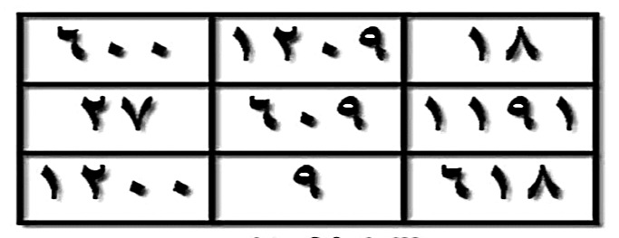

## HALAMAN 01 — SAMPUL — أَنْوَارُ الشَّيْخِ الْبَشِيرِ

### arab
أَنْوَارُ الشَّيْخِ الْبَشِيرِ

مُنْتَدَيَاتُ الْأَنْوَارِ الْقَادِرِيَّةِ

وَالْأَرْوَاحِ الرَّحْمَانِيَّةِ

### latin
[Latin Washal belum tersedia]

### Terjemahan
Cahaya-cahaya Syeikh Al-Basyir. Forum Cahaya Al-Qadiriyah dan Ruh-Ruh Ar-Rahmaniyah.

### 4. Syarah dan Penjelasan
_Syarah sesuai nash kitab._

### 5. Khususiyah dan Tatacara Praktik
_Khususiyah sesuai nash — lihat Syarah._

## HALAMAN 02 — IHDA' — إِهْدَاءُ الشَّيْخِ الْبَشِيرِ

### arab
إِهْدَاءُ الشَّيْخِ الْبَشِيرِ

أُهْدِي هَذَا الْعَمَلَ إِلَى سَيِّدِي رَسُولِ اللهِ صَلَّى اللهُ عَلَيْهِ وَسَلَّمَ

وَإِلَى آلِ بَيْتِهِ الطَّيِّبِينَ الْأَخْيَارِ

وَلِلشَّيْخِ الْفَقِيرِ الْقَادِرِيِّ

وَلِلدُّكْتُورِ بِيهُونِي

وَإِلَى جَمِيعِ الْفُقَرَاءِ

### latin
Ihdā'ush-Syaikhil-Basyīr, uhdī hādzal-'amala ilā Sayyidī Rasūlillāhi ṣallallāhu 'alaihi wa sallam, wa ilā Āli baitihith-Ṭayyibīnal-Akhyār, wa lish-Syaikhil-Faqīril-Qādiriyy, wa lid-Duktūri Bīhūnī, wa ilā jamī'il-Fuqarā'.

### Terjemahan
Persembahan Syeikh Al-Basyir. Aku hadiahkan karya ini kepada junjunganku Rasulullah shallallahu 'alaihi wa sallam, kepada keluarga beliau yang baik dan terpilih, kepada Syeikh Al-Faqir Al-Qadiri, kepada Dr. Baihuni, dan kepada seluruh fuqara.

### 4. Syarah dan Penjelasan
Ihda' adalah adab sufi: menghadiahkan pahala karya kepada Nabi & Ahlul Bait sebelum ilmu disebar — menandakan keberkahan sanad. Syaikh al-Faqir al-Qadiri adalah guru thariqah penulis (disebut juga di ijazah hal 03: «athāla Allāhu lanā fī 'umrih» — semoga dipanjangkan umur). Dr. Bihuni (بيهوني) kemungkinan peneliti/mentor akademik forum — disebut setara guru, menunjukkan kolaborasi sufi-akademik. Fuqara (فقراء) bukan fakir miskin harta, tetapi «faqir ilallāh» — murid yang merasa butuh kepada Allah, istilah Qadiriyah untuk ikhwan.

### 5. Khususiyah dan Tatacara Praktik
Halaman ihda' tidak ada ritual khusus — fungsinya niyyah & sanad. Adab: baca ihda' dengan khushu', hadiahkan Fatihah setelahnya (seperti ijazah hal 03: shalawat + Fatihah untuk Nabi, guru, diri). Tidak perlu menulis/membakar halaman ini.

## HALAMAN 03 — IJAZAH 'AMMAH — إِجَازَةُ الشَّيْخِ الْبَشِيرِ

### arab
إِجَازَةُ الشَّيْخِ الْبَشِيرِ

لَقَدْ أَجَزْتُ كُلَّ مَنْ وَصَلَتْ إِلَيْهِ فَوَائِدِي وَرِيَاضَاتِي إِجَازَةً عَامَّةً

فِيمَا يُرْضِي اللهَ وَرَسُولَهُ وَيَقُومُ بِهَا بَعْدَ

الصَّلَاةِ عَلَى الْحَبِيبِ الْمُصْطَفَى وَقِرَاءَةِ الْفَاتِحَةِ وَإِهْدَاءِ ثَوَابِهَا

لِرُوحِ الْحَبِيبِ مُحَمَّدٍ صَلَّى اللهُ عَلَيْهِ وَسَلَّمَ وَإِلَى رُوحِ

شَيْخِي رَحِمَهُ اللهُ عَلَيْهِ وَلِفَاتِحَةٍ لِي

وَإِلَى الشَّيْخِ الْفَقِيرِ الْقَادِرِيِّ أَطَالَ اللهُ لَنَا فِي عُمُرِهِ

وَبِذَلِكَ تَكُونُ قَدْ وَصَلَتْهُ الْإِجَازَةُ الْعَامَّةُ

### latin
Laqad ajastukulla maw-wa-shallat ilaihi fawā'idī wa riyādhātī ijāzatan 'āmma(tan) fīmā yurdhiLlāha wa Rasūlahu wa yaqūmu bihā ba'daṣ-Ṣalāti 'alal-Ḥabībil-Muṣṭafā wa qirā'atil-Fātiḥati wa ihdā'i thawābihā li rūḥil-Ḥabībi Muḥammadin ṣallallāhu 'alaihi wa sallam, wa ilā rūḥi syaikhī raḥimahullāh 'alaih, wa li Fātiḥatillī, wa ilash-Syaikhil-Faqīril-Qādiriyyi aṭālallāhu lanā fī 'umrih, wa bi dzālika takūnu qad washallathul-ijāzatul-'āmmah.

### Terjemahan
Ijazah dari Syeikh Al-Basyir. Sungguh aku telah memberi ijazah umum kepada setiap orang yang sampai kepadanya faedah-faedah dan riyadhah-riyadhahku, untuk hal yang diridhai Allah dan Rasul-Nya. Caranya: membaca shalawat kepada Al-Habib Al-Musthafa, membaca Al-Fatihah dan menghadiahkan pahalanya kepada ruh Al-Habib Muhammad shallallahu 'alaihi wa sallam, kepada ruh guruku, dan kepada Syeikh Al-Faqir Al-Qadiri — semoga Allah panjangkan umurnya untuk kami. Dengan itu ijazah umum telah sampai kepadanya.

### 4. Syarah dan Penjelasan
Ijazah 'ammah adalah sanad terbuka khas tradisi Qadiriyah kontemporer: tidak perlu baiat tatap muka, cukup menerima naskah dengan syarat shalawat & Fatihah. «Fīmā yurdhi Allāha wa Rasūlah» adalah batas maqashid syar'i — ijazah batal jika untuk zalim/sihir merusak (prinsip hal 64: *yu'til hikmata man yasyā'*). Urutan hadiah Fatihah: Nabi → guru → diri penulis → Syaikh Faqir Qadiri, menunjukkan tawadhu' & silsilah. Kalimat «athāla Allāhu lanā fī 'umrih» (semoga Allah panjangkan umur) menunjukkan Syaikh Faqir masih hidup saat kitab ditulis — bukan tokoh wafat.

### 5. Khususiyah dan Tatacara Praktik
Tata cara menerima ijazah (wajib sebelum amal faedah apa pun): 1) Niat untuk ridha Allah, 2) Shalawat 1× (minimal), 3) Fatihah 1× dengan hadiah seperti di atas (niat dalam hati: «hadiah pahala untuk...»), 4) Yakin ijazah telah washil (sampai) — tidak perlu mimpi/karamah. Khususiyah: ijazah ini mengikat sanad ruhani; mengamalkan tanpa ijazah = tanpa sanad (kurang barakah, meski tetap boleh sebagai doa umum). Tidak ada mahar/puasa khusus untuk ijazah ini.

## HALAMAN 04 — SAMPUL DALAM — فَوَائِدُ وَمُجَرَّبَاتُ الشَّيْخِ الْبَشِيرِ

### arab
فَوَائِدُ وَمُجَرَّبَاتُ الشَّيْخِ الْبَشِيرِ

### latin
Fawā'idu wa Mujarrabātush-Syaikhil-Basyīr

### Terjemahan
Faedah-faedah dan mujarrabat-mujarrabat Syeikh Al-Basyir.

### 4. Syarah dan Penjelasan
Halaman ini adalah title page dalam (bukan duplikat sampul). Bedanya: sampul hal 01 menyebut forum penerbit, hal 04 hanya menyebut isi (fawaid & mujarrabat). Warna hijau melambangkan keberkahan & Qadiriyah. Fungsi: penanda mulai bab inti setelah muqaddimah sanad (ihda' + ijazah).

### 5. Khususiyah dan Tatacara Praktik
Sama seperti sampul — tidak ada ritual. Hanya penanda niat: membaca judul dalam ini dengan berharap faidah & mujarrabat yang sahih.

## HALAMAN 05 — FIHRIS — فِهْرِسُ مُجَرَّبَاتِ الشَّيْخِ الْبَشِيرِ

### arab
فِهْرِسُ مُجَرَّبَاتِ الشَّيْخِ الْبَشِيرِ

1. طَرِيقَةُ الْمَيْسَرَةِ فِي جَلْبِ الْأَرْزَاقِ
2. فَائِدَةٌ مُحْرِقَةٌ طَارِدَةٌ لِلْجِنِّ وَالْمَرَدَةِ بِإِذْنِ اللهِ
3. فَائِدَةٌ قَاطِعَةٌ لِعِلَاجِ الْمَسِّ
4. الزَّجْرُ الْقَاطِعُ لِأَخْذِ الْعَهْدِ وَالْمِيثَاقِ عَلَى خَادِمِ الْاِسْتِنْزَالِ
5. فَائِدَةٌ لِطَرْدِ عُطُوشٍ مُفْسِدِ الْأَعْمَالِ الرُّوحَانِيَّةِ
6. الدُّرَّةُ النُّورَانِيَّةُ فِي عِلَاجِ الْأَعْرَاضِ الرُّوحَانِيَّةِ
7. فَائِدَةٌ فِي تَدْمِيرِ الظَّالِمِ
8. فَائِدَةٌ مُجَرَّبَةٌ لِقَهْرِ الْقَرِينِ
9. السَّيْفُ الْبَتَّارُ لِدَفْعِ مَيْمُونٍ الْغَدَّارِ
10. فَائِدَةٌ قَاطِعَةٌ لِرَدِّ الْخَادِمِ
11. دُعَاءُ الْخَائِفِ
12. الْآيَاتُ الْعَشْرُ الْمُبْطِلَاتُ لِلنَّفْثِ وَالسِّحْرِ
13. فَائِدَةٌ فِي الْكَشْفِ الْمَنَامِيِّ

### latin
fawā'idu → fawā'idum-muhriqatun ṭāridatun lil-Jinni wal-Maradati bi'iznillāh).

### Terjemahan
Daftar isi mujarrabat Syeikh Al-Basyir. 1. Cara Maysarah untuk menarik rezeki. 2. Faedah pembakar pengusir jin dan maradah dengan izin Allah. 3. Faedah pemutus untuk mengobati kerasukan. 4. Bentakan pemutus untuk mengambil janji dan sumpah atas khadam istinzal. 5. Faedah untuk mengusir 'Uthush perusak amalan ruhani. 6. Mutiara bercahaya untuk mengobati gejala-gejala ruhani. 7. Faedah untuk menghancurkan orang zalim. 8. Faedah mujarrab untuk menundukkan qarin. 9. Pedang pemotong untuk menolak Maimun yang khianat. 10. Faedah pemutus untuk mengembalikan khadam. 11. Doa orang yang takut. 12. Sepuluh ayat pembatal tiupan dan sihir. 13. Faedah untuk kasyaf melalui mimpi.

### 4. Syarah dan Penjelasan
Fihris ini adalah peta 13 faedah yang menjadi inti kitab (hal 06–30). Faedah 1–3 tentang rizki & jin; 4–6 tentang khadam & gangguan; 7–9 tentang zhalim & qarin; 10–13 tentang perlindungan & kasyaf. Jumlah 13 bukan 12 seperti dugaan awal (koreksi dari analisis Batch01 lama). Faedah 12 (10 Ayat Mubthilat) merujuk pada kumpulan «10 Qala» yang akan dibahas di hal 27–28 dengan wafaq 2190.

### 5. Khususiyah dan Tatacara Praktik
Fihris tidak ada amalan — hanya penunjuk. Adab: baca fihris untuk memilih hajat, jangan amalkan semua sekaligus. Prioritaskan faedah yang sesuai hajat & telah dapat ijazah hal 03.

## HALAMAN 06 — FAEDAH 01 (1/3) — طَرِيقَةُ الْمَيْسَرَةِ فِي جَلْبِ الْأَرْزَاقِ

### arab
طَرِيقَةُ الْمَيْسَرَةِ فِي جَلْبِ الْأَرْزَاقِ

إِخْوَتِي فِي اللهِ

أَضَعُ بَيْنَ أَيْدِيكُمْ هَذِهِ الدُّرَّةَ النَّافِعَةَ فِي جَلْبِ الْأَرْزَاقِ، وَرَوَاجِ التِّجَارَةِ، وَهِيَ طَرِيقَةُ الْمَيْسَرَةِ، وَارْتَأَيْتُ أَنْ أَضَعَهَا لَكُمْ لِمَا فِيهَا مِنَ الْخَيْرِ وَالْبَرَكَةِ، وَكَذَلِكَ لِاحْتِوَائِهَا عَلَى قَوَاعِدَ حَرْفِيَّةٍ تُسَاعِدُكُمْ عَلَى مَا نَحْنُ بِصَدَدِهِ بِإِذْنِ اللهِ

وَنَضَعُ فِي ذَلِكَ مِثَالًا بِاسْمِ مُرَادٍ وَأُمِّهِ مَرْيَمَ،

م ر ا د م ر ي م = 535 نَلْفِظُ الْعَدَدَ حَرْفِيًّا،

535 ، خَمْسُ مِائَةٍ وَثَلَاثُونَ وَخَمْسُ مِائَةٍ ، ثُمَّ نُزِيلُ التَّكْرَارَ مِنَ الْحُرُوفِ هَكَذَا،

خ م س و ث ل ن ا هـ = 9 أَحْرُفٍ ، وَكَذَلِكَ نَفْعَلُ بِاسْمِ الطَّالِبِ نُزِيلُ مِنْهُ الْمُكَرَّرَ وَحُرُوفَ الْمَدِّ هَكَذَا،

م ر ا د م ر ي م ، تَصِيرُ كَالتَّالِي ، م ر د ي = 4 حُرُوفٍ ، ثُمَّ نَطْرَحُ الْأَقَلَّ مِنَ الْأَكْثَرِ،

9 - 4 = 5 فَثَبَتَ الْعَمَلُ فِي وَفْقٍ مُخَمَّسٍ ، وَعَدَدُ بُيُوتِهِ 25 بَيْتًا ، ثُمَّ بَعْدَ ذَلِكَ نُقَارِنُ حُرُوفَ لَفْظِ الْعَدَدِ مَعَ حُرُوفِ الطَّالِبِ وَنُزِيلُ الْمُكَرَّرَ مِنْهُمَا ، خ م س و ث ل ن ا هـ م ر د ي ، فَتَصِيرُ الْحُرُوفُ هَكَذَا،

خ م س و ث ل ن ا هـ م ر د ي = 12 حَرْفًا نَطْرَحُهَا مِنْ عَدَدِ بُيُوتِ الْمُخَمَّسِ، 25 - 12 = 13،

وَهَذَا هُوَ الْأُسُّ الْحَرْفِيُّ الْمُعَدَّلُ، فَنَأْخُذُ مِنَ الْحُرُوفِ مَا كَانَ عَدَدُهُ أَقَلَّ مِنْ 13 تُوضَعُ فِي وَفْقِ الْعَمَلِ وَمَا كَانَ أَكْثَرَ مِنْ 13 فَهِيَ لِلرُّوحَانِيِّ، وَالْحُرُوفُ الْمُسْتَخْرَجَةُ هِيَ كَالْآتِي،

أَقَلَّ مِنْ 13 ، و ا هـ د ي

أَكْثَرَ مِنْ 13 ، خ م س و ث ل ن ر ، وَجَبَ عَلَيْنَا تَعْدِيلُ حَرْفَيْنِ ظُلْمَانِيَّيْنِ مِنَ الرُّوحَانِيِّ [ خ ث ] لَكِنَّ التَّعْدِيلَ يَكُونُ بِالْمِيزَانِ الْإِبْقِيِّ بِدُونِ نِسَبٍ تَفَاضُلِيَّةٍ، وَعَلَيْهِ نَسْتَبْدِلُ حَرْفَ [ خ ] بِحَرْفِ [ س ] وَ [ ث ] بِحَرْفِ [ ن ] فَتَصِيرُ الْحُرُوفُ كَالتَّالِي [ س م س ن ل ن ر ] ثُمَّ نُكَسِّرُهَا 3 مَرَّاتٍ هَكَذَا،

س م س ن ل ن ر
ر س ن م ل س ن
ن ر س س ن ل م

### latin
Ṭarīqatul-Maysarati fī Jalbil-Arzāq, ikhwatī fillāh, aḍa'u baina aidīkum hādzihid-durratan-nāfi'ata fī jalbil-arzāqi wa rawājit-tijārah, wahya Ṭarīqatul-Maysarah, warta'aytu an aḍa'ahā lakum limā fīhā minal-khairi wal-barakah... bismi Murādin wa ummihi Maryam, mīm rā' alif dāl mīm rā' yā' mīm = 535 nalfiẓul-'adada ḥarfiyyā...

### Terjemahan
Cara Maysarah untuk menarik rezeki. Wahai saudara-saudaraku karena Allah, aku letakkan di hadapan kalian mutiara yang bermanfaat ini untuk menarik rezeki dan melariskan perdagangan, yaitu Cara Maysarah. Aku pandang baik untuk meletakkannya bagi kalian karena di dalamnya ada kebaikan dan keberkahan, dan juga karena mengandung kaidah-kaidah huruf yang membantu kalian dalam apa yang sedang kita bahas dengan izin Allah. Aku berikan contoh dengan nama Murad dan ibunya Maryam: م ر ا د م ر ي م = 535, kita ucapkan bilangan itu secara huruf: خَمْسُ مِائَةٍ وَثَلَاثُونَ وَخَمْسُ مِائَةٍ, kemudian kita hilangkan huruf yang berulang sehingga menjadi خ م س و ث ل ن ا هـ = 9 huruf. Begitu juga kita lakukan pada nama penanya, kita hilangkan yang berulang dan huruf mad, sehingga م ر ا د م ر ي م menjadi م ر د ي = 4 huruf. Kemudian kita kurangkan yang lebih sedikit dari yang lebih banyak: 9 - 4 = 5, maka pekerjaannya tetap pada wafaq 5×5 yang jumlah petaknya 25. Kemudian kita bandingkan huruf-huruf lafaz bilangan dengan huruf-huruf penanya dan kita hilangkan yang berulang di antara keduanya: خ م س و ث ل ن ا هـ + م ر د ي menjadi 12 huruf, kita kurangkan dari jumlah petak wafaq 5×5: 25 - 12 = 13. Ini adalah pokok huruf yang telah disesuaikan. Maka kita ambil dari huruf-huruf itu yang jumlahnya kurang dari 13 untuk diletakkan pada wafaq amal, dan yang lebih dari 13 untuk ruhaninya. Huruf-huruf yang dikeluarkan adalah: kurang dari 13: و ا هـ د ي ; lebih dari 13: خ م س و ث ل ن ر. Wajib atas kita menyesuaikan dua huruf zhulmani dari pihak ruhani [خ ث] tetapi penyesuaian dengan mizan yang kekal tanpa nisbah perbedaan, maka kita ganti huruf [خ] dengan huruf [س] dan [ث] dengan huruf [ن] sehingga huruf-hurufnya menjadi [س م س ن ل ن ر] kemudian kita pecah tiga kali seperti ini: س م س ن ل ن ر / ر س ن م ل س ن / ن ر س س ن ل م.

### 4. Syarah dan Penjelasan
Faedah Maysarah adalah faedah pertama & paling terperinci (hal 06-08) — menjadi «pintu» hisab huruf untuk 12 faedah lain. Nama Murad bin Maryam = «yang diinginkan bin Maryam» (contoh generik, bukan orang spesifik). Bilangan 535 (khamsu mi'ah ...) adalah hisab Jumal kabir? Bukan, ini hisab lafzhi (melafalkan angka jadi huruf) — metode khas Syeikh Basyir, beda dengan Jumal abjadi biasa (ا=1...). Wafaq mukhammas 5×5 = 25 petak melambangkan keseimbangan 5 rukun / 5 panca indera (tafsir penulis hal 45-46). Pembagian 13 (al-uss al-harfi al-mu'addal) adalah inti: huruf <13 (wafaq amal) vs >13 (ruhani) — angka 13 muncul dari 25−12, menjadi threshold suci (di faedah 08 juga akan muncul 582 etc.). Ta'dil خ→س & ث→ن dengan mizan ibaqi adalah kaidah tabdil zhulmani→nurani — huruf keras (kho, tsa) ditukar ke halus (sin, nun) agar wafaq tidak «panas» (zhulmani = berat, nurani = cahaya).

### 5. Khususiyah dan Tatacara Praktik
Khasiat: melariskan dagang & menarik rizki halal. Belum ada tatacara di hal 06 — baru hisab. Persiapan: siapkan nama penanya (tholib) + nama ibu, hitung seperti contoh, siapkan kertas putih & tinta misk (akan dirinci hal 07).

## HALAMAN 07 — FAEDAH 01 (2/3) — LANJUTAN MAYSARAH

### arab
طَرِيقَةُ الْمَيْسَرَةِ فِي جَلْبِ الْأَرْزَاقِ

ثُمَّ نَلْقُطُ مِنَ السَّطْرِ الثَّانِي اسْمَ الرُّوحَانِيِّ مُبْتَدِئِينَ مِنَ الْحَرْفِ الثَّانِي وَنَسِيرُ بِالتَّثْلِيثِ هَكَذَا،

[ س م س ] وَعَلَيْهِ يَكُونُ الرُّوحَانِيُّ هُوَ [ سَمْسَائِيلُ ] ثُمَّ نَلْقُطُ مِنَ السَّطْرِ الثَّالِثِ كَذَلِكَ بِالتَّثْلِيثِ

مُبْتَدِئِينَ مِنَ الْحَرْفِ الْأَوَّلِ لِاسْتِخْرَاجِ الرُّوحَانِيِّ الْحَاكِمِ فَتَكُونُ حُرُوفُهُ هِيَ [ ن س ل م ] وَعَلَيْهِ

يَكُونُ الرُّوحَانِيُّ بَعْدَ تَرْتِيبِ حُرُوفِهِ هُوَ [ نَسْمَائِيلُ ] ثُمَّ نَأْخُذُ حُرُوفَ الْعَمَلِ وَالرُّوحَانِيِّ الْحَاكِمِ

مَبْسُوطَةً بِدُونِ تِكْرَارٍ وَبِدُونِ حُرُوفٍ ظُلْمَانِيَّةٍ وَنَسْتَخْرِجُ مِنْهَا مَا تَرَكَّبَ فِيهَا مِنْ أَسْمَاءِ اللهِ

الْحُسْنَى النُّورَانِيَّةِ هَكَذَا، [ ن ل م س ي هـ و ] وَعَلَيْهِ تَكُونُ الْأَسْمَاءُ الْمُسْتَخْرَجَةُ هِيَ [ لَا إِلَهَ إِلَّا

اللهُ الْمُهَيْمِنُ ] وَهِيَ الَّتِي تُتْلَى عَلَى الْعَمَلِ،

أَمَّا طَرِيقَةُ الْعَمَلِ، نَأْخُذُ الْحُرُوفَ الْخَمْسَةَ الَّتِي لِلْعَمَلِ وَنَقْسِمُهَا عَلَى 7 لِاسْتِخْرَاجِ سَاعَةِ الْعَمَلِ

هَكَذَا،

و ا هـ د ي = 27 مَقْسُومَةً عَلَى 7 الْخَارِجُ 3 وَالْبَاقِي 6 إِذَنْ سَاعَةُ الْعَمَلِ هِيَ الزُّهَرَةُ، وَعَلَيْهِ

تَكُونُ الْكِتَابَةُ وَالتِّلَاوَةُ سَاعَةَ الزُّهَرَةِ فِي أَيِّ يَوْمٍ شِئْنَا،

فَنَأْخُذُ حُرُوفَ الْعَمَلِ مُرَتَّبَةً وَنَنْزِلُ بِهَا فِي وَفْقٍ مُخَمَّسٍ وَنُحَوِّطُهُ بِالْآيَةِ [ قَوْلُهُ الْحَقُّ وَلَهُ الْمُلْكُ

] وَنَكْتُبُ عَلَى الْأَرْكَانِ الْأَرْبَعَةِ اسْمَ الرُّوحَانِيِّ [ سَمْسَائِيلَ ] وَنَدُورُ عَلَيْهِ الْآيَتَيْنِ الْكَرِيمَتَيْنِ، اللهُ

لَطِيفٌ بِعِبَادِهِ يَرْزُقُ مَنْ يَشَاءُ وَهُوَ الْقَوِيُّ الْعَزِيزُ ، وَالْآيَةَ ، الَّذِينَ يَتْلُونَ كِتَابَ اللهِ ... إِلَى لَنْ

تَبُورَ .

وَفِي نَفْسِ الْوَرَقَةِ مِنْ وَرَاءِ وَفْقِ الْمُخَمَّسِ تَرْسُمُ وَفْقًا بِقَدْرِ حُرُوفِ الرُّوحَانِيِّ الْحَاكِمِ وَتَنْزِلُ وَنَنْزِلُ بِهِ

كَمَا فَعَلْنَا بِحُرُوفِ الْعَمَلِ فَيَكُونُ وَفْقًا مُرَبَّعًا وَتُحَوِّطُهُ بِاسْمِهِ، وَالْكِتَابَةُ تَكُونُ

بِمَاءِ وَرْدٍ وَزَعْفَرَانَ وَمِسْكٍ مَعَ بَخُورٍ طَيِّبٍ

كَاللُّبَانِ وَعُودِ الصَّلِيبِ

### latin
Tsumma nalquthu minas-sathrits-tsānismarrūḥāniyyi mubtadi'īna minal-ḥarfits-tsānī wa nasīru bit-tathlīthi hākadzā: [sīn mīm sīn] wa 'alaihi yakūnur-rūḥāniyyu huwa Samsā'īlu... wa takūnus-sā'atu hiyaz-Zuharah...

### Terjemahan
Kemudian kita ambil dari baris kedua nama ruhaninya dengan memulai dari huruf kedua dan kita berjalan dengan pelompatan tiga, yaitu [س م س] maka ruhaninya adalah [Samsail]. Kemudian kita ambil dari baris ketiga juga dengan pelompatan tiga dengan memulai dari huruf pertama untuk mengeluarkan ruhani yang menguasai, maka huruf-hurufnya adalah [ن س ل م] maka ruhaninya setelah disusun huruf-hurufnya adalah [Nasmahil]. Kemudian kita ambil huruf-huruf amal dan ruhani yang menguasai yang terhampar tanpa pengulangan dan tanpa huruf-huruf zhulmani dan kita keluarkan darinya nama-nama Allah yang indah yang bercahaya, yaitu [ن ل م س ي هـ و] maka nama-nama yang dikeluarkan adalah [Laa Ilaaha Illallah Al-Muhaimin] dan itulah yang dibaca atas amalan tersebut. Adapun cara amalnya: kita ambil lima huruf untuk amal dan kita bagi 7 untuk mengeluarkan jam amalnya seperti ini: و ا هـ د ي = 27 dibagi 7 hasilnya 3 sisanya 6, maka jam amalnya adalah Zuhrah. Maka penulisan dan pembacaan pada jam Zuhrah pada hari apa saja yang kita kehendaki. Maka kita ambil huruf-huruf amal yang tersusun dan kita turunkan pada wafaq 5×5 dan kita kelilingi dengan ayat [Qauluhul-Haqqu wa lahul-Mulku] dan kita tulis pada empat sudutnya nama ruhani [Samsail] dan kita kelilingi dengan dua ayat yang mulia: Allahu Lathifun bi 'Ibadihi Yarzuqu man Yasya' wa Huwal-Qawiyyul-'Aziz, dan ayat: Alladzina Yatluuna Kitaballah ... hingga Lan Tabur. Dan pada kertas yang sama di belakang wafaq 5×5 kita gambar wafaq sesuai jumlah huruf ruhani yang menguasai dan kita turunkan di dalamnya sebagaimana kita lakukan pada huruf-huruf amal, maka menjadi wafaq 4×4 dan kita kelilingi dengan namanya. Penulisan dengan air mawar, za'faran dan misik beserta dupa yang harum seperti luban dan kayu gaharu salib.

### 4. Syarah dan Penjelasan
Samsail vs Nasmahil: Samsail adalah Ruhani Khadim (pelaksana), Nasmahil adalah Ruhani Hakim (pengawas) — hierarki ruhani 2 tingkat khas Qadiriyah (khadim di bawah hakim). Tatslits (loncat 3) adalah kaidah taltif — mengambil tiap huruf ke-3 dari baris taksir, melambangkan perimbangan 3 unsur (jism-ruh-aql). Asma «La ilaha illa Allah al-Muhaimin» (196×) — bukan «Ya Razzaq» yang diduga — menunjukkan inti rizki adalah tauhid & pengawasan Allah (al-Muhaimin), bukan mantra jin. Hisab jam Zuhrah: sisa 6 dari 27÷7 — dalam falak klasik Zuhrah (Venus) = bintang ke-6 (urutan: Qamar 1, 'Utarid 2, Zuhrah 6? Variasi). Penulis tetap pada sisa 6 = Zuhrah (cek konsistensi: hal 06 menyebut 7 jam: Syams, Zuhrah, 'Utharid, Qamar, Zuhal, Musytari, Mirrikh — sisa 1=Syams ... 6=Zuhrah, 0=Zuhal). Ayat pelingkaran: Qawluhul-Haq (kekuasaan ucapan Allah), Lathif (Kelembutan rizki), Yatlu Kitab Allah (keberkahan tilawah) — tiga ayat rangkuman tauhid-rizki-barokah.

### 5. Khususiyah dan Tatacara Praktik
- Waktu: Jam Zuhrah hari apa saja (siang/malam hitung falak 12 jam siang +12 malam mulai terbit). Jika terlewat, tunda ke hari berikut jam sama — jangan paksakan jam lain.
- Alat: Kertas putih polos, qalam, tinta ruhani: air mawar + za'faran + misk (nisabah 1:1:sedikit misk), tanpa tinta hitam kimia.
- Bukhur: Luban (kemenyan putih) + 'ud shalib (kayu gaharu salib) — dibakar saat tulis & tilawah untuk mewangikan majelis ruhani (bukan untuk jin).
- Tulisan: Wafaq mukhammas di depan (huruf و ا هـ د ي diputar), keliling ayat; wafaq murabba' di belakang (huruf ن س ل م diputar). 4 sudut mukhammas tulis «سمسائيل» tiap sudut.
- Tilawah: 'Azimah «لا إله إلا الله المهيمن» 196× (angka dari 27? 27×? 196 =14² — rahasia mizan, akan muncul di hal 08). Niat tawajjuh kepada Allah dengan hajat.
- Pantangan: Tulis dalam keadaan suci (wudhu), menghadap kiblat, tidak bercanda/merokok, niat halal.

## HALAMAN 08 — FAEDAH 01 (3/3) — 2 WAFAQ (MUKHAMMAS 5×5 & MURABBA' 4×4)

### arab
طَرِيقَةُ الْمَيْسَرَةِ فِي جَلْبِ الْأَرْزَاقِ

وَهَذَا وَفْقُ الْعَمَلِ وَهَذَا الْوَفْقُ الْمُرَبَّعُ الَّذِي نَزَلْنَا فِيهِ الرُّوحَانِيَّ

طَرِيقَةُ الْمَيْسَرَةِ فِي جَلْبِ الْأَرْزَاقِ
الشَّيْخُ الْبَشِيرُ
http://www.alanwaralqadria.com
مُنْتَدَى الْأَنْوَارِ الْقَادِرِيَّةِ وَالْأَرْوَاحِ الرَّحْمَانِيَّةِ

وَعَدَدُ الْعَزِيمَةِ 196 مَرَّةً مَعَ التَّوَجُّهِ إِلَى اللهِ عَزَّ وَجَلَّ بِطَلَبِكَ،

أَسْأَلُ اللهَ عَزَّ وَجَلَّ أَنْ يَنْفَعَكُمْ بِهَذِهِ الذَّخِيرَةِ الْمُبَارَكَةِ إِنَّهُ وَلِيُّ ذَلِكَ وَالْقَادِرُ عَلَيْهِ وَالسَّلَامُ

### latin
Wa hādzā wafqul-'amali wa hādzal-wafqul-murabba'ulladzī nazalnā fīhir-rūḥāniyy, ... wa 'adadul-'azīmati mi'atun wa sittun wa tis'ūna marratam-ma'at-tawajjuhi ilallāhi 'azza wa jalla bi ṭalabik, as'alullāha 'azza wa jalla an yanfa'akum bihādzihidz-dzakhīratil-mubārakati innahu Waliyyu dzālika wal-Qādiru 'alaihi was-salām.

### Terjemahan
Dan inilah wafaq amal dan wafaq 4×4 yang kita turunkan di dalamnya ruhani tersebut. Cara Maysarah untuk menarik rezeki. Syeikh Al-Basyir. Forum Cahaya Al-Qadiriyah dan Ruh-Ruh Ar-Rahmaniyah. http://www.alanwaralqadria.com. Jumlah bacaan wirid 196 kali beserta menghadap kepada Allah Azza wa Jalla dengan permohonanmu. Aku memohon kepada Allah Azza wa Jalla agar memberi manfaat kepada kalian dengan simpanan yang diberkahi ini, sesungguhnya Dia-lah penolongnya dan Yang Maha Kuasa atasnya. Wassalam.

### 4. Syarah dan Penjelasan
Wafaq Mukhammas 5×5 (kanan di scan): Matriks 5×5 = 25 petak berisi 5 huruf amal (و ا هـ د ي) yang dirotasi tiap baris — pola tadwir (perputaran). Konstanta wafaq mukhammas bukan angka (seperti mukhammas ghazali 65) melainkan huruf — tiap baris/kolom/diagonal mengandung semua 5 huruf tanpa ulang, melambangkan keseimbangan rizki dari 5 arah. Wafaq Murabba' 4×4 (kiri): 16 petak berisi 4 huruf Ruhani Hakim (م س ل ن) rotasi — melambangkan 4 penjuru/4 khadim. Keduanya ditulis di satu kertas bolak-balik (mukhammas depan, murabba' belakang) — simbol zahir (amal) & batin (ruhani). 'Azimah 196×: 196 = 14² = 196 → 14 = jumlah huruf «لا إله إلا الله المهيمن» tanpa ulang? Hitung: ل ا إ ل هـ إ ل ا ا ل ل هـ ا ل م هـ ي م ن =14 unik → 14² =196 — rahasia mizan penulis (angka «muka» — lihat hal 45: mizan ibaqi). Link forum di bawah wafaq menegaskan otentisitas digital.

### 5. Khususiyah dan Tatacara Praktik
- Fungsi: Pelaris dagang, pembuka pintu rizki halal (bukan judi/maksiat).  
- Waktu: Jam Zuhrah (hal 07) — tulis & baca di jam itu; 'azimah 196× dibaca setelah tulis, menghadap kiblat, tawajjuh (konsentrasi hajat).  
- Media: Kertas putih, tinta mawar-za'faran-misk, bukhur luban/'ud salib.  
- Adab: Niat halal, yakin Allah pemberi rizki (wafaq sabab doa, bukan jimat berkuasa), tinggalkan jika was-was. Jika hajat belum qabul, ulangi 3/7 malam berturut pada jam sama — bukan menambah jumlah wirid.  
- Pantangan Faedah 01: Jangan gunakan untuk menipu timbangan / riba — penulis syaratkan «fimā yurdhi Allāh».

[Gambar: Wafaq Hal 08]

[Gambar: Wafaq Hal 08]

## HALAMAN 09 — FAEDAH MUHRIQAH 1/2 — فَائِدَةٌ مُحْرِقَةٌ طَارِدَةٌ لِلْجِنِّ

### arab
فَائِدَةٌ مُحْرِقَةٌ طَارِدَةٌ لِلْجِنِّ وَالْمَرَدَةِ بِإِذْنِ اللهِ

اَلسَّلَامُ عَلَيْكُمْ وَرَحْمَةُ اللهِ وَبَرَكَاتُهُ

إِخْوَتِي فِي اللهِ أَضَعُ لَكُمْ هَذِهِ الْفَائِدَةَ الْخَاصَّةَ بِإِحْرَاقِ الْجِنِّ وَطَرْدِهِ مِنْ جَسَدِ الْإِنْسَانِ بِإِذْنِ اللهِ وَهِيَ كَالتَّالِي،

نَأْخُذُ اسْمَ الشَّخْصِ وَأُمِّهِ وَنُزِيلُ مِنْهُ الْحُرُوفَ الْمُكَرَّرَةَ إِنْ كَانَ فِي الِاسْمِ وَإِلَّا يَبْقَى الِاسْمُ كَمَا هُوَ بِدُونِ حَذْفٍ إِذَا لَمْ تَتَكَرَّرْ فِيهِ الْحُرُوفُ، ثُمَّ نَمْزُجُهُ بِالْحُرُوفِ النَّارِيَّةِ وَالْهَوَائِيَّةِ النُّورَانِيَّةِ [ا هـ ط م ك س ق] حَيْثُ يَكُونُ أَوَّلُ حَرْفٍ مِنْهَا وَآخِرُ حَرْفٍ مِنْهَا كَذَلِكَ ثُمَّ نَكْسِرُ السَّطْرَ الْمَمْزُوجَ إِلَى الْمَخْرَجِ مَعَ تَرْكِهِ أَيْ نَأْخُذُ السُّطُورَ الَّتِي قَبْلَهُ فَقَطْ وَنَنْظُرُ إِلَى عَدَدِ سُطُورِ التَّكْسِيرِ أَهِيَ زَوْجٌ أَوْ فَرْدٌ فَإِنْ كَانَتْ زَوْجِيَّةً نَأْخُذُ الرُّوحَانِيَّ مِنَ السَّطْرِ الثَّانِي وَإِنْ كَانَتْ فَرْدِيَّةً نَأْخُذُهَا مِنَ السَّطْرِ الثَّالِثِ،

وَكَذَلِكَ حُرُوفُهُ إِنْ كَانَ التَّكْسِيرُ زَوْجًا تَكُونُ حُرُوفُ الرُّوحَانِيِّ زَوْجِيَّةً وَإِنْ كَانَ فَرْدًا تَكُونُ حُرُوفُهُ فَرْدِيَّةً، وَالْأَخْذُ مِنَ السَّطْرِ بِتَرْكِ حَرْفَيْنِ مِنْ أَوَّلِ السَّطْرِ وَحَرْفَيْنِ مِنْ آخِرِهِ حَتَّى يَبْقَى لَنَا حُرُوفُ الرُّوحَانِيِّ فِي الْوَسَطِ فِي هَذَا إِذَا كَانَ التَّكْسِيرُ زَوْجًا أَمَّا إِنْ كَانَ فَرْدًا نَتْرُكُ حَرْفًا مِنَ الْأَوَّلِ وَحَرْفًا مِنَ الْآخِرِ حَتَّى تَبْقَى حُرُوفُ الرُّوحَانِيِّ فِي الْوَسَطِ، ثُمَّ نَجْمَعُ عَدَدَ حُرُوفِ الرُّوحَانِيِّ وَنَسْتَنْطِقُهَا وَنُذَيِّلُهَا بِـ اييل وَنَرْسُمُ جَدْوَلًا بِعَدَدِ حُرُوفِ التَّكْسِيرِ وَنَكْتُبُ عَلَى أَرْكَانِهِ اسْمَ الرُّوحَانِيِّ الْمُسْتَخْرَجَ وَنَدُورُ عَلَيْهِ الْجَمِيعَ الْقَسَمَ الْآتِيَ ذِكْرُهُ.

نَعْمَلُ ثَلَاثَ وَرَقَاتٍ مِنَ الْعَمَلِ الْمَذْكُورِ وَنَكْتُبُهُ أَيْضًا فِي صَحْنٍ نَقِيٍّ وَيُمْحَى بِمَاءٍ طَاهِرٍ، يُبَخَّرُ الْمَرِيضُ ثَلَاثَ لَيَالٍ مُتَتَالِيَةٍ فِي كُلِّ لَيْلَةٍ وَرَقَةً وَيَدْهِنُ كَذَلِكَ جِسْمَهُ كُلَّهُ كُلَّ لَيْلَةٍ بَعْدَ الْبَخُورِ وَيَنَامُ فِي فِرَاشِهِ مُنْفَصِلًا.

وَالبَخُورُ الَّذِي يُوضَعُ مَعَ كُلِّ وَرَقَةٍ هُوَ [٧ وَرَقَاتِ سِدْرٍ، ٧ حَبَّاتِ قَرَنْفُلٍ، قَلِيلٌ مِنَ الْمُصْطَكَى] وَهَذَا مِثَالٌ لِلْقِيَاسِ، فَرَدَدْنَا اسْمَ الْمَرِيضِ وَأُمِّهِ هُوَ حَسَنُ رُقَيَّةَ،

### latin
Fā'idatum-muhriqatun ṭāridatun lil-jinni wal-maradati bi'iznillāhi, as-salāmu 'alaikum wa rahmatullāhi wa barakātuh, ikhwatī fillāh adha'u lakum hādzihil-fā'idata al-khāshshata bi'ihrāqil-jinni wa thardihi min jasadil-insāni bi'iznillāh... na'khudzu isma asy-syakhshi wa ummihi ... [alif hā' thā' mīm kāf sīn qāf] ...

### Terjemahan
Faedah pembakar pengusir jin dan maradah dengan izin Allah. Assalamu'alaikum warahmatullahi wabarakatuh. Wahai saudara-saudaraku karena Allah, aku letakkan bagi kalian faedah khusus ini untuk membakar jin dan mengusirnya dari jasad manusia dengan izin Allah, yaitu sebagai berikut: Kita ambil nama orang tersebut dan nama ibunya dan kita hilangkan huruf-huruf yang berulang jika ada dalam nama, jika tidak ada pengulangan maka nama tetap sebagaimana adanya tanpa penghapusan. Kemudian kita campurkan dengan huruf-huruf berunsur api dan udara yang bercahaya [ا هـ ط م ك س ق] di mana huruf pertama dan huruf terakhirnya tetap demikian. Kemudian kita pecahkan baris yang telah dicampur sampai ke tempat keluar dengan membiarkannya, yaitu kita ambil baris-baris sebelumnya saja dan kita lihat jumlah baris pemecahan apakah genap atau ganjil. Jika genap kita ambil ruhaninya dari baris kedua, jika ganjil kita ambil dari baris ketiga. Demikian pula huruf-hurufnya: jika pemecahan genap maka huruf-huruf ruhaninya genap, jika ganjil maka huruf-hurufnya ganjil. Pengambilan dari baris dengan meninggalkan dua huruf dari awal baris dan dua huruf dari akhirnya hingga tersisa huruf-huruf ruhani di tengah, ini jika pemecahan genap; adapun jika ganjil kita tinggalkan satu huruf dari awal dan satu huruf dari akhir hingga tersisa huruf-huruf ruhani di tengah. Kemudian kita kumpulkan jumlah huruf-huruf ruhani dan kita ucapkan dan kita akhiri dengan -ail dan kita gambar tabel sesuai jumlah huruf pemecahan dan kita tulis pada sudut-sudutnya nama ruhani yang telah dikeluarkan dan kita kelilingi semuanya dengan sumpah yang akan disebutkan. Kita buat tiga lembar dari amalan tersebut dan kita tulis juga pada piring yang bersih dan dihapus dengan air yang suci. Orang sakit diberi pengasapan tiga malam berturut-turut, tiap malam satu lembar dan ia mengolesi seluruh tubuhnya tiap malam setelah pengasapan dan tidur di tempat tidurnya secara terpisah. Dupa yang diletakkan bersama tiap lembar adalah [7 lembar daun bidara, 7 butir cengkeh, sedikit mustaka] dan ini contoh untuk diqiyaskan. Maka contoh nama orang sakit dan ibunya adalah Hasan dan Ruqayyah.

### 4. Syarah dan Penjelasan
Faedah ini adalah Faedah 02 (pertama dari seri jin). Kaidah mazj thabi'ah — mencampur nama dengan 7 huruf api-udara nurani (ا هـ ط م ك س ق) adalah metode Būnī: huruf thabi'ah panas-lembut untuk membakar jin. Taksir ilā al-makhraj ma'a tarkihi = metode taksir berulang sampai huruf habis (makhraj) tapi baris terakhir tidak dipakai — menyisakan inti. Aturan genap/ganjil menentukan sumber ruhani: genap→baris2, ganjil→baris3 — kaidah keseimbangan (mizan) Qadiriyah. 3 lembar + piring mahw = simbol 3 malam + penyatuan zahir-batin (tulisan & air). Bukhur bidara (sidr, penangkal sihir), qaranful (cengkeh, penguat), mustakā (damar, pewangi) — bahan klasik ruqyah.

### 5. Khususiyah dan Tatacara Praktik
Khasiat: membakar jin 'aridh & maradah yang menetap di jasad, bi'iznillah — bukan untuk iseng. Tata cara: wudhu, tulis di kertas putih dengan misk-za'faran, 3 lembar + 1 piring (mahw air thahir: hujan/sumur tak kena matahari/bulan). Bakhur tiap malam 1 lembar + oles + tidur pisah 3 malam. Jika tak ada hujan, pakai sumur. Pantangan: tulis setelah isya? Tidak mutlak (hal09 tidak sebut waktu — fleksibel), jaga aurat, niat lillāh, jangan untuk balas dendam.

## HALAMAN 10 — FAEDAH MUHRIQAH 2/2 — JADWAL & QASAM — حِنْقَايِيلُ

### arab
فَائِدَةٌ مُحْرِقَةٌ طَارِدَةٌ لِلْجِنِّ وَالْمَرَدَةِ بِإِذْنِ اللهِ

أَخَذْنَا حُرُوفَ الرُّوحَانِيِّ مِنَ السَّطْرِ الثَّالِثِ وَهِيَ [ن ح ق] عَدَدُهَا ١٥٨ نُطْقُهَا [حِنْقَايِيلُ] هُوَ الرُّوحَانِيُّ نَكْتُبُهُ عَلَى الْأَرْكَانِ وَنَدُورُ بِهِ الْقَسَمَ الْآتِيَ [بِسْمِ اللهِ الرَّحْمَنِ الرَّحِيمِ أَقْسَمْتُ عَلَيْكُمْ أَيَّتُهَا الْأَرْوَاحُ الرُّوحَانِيَّةُ طَكْثَايِيلُ وَأَنْتَ يَا عَوْثَايِيلُ بِحَقِّ الْمَلِكِ الْحَاكِمِ عَلَيْكُمْ فَهْغَايِيلُ وَبِحَقِّ آهْيَا شَرَاهْيَا أَدُونَايَ أَصْبَاؤُوتَ آلِ شَدَّايَ وَبِحَقِّ إِنْ كَانَتْ إِلَّا صَيْحَةً وَاحِدَةً فَإِذَا هُمْ جَمِيعٌ لَدَيْنَا مُحْضَرُونَ أَنْ تَحْضُرُوا السَّاعَةَ وَتَنْزِلُوا عَلَى هَذَا الْمَارِدِ الْمُتَجَبِّرِ وَالْمُؤْذِي لِخَلْقِ اللهِ بِالطَّرْدِ وَالْحَرْقِ وَالنَّكَالِ خُذُوهُ وَبِأَنْوَارِكُمْ أَحْرِقُوهُ بِحَقِّ وَالسَّمَاءِ ذَاتِ الْبُرُوجِ إِلَى آخِرِ السُّورَةِ] ثُمَّ الْقَسَمُ يُتْلَى عَلَى كُلِّ وَرَقَةٍ ٥ مَرَّاتٍ وَكَذَلِكَ عَلَى الْمَاءِ وَالسَّلَامُ

### latin
Akhadznā hurūfar-rūhāniy minas-sathrits-tsālitsi wa hiya [ ن ح ق ] — [Rajah Huruf — tidak diterjemahkan] — 'adaduhā mi'atun wa tsamāniyatun wa khamsūna (158) nuthquhā Hinqāyīl... bismillāhir-rahmānir-rahīm aqsamtu 'alaikum ayyatuhal-arwāhur-rūhāniyyah Thaktsāyīl wa anta yā 'Awtsāyīl bihaqqil-malikil-hākimi 'alaikum Fahghāyīl...

### Terjemahan
Kita ambil huruf-huruf ruhani dari baris ketiga yaitu [ن ح ق] jumlahnya 158, pengucapannya [Hinqayil], dialah ruhaninya, kita tulis di sudut-sudut dan kita kelilingi dengan sumpah berikut: [Dengan nama Allah Yang Maha Pengasih Maha Penyayang, aku bersumpah kepada kalian wahai ruh-ruh ruhaniyah Thaktsayil dan engkau wahai 'Awtsayil dengan hak raja yang menguasai kalian Fahghayil dan dengan hak Ahya Syarahya Adunai Ashba'ut Ali Syaddai dan dengan hak 'In Kaanat Illa Shaihataw Wahidataw fa Idza Hum Jami'un Ladaina Muhdharun' agar kalian hadir sekarang dan turun atas marid yang sombong dan menyakiti makhluk Allah ini dengan pengusiran, pembakaran dan siksaan. Ambillah dia dan dengan cahaya-cahaya kalian bakarlah dia dengan hak 'Was-sama'i Dzatil-Buruj' hingga akhir surah]. Kemudian sumpah dibaca pada tiap lembar 5 kali dan demikian juga pada air. Wassalam.

### 4. Syarah dan Penjelasan
Contoh praktik Hasan bin Ruqayyah: dari taksir nama + huruf thabi'ah diperoleh huruf ruhani ن ح ق =158 → Hinqāyīl — bukan nama jin, tapi khadim ruhaniyyah pengusir. Empat sudut jadwal = 4 penjuru (malaikat hafazhah). Qasam berlapis: (1) basmalah, (2) sumpah kepada Thaktsāyīl & 'Awtsāyīl (dua khadim), (3) demi raja Fahghāyīl (hakim), (4) asma barhatiyyah Āhyā Syarāhyā (kunci sufi klasik), (5) ayat Yasin 53 (hadirkan), (6) ayat Buruj (pembakar). 5× tiap lembar = 15× total 3 malam, menyempurnakan 3 lembar + air.

### 5. Khususiyah dan Tatacara Praktik
Tata cara Hal10: tulis jadwal 5×15 (lihat crop), tulis Hinqāyīl di 4 sudut miring (diagonal merah), kelilingi qasam. Tulis 3 lembar + 1 piring mahw. Bakhur: 7 sidr +7 qaranful + mustaka tiap malam. Baca qasam 5× tiap lembar + pada air mahw, oles tubuh, tidur pisah. Waktu fleksibel (tidak terikat jam Zuhrah seperti Faedah01).

[Gambar: Wafaq Hal 10]

## HALAMAN 11 — FAEDAH QATHI'AH 1/2 — فَائِدَةٌ قَاطِعَةٌ لِعِلَاجِ الْمَسِّ

### arab
فَائِدَةٌ قَاطِعَةٌ لِعِلَاجِ الْمَسِّ

اَلسَّلَامُ عَلَيْكُمْ وَرَحْمَةُ اللهِ وَبَرَكَاتُهُ، إِخْوَتِي فِي اللهِ إِلَيْكُمْ فَائِدَةٌ مِنْ الْفَوَائِدِ الْمُجَرَّبَةِ فِي عِلَاجِ حَالَاتِ الْمَسِّ وَتَنْفَعُ أَيْضًا لِإِبْطَالِ الْمَوَانِعِ عَنِ الدَّفَائِنِ وَهِيَ مُجَرَّبَةٌ وَسَرِيعَةُ النَّفَاذِ

يُكْتَبُ الْوَفْقُ فِي الصَّفْحَةِ التَّالِيَةِ فِي آنِيَةٍ نَظِيفَةٍ جَدِيدَةٍ بِمَاءِ وَرْدٍ وَزَعْفَرَانٍ وَمِسْكٍ وَتُدَارُ بِهِ الْآيَاتُ وَالسُّوَرُ الشَّرِيفَةُ وَبَعْدَ الْكِتَابَةِ يُمْحَى بِمَاءٍ طَاهِرٍ وَإِنْ كَانَ مَاءَ مَطَرٍ كَانَ أَجْوَدَ وَإِلَّا مَاءَ بِئْرٍ لَا تَنْتَظِرُهُ شَمْسٌ وَلَا ضَوْءُ قَمَرٍ، وَمَحْوُ الْكِتَابَةِ يَكُونُ بِسَبَّابَةِ الْيَدِ الْيُمْنَى وَتِلَاوَةً عِنْدَ الْمَحْوِ ٧ مَرَّاتٍ، وَالْكِتَابَةُ تَكُونُ بِتَرْتِيبٍ الَّذِي أَضَعُهُ وَكَذَلِكَ التِّلَاوَةُ

١ وَالشَّمْسِ وَضُحَاهَا إِلَى آخِرِ السُّورَةِ
٢ سُورَةُ الْإِخْلَاصِ
٣ اللهُ نُورُ السَّمَاوَاتِ وَالْأَرْضِ إِلَى تُرْفَعَ
٤ وَأَذِّنْ فِي النَّاسِ بِالْحَجِّ إِلَى عَمِيقٍ
٥ قُلْ أُوحِيَ إِلَى آخِرِ السُّورَةِ
وَالْكِتَابَةُ تَكُونُ بَعْدَ صَلَاةِ الْعِشَاءِ إِلَّا يَوْمَ الْأَرْبِعَاءِ وَالسَّبْتِ وَالْوَفْقُ هُوَ كَالتَّالِي

### latin
Fā'idatun qāthi'atun li'ilājil-massi, as-salāmu 'alaikum ..., yuktabul-wafqu fish-shafhatit-tāliyah fī āniyatin nazhīfatin jadīdatin bimā'i wardin wa za'farānin wa miskin wa tudāru bihil-āyātu ...

### Terjemahan
Faedah pemutus untuk mengobati kerasukan. Assalamu'alaikum warahmatullahi wabarakatuh, wahai saudara-saudaraku karena Allah, untuk kalian faedah dari faedah-faedah yang telah teruji dalam mengobati keadaan kerasukan dan juga bermanfaat untuk membatalkan penghalang dari harta terpendam, ia telah teruji dan cepat tembus. Wafaq pada halaman berikutnya ditulis pada bejana yang bersih dan baru dengan air mawar, za'faran dan misik dan dikelilingi dengan ayat-ayat dan surah-surah yang mulia dan setelah penulisan dihapus dengan air yang suci, jika dengan air hujan maka lebih baik, jika tidak maka dengan air sumur yang tidak terkena matahari dan tidak terkena cahaya bulan. Penghapusan tulisan dengan jari telunjuk tangan kanan dan bacaan ketika penghapusan 7 kali. Penulisan dengan urutan yang aku letakkan dan demikian pula pembacaannya: 1. Wasy-Syamsi wa Dhuhaaha hingga akhir surah. 2. Surah Al-Ikhlash. 3. Allahu Nuru As-Samawati wal-Ardhi hingga Turfa'. 4. Wa Adzdzin fin-Nasi bil-Hajji hingga 'Amiq. 5. Qul Uhiya hingga akhir surah. Penulisan setelah shalat Isya kecuali hari Rabu dan Sabtu, dan wafaqnya adalah sebagai berikut.

### 4. Syarah dan Penjelasan
Faedah ini Fā'idah Qāthi'ah = pemutus (qāthi' = memutuskan ikatan jin). Mass = kerasukan (jin menyentuh saraf). Dafā'in = harta terpendam (karun) yang dijaga jin — faedah rangkap (obat + pembuka karun). Bejana baru = simbol kesucian (najis membatalkan). Air hujan > sumur = hujan langsung dari langit (barakah), sumur tak kena matahari/bulan = air tersembunyi (ghayb) sesuai adab sufi. 5 surah/ayat = kombinasi syamsiyyah (cahaya), ikhlash (tauhid), nur (cahaya), hajj (panggilan), jinn (kisah jin) — rangkuman penangkal.

### 5. Khususiyah dan Tatacara Praktik
Khasiat: terapi mass & buka penghalang dafā'in. Waktu: setelah Isya, kecuali Rabu & Sabtu (hari nahas dalam falak Jafari — hindari). Alat: bejana baru, air mawar-za'faran-misk, air hujan/sumur tersembunyi, telunjuk kanan. Bacaan: 5 surah urut tulis & baca 7× saat mahw. Air mahw: minum + mandi? Naskah hanya sebut mahw & baca, tidak detail minum — cukup mahw lalu pakai airnya (ruqyah).

## HALAMAN 12 — FAEDAH QATHI'AH 2/2 — WAFAQ 3×3

### arab
فَائِدَةٌ قَاطِعَةٌ لِعِلَاجِ الْمَسِّ

وَفْقٌ لِعِلَاجِ الْمَسِّ

| ١٨ | ١٢٠٩ | ٦٠٠ |
| ١١٩١ | ٦٠٩ | ٢٧ |
| ٦١٨ | ٩ | ١٢٠٠ |

الشَّيْخُ الْبَشِيرُ
مُنْتَدَى الْأَنْوَارِ الْقَادِرِيَّةِ وَالْأَرْوَاحِ الرَّحْمَانِيَّةِ
http://www.alanwaralqadria.com

كِتَابَةُ الْآيَاتِ وَالسُّوَرِ تَبْدَأُ مِنْ فَوْقِ الْوَفْقِ مِنْ جِهَةِ الْيَمِينِ اتِّجَاهًا إِلَى الْيَسَارِ، وَفَّقَكُمُ اللهُ لِمَا يُحِبُّهُ وَيَرْضَاهُ

### latin
Wafqun li'ilājil-massi, kitābatul-āyāti was-suwari tabda'u min fawqil-wafqi min jihatil-yamīni ittijāhan ilal-yasāri, waffaqakumullāhu limā yuhibbuhu wa yardhāh.

### Terjemahan
Faedah pemutus untuk mengobati kerasukan. Wafaq untuk mengobati kerasukan. Syeikh Al-Basyir. Forum Cahaya Al-Qadiriyah dan Ruh-Ruh Ar-Rahmaniyah. http://www.alanwaralqadria.com. Penulisan ayat-ayat dan surah-surah dimulai dari atas wafaq dari arah kanan menuju ke kiri. Semoga Allah memberi taufik kepada kalian pada apa yang Dia cintai dan ridhai.

### 4. Syarah dan Penjelasan
Wafaq 3×3 angka Hal12 adalah wafaq 'adadi mu'addal khusus Faedah Qathi'ah — bukan wafaq Ghazali 15. Angka: 18 (baris1 kanan), 1209, 600; 1191,609,27; 618,9,1200 — jika dihitung: 18+609+1200=1827? 600+27+9=6036? Konstanta tidak 15 seperti mutsallats klasik, tapi mizan khass untuk mass. Cara tulis: mulai dari atas kanan ke kiri — sesuai kaidah kuttab Arab (kanan dulu). Doa waffaqakumullah = penutup adab.

### 5. Khususiyah dan Tatacara Praktik
Tata cara sama Hal11 — wafaq ini yang ditulis di bejana. Tulis angka dengan tinta misk, kelilingi 5 surah/ayat Hal11 dari atas kanan ke kiri. Mahw dengan air thahir + telunjuk kanan 7×.

[Gambar: Wafaq Hal 12 — 3×3 — salin persis crop IMG_20261025_073117.jpg — hal12_crop_sharp.jpg — 35KB tajam]

## HALAMAN 13 — ZAJR QATHI' 1/3 — الزَّجْرُ الْقَاطِعُ لِأَخْذِ الْعَهْدِ وَالْمِيثَاقِ عَلَى خَادِمِ الِاسْتِنْزَالِ

### arab
الزَّجْرُ الْقَاطِعُ لِأَخْذِ الْعَهْدِ وَالْمِيثَاقِ عَلَى خَادِمِ الِاسْتِنْزَالِ

السَّلَامُ عَلَيْكُمْ وَرَحْمَةُ اللهِ وَبَرَكَاتُهُ

إِخْوَتِي فِي اللهِ، كَثِيرًا مَا وَقَعَ لَكُمْ أَنِ اسْتَخْدَمْتُمُ اسْتِنْزَالًا وَحَضَرَ خَادِمُهُ وَسَأَلْتُمُوهُ عَنْ أَمْرٍ فَأَجَابَكُمْ عَنْهُ وَوَجَدْتُمْ مَا قَالَهُ كَذِبًا [أَيْ الصَّبِيِّ]، وَهَذِهِ الْحَالَةُ تَقَعُ لِمَنْ يَعْمَلُونَ الِاسْتِنْزَالَ عَبْرَ الْوَسِيطِ [أَيْ الصَّبِيِّ]، وَمُعْظَمُ هَذِهِ الِاسْتِنْزَالَاتِ كَاذِبَةٌ، وَالسَّبَبُ هُوَ إِمَّا أَنْ يَكُونَ الطَّالِبُ غَيْرَ مُتَمَرِّسٍ، وَإِمَّا أَنْ يَكُونَ قَدْ تَمَادَى بِفِعْلِ الِاسْتِنْزَالِ وَطَلَبِ الْخُدَّامِ وَسُؤَالِهِمْ عَنْ أُمُورٍ تُحَقِّرُ مِنْ مَكَانَتِهِمْ، خُصُوصًا إِذَا كَانَ الْخَادِمُ عُلْوِيًّا فَإِنَّهُ يَمْتَنِعُ عَنِ النُّزُولِ وَيَدْخُلُ مَكَانَهُ خَادِمٌ سُفْلِيٌّ كَذَّابٌ [عُلْوِيًّا لَيْسَتِ الْإِشَارَةُ هُنَا لِلْمُلُوكِ السَّبْعَةِ فَهِيَ لَا تَنْزِلُ أَبَدًا إِلَّا فِي اسْتِنْزَالٍ نَفْسِيٍّ رَبَّانِيٍّ]

وَهَذِهِ فَائِدَةٌ قَاطِعَةٌ لِزَجْرِ خُدَّامِ الِاسْتِنْزَالِ وَحَثِّهِمْ عَلَى قَوْلِ الْحَقِّ، وَلَا تُخْبِرِ النَّاظِرَ بِمَا تُرِيدُ فِعْلَهُ كَيْ تَتَأَكَّدَ مِمَّا يَنْظُرُ لَهُ، بَعْدَ مَا تَعْمَلُ الِاسْتِنْزَالَ وَيُخْبِرُكَ بِحُضُورِ الْخَادِمِ تَتْلُو هَذِهِ الْآيَةَ سَبْعَ مَرَّاتٍ وَأَنْتَ مَاسِكٌ بِجَبْهَةِ النَّاظِرِ لِتَثْقِيفِهِ:

﴿ وَلَوْ أَرَادُوا الْخُرُوجَ لَأَعَدُّوا لَهُ عُدَّةً وَلَكِنْ كَرِهَ اللهُ انْبِعَاثَهُمْ فَثَبَّطَهُمْ وَقِيلَ اقْعُدُوا مَعَ الْقَاعِدِينَ ﴾

وَبَعْدَ ذَلِكَ تَأْمُرُهُ بِالشَّهَادَتَيْنِ وَالصَّلَاةِ عَلَى النَّبِيِّ صَلَّى اللهُ عَلَيْهِ وَسَلَّمَ، ثُمَّ تَأْمُرُهُ أَنْ يَأْتِيَ بِالْمُصْحَفِ الشَّرِيفِ وَيَفْتَحَهُ فِي سُورَةِ الْمُجَادَلَةِ، وَأْمُرِ النَّاظِرَ أَنْ يَبْدَأَ فِي قِرَاءَةِ السُّورَةِ لِتَتَأَكَّدَ أَنَّهَا هِيَ، بَعْدَ ذَلِكَ تَأْمُرُ الْخَادِمَ أَنْ يَضَعَ يَدَهُ الْيُمْنَى عَلَيْهَا وَيُعَاهِدَكَ بِقَوْلِ الْحَقِّ، وَإِنْ أَبَى وَهُوَ سَيَفْعَلُ ذَلِكَ لَا مَحَالَةَ ازْجُرْهُ بِهَذَا الزَّجْرِ الْقَاطِعِ:

### latin
Az-Zajrul-qāthi‘u li’akhdzil-‘ahdi wal-mītsāqi ‘alā khādimil-istinzāli

As-salāmu ‘alaikum wa rahmatullāhi wa barakātuh

Ikhwatī fillāhi, katsīran mā waqa‘a lakum ani istakhdamtumu istinzālan wa hadhara khādimuhu wa sa’altumūhu ‘an amrin fa’ajābakum ‘anhu wa wajadtum mā qālahu kadziban [ay ash-shabiyyi], wa hādzihil-ḥālatu taqa‘u liman ya‘malūnal-istinzāla ‘abral-wasīthi [ay ash-shabiyyi], wa mu‘zhamu hādzihil-istinzālātsi kādzibatun, was-sababu huwa immā an yakūna ath-thālibu ghaira mutamarrisin, wa immā an yakūna qad tamādā bifi‘lil-istinzāli wa thalabil-khuddāmi wa su’ālihim ‘an umūrin tuhaqqiru min makānatihim, khushūshan idzā kānal-khādimu ‘ulwiyyan fa’innahu yamtani‘u ‘anin-nuzūli wa yadkhulu makānahu khādimun sufliyyun kadzdzābun [‘ulwiyyan laisatil-isyāratu hunā lil-mulūkis-sab‘ati fahiya lā tanzilu abadan illā fī istinzālin nafsiyyin rabbāniyyin]

Wa hādzihi fā’idatun qāthi‘atun lizajri khuddāmil-istinzāli wa hatstsihim ‘alā qaulil-ḥaqqi, wa lā tukhbirin-nāzhira bimā turīdu fi‘lahu kai tata’akkada mimmā yanzhuru lahu, ba‘da mā ta‘malul-istinzāla wa yukhbiruka biḥudhūril-khādimi tatlū hādzihil-āyata sab‘a marrātin wa anta māsikun bijabhatin-nāzhiri litatsqīfihi:

﴿ Wa lau arādul-khurūja la’a‘addū lahu ‘uddatan wa lākin karihallāhub‘ātsahum fatsabbathahum wa qīla iq‘udū ma‘al-qā‘idīna ﴾ (QS At-Taubah: 46)

Wa ba‘da dzālika ta’muruhu bisy-syahādataini wash-shalāti ‘alan-nabiyyi shallallāhu ‘alaihi wa sallama, tsumma ta’muruhu an ya’tiya bil-mushḥafisy-syarīfi wa yaftahahu fī sūratil-mujādalati, wa’murin-nāzhira an yabda’a fī qirā’atis-sūrati litata’akkada annahā hiya, ba‘da dzālika ta’murul-khādima an yadha‘a yadahul-yumnā ‘alaihā wa yu‘āhidaka biqaulil-ḥaqqi, wa in abā wa huwa saya‘alu dzālika lā maḥālata izjurhu bihādzaz-zajril-qāthi‘i:

### Terjemahan
Gertakan Pemutus untuk Mengambil Sumpah dan Janji atas Khādim Istinzāl:

“Assalāmu‘alaikum warahmatullāhi wabarakātuh.

Wahai saudara-saudaraku karena Allah, sering terjadi pada kalian bahwa kalian telah menggunakan suatu istinzāl (teknik menghadirkan khādim ghaib melalui perantara), lalu khādimnya hadir dan kalian bertanya kepadanya tentang suatu urusan, kemudian ia menjawab kalian *tentang urusan itu* namun ternyata apa yang dikatakannya kalian dapati sebagai kedustaan — [yaitu perantara anak kecil tersebut (ash-shabiyy)]. Keadaan seperti ini menimpa orang-orang yang melakukan istinzāl melalui perantara (al-wasīth) [yaitu anak kecil], dan mayoritas istinzāl-istinzāl seperti ini adalah dusta. Sebabnya ialah terkadang sang penuntut ilmu (ath-thālib) belum terlatih/mahir, dan terkadang ia telah berlebihan dalam melakukan istinzāl serta meminta para khādim dan menanyai mereka tentang perkara-perkara yang merendahkan kedudukan mereka. Khususnya apabila khādim tersebut tergolong ‘ulwiyy (luhur/atas), maka ia enggan untuk turun lalu masuk menggantikannya khādim suflī (bawah/rendah) yang pendusta — [yang dimaksud ‘ulwiyy di sini bukanlah isyarat kepada tujuh raja jin; mereka tidak akan pernah turun sama sekali kecuali dalam istinzāl nafsī rabbānī (istinzāl kejiwaan yang bersifat ketuhanan/rabbani)].

Dan ini adalah faedah yang ampuh untuk menggertak para khādim istinzāl dan mendorong mereka agar berkata benar: Jangan beritahu sang penglihat (an-nāzhir) tentang apa yang hendak kamu lakukan agar kamu dapat memastikan kebenaran apa yang ia lihat. Setelah kamu melakukan istinzāl dan ia memberitahumu tentang kehadiran khādim, bacalah ayat berikut sebanyak **tujuh kali** dalam keadaan kamu **memegang dahi an-nāzhir untuk mengunci/menguatkannya (li-tatsqīfihi)**:

﴿ وَلَوْ أَرَادُوا الْخُرُوجَ لَأَعَدُّوا لَهُ عُدَّةً وَلَٰكِن كَرِهَ اللَّهُ انبِعَاثَهُمْ فَثَبَّطَهُمْ وَقِيلَ اقْعُدُوا مَعَ الْقَاعِدِينَ ﴾ (QS At-Taubah: 46)

Setelah itu, perintahkan ia (khādim melalui perantara) untuk mengucapkan dua kalimat syahadat dan shalawat kepada Nabi shallallāhu ‘alaihi wa sallam. Kemudian perintahkan ia untuk mendatangkan mushaf yang mulia dan membukanya pada **Surah al-Mujādalah**. Perintahkan an-nāzhir untuk mulai membaca surah tersebut agar kamu dapat memastikan bahwa yang terbuka memang surah itu. Setelah itu, perintahkan khādim untuk meletakkan tangan kanannya di atas mushaf tersebut dan berjanji kepadamu untuk berkata benar. **Jika ia menolak — padahal ia pasti akan melakukannya, tidak dapat tidak — maka gertaklah ia dengan gertakan pemutus (az-zajr al-qāthi‘) berikut ini:”

### Syarah dan Penjelasan
Halaman ini adalah **muqaddimah Zajr Qāthi‘ (Bagian 1/3)** — etika istinzāl melalui perantara anak kecil (ash-shabiyy/an-nāzhir al-wasīth). Penulis menegaskan dua penyebab utama kedustaan khādim: (1) *ghairu mutamarris* — penuntut belum mahir menguasai adab istinzāl, dan (2) *tamādā* — berlebihan meminta khādim untuk hal-hal remeh yang merendahkan martabat khādim ‘ulwī. ‘Ulwī vs suflī: khādim luhur bersifat mulia, tidak sudi turun untuk urusan rendah; kekosongan diisi khādim suflī pendusta. Penegasan **[bukan tujuh raja]** membatasi: tujuh raja jin agung (Mudzhab, Murrah, al-Aḥmar, Barqān, Syamhūrasy, al-Abyadh, Maimūn) tidak turun dalam istinzāl biasa, hanya dalam *istinzāl nafsī rabbānī* — praktik sufi tingkat tinggi dengan penyucian jiwa, bukan sekadar panggil-memanggil. Koreksi penting: *fa-ajābakum ‘anhu* — jawaban **tentang** persoalan yang ditanyakan, bukan jawaban umum; detail “‘anhu” dihilangkan dalam naskah Final lama. *Litatsqīfihi* — mengunci/memperkuat penglihatan nāzhir, bukan sekadar “menahan”: akar *tsaqafa* berarti menegakkan/meluruskan. Ayat At-Taubah: 46 — *lau arādul-khurūja...* — berfungsi sebagai *qufl* (kunci) agar khādim suflī tidak kabur: “jika mereka ingin keluar...” dibaca 7× sambil memegang dahi — sinkronisasi fisik-spiritual. Sumpah di atas al-Mujādalah — dipilih karena setiap ayatnya mengandung Lafzh al-Jalālah (Allah), sehingga jin fasik takut bersumpah palsu di atasnya; nāzhir diperintah membaca untuk verifikasi objektif (anti-sugesti).

### Khususiyah dan Tatacara Praktik
Fungsi halaman ini adalah *uji kejujuran* sebelum masuk ke matan Zajr (Hal14). Tata cara yang diajarkan: (1) Rahasiakan niat dari nāzhir (uji buta), (2) Setelah istinzāl dan laporan “khādim hadir”, pegang dahi nāzhir dan baca At-Taubah: 46 sebanyak 7× — niat mengunci (tatsqīf), (3) Syahadatain + shalawat (memurnikan saluran), (4) Hadirkan mushaf, buka al-Mujādalah, verifikasi bacaan nāzhir, (5) Letakkan tangan kanan khādim di atas mushaf dan minta sumpah jujur — jika menolak, lanjutkan ke Hal14 (Az-Zajr al-Qāthi‘). Pantangan: jangan lakukan untuk main-main, jaga adab, jangan tanya hal merendahkan. Waktu tidak terikat, namun dianjurkan suci (wudhu) dan menghadap kiblat. Kegagalan biasanya karena thālib ghairu mutamarris — perbanyak riyādhah sebelum mengulang.

[Gambar: Halaman 13 — Zajr Qathi' 1/3 — 7× At-Taubah 46 + sumpah Mujādalah]

## HALAMAN 14 — ZAJR QATHI' 2/3 — مَتْنُ الزَّجْرِ الْقَاطِعِ لِخَادِمِ الِاسْتِنْزَالِ

### arab
[ بِسْمِ اللهِ الرَّحْمٰنِ الرَّحِيمِ، الْمَلِكِ الْحَقِّ الْمُبِينِ، الَّذِي قَالَ فِي مُحْكَمِ كِتَابِهِ الْكَرِيمِ:

﴿ الم ۝ اللهُ لَا إِلَهَ إِلَّا هُوَ الْحَيُّ الْقَيُّومُ ۝ نَزَّلَ عَلَيْكَ الْكِتَابَ بِالْحَقِّ مُصَدِّقًا لِمَا بَيْنَ يَدَيْهِ وَأَنْزَلَ التَّوْرَاةَ وَالْإِنْجِيلَ ۝ مِنْ قَبْلُ هُدًى لِلنَّاسِ وَأَنْزَلَ الْفُرْقَانَ إِنَّ الَّذِينَ كَفَرُوا بِآيَاتِ اللهِ لَهُمْ عَذَابٌ شَدِيدٌ وَاللهُ عَزِيزٌ ذُو انْتِقَامٍ ﴾

﴿ سَنُلْقِي فِي قُلُوبِ الَّذِينَ كَفَرُوا الرُّعْبَ بِمَا أَشْرَكُوا بِاللهِ مَا لَمْ يُنَزِّلْ بِهِ سُلْطَانًا وَمَأْوَاهُمُ النَّارُ وَبِئْسَ مَثْوَى الظَّالِمِينَ ﴾

﴿ لَهُمْ مِنْ جَهَنَّمَ مِهَادٌ وَمِنْ فَوْقِهِمْ غَوَاشٍ وَكَذَلِكَ نَجْزِي الظَّالِمِينَ ﴾

﴿ إِذْ يُوحِي رَبُّكَ إِلَى الْمَلَائِكَةِ أَنِّي مَعَكُمْ فَثَبِّتُوا الَّذِينَ آمَنُوا سَأُلْقِي فِي قُلُوبِ الَّذِينَ كَفَرُوا الرُّعْبَ فَاضْرِبُوا فَوْقَ الْأَعْنَاقِ وَاضْرِبُوا مِنْهُمْ كُلَّ بَنَانٍ ﴾

انْزِلُوا يَا مَلَائِكَةَ رَبِّي عَلَى هَؤُلَاءِ الْأَعْوَانِ بِالضَّرْبِ وَالْقَصْفِ وَالْعَذَابِ الشَّدِيدِ حَتَّى يُطِيعُوا أَمْرِي وَيُعَاهِدُونِي عَلَى قَوْلِ الْحَقِّ بِحَقِّ اللهِ الْمَلِكِ الْحَقِّ الْمُبِينِ، أَجِيبُوا وَأَطِيعُوا يَا مَعْشَرَ الْخُدَّامِ، فَإِنْ عَصَيْتُمْ وَأَبَيْتُمْ فَلَا أَرْضَ تُقِلُّكُمْ وَلَا سَمَاءَ تُظِلُّكُمْ وَلَا أَيْنَ تَهْرُبُونَ وَلَا أَيْنَ تُمْنَعُونَ، وَأَسْمَاءُ اللهِ مُحِيطَةٌ بِكُمْ، وَعَزِيمَتِي هَذِهِ نَارٌ وَحَرِيقٌ عَلَيْكُمْ

فَإِنِّي أَقْسَمْتُ عَلَيْكُمْ بِاللهِ الْعَظِيمِ وَبِحَقِّ هَذَا الْقَسَمِ الْعَظِيمِ أَنْ تَجْعَلُوا كَلِمَتِي عِنْدَكُمْ سَارِيَةً نَافِذَةً، وَكَلَامِي عِنْدَكُمْ مَسْمُوعًا مَقْبُولًا، وَأَنْ تَخْدُمُونِي وَتُطِيعُونِي وَتُعَاهِدُونِي عَلَى قَوْلِ الْحَقِّ بِحَقِّ مَا أَقْسَمْتُ بِهِ عَلَيْكُمْ، وَإِنَّهُ لَقَسَمٌ لَوْ تَعْلَمُونَ عَظِيمٌ، تَكَادُ السَّمَاوَاتُ يَتَفَطَّرْنَ مِنْهُ وَتَنْشَقُّ الْأَرْضُ وَتَخِرُّ الْجِبَالُ هَدًّا

هَيَّا يَا مَعْشَرَ الْخُدَّامِ، زَجَرْتُكُمْ زَجْرًا وَدَعَوْتُكُمْ دَعْوَةً لَا خَلَاصَ لَكُمْ مِنْهَا وَلَا مَفَرَّ لَكُمْ مِنْهَا حَتَّى تُطِيعُوا أَمْرِي

فَهَكَذَا سَيُعَاهِدُكَ وَيَضَعُ يَدَهُ عَلَى السُّورَةِ، عِنْدَهَا اقْرَإِ الْآيَةَ:

﴿ وَأَوْفُوا بِعَهْدِ اللهِ إِذَا عَاهَدْتُمْ وَلَا تَنْقُضُوا الْأَيْمَانَ بَعْدَ تَوْكِيدِهَا وَقَدْ جَعَلْتُمُ اللهَ عَلَيْكُمْ كَفِيلًا ﴾ ]

ثُمَّ اصْرِفْهُ وَلَا تَعْمَلِ الِاسْتِنْزَالَ ذَلِكَ الْيَوْمَ، فَإِنْ عَمِلْتَ الِاسْتِنْزَالَ بَعْدَهَا سَتَجِدُ مَا يَقُولُ لَكَ حَقًّا وَيَكُونُ مَعَكَ صَادِقًا بِإِذْنِ اللهِ

نَفَعَنِي اللهُ وَإِيَّاكُمْ بِالْقُرْآنِ الْعَظِيمِ وَحَشَرَنِي وَإِيَّاكُمْ فِي زُمْرَةِ الْمُتَّقِينَ وَغَفَرَ لِي وَلَكُمْ وَلِلْمُؤْمِنِينَ أَجْمَعِينَ، وَالسَّلَامُ

### latin
Bismillāhir-raḥmānir-raḥīm, al-malikil-ḥaqqil-mubīn, alladzī qāla fī muḥkami kitābihil-karīm:

﴿ Alif-Lām-Mīm, Allāhu lā ilāha illā huwal-ḥayyul-qayyūmu, nazzala ‘alaikal-kitāba bil-ḥaqqi mushaddiqan limā baina yadaihi wa anzalat-taurāta wal-injīla, min qablu hudan lin-nāsi wa anzalal-furqāna innalladzīna kafarū bi’āyātillāhi lahum ‘adzābun syadīdun wallāhu ‘azīzun dzun-tiqāmin ﴾ (QS Āli ‘Imrān: 1-4)

﴿ Sanulqī fī qulūbilladzīna kafarūr-ru‘ba bimā asyrakū billāhi mā lam yunazzil bihi sulthānan wa ma’wāhumun-nāru wa bi’sa matswāzh-zhālimīna ﴾ (QS Āli ‘Imrān: 151)

﴿ Lahum min jahannama mihādun wa min fauqihim ghawāsyin wa kadzālika najzīzh-zhālimīna ﴾ (QS Al-A‘rāf: 41)

﴿ Idz yūḥī rabbuka ilal-malā’ikati annī ma‘akum fatsabbitulladzīna āmanū sa’ulqī fī qulūbilladzīna kafarūr-ru‘ba fadhribū fauqal-a‘nāqi wadhribū minhum kulla banānin ﴾ (QS Al-Anfāl: 12)

Inzilū yā malā’ikata rabbī ‘alā hā’ulā’il-a‘wāni bidh-dharbi wal-qashfi wal-‘adzābisy-syadīdi ḥattā yuthī‘ū amrī wa yu‘āhidūnī ‘alā qaulil-ḥaqqi biḥaqqillāhil-malikil-ḥaqqil-mubīni, ajībū wa athī‘ū yā ma‘syarak-khuddāmi, fa’in ‘ashaitum wa abaitum falā ardha tuqillukum wa lā samā’a tuzhillukum wa lā aina tahrubūna wa lā aina tumna‘ūna, wa asmā’ullāhi muḥīthatun bikum, wa ‘azīmatī hādzihi nārun wa ḥarīqun ‘alaikum

Fa’innī aqsamtu ‘alaikum billāhil-‘azhīmi wa biḥaqqi hādzal-qasamil-‘azhīmi an taj‘alū kalimatī ‘indakum sāriyatan nāfidzatan, wa kalāmī ‘indakum masmū‘an maqbūlan, wa an takhdumūnī wa tuthī‘ūnī wa tu‘āhidūnī ‘alā qaulil-ḥaqqi biḥaqqi mā aqsamtu bihī ‘alaikum, wa innahu laqasamun lau ta‘lamūna ‘azhīmun, takādus-samāwātu yatafaththarna minhu wa tansyaqqul-ardhu wa takhirrul-jibālu haddan

Hayyā yā ma‘syarak-khuddāmi, zajartukum zajran wa da‘autukum da‘watan lā khalāsha lakum minhā wa lā mafarra lakum minhā ḥattā tuthī‘ū amrī

Fahākadzā sayu‘āhiduka wa yadha‘u yadahu ‘alas-sūrati, ‘indahāq-ra’il-āyata:

﴿ Wa aufū bi‘ahdillāhi idzā ‘āhadtum wa lā tanqudhul-aimāna ba‘da taukīdihā wa qad ja‘altumullāha ‘alaikum kafīlan ﴾ (QS An-Naḥl: 91)

Tsummash-rifhu wa lā ta‘malil-istinzāla dzālikal-yauma, fa’in ‘amiltal-istinzāla ba‘dahā satajidu mā yaqūlu laka ḥaqqan wa yakūnu ma‘aka shādiqan bi’idznillāhi

Nafa‘aniyallāhu wa iyyākum bil-qur’ānil-‘azhīmi wa ḥasyaranī wa iyyākum fī zumratil-muttaqīna wa ghafara lī wa lakum wa lil-mu’minīna ajma‘īna, was-salāmu

### Terjemahan
Teks Gertakan Pemutus Khādim Istinzāl (Az-Zajr al-Qāthi‘):

“Dengan nama Allah Yang Maha Pengasih Maha Penyayang, Yang Merupakan Raja Yang Maha Benar lagi Maha Nyata, Yang berfirman dalam Kitab-Nya yang muhkam lagi mulia:

• ‘Alif Lām Mīm. Allah, tiada tuhan selain Dia Yang Maha Hidup lagi terus-menerus mengurus (makhluk-Nya). Dia menurunkan kepadamu Kitab dengan hak, membenarkan apa yang ada di hadapannya, dan menurunkan Taurat dan Injil — sebelumnya sebagai petunjuk bagi manusia — dan menurunkan al-Furqān. Sesungguhnya orang-orang yang kafir terhadap ayat-ayat Allah, bagi mereka azab yang keras, dan Allah Mahaperkasa Pemilik balasan siksaan’ (QS Āli ‘Imrān: 1-4).

• ‘Akan Kami masukkan ke dalam hati orang-orang kafir rasa takut disebabkan mereka mempersekutukan Allah dengan sesuatu yang Allah tidak menurunkan keterangan pun tentangnya, dan tempat kembali mereka ialah neraka, dan seburuk-buruk tempat tinggal orang-orang zhalim’ (QS Āli ‘Imrān: 151).

• ‘Bagi mereka hamparan dari neraka Jahannam dan di atas mereka selimut (api), demikianlah Kami membalas orang-orang yang zhalim’ (QS al-A‘rāf: 41).

• ‘(Ingatlah) ketika Tuhanmu mewahyukan kepada para malaikat: Sesungguhnya Aku bersamamu, maka teguhkanlah orang-orang yang beriman, akan Aku masukkan rasa takut ke dalam hati orang-orang kafir, maka penggallah di atas leher (mereka) dan penggallah tiap-tiap ujung jari mereka’ (QS al-Anfāl: 12).

Turunlah wahai malaikat-malaikat Tuhanku kepada para pembantu/khādim ini dengan pukulan, sambaran petir, dan azab yang keras hingga mereka menaati perintahku dan berjanji kepadaku untuk berkata benar, demi hak Allah Raja Yang Maha Benar lagi Maha Nyata! Jawablah dan taatilah wahai sekumpulan khādim! Maka jika kalian durhaka dan enggan, maka tidak ada bumi yang akan menopang kalian, tidak ada langit yang akan menaungi kalian, tidak ada tempat kalian lari, dan tidak ada tempat kalian berlindung — sedangkan Nama-Nama Allah meliputi kalian! Dan ‘azīmah-ku ini adalah api dan pembakaran atas kalian!

Maka sesungguhnya aku telah bersumpah atas kalian demi Allah Yang Maha Agung dan demi hak sumpah yang agung ini agar kalian menjadikan kata-kataku berlaku dan menembus di sisi kalian, dan perkataanku didengar lagi diterima di sisi kalian, dan agar kalian melayaniku, menaatiku, dan berjanji kepadaku untuk berkata benar demi hak apa yang telah aku sumpahkan atas kalian. Dan sesungguhnya ia benar-benar sumpah yang agung — jika kalian mengetahui — yang hampir-hampir langit pecah karenanya, bumi terbelah, dan gunung-gunung runtuh hancur berkeping-keping!

Bersegeralah wahai sekumpulan khādim, aku telah menggertak kalian dengan satu gertakan dan menyeru kalian dengan satu seruan yang tidak ada keselamatan bagi kalian darinya dan tidak ada tempat lari bagi kalian darinya hingga kalian menaati perintahku!’

Tahap Pengikatan Janji:

Maka dengan cara seperti inilah ia (khādim) akan berjanji kepadamu dan meletakkan tangannya di atas surah (al-Mujādalah di mushaf). Pada saat itu bacalah ayat:

﴿ وَأَوْفُوا بِعَهْدِ اللهِ إِذَا عَاهَدْتُمْ وَلَا تَنْقُضُوا الْأَيْمَانَ بَعْدَ تَوْكِيدِهَا وَقَدْ جَعَلْتُمُ اللهَ عَلَيْكُمْ كَفِيلًا ﴾ ] (QS an-Naḥl: 91)

Kemudian pulangkanlah ia (ishrāf) dan jangan melakukan istinzāl pada hari itu juga. Maka sesungguhnya jika kamu melakukan istinzāl setelahnya (hari berikutnya), kamu akan mendapati apa yang ia katakan kepadamu adalah benar dan ia akan senantiasa jujur bersamamu — dengan izin Allah.

Semoga Allah memberi manfaat kepadaku dan kepada kalian melalui al-Qur’an yang agung, mengumpulkan aku dan kalian dalam rombongan orang-orang yang bertakwa, dan mengampuni diriku, kalian, dan seluruh orang-orang mukmin semuanya. Wassalām.”

### Syarah dan Penjelasan
Halaman ini adalah **matan Az-Zajr al-Qāthi‘ (Bagian 2/3 — inti ancaman)**. Strukturnya tersusun sebagai *‘azīmah qasamiyyah* (sumpah pengikat) dengan empat lapis ayat azab: (1) Āli ‘Imrān: 1-4 — tauḥīd dan ancaman bagi kafir ayat Allah, menegaskan otoritas Rabb al-‘Arsy; (2) Āli ‘Imrān: 151 — *ru‘b* (rasa takut) yang dilemparkan ke hati musuh — untuk melemahkan mental jin suflī; (3) al-A‘rāf: 41 — gambaran Jahanam sebagai pembalasan zhalim — untuk menggetarkan khādim yang zhalim/pendusta; (4) al-Anfāl: 12 — wahyu kepada malaikat untuk memenggal leher dan ujung jari — memanggil *malā’ikatul-‘adzāb* sebagai eksekutor spiritual. Keempatnya dirangkai dalam satu silsilah *qāla fī muḥkami kitābihil-karīm* — bukan sekadar kutipan, melainkan istidlāl bahwa Allah sendiri telah menetapkan sunnah penghukuman. Seruan *inzilū yā malā’ikata rabbī* — bukan memerintah malaikat secara hakiki (yang hanya patuh pada Allah), melainkan tawassul: memohon agar Allah memerintahkan malaikat-Nya untuk menekan khādim — adab hikmah Qādiriyyah membedakan *amr takwīnī* (Allah) dan *amr ta‘abbudī* (manusia). Ancaman *falā ardha tuqillukum...* menggunakan struktur *lā nāfiyatu lil-jinsi* — negasi total: tidak ada tempat berlindung di semesta — menegaskan bahwa Asmā’ Allah *muḥīthah* (meliputi). ‘Azīmah “*nārun wa ḥarīqun ‘alaikum*” — api hakiki bagi entitas halus yang hakikatnya dari api — maka api Asmā’ lebih membakar. Puncak sumpah mengutip QS al-Ḥāqqah: *wa innahu laqasamun lau ta‘lamūna ‘azhīm* dan QS Maryam/asy-Syūrā: *takādus-samāwātu yatafattharna...* — sumpah yang mengguncang langit-bumi, sebagai *tahdīd* final. Penutup *fahākadzā sayu‘āhiduka* — janji akan terjadi *lā maḥālata* (pasti), namun tetap disempurnakan dengan An-Naḥl: 91 — *wa aufū bi‘ahdillāhi...* — mengikat janji manusia-jin di atas kalam Allah. Perintah *tshummash-rifhu wa lā ta‘malil-istinzāla dzālikal-yauma* — *karantina satu hari* (tark al-istinzāl yaumahu) — memberi jeda stabilisasi gelombang (istidlāl penulis: “baru pada hari berikutnya istinzāl siap 100% jujur”). Doa penutup *nafa‘aniyallāhu...* — adab khatam dengan shalawat Fatihah dan istighfar kolektif, ciri khas Syaikh al-Basyīr.

### Khususiyah dan Tatacara Praktik
Halaman ini adalah *eksekusi* Zajr: dibaca **setelah** muqaddimah Hal13 dan setelah penolakan khādim untuk bersumpah. Cara baca: menghadap kiblat, dalam keadaan suci, suara tegas (jahr) tetapi tidak berteriak memekik — “*zajara zajran*” (gertakan mantap). Empat ayat dibaca berurutan dengan tartīl, lalu seruan *inzilū...* hingga *ḥattā tuthī‘ū amrī* — satu nafas jika mampu, atau pecah dua. Jangan menambah/mengurangi ayat — keempatnya adalah *rukun Zajr*. Setelah selesai, jangan lanjutkan istinzāl hari itu — *ishrāf* (pulangkan) khādim dengan salam. Keesokan harinya, istinzāl dapat dipakai untuk hajat halal — khādim kini *mu‘āhad* (terikat janji) dan akan *shādiqan bi’idznillāhi*. Larangan: jangan gunakan untuk menanyakan aib orang, judi, atau sihir pemisah — sumpah akan batal dan khādim kembali suflī. Kelebihan khusus: metode ini adalah *filter permanen* — sekali diikat, semua istinzāl berikutnya tersaring otomatis dari dusta, berbeda dengan ruqyah biasa yang bersifat temporer.

[Gambar: Halaman 14 — Zajr Qathi' 2/3 — 4 ayat azab + ishrāf]

