## HALAMAN 01 — SAMPUL — أَنْوَارُ الشَّيْخِ الْبَشِيرِ

### arab
أَنْوَارُ الشَّيْخِ الْبَشِيرِ

مُنْتَدَيَاتُ الْأَنْوَارِ الْقَادِرِيَّةِ

وَالْأَرْوَاحِ الرَّحْمَانِيَّةِ

### latin
[Latin Washal belum tersedia]

### Terjemahan
Cahaya-cahaya Syeikh Al-Basyir. Forum Cahaya Al-Qadiriyah dan Ruh-Ruh Ar-Rahmaniyah.

### Syarah dan Penjelasan
_Syarah._

### Khususiyah dan Tatacara Praktik
_Khususiyah._

## HALAMAN 02 — IHDA' — إِهْدَاءُ الشَّيْخِ الْبَشِيرِ

### arab
إِهْدَاءُ الشَّيْخِ الْبَشِيرِ

أُهْدِي هَذَا الْعَمَلَ إِلَى سَيِّدِي رَسُولِ اللهِ صَلَّى اللهُ عَلَيْهِ وَسَلَّمَ

وَإِلَى آلِ بَيْتِهِ الطَّيِّبِينَ الْأَخْيَارِ

وَلِلشَّيْخِ الْفَقِيرِ الْقَادِرِيِّ

وَلِلدُّكْتُورِ بِيهُونِي

وَإِلَى جَمِيعِ الْفُقَرَاءِ

### latin
Ihdā'ush-Syaikhil-Basyīr, uhdī hādzal-'amala ilā Sayyidī Rasūlillāhi ṣallallāhu 'alaihi wa sallam, wa ilā Āli baitihith-Ṭayyibīnal-Akhyār, wa lish-Syaikhil-Faqīril-Qādiriyy, wa lid-Duktūri Bīhūnī, wa ilā jamī'il-Fuqarā'.

### Terjemahan
Persembahan Syeikh Al-Basyir. Aku hadiahkan karya ini kepada junjunganku Rasulullah shallallahu 'alaihi wa sallam, kepada keluarga beliau yang baik dan terpilih, kepada Syeikh Al-Faqir Al-Qadiri, kepada Dr. Baihuni, dan kepada seluruh fuqara.

### Syarah dan Penjelasan
_Syarah._

### Khususiyah dan Tatacara Praktik
_Khususiyah._

## HALAMAN 03 — IJAZAH 'AMMAH — إِجَازَةُ الشَّيْخِ الْبَشِيرِ

### arab
إِجَازَةُ الشَّيْخِ الْبَشِيرِ

لَقَدْ أَجَزْتُ كُلَّ مَنْ وَصَلَتْ إِلَيْهِ فَوَائِدِي وَرِيَاضَاتِي إِجَازَةً عَامَّةً

فِيمَا يُرْضِي اللهَ وَرَسُولَهُ وَيَقُومُ بِهَا بَعْدَ

الصَّلَاةِ عَلَى الْحَبِيبِ الْمُصْطَفَى وَقِرَاءَةِ الْفَاتِحَةِ وَإِهْدَاءِ ثَوَابِهَا

لِرُوحِ الْحَبِيبِ مُحَمَّدٍ صَلَّى اللهُ عَلَيْهِ وَسَلَّمَ وَإِلَى رُوحِ

شَيْخِي رَحِمَهُ اللهُ عَلَيْهِ وَلِفَاتِحَةٍ لِي

وَإِلَى الشَّيْخِ الْفَقِيرِ الْقَادِرِيِّ أَطَالَ اللهُ لَنَا فِي عُمُرِهِ

وَبِذَلِكَ تَكُونُ قَدْ وَصَلَتْهُ الْإِجَازَةُ الْعَامَّةُ

### latin
Laqad ajastukulla maw-wa-shallat ilaihi fawā'idī wa riyādhātī ijāzatan 'āmma(tan) fīmā yurdhiLlāha wa Rasūlahu wa yaqūmu bihā ba'daṣ-Ṣalāti 'alal-Ḥabībil-Muṣṭafā wa qirā'atil-Fātiḥati wa ihdā'i thawābihā li rūḥil-Ḥabībi Muḥammadin ṣallallāhu 'alaihi wa sallam, wa ilā rūḥi syaikhī raḥimahullāh 'alaih, wa li Fātiḥatillī, wa ilash-Syaikhil-Faqīril-Qādiriyyi aṭālallāhu lanā fī 'umrih, wa bi dzālika takūnu qad washallathul-ijāzatul-'āmmah.

### Terjemahan
Ijazah dari Syeikh Al-Basyir. Sungguh aku telah memberi ijazah umum kepada setiap orang yang sampai kepadanya faedah-faedah dan riyadhah-riyadhahku, untuk hal yang diridhai Allah dan Rasul-Nya. Caranya: membaca shalawat kepada Al-Habib Al-Musthafa, membaca Al-Fatihah dan menghadiahkan pahalanya kepada ruh Al-Habib Muhammad shallallahu 'alaihi wa sallam, kepada ruh guruku, dan kepada Syeikh Al-Faqir Al-Qadiri — semoga Allah panjangkan umurnya untuk kami. Dengan itu ijazah umum telah sampai kepadanya.

### Syarah dan Penjelasan
_Syarah._

### Khususiyah dan Tatacara Praktik
_Khususiyah._

## HALAMAN 04 — SAMPUL DALAM — فَوَائِدُ وَمُجَرَّبَاتُ

### arab
فَوَائِدُ وَمُجَرَّبَاتُ الشَّيْخِ الْبَشِيرِ

### latin
Fawā'idu wa Mujarrabātush-Syaikhil-Basyīr

### Terjemahan
Faedah-faedah dan mujarrabat-mujarrabat Syeikh Al-Basyir.

### Syarah dan Penjelasan
_Syarah._

### Khususiyah dan Tatacara Praktik
_Khususiyah._

## HALAMAN 05 — FIHRIS — فِهْرِسُ مُجَرَّبَاتِ

### arab
فِهْرِسُ مُجَرَّبَاتِ الشَّيْخِ الْبَشِيرِ

1. طَرِيقَةُ الْمَيْسَرَةِ فِي جَلْبِ الْأَرْزَاقِ
2. فَائِدَةٌ مُحْرِقَةٌ طَارِدَةٌ لِلْجِنِّ وَالْمَرَدَةِ بِإِذْنِ اللهِ
3. فَائِدَةٌ قَاطِعَةٌ لِعِلَاجِ الْمَسِّ
4. الزَّجْرُ الْقَاطِعُ لِأَخْذِ الْعَهْدِ وَالْمِيثَاقِ عَلَى خَادِمِ الْاِسْتِنْزَالِ
5. فَائِدَةٌ لِطَرْدِ عُطُوشٍ مُفْسِدِ الْأَعْمَالِ الرُّوحَانِيَّةِ
6. الدُّرَّةُ النُّورَانِيَّةُ فِي عِلَاجِ الْأَعْرَاضِ الرُّوحَانِيَّةِ
7. فَائِدَةٌ فِي تَدْمِيرِ الظَّالِمِ
8. فَائِدَةٌ مُجَرَّبَةٌ لِقَهْرِ الْقَرِينِ
9. السَّيْفُ الْبَتَّارُ لِدَفْعِ مَيْمُونٍ الْغَدَّارِ
10. فَائِدَةٌ قَاطِعَةٌ لِرَدِّ الْخَادِمِ
11. دُعَاءُ الْخَائِفِ
12. الْآيَاتُ الْعَشْرُ الْمُبْطِلَاتُ لِلنَّفْثِ وَالسِّحْرِ
13. فَائِدَةٌ فِي الْكَشْفِ الْمَنَامِيِّ

### latin
fawā'idu → fawā'idum-muhriqatun ṭāridatun lil-Jinni wal-Maradati bi'iznillāh).

### Terjemahan
Daftar isi mujarrabat Syeikh Al-Basyir. 1. Cara Maysarah untuk menarik rezeki. 2. Faedah pembakar pengusir jin dan maradah dengan izin Allah. 3. Faedah pemutus untuk mengobati kerasukan. 4. Bentakan pemutus untuk mengambil janji dan sumpah atas khadam istinzal. 5. Faedah untuk mengusir 'Uthush perusak amalan ruhani. 6. Mutiara bercahaya untuk mengobati gejala-gejala ruhani. 7. Faedah untuk menghancurkan orang zalim. 8. Faedah mujarrab untuk menundukkan qarin. 9. Pedang pemotong untuk menolak Maimun yang khianat. 10. Faedah pemutus untuk mengembalikan khadam. 11. Doa orang yang takut. 12. Sepuluh ayat pembatal tiupan dan sihir. 13. Faedah untuk kasyaf melalui mimpi.

### Syarah dan Penjelasan
_Syarah._

### Khususiyah dan Tatacara Praktik
_Khususiyah._

## HALAMAN 06 — FAEDAH MAYSARAH 1/3 — طَرِيقَةُ الْمَيْسَرَةِ

### arab
طَرِيقَةُ الْمَيْسَرَةِ فِي جَلْبِ الْأَرْزَاقِ

إِخْوَتِي فِي اللهِ

أَضَعُ بَيْنَ أَيْدِيكُمْ هَذِهِ الدُّرَّةَ النَّافِعَةَ فِي جَلْبِ الْأَرْزَاقِ، وَرَوَاجِ التِّجَارَةِ، وَهِيَ طَرِيقَةُ الْمَيْسَرَةِ، وَارْتَأَيْتُ أَنْ أَضَعَهَا لَكُمْ لِمَا فِيهَا مِنَ الْخَيْرِ وَالْبَرَكَةِ، وَكَذَلِكَ لِاحْتِوَائِهَا عَلَى قَوَاعِدَ حَرْفِيَّةٍ تُسَاعِدُكُمْ عَلَى مَا نَحْنُ بِصَدَدِهِ بِإِذْنِ اللهِ

وَنَضَعُ فِي ذَلِكَ مِثَالًا بِاسْمِ مُرَادٍ وَأُمِّهِ مَرْيَمَ،

م ر ا د م ر ي م = 535 نَلْفِظُ الْعَدَدَ حَرْفِيًّا،

535 ، خَمْسُ مِائَةٍ وَثَلَاثُونَ وَخَمْسُ مِائَةٍ ، ثُمَّ نُزِيلُ التَّكْرَارَ مِنَ الْحُرُوفِ هَكَذَا،

خ م س و ث ل ن ا هـ = 9 أَحْرُفٍ ، وَكَذَلِكَ نَفْعَلُ بِاسْمِ الطَّالِبِ نُزِيلُ مِنْهُ الْمُكَرَّرَ وَحُرُوفَ الْمَدِّ هَكَذَا،

م ر ا د م ر ي م ، تَصِيرُ كَالتَّالِي ، م ر د ي = 4 حُرُوفٍ ، ثُمَّ نَطْرَحُ الْأَقَلَّ مِنَ الْأَكْثَرِ،

9 - 4 = 5 فَثَبَتَ الْعَمَلُ فِي وَفْقٍ مُخَمَّسٍ ، وَعَدَدُ بُيُوتِهِ 25 بَيْتًا ، ثُمَّ بَعْدَ ذَلِكَ نُقَارِنُ حُرُوفَ لَفْظِ الْعَدَدِ مَعَ حُرُوفِ الطَّالِبِ وَنُزِيلُ الْمُكَرَّرَ مِنْهُمَا ، خ م س و ث ل ن ا هـ م ر د ي ، فَتَصِيرُ الْحُرُوفُ هَكَذَا،

خ م س و ث ل ن ا هـ م ر د ي = 12 حَرْفًا نَطْرَحُهَا مِنْ عَدَدِ بُيُوتِ الْمُخَمَّسِ، 25 - 12 = 13،

وَهَذَا هُوَ الْأُسُّ الْحَرْفِيُّ الْمُعَدَّلُ، فَنَأْخُذُ مِنَ الْحُرُوفِ مَا كَانَ عَدَدُهُ أَقَلَّ مِنْ 13 تُوضَعُ فِي وَفْقِ الْعَمَلِ وَمَا كَانَ أَكْثَرَ مِنْ 13 فَهِيَ لِلرُّوحَانِيِّ، وَالْحُرُوفُ الْمُسْتَخْرَجَةُ هِيَ كَالْآتِي،

أَقَلَّ مِنْ 13 ، و ا هـ د ي

أَكْثَرَ مِنْ 13 ، خ م س و ث ل ن ر ، وَجَبَ عَلَيْنَا تَعْدِيلُ حَرْفَيْنِ ظُلْمَانِيَّيْنِ مِنَ الرُّوحَانِيِّ [ خ ث ] لَكِنَّ التَّعْدِيلَ يَكُونُ بِالْمِيزَانِ الْإِبْقِيِّ بِدُونِ نِسَبٍ تَفَاضُلِيَّةٍ، وَعَلَيْهِ نَسْتَبْدِلُ حَرْفَ [ خ ] بِحَرْفِ [ س ] وَ [ ث ] بِحَرْفِ [ ن ] فَتَصِيرُ الْحُرُوفُ كَالتَّالِي [ س م س ن ل ن ر ] ثُمَّ نُكَسِّرُهَا 3 مَرَّاتٍ هَكَذَا،

س م س ن ل ن ر
ر س ن م ل س ن
ن ر س س ن ل م

### latin
Ṭarīqatul-Maysarati fī Jalbil-Arzāq, ikhwatī fillāh, aḍa'u baina aidīkum hādzihid-durratan-nāfi'ata fī jalbil-arzāqi wa rawājit-tijārah, wahya Ṭarīqatul-Maysarah, warta'aytu an aḍa'ahā lakum limā fīhā minal-khairi wal-barakah... bismi Murādin wa ummihi Maryam, mīm rā' alif dāl mīm rā' yā' mīm = 535 nalfiẓul-'adada ḥarfiyyā...

### Terjemahan
Cara Maysarah untuk menarik rezeki. Wahai saudara-saudaraku karena Allah, aku letakkan di hadapan kalian mutiara yang bermanfaat ini untuk menarik rezeki dan melariskan perdagangan, yaitu Cara Maysarah. Aku pandang baik untuk meletakkannya bagi kalian karena di dalamnya ada kebaikan dan keberkahan, dan juga karena mengandung kaidah-kaidah huruf yang membantu kalian dalam apa yang sedang kita bahas dengan izin Allah. Aku berikan contoh dengan nama Murad dan ibunya Maryam: م ر ا د م ر ي م = 535, kita ucapkan bilangan itu secara huruf: خَمْسُ مِائَةٍ وَثَلَاثُونَ وَخَمْسُ مِائَةٍ, kemudian kita hilangkan huruf yang berulang sehingga menjadi خ م س و ث ل ن ا هـ = 9 huruf. Begitu juga kita lakukan pada nama penanya, kita hilangkan yang berulang dan huruf mad, sehingga م ر ا د م ر ي م menjadi م ر د ي = 4 huruf. Kemudian kita kurangkan yang lebih sedikit dari yang lebih banyak: 9 - 4 = 5, maka pekerjaannya tetap pada wafaq 5×5 yang jumlah petaknya 25. Kemudian kita bandingkan huruf-huruf lafaz bilangan dengan huruf-huruf penanya dan kita hilangkan yang berulang di antara keduanya: خ م س و ث ل ن ا هـ + م ر د ي menjadi 12 huruf, kita kurangkan dari jumlah petak wafaq 5×5: 25 - 12 = 13. Ini adalah pokok huruf yang telah disesuaikan. Maka kita ambil dari huruf-huruf itu yang jumlahnya kurang dari 13 untuk diletakkan pada wafaq amal, dan yang lebih dari 13 untuk ruhaninya. Huruf-huruf yang dikeluarkan adalah: kurang dari 13: و ا هـ د ي ; lebih dari 13: خ م س و ث ل ن ر. Wajib atas kita menyesuaikan dua huruf zhulmani dari pihak ruhani [خ ث] tetapi penyesuaian dengan mizan yang kekal tanpa nisbah perbedaan, maka kita ganti huruf [خ] dengan huruf [س] dan [ث] dengan huruf [ن] sehingga huruf-hurufnya menjadi [س م س ن ل ن ر] kemudian kita pecah tiga kali seperti ini: س م س ن ل ن ر / ر س ن م ل س ن / ن ر س س ن ل م.

### Syarah dan Penjelasan
_Syarah._

### Khususiyah dan Tatacara Praktik
_Khususiyah._

## HALAMAN 07 — FAEDAH MAYSARAH 2/3 — LANJUTAN

### arab
طَرِيقَةُ الْمَيْسَرَةِ فِي جَلْبِ الْأَرْزَاقِ

ثُمَّ نَلْقُطُ مِنَ السَّطْرِ الثَّانِي اسْمَ الرُّوحَانِيِّ مُبْتَدِئِينَ مِنَ الْحَرْفِ الثَّانِي وَنَسِيرُ بِالتَّثْلِيثِ هَكَذَا،

[ س م س ] وَعَلَيْهِ يَكُونُ الرُّوحَانِيُّ هُوَ [ سَمْسَائِيلُ ] ثُمَّ نَلْقُطُ مِنَ السَّطْرِ الثَّالِثِ كَذَلِكَ بِالتَّثْلِيثِ

مُبْتَدِئِينَ مِنَ الْحَرْفِ الْأَوَّلِ لِاسْتِخْرَاجِ الرُّوحَانِيِّ الْحَاكِمِ فَتَكُونُ حُرُوفُهُ هِيَ [ ن س ل م ] وَعَلَيْهِ

يَكُونُ الرُّوحَانِيُّ بَعْدَ تَرْتِيبِ حُرُوفِهِ هُوَ [ نَسْمَائِيلُ ] ثُمَّ نَأْخُذُ حُرُوفَ الْعَمَلِ وَالرُّوحَانِيِّ الْحَاكِمِ

مَبْسُوطَةً بِدُونِ تِكْرَارٍ وَبِدُونِ حُرُوفٍ ظُلْمَانِيَّةٍ وَنَسْتَخْرِجُ مِنْهَا مَا تَرَكَّبَ فِيهَا مِنْ أَسْمَاءِ اللهِ

الْحُسْنَى النُّورَانِيَّةِ هَكَذَا، [ ن ل م س ي هـ و ] وَعَلَيْهِ تَكُونُ الْأَسْمَاءُ الْمُسْتَخْرَجَةُ هِيَ [ لَا إِلَهَ إِلَّا

اللهُ الْمُهَيْمِنُ ] وَهِيَ الَّتِي تُتْلَى عَلَى الْعَمَلِ،

أَمَّا طَرِيقَةُ الْعَمَلِ، نَأْخُذُ الْحُرُوفَ الْخَمْسَةَ الَّتِي لِلْعَمَلِ وَنَقْسِمُهَا عَلَى 7 لِاسْتِخْرَاجِ سَاعَةِ الْعَمَلِ

هَكَذَا،

و ا هـ د ي = 27 مَقْسُومَةً عَلَى 7 الْخَارِجُ 3 وَالْبَاقِي 6 إِذَنْ سَاعَةُ الْعَمَلِ هِيَ الزُّهَرَةُ، وَعَلَيْهِ

تَكُونُ الْكِتَابَةُ وَالتِّلَاوَةُ سَاعَةَ الزُّهَرَةِ فِي أَيِّ يَوْمٍ شِئْنَا،

فَنَأْخُذُ حُرُوفَ الْعَمَلِ مُرَتَّبَةً وَنَنْزِلُ بِهَا فِي وَفْقٍ مُخَمَّسٍ وَنُحَوِّطُهُ بِالْآيَةِ [ قَوْلُهُ الْحَقُّ وَلَهُ الْمُلْكُ

] وَنَكْتُبُ عَلَى الْأَرْكَانِ الْأَرْبَعَةِ اسْمَ الرُّوحَانِيِّ [ سَمْسَائِيلَ ] وَنَدُورُ عَلَيْهِ الْآيَتَيْنِ الْكَرِيمَتَيْنِ، اللهُ

لَطِيفٌ بِعِبَادِهِ يَرْزُقُ مَنْ يَشَاءُ وَهُوَ الْقَوِيُّ الْعَزِيزُ ، وَالْآيَةَ ، الَّذِينَ يَتْلُونَ كِتَابَ اللهِ ... إِلَى لَنْ

تَبُورَ .

وَفِي نَفْسِ الْوَرَقَةِ مِنْ وَرَاءِ وَفْقِ الْمُخَمَّسِ تَرْسُمُ وَفْقًا بِقَدْرِ حُرُوفِ الرُّوحَانِيِّ الْحَاكِمِ وَتَنْزِلُ وَنَنْزِلُ بِهِ

كَمَا فَعَلْنَا بِحُرُوفِ الْعَمَلِ فَيَكُونُ وَفْقًا مُرَبَّعًا وَتُحَوِّطُهُ بِاسْمِهِ، وَالْكِتَابَةُ تَكُونُ

بِمَاءِ وَرْدٍ وَزَعْفَرَانَ وَمِسْكٍ مَعَ بَخُورٍ طَيِّبٍ

كَاللُّبَانِ وَعُودِ الصَّلِيبِ

### latin
Tsumma nalquthu minas-sathrits-tsānismarrūḥāniyyi mubtadi'īna minal-ḥarfits-tsānī wa nasīru bit-tathlīthi hākadzā: [sīn mīm sīn] wa 'alaihi yakūnur-rūḥāniyyu huwa Samsā'īlu... wa takūnus-sā'atu hiyaz-Zuharah...

### Terjemahan
Kemudian kita ambil dari baris kedua nama ruhaninya dengan memulai dari huruf kedua dan kita berjalan dengan pelompatan tiga, yaitu [س م س] maka ruhaninya adalah [Samsail]. Kemudian kita ambil dari baris ketiga juga dengan pelompatan tiga dengan memulai dari huruf pertama untuk mengeluarkan ruhani yang menguasai, maka huruf-hurufnya adalah [ن س ل م] maka ruhaninya setelah disusun huruf-hurufnya adalah [Nasmahil]. Kemudian kita ambil huruf-huruf amal dan ruhani yang menguasai yang terhampar tanpa pengulangan dan tanpa huruf-huruf zhulmani dan kita keluarkan darinya nama-nama Allah yang indah yang bercahaya, yaitu [ن ل م س ي هـ و] maka nama-nama yang dikeluarkan adalah [Laa Ilaaha Illallah Al-Muhaimin] dan itulah yang dibaca atas amalan tersebut. Adapun cara amalnya: kita ambil lima huruf untuk amal dan kita bagi 7 untuk mengeluarkan jam amalnya seperti ini: و ا هـ د ي = 27 dibagi 7 hasilnya 3 sisanya 6, maka jam amalnya adalah Zuhrah. Maka penulisan dan pembacaan pada jam Zuhrah pada hari apa saja yang kita kehendaki. Maka kita ambil huruf-huruf amal yang tersusun dan kita turunkan pada wafaq 5×5 dan kita kelilingi dengan ayat [Qauluhul-Haqqu wa lahul-Mulku] dan kita tulis pada empat sudutnya nama ruhani [Samsail] dan kita kelilingi dengan dua ayat yang mulia: Allahu Lathifun bi 'Ibadihi Yarzuqu man Yasya' wa Huwal-Qawiyyul-'Aziz, dan ayat: Alladzina Yatluuna Kitaballah ... hingga Lan Tabur. Dan pada kertas yang sama di belakang wafaq 5×5 kita gambar wafaq sesuai jumlah huruf ruhani yang menguasai dan kita turunkan di dalamnya sebagaimana kita lakukan pada huruf-huruf amal, maka menjadi wafaq 4×4 dan kita kelilingi dengan namanya. Penulisan dengan air mawar, za'faran dan misik beserta dupa yang harum seperti luban dan kayu gaharu salib.

### Syarah dan Penjelasan
_Syarah._

### Khususiyah dan Tatacara Praktik
_Khususiyah._

## HALAMAN 08 — FAEDAH MAYSARAH 3/3 — 2 WAFAQ

### arab
طَرِيقَةُ الْمَيْسَرَةِ فِي جَلْبِ الْأَرْزَاقِ

وَهَذَا وَفْقُ الْعَمَلِ وَهَذَا الْوَفْقُ الْمُرَبَّعُ الَّذِي نَزَلْنَا فِيهِ الرُّوحَانِيَّ

طَرِيقَةُ الْمَيْسَرَةِ فِي جَلْبِ الْأَرْزَاقِ
الشَّيْخُ الْبَشِيرُ
http://www.alanwaralqadria.com
مُنْتَدَى الْأَنْوَارِ الْقَادِرِيَّةِ وَالْأَرْوَاحِ الرَّحْمَانِيَّةِ

وَعَدَدُ الْعَزِيمَةِ 196 مَرَّةً مَعَ التَّوَجُّهِ إِلَى اللهِ عَزَّ وَجَلَّ بِطَلَبِكَ،

أَسْأَلُ اللهَ عَزَّ وَجَلَّ أَنْ يَنْفَعَكُمْ بِهَذِهِ الذَّخِيرَةِ الْمُبَارَكَةِ إِنَّهُ وَلِيُّ ذَلِكَ وَالْقَادِرُ عَلَيْهِ وَالسَّلَامُ

### latin
Wa hādzā wafqul-'amali wa hādzal-wafqul-murabba'ulladzī nazalnā fīhir-rūḥāniyy, ... wa 'adadul-'azīmati mi'atun wa sittun wa tis'ūna marratam-ma'at-tawajjuhi ilallāhi 'azza wa jalla bi ṭalabik, as'alullāha 'azza wa jalla an yanfa'akum bihādzihidz-dzakhīratil-mubārakati innahu Waliyyu dzālika wal-Qādiru 'alaihi was-salām.

### Terjemahan
Dan inilah wafaq amal dan wafaq 4×4 yang kita turunkan di dalamnya ruhani tersebut. Cara Maysarah untuk menarik rezeki. Syeikh Al-Basyir. Forum Cahaya Al-Qadiriyah dan Ruh-Ruh Ar-Rahmaniyah. http://www.alanwaralqadria.com. Jumlah bacaan wirid 196 kali beserta menghadap kepada Allah Azza wa Jalla dengan permohonanmu. Aku memohon kepada Allah Azza wa Jalla agar memberi manfaat kepada kalian dengan simpanan yang diberkahi ini, sesungguhnya Dia-lah penolongnya dan Yang Maha Kuasa atasnya. Wassalam.

### Syarah dan Penjelasan
_Syarah._

### Khususiyah dan Tatacara Praktik
_Khususiyah._

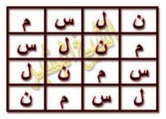
[Gambar: Halaman 08]

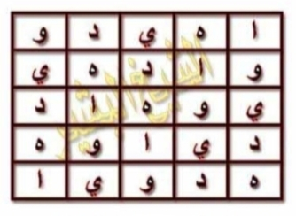
[Gambar: Halaman 08]

## HALAMAN 09 — FAEDAH MUHRIQAH 1/2

### arab
فَائِدَةٌ مُحْرِقَةٌ طَارِدَةٌ لِلْجِنِّ وَالْمَرَدَةِ بِإِذْنِ اللهِ

اَلسَّلَامُ عَلَيْكُمْ وَرَحْمَةُ اللهِ وَبَرَكَاتُهُ

إِخْوَتِي فِي اللهِ أَضَعُ لَكُمْ هَذِهِ الْفَائِدَةَ الْخَاصَّةَ بِإِحْرَاقِ الْجِنِّ وَطَرْدِهِ مِنْ جَسَدِ الْإِنْسَانِ بِإِذْنِ اللهِ وَهِيَ كَالتَّالِي،

نَأْخُذُ اسْمَ الشَّخْصِ وَأُمِّهِ وَنُزِيلُ مِنْهُ الْحُرُوفَ الْمُكَرَّرَةَ إِنْ كَانَ فِي الِاسْمِ وَإِلَّا يَبْقَى الِاسْمُ كَمَا هُوَ بِدُونِ حَذْفٍ إِذَا لَمْ تَتَكَرَّرْ فِيهِ الْحُرُوفُ، ثُمَّ نَمْزُجُهُ بِالْحُرُوفِ النَّارِيَّةِ وَالْهَوَائِيَّةِ النُّورَانِيَّةِ [ا هـ ط م ك س ق] حَيْثُ يَكُونُ أَوَّلُ حَرْفٍ مِنْهَا وَآخِرُ حَرْفٍ مِنْهَا كَذَلِكَ ثُمَّ نَكْسِرُ السَّطْرَ الْمَمْزُوجَ إِلَى الْمَخْرَجِ مَعَ تَرْكِهِ أَيْ نَأْخُذُ السُّطُورَ الَّتِي قَبْلَهُ فَقَطْ وَنَنْظُرُ إِلَى عَدَدِ سُطُورِ التَّكْسِيرِ أَهِيَ زَوْجٌ أَوْ فَرْدٌ فَإِنْ كَانَتْ زَوْجِيَّةً نَأْخُذُ الرُّوحَانِيَّ مِنَ السَّطْرِ الثَّانِي وَإِنْ كَانَتْ فَرْدِيَّةً نَأْخُذُهَا مِنَ السَّطْرِ الثَّالِثِ،

وَكَذَلِكَ حُرُوفُهُ إِنْ كَانَ التَّكْسِيرُ زَوْجًا تَكُونُ حُرُوفُ الرُّوحَانِيِّ زَوْجِيَّةً وَإِنْ كَانَ فَرْدًا تَكُونُ حُرُوفُهُ فَرْدِيَّةً، وَالْأَخْذُ مِنَ السَّطْرِ بِتَرْكِ حَرْفَيْنِ مِنْ أَوَّلِ السَّطْرِ وَحَرْفَيْنِ مِنْ آخِرِهِ حَتَّى يَبْقَى لَنَا حُرُوفُ الرُّوحَانِيِّ فِي الْوَسَطِ فِي هَذَا إِذَا كَانَ التَّكْسِيرُ زَوْجًا أَمَّا إِنْ كَانَ فَرْدًا نَتْرُكُ حَرْفًا مِنَ الْأَوَّلِ وَحَرْفًا مِنَ الْآخِرِ حَتَّى تَبْقَى حُرُوفُ الرُّوحَانِيِّ فِي الْوَسَطِ، ثُمَّ نَجْمَعُ عَدَدَ حُرُوفِ الرُّوحَانِيِّ وَنَسْتَنْطِقُهَا وَنُذَيِّلُهَا بِـ اييل وَنَرْسُمُ جَدْوَلًا بِعَدَدِ حُرُوفِ التَّكْسِيرِ وَنَكْتُبُ عَلَى أَرْكَانِهِ اسْمَ الرُّوحَانِيِّ الْمُسْتَخْرَجَ وَنَدُورُ عَلَيْهِ الْجَمِيعَ الْقَسَمَ الْآتِيَ ذِكْرُهُ.

نَعْمَلُ ثَلَاثَ وَرَقَاتٍ مِنَ الْعَمَلِ الْمَذْكُورِ وَنَكْتُبُهُ أَيْضًا فِي صَحْنٍ نَقِيٍّ وَيُمْحَى بِمَاءٍ طَاهِرٍ، يُبَخَّرُ الْمَرِيضُ ثَلَاثَ لَيَالٍ مُتَتَالِيَةٍ فِي كُلِّ لَيْلَةٍ وَرَقَةً وَيَدْهِنُ كَذَلِكَ جِسْمَهُ كُلَّهُ كُلَّ لَيْلَةٍ بَعْدَ الْبَخُورِ وَيَنَامُ فِي فِرَاشِهِ مُنْفَصِلًا.

وَالبَخُورُ الَّذِي يُوضَعُ مَعَ كُلِّ وَرَقَةٍ هُوَ [٧ وَرَقَاتِ سِدْرٍ، ٧ حَبَّاتِ قَرَنْفُلٍ، قَلِيلٌ مِنَ الْمُصْطَكَى] وَهَذَا مِثَالٌ لِلْقِيَاسِ، فَرَدَدْنَا اسْمَ الْمَرِيضِ وَأُمِّهِ هُوَ حَسَنُ رُقَيَّةَ،

### latin
Fā'idatum-muhriqatun ṭāridatun lil-jinni wal-maradati bi'iznillāhi, as-salāmu 'alaikum wa rahmatullāhi wa barakātuh, ikhwatī fillāh adha'u lakum hādzihil-fā'idata al-khāshshata bi'ihrāqil-jinni wa thardihi min jasadil-insāni bi'iznillāh... na'khudzu isma asy-syakhshi wa ummihi ... [alif hā' thā' mīm kāf sīn qāf] ...

### Terjemahan
Faedah pembakar pengusir jin dan maradah dengan izin Allah. Assalamu'alaikum warahmatullahi wabarakatuh. Wahai saudara-saudaraku karena Allah, aku letakkan bagi kalian faedah khusus ini untuk membakar jin dan mengusirnya dari jasad manusia dengan izin Allah, yaitu sebagai berikut: Kita ambil nama orang tersebut dan nama ibunya dan kita hilangkan huruf-huruf yang berulang jika ada dalam nama, jika tidak ada pengulangan maka nama tetap sebagaimana adanya tanpa penghapusan. Kemudian kita campurkan dengan huruf-huruf berunsur api dan udara yang bercahaya [ا هـ ط م ك س ق] di mana huruf pertama dan huruf terakhirnya tetap demikian. Kemudian kita pecahkan baris yang telah dicampur sampai ke tempat keluar dengan membiarkannya, yaitu kita ambil baris-baris sebelumnya saja dan kita lihat jumlah baris pemecahan apakah genap atau ganjil. Jika genap kita ambil ruhaninya dari baris kedua, jika ganjil kita ambil dari baris ketiga. Demikian pula huruf-hurufnya: jika pemecahan genap maka huruf-huruf ruhaninya genap, jika ganjil maka huruf-hurufnya ganjil. Pengambilan dari baris dengan meninggalkan dua huruf dari awal baris dan dua huruf dari akhirnya hingga tersisa huruf-huruf ruhani di tengah, ini jika pemecahan genap; adapun jika ganjil kita tinggalkan satu huruf dari awal dan satu huruf dari akhir hingga tersisa huruf-huruf ruhani di tengah. Kemudian kita kumpulkan jumlah huruf-huruf ruhani dan kita ucapkan dan kita akhiri dengan -ail dan kita gambar tabel sesuai jumlah huruf pemecahan dan kita tulis pada sudut-sudutnya nama ruhani yang telah dikeluarkan dan kita kelilingi semuanya dengan sumpah yang akan disebutkan. Kita buat tiga lembar dari amalan tersebut dan kita tulis juga pada piring yang bersih dan dihapus dengan air yang suci. Orang sakit diberi pengasapan tiga malam berturut-turut, tiap malam satu lembar dan ia mengolesi seluruh tubuhnya tiap malam setelah pengasapan dan tidur di tempat tidurnya secara terpisah. Dupa yang diletakkan bersama tiap lembar adalah [7 lembar daun bidara, 7 butir cengkeh, sedikit mustaka] dan ini contoh untuk diqiyaskan. Maka contoh nama orang sakit dan ibunya adalah Hasan dan Ruqayyah.

### Syarah dan Penjelasan
_Syarah._

### Khususiyah dan Tatacara Praktik
_Khususiyah._

## HALAMAN 10 — FAEDAH MUHRIQAH 2/2 — JADWAL & QASAM

### arab
فَائِدَةٌ مُحْرِقَةٌ طَارِدَةٌ لِلْجِنِّ وَالْمَرَدَةِ بِإِذْنِ اللهِ

أَخَذْنَا حُرُوفَ الرُّوحَانِيِّ مِنَ السَّطْرِ الثَّالِثِ وَهِيَ [ن ح ق] عَدَدُهَا ١٥٨ نُطْقُهَا [حِنْقَايِيلُ] هُوَ الرُّوحَانِيُّ نَكْتُبُهُ عَلَى الْأَرْكَانِ وَنَدُورُ بِهِ الْقَسَمَ الْآتِيَ [بِسْمِ اللهِ الرَّحْمَنِ الرَّحِيمِ أَقْسَمْتُ عَلَيْكُمْ أَيَّتُهَا الْأَرْوَاحُ الرُّوحَانِيَّةُ طَكْثَايِيلُ وَأَنْتَ يَا عَوْثَايِيلُ بِحَقِّ الْمَلِكِ الْحَاكِمِ عَلَيْكُمْ فَهْغَايِيلُ وَبِحَقِّ آهْيَا شَرَاهْيَا أَدُونَايَ أَصْبَاؤُوتَ آلِ شَدَّايَ وَبِحَقِّ إِنْ كَانَتْ إِلَّا صَيْحَةً وَاحِدَةً فَإِذَا هُمْ جَمِيعٌ لَدَيْنَا مُحْضَرُونَ أَنْ تَحْضُرُوا السَّاعَةَ وَتَنْزِلُوا عَلَى هَذَا الْمَارِدِ الْمُتَجَبِّرِ وَالْمُؤْذِي لِخَلْقِ اللهِ بِالطَّرْدِ وَالْحَرْقِ وَالنَّكَالِ خُذُوهُ وَبِأَنْوَارِكُمْ أَحْرِقُوهُ بِحَقِّ وَالسَّمَاءِ ذَاتِ الْبُرُوجِ إِلَى آخِرِ السُّورَةِ] ثُمَّ الْقَسَمُ يُتْلَى عَلَى كُلِّ وَرَقَةٍ ٥ مَرَّاتٍ وَكَذَلِكَ عَلَى الْمَاءِ وَالسَّلَامُ

### latin
Akhadznā hurūfar-rūhāniy minas-sathrits-tsālitsi wa hiya [ ن ح ق ] — [Rajah Huruf — tidak diterjemahkan] — 'adaduhā mi'atun wa tsamāniyatun wa khamsūna (158) nuthquhā Hinqāyīl... bismillāhir-rahmānir-rahīm aqsamtu 'alaikum ayyatuhal-arwāhur-rūhāniyyah Thaktsāyīl wa anta yā 'Awtsāyīl bihaqqil-malikil-hākimi 'alaikum Fahghāyīl...

### Terjemahan
Kita ambil huruf-huruf ruhani dari baris ketiga yaitu [ن ح ق] jumlahnya 158, pengucapannya [Hinqayil], dialah ruhaninya, kita tulis di sudut-sudut dan kita kelilingi dengan sumpah berikut: [Dengan nama Allah Yang Maha Pengasih Maha Penyayang, aku bersumpah kepada kalian wahai ruh-ruh ruhaniyah Thaktsayil dan engkau wahai 'Awtsayil dengan hak raja yang menguasai kalian Fahghayil dan dengan hak Ahya Syarahya Adunai Ashba'ut Ali Syaddai dan dengan hak 'In Kaanat Illa Shaihataw Wahidataw fa Idza Hum Jami'un Ladaina Muhdharun' agar kalian hadir sekarang dan turun atas marid yang sombong dan menyakiti makhluk Allah ini dengan pengusiran, pembakaran dan siksaan. Ambillah dia dan dengan cahaya-cahaya kalian bakarlah dia dengan hak 'Was-sama'i Dzatil-Buruj' hingga akhir surah]. Kemudian sumpah dibaca pada tiap lembar 5 kali dan demikian juga pada air. Wassalam.

### Syarah dan Penjelasan
_Syarah._

### Khususiyah dan Tatacara Praktik
_Khususiyah._

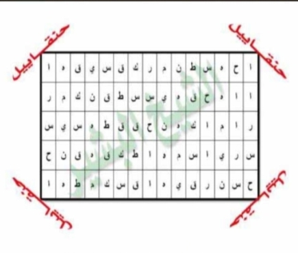
[Gambar: Halaman 10]

## HALAMAN 11 — FAEDAH QATHI'AH 1/2

### arab
فَائِدَةٌ قَاطِعَةٌ لِعِلَاجِ الْمَسِّ

اَلسَّلَامُ عَلَيْكُمْ وَرَحْمَةُ اللهِ وَبَرَكَاتُهُ، إِخْوَتِي فِي اللهِ إِلَيْكُمْ فَائِدَةٌ مِنْ الْفَوَائِدِ الْمُجَرَّبَةِ فِي عِلَاجِ حَالَاتِ الْمَسِّ وَتَنْفَعُ أَيْضًا لِإِبْطَالِ الْمَوَانِعِ عَنِ الدَّفَائِنِ وَهِيَ مُجَرَّبَةٌ وَسَرِيعَةُ النَّفَاذِ

يُكْتَبُ الْوَفْقُ فِي الصَّفْحَةِ التَّالِيَةِ فِي آنِيَةٍ نَظِيفَةٍ جَدِيدَةٍ بِمَاءِ وَرْدٍ وَزَعْفَرَانٍ وَمِسْكٍ وَتُدَارُ بِهِ الْآيَاتُ وَالسُّوَرُ الشَّرِيفَةُ وَبَعْدَ الْكِتَابَةِ يُمْحَى بِمَاءٍ طَاهِرٍ وَإِنْ كَانَ مَاءَ مَطَرٍ كَانَ أَجْوَدَ وَإِلَّا مَاءَ بِئْرٍ لَا تَنْتَظِرُهُ شَمْسٌ وَلَا ضَوْءُ قَمَرٍ، وَمَحْوُ الْكِتَابَةِ يَكُونُ بِسَبَّابَةِ الْيَدِ الْيُمْنَى وَتِلَاوَةً عِنْدَ الْمَحْوِ ٧ مَرَّاتٍ، وَالْكِتَابَةُ تَكُونُ بِتَرْتِيبٍ الَّذِي أَضَعُهُ وَكَذَلِكَ التِّلَاوَةُ

١ وَالشَّمْسِ وَضُحَاهَا إِلَى آخِرِ السُّورَةِ
٢ سُورَةُ الْإِخْلَاصِ
٣ اللهُ نُورُ السَّمَاوَاتِ وَالْأَرْضِ إِلَى تُرْفَعَ
٤ وَأَذِّنْ فِي النَّاسِ بِالْحَجِّ إِلَى عَمِيقٍ
٥ قُلْ أُوحِيَ إِلَى آخِرِ السُّورَةِ
وَالْكِتَابَةُ تَكُونُ بَعْدَ صَلَاةِ الْعِشَاءِ إِلَّا يَوْمَ الْأَرْبِعَاءِ وَالسَّبْتِ وَالْوَفْقُ هُوَ كَالتَّالِي

### latin
Fā'idatun qāthi'atun li'ilājil-massi, as-salāmu 'alaikum ..., yuktabul-wafqu fish-shafhatit-tāliyah fī āniyatin nazhīfatin jadīdatin bimā'i wardin wa za'farānin wa miskin wa tudāru bihil-āyātu ...

### Terjemahan
Faedah pemutus untuk mengobati kerasukan. Assalamu'alaikum warahmatullahi wabarakatuh, wahai saudara-saudaraku karena Allah, untuk kalian faedah dari faedah-faedah yang telah teruji dalam mengobati keadaan kerasukan dan juga bermanfaat untuk membatalkan penghalang dari harta terpendam, ia telah teruji dan cepat tembus. Wafaq pada halaman berikutnya ditulis pada bejana yang bersih dan baru dengan air mawar, za'faran dan misik dan dikelilingi dengan ayat-ayat dan surah-surah yang mulia dan setelah penulisan dihapus dengan air yang suci, jika dengan air hujan maka lebih baik, jika tidak maka dengan air sumur yang tidak terkena matahari dan tidak terkena cahaya bulan. Penghapusan tulisan dengan jari telunjuk tangan kanan dan bacaan ketika penghapusan 7 kali. Penulisan dengan urutan yang aku letakkan dan demikian pula pembacaannya: 1. Wasy-Syamsi wa Dhuhaaha hingga akhir surah. 2. Surah Al-Ikhlash. 3. Allahu Nuru As-Samawati wal-Ardhi hingga Turfa'. 4. Wa Adzdzin fin-Nasi bil-Hajji hingga 'Amiq. 5. Qul Uhiya hingga akhir surah. Penulisan setelah shalat Isya kecuali hari Rabu dan Sabtu, dan wafaqnya adalah sebagai berikut.

### Syarah dan Penjelasan
_Syarah._

### Khususiyah dan Tatacara Praktik
_Khususiyah._

## HALAMAN 12 — FAEDAH QATHI'AH 2/2 — WAFAQ 3×3

### arab
فَائِدَةٌ قَاطِعَةٌ لِعِلَاجِ الْمَسِّ

وَفْقٌ لِعِلَاجِ الْمَسِّ

| ١٨ | ١٢٠٩ | ٦٠٠ |
| ١١٩١ | ٦٠٩ | ٢٧ |
| ٦١٨ | ٩ | ١٢٠٠ |

الشَّيْخُ الْبَشِيرُ
مُنْتَدَى الْأَنْوَارِ الْقَادِرِيَّةِ وَالْأَرْوَاحِ الرَّحْمَانِيَّةِ
http://www.alanwaralqadria.com

كِتَابَةُ الْآيَاتِ وَالسُّوَرِ تَبْدَأُ مِنْ فَوْقِ الْوَفْقِ مِنْ جِهَةِ الْيَمِينِ اتِّجَاهًا إِلَى الْيَسَارِ، وَفَّقَكُمُ اللهُ لِمَا يُحِبُّهُ وَيَرْضَاهُ

### latin
Wafqun li'ilājil-massi, kitābatul-āyāti was-suwari tabda'u min fawqil-wafqi min jihatil-yamīni ittijāhan ilal-yasāri, waffaqakumullāhu limā yuhibbuhu wa yardhāh.

### Terjemahan
Faedah pemutus untuk mengobati kerasukan. Wafaq untuk mengobati kerasukan. Syeikh Al-Basyir. Forum Cahaya Al-Qadiriyah dan Ruh-Ruh Ar-Rahmaniyah. http://www.alanwaralqadria.com. Penulisan ayat-ayat dan surah-surah dimulai dari atas wafaq dari arah kanan menuju ke kiri. Semoga Allah memberi taufik kepada kalian pada apa yang Dia cintai dan ridhai.

### Syarah dan Penjelasan
_Syarah._

### Khususiyah dan Tatacara Praktik
_Khususiyah._

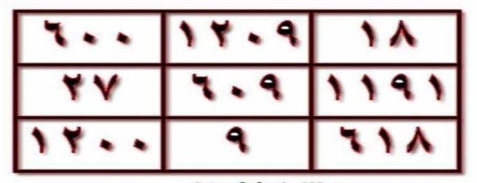
[Gambar: Halaman 12]

## HALAMAN 13 — ZAJR QATHI' 1/3 — الزَّجْرُ الْقَاطِعُ

### arab
الزَّجْرُ الْقَاطِعُ لِأَخْذِ الْعَهْدِ وَالْمِيثَاقِ عَلَى خَادِمِ الِاسْتِنْزَالِ

السَّلَامُ عَلَيْكُمْ وَرَحْمَةُ اللهِ وَبَرَكَاتُهُ

إِخْوَتِي فِي اللهِ، كَثِيرًا مَا وَقَعَ لَكُمْ أَنِ اسْتَخْدَمْتُمُ اسْتِنْزَالًا وَحَضَرَ خَادِمُهُ وَسَأَلْتُمُوهُ عَنْ أَمْرٍ فَأَجَابَكُمْ عَنْهُ وَوَجَدْتُمْ مَا قَالَهُ كَذِبًا [أَيْ الصَّبِيِّ]، وَهَذِهِ الْحَالَةُ تَقَعُ لِمَنْ يَعْمَلُونَ الِاسْتِنْزَالَ عَبْرَ الْوَسِيطِ [أَيْ الصَّبِيِّ]، وَمُعْظَمُ هَذِهِ الِاسْتِنْزَالَاتِ كَاذِبَةٌ، وَالسَّبَبُ هُوَ إِمَّا أَنْ يَكُونَ الطَّالِبُ غَيْرَ مُتَمَرِّسٍ، وَإِمَّا أَنْ يَكُونَ قَدْ تَمَادَى بِفِعْلِ الِاسْتِنْزَالِ وَطَلَبِ الْخُدَّامِ وَسُؤَالِهِمْ عَنْ أُمُورٍ تُحَقِّرُ مِنْ مَكَانَتِهِمْ، خُصُوصًا إِذَا كَانَ الْخَادِمُ عُلْوِيًّا فَإِنَّهُ يَمْتَنِعُ عَنِ النُّزُولِ وَيَدْخُلُ مَكَانَهُ خَادِمٌ سُفْلِيٌّ كَذَّابٌ [عُلْوِيًّا لَيْسَتِ الْإِشَارَةُ هُنَا لِلْمُلُوكِ السَّبْعَةِ فَهِيَ لَا تَنْزِلُ أَبَدًا إِلَّا فِي اسْتِنْزَالٍ نَفْسِيٍّ رَبَّانِيٍّ]

وَهَذِهِ فَائِدَةٌ قَاطِعَةٌ لِزَجْرِ خُدَّامِ الِاسْتِنْزَالِ وَحَثِّهِمْ عَلَى قَوْلِ الْحَقِّ، وَلَا تُخْبِرِ النَّاظِرَ بِمَا تُرِيدُ فِعْلَهُ كَيْ تَتَأَكَّدَ مِمَّا يَنْظُرُ لَهُ، بَعْدَ مَا تَعْمَلُ الِاسْتِنْزَالَ وَيُخْبِرُكَ بِحُضُورِ الْخَادِمِ تَتْلُو هَذِهِ الْآيَةَ سَبْعَ مَرَّاتٍ وَأَنْتَ مَاسِكٌ بِجَبْهَةِ النَّاظِرِ لِتَثْقِيفِهِ:

﴿ وَلَوْ أَرَادُوا الْخُرُوجَ لَأَعَدُّوا لَهُ عُدَّةً وَلَكِنْ كَرِهَ اللهُ انْبِعَاثَهُمْ فَثَبَّطَهُمْ وَقِيلَ اقْعُدُوا مَعَ الْقَاعِدِينَ ﴾

وَبَعْدَ ذَلِكَ تَأْمُرُهُ بِالشَّهَادَتَيْنِ وَالصَّلَاةِ عَلَى النَّبِيِّ صَلَّى اللهُ عَلَيْهِ وَسَلَّمَ، ثُمَّ تَأْمُرُهُ أَنْ يَأْتِيَ بِالْمُصْحَفِ الشَّرِيفِ وَيَفْتَحَهُ فِي سُورَةِ الْمُجَادَلَةِ، وَأْمُرِ النَّاظِرَ أَنْ يَبْدَأَ فِي قِرَاءَةِ السُّورَةِ لِتَتَأَكَّدَ أَنَّهَا هِيَ، بَعْدَ ذَلِكَ تَأْمُرُ الْخَادِمَ أَنْ يَضَعَ يَدَهُ الْيُمْنَى عَلَيْهَا وَيُعَاهِدَكَ بِقَوْلِ الْحَقِّ، وَإِنْ أَبَى وَهُوَ سَيَفْعَلُ ذَلِكَ لَا مَحَالَةَ ازْجُرْهُ بِهَذَا الزَّجْرِ الْقَاطِعِ:

### latin
Az-Zajrul-qāthi‘u li’akhdzil-‘ahdi wal-mītsāqi ‘alā khādimil-istinzāli

As-salāmu ‘alaikum wa rahmatullāhi wa barakātuh

Ikhwatī fillāhi, katsīran mā waqa‘a lakum ani istakhdamtumu istinzālan wa hadhara khādimuhu wa sa’altumūhu ‘an amrin fa’ajābakum ‘anhu wa wajadtum mā qālahu kadziban [ay ash-shabiyyi], wa hādzihil-ḥālatu taqa‘u liman ya‘malūnal-istinzāla ‘abral-wasīthi [ay ash-shabiyyi], wa mu‘zhamu hādzihil-istinzālātsi kādzibatun, was-sababu huwa immā an yakūna ath-thālibu ghaira mutamarrisin, wa immā an yakūna qad tamādā bifi‘lil-istinzāli wa thalabil-khuddāmi wa su’ālihim ‘an umūrin tuhaqqiru min makānatihim, khushūshan idzā kānal-khādimu ‘ulwiyyan fa’innahu yamtani‘u ‘anin-nuzūli wa yadkhulu makānahu khādimun sufliyyun kadzdzābun [‘ulwiyyan laisatil-isyāratu hunā lil-mulūkis-sab‘ati fahiya lā tanzilu abadan illā fī istinzālin nafsiyyin rabbāniyyin]

Wa hādzihi fā’idatun qāthi‘atun lizajri khuddāmil-istinzāli wa hatstsihim ‘alā qaulil-ḥaqqi, wa lā tukhbirin-nāzhira bimā turīdu fi‘lahu kai tata’akkada mimmā yanzhuru lahu, ba‘da mā ta‘malul-istinzāla wa yukhbiruka biḥudhūril-khādimi tatlū hādzihil-āyata sab‘a marrātin wa anta māsikun bijabhatin-nāzhiri litatsqīfihi:

﴿ Wa lau arādul-khurūja la’a‘addū lahu ‘uddatan wa lākin karihallāhub‘ātsahum fatsabbathahum wa qīla iq‘udū ma‘al-qā‘idīna ﴾ (QS At-Taubah: 46)

Wa ba‘da dzālika ta’muruhu bisy-syahādataini wash-shalāti ‘alan-nabiyyi shallallāhu ‘alaihi wa sallama, tsumma ta’muruhu an ya’tiya bil-mushḥafisy-syarīfi wa yaftahahu fī sūratil-mujādalati, wa’murin-nāzhira an yabda’a fī qirā’atis-sūrati litata’akkada annahā hiya, ba‘da dzālika ta’murul-khādima an yadha‘a yadahul-yumnā ‘alaihā wa yu‘āhidaka biqaulil-ḥaqqi, wa in abā wa huwa saya‘alu dzālika lā maḥālata izjurhu bihādzaz-zajril-qāthi‘i:

### Terjemahan
Gertakan Pemutus untuk Mengambil Sumpah dan Janji atas Khādim Istinzāl:

“Assalāmu‘alaikum warahmatullāhi wabarakātuh.

Wahai saudara-saudaraku karena Allah, sering terjadi pada kalian bahwa kalian telah menggunakan suatu istinzāl (teknik menghadirkan khādim ghaib melalui perantara), lalu khādimnya hadir dan kalian bertanya kepadanya tentang suatu urusan, kemudian ia menjawab kalian *tentang urusan itu* namun ternyata apa yang dikatakannya kalian dapati sebagai kedustaan — [yaitu perantara anak kecil tersebut (ash-shabiyy)]. Keadaan seperti ini menimpa orang-orang yang melakukan istinzāl melalui perantara (al-wasīth) [yaitu anak kecil], dan mayoritas istinzāl-istinzāl seperti ini adalah dusta. Sebabnya ialah terkadang sang penuntut ilmu (ath-thālib) belum terlatih/mahir, dan terkadang ia telah berlebihan dalam melakukan istinzāl serta meminta para khādim dan menanyai mereka tentang perkara-perkara yang merendahkan kedudukan mereka. Khususnya apabila khādim tersebut tergolong ‘ulwiyy (luhur/atas), maka ia enggan untuk turun lalu masuk menggantikannya khādim suflī (bawah/rendah) yang pendusta — [yang dimaksud ‘ulwiyy di sini bukanlah isyarat kepada tujuh raja jin; mereka tidak akan pernah turun sama sekali kecuali dalam istinzāl nafsī rabbānī (istinzāl kejiwaan yang bersifat ketuhanan/rabbani)].

Dan ini adalah faedah yang ampuh untuk menggertak para khādim istinzāl dan mendorong mereka agar berkata benar: Jangan beritahu sang penglihat (an-nāzhir) tentang apa yang hendak kamu lakukan agar kamu dapat memastikan kebenaran apa yang ia lihat. Setelah kamu melakukan istinzāl dan ia memberitahumu tentang kehadiran khādim, bacalah ayat berikut sebanyak **tujuh kali** dalam keadaan kamu **memegang dahi an-nāzhir untuk mengunci/menguatkannya (li-tatsqīfihi)**:

﴿ وَلَوْ أَرَادُوا الْخُرُوجَ لَأَعَدُّوا لَهُ عُدَّةً وَلَٰكِن كَرِهَ اللَّهُ انبِعَاثَهُمْ فَثَبَّطَهُمْ وَقِيلَ اقْعُدُوا مَعَ الْقَاعِدِينَ ﴾ (QS At-Taubah: 46)

Setelah itu, perintahkan ia (khādim melalui perantara) untuk mengucapkan dua kalimat syahadat dan shalawat kepada Nabi shallallāhu ‘alaihi wa sallam. Kemudian perintahkan ia untuk mendatangkan mushaf yang mulia dan membukanya pada **Surah al-Mujādalah**. Perintahkan an-nāzhir untuk mulai membaca surah tersebut agar kamu dapat memastikan bahwa yang terbuka memang surah itu. Setelah itu, perintahkan khādim untuk meletakkan tangan kanannya di atas mushaf tersebut dan berjanji kepadamu untuk berkata benar. **Jika ia menolak — padahal ia pasti akan melakukannya, tidak dapat tidak — maka gertaklah ia dengan gertakan pemutus (az-zajr al-qāthi‘) berikut ini:”

### Syarah dan Penjelasan
Halaman ini adalah **muqaddimah Zajr Qāthi‘ (Bagian 1/3)** — etika istinzāl melalui perantara anak kecil (ash-shabiyy/an-nāzhir al-wasīth). Penulis menegaskan dua penyebab utama kedustaan khādim: (1) *ghairu mutamarris* — penuntut belum mahir menguasai adab istinzāl, dan (2) *tamādā* — berlebihan meminta khādim untuk hal-hal remeh yang merendahkan martabat khādim ‘ulwī. ‘Ulwī vs suflī: khādim luhur bersifat mulia, tidak sudi turun untuk urusan rendah; kekosongan diisi khādim suflī pendusta. Penegasan **[bukan tujuh raja]** membatasi: tujuh raja jin agung (Mudzhab, Murrah, al-Aḥmar, Barqān, Syamhūrasy, al-Abyadh, Maimūn) tidak turun dalam istinzāl biasa, hanya dalam *istinzāl nafsī rabbānī* — praktik sufi tingkat tinggi dengan penyucian jiwa, bukan sekadar panggil-memanggil. Koreksi penting: *fa-ajābakum ‘anhu* — jawaban **tentang** persoalan yang ditanyakan, bukan jawaban umum; detail “‘anhu” dihilangkan dalam naskah Final lama. *Litatsqīfihi* — mengunci/memperkuat penglihatan nāzhir, bukan sekadar “menahan”: akar *tsaqafa* berarti menegakkan/meluruskan. Ayat At-Taubah: 46 — *lau arādul-khurūja...* — berfungsi sebagai *qufl* (kunci) agar khādim suflī tidak kabur: “jika mereka ingin keluar...” dibaca 7× sambil memegang dahi — sinkronisasi fisik-spiritual. Sumpah di atas al-Mujādalah — dipilih karena setiap ayatnya mengandung Lafzh al-Jalālah (Allah), sehingga jin fasik takut bersumpah palsu di atasnya; nāzhir diperintah membaca untuk verifikasi objektif (anti-sugesti).

### Khususiyah dan Tatacara Praktik
Fungsi halaman ini adalah *uji kejujuran* sebelum masuk ke matan Zajr (Hal14). Tata cara yang diajarkan: (1) Rahasiakan niat dari nāzhir (uji buta), (2) Setelah istinzāl dan laporan “khādim hadir”, pegang dahi nāzhir dan baca At-Taubah: 46 sebanyak 7× — niat mengunci (tatsqīf), (3) Syahadatain + shalawat (memurnikan saluran), (4) Hadirkan mushaf, buka al-Mujādalah, verifikasi bacaan nāzhir, (5) Letakkan tangan kanan khādim di atas mushaf dan minta sumpah jujur — jika menolak, lanjutkan ke Hal14 (Az-Zajr al-Qāthi‘). Pantangan: jangan lakukan untuk main-main, jaga adab, jangan tanya hal merendahkan. Waktu tidak terikat, namun dianjurkan suci (wudhu) dan menghadap kiblat. Kegagalan biasanya karena thālib ghairu mutamarris — perbanyak riyādhah sebelum mengulang.

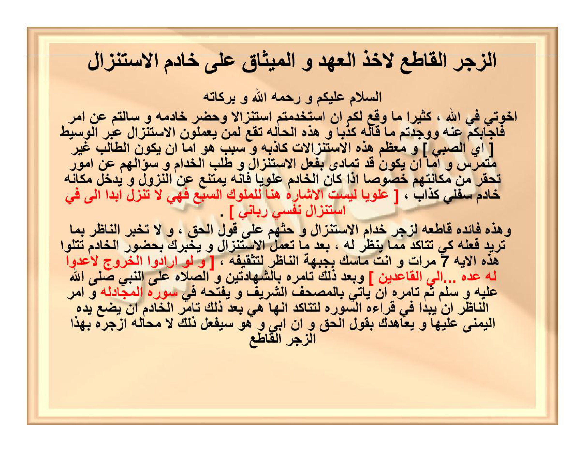
[Gambar: Halaman 13 — Zajr Qathi' 1/3 — 7× At-Taubah 46 + sumpah Mujādalah]

[Gambar: Halaman 13]

## HALAMAN 14 — ZAJR QATHI' 2/3 — الزَّجْرُ الْقَاطِعُ (LANJUTAN)

### arab
[ بِسْمِ اللهِ الرَّحْمٰنِ الرَّحِيمِ، الْمَلِكِ الْحَقِّ الْمُبِينِ، الَّذِي قَالَ فِي مُحْكَمِ كِتَابِهِ الْكَرِيمِ:

﴿ الم ۝ اللهُ لَا إِلَهَ إِلَّا هُوَ الْحَيُّ الْقَيُّومُ ۝ نَزَّلَ عَلَيْكَ الْكِتَابَ بِالْحَقِّ مُصَدِّقًا لِمَا بَيْنَ يَدَيْهِ وَأَنْزَلَ التَّوْرَاةَ وَالْإِنْجِيلَ ۝ مِنْ قَبْلُ هُدًى لِلنَّاسِ وَأَنْزَلَ الْفُرْقَانَ إِنَّ الَّذِينَ كَفَرُوا بِآيَاتِ اللهِ لَهُمْ عَذَابٌ شَدِيدٌ وَاللهُ عَزِيزٌ ذُو انْتِقَامٍ ﴾

﴿ سَنُلْقِي فِي قُلُوبِ الَّذِينَ كَفَرُوا الرُّعْبَ بِمَا أَشْرَكُوا بِاللهِ مَا لَمْ يُنَزِّلْ بِهِ سُلْطَانًا وَمَأْوَاهُمُ النَّارُ وَبِئْسَ مَثْوَى الظَّالِمِينَ ﴾

﴿ لَهُمْ مِنْ جَهَنَّمَ مِهَادٌ وَمِنْ فَوْقِهِمْ غَوَاشٍ وَكَذَلِكَ نَجْزِي الظَّالِمِينَ ﴾

﴿ إِذْ يُوحِي رَبُّكَ إِلَى الْمَلَائِكَةِ أَنِّي مَعَكُمْ فَثَبِّتُوا الَّذِينَ آمَنُوا سَأُلْقِي فِي قُلُوبِ الَّذِينَ كَفَرُوا الرُّعْبَ فَاضْرِبُوا فَوْقَ الْأَعْنَاقِ وَاضْرِبُوا مِنْهُمْ كُلَّ بَنَانٍ ﴾

انْزِلُوا يَا مَلَائِكَةَ رَبِّي عَلَى هَؤُلَاءِ الْأَعْوَانِ بِالضَّرْبِ وَالْقَصْفِ وَالْعَذَابِ الشَّدِيدِ حَتَّى يُطِيعُوا أَمْرِي وَيُعَاهِدُونِي عَلَى قَوْلِ الْحَقِّ بِحَقِّ اللهِ الْمَلِكِ الْحَقِّ الْمُبِينِ، أَجِيبُوا وَأَطِيعُوا يَا مَعْشَرَ الْخُدَّامِ، فَإِنْ عَصَيْتُمْ وَأَبَيْتُمْ فَلَا أَرْضَ تُقِلُّكُمْ وَلَا سَمَاءَ تُظِلُّكُمْ وَلَا أَيْنَ تَهْرُبُونَ وَلَا أَيْنَ تُمْنَعُونَ، وَأَسْمَاءُ اللهِ مُحِيطَةٌ بِكُمْ، وَعَزِيمَتِي هَذِهِ نَارٌ وَحَرِيقٌ عَلَيْكُمْ

فَإِنِّي أَقْسَمْتُ عَلَيْكُمْ بِاللهِ الْعَظِيمِ وَبِحَقِّ هَذَا الْقَسَمِ الْعَظِيمِ أَنْ تَجْعَلُوا كَلِمَتِي عِنْدَكُمْ سَارِيَةً نَافِذَةً، وَكَلَامِي عِنْدَكُمْ مَسْمُوعًا مَقْبُولًا، وَأَنْ تَخْدُمُونِي وَتُطِيعُونِي وَتُعَاهِدُونِي عَلَى قَوْلِ الْحَقِّ بِحَقِّ مَا أَقْسَمْتُ بِهِ عَلَيْكُمْ، وَإِنَّهُ لَقَسَمٌ لَوْ تَعْلَمُونَ عَظِيمٌ، تَكَادُ السَّمَاوَاتُ يَتَفَطَّرْنَ مِنْهُ وَتَنْشَقُّ الْأَرْضُ وَتَخِرُّ الْجِبَالُ هَدًّا

هَيَّا يَا مَعْشَرَ الْخُدَّامِ، زَجَرْتُكُمْ زَجْرًا وَدَعَوْتُكُمْ دَعْوَةً لَا خَلَاصَ لَكُمْ مِنْهَا وَلَا مَفَرَّ لَكُمْ مِنْهَا حَتَّى تُطِيعُوا أَمْرِي

فَهَكَذَا سَيُعَاهِدُكَ وَيَضَعُ يَدَهُ عَلَى السُّورَةِ، عِنْدَهَا اقْرَإِ الْآيَةَ:

﴿ وَأَوْفُوا بِعَهْدِ اللهِ إِذَا عَاهَدْتُمْ وَلَا تَنْقُضُوا الْأَيْمَانَ بَعْدَ تَوْكِيدِهَا وَقَدْ جَعَلْتُمُ اللهَ عَلَيْكُمْ كَفِيلًا ﴾ ]

ثُمَّ اصْرِفْهُ وَلَا تَعْمَلِ الِاسْتِنْزَالَ ذَلِكَ الْيَوْمَ، فَإِنْ عَمِلْتَ الِاسْتِنْزَالَ بَعْدَهَا سَتَجِدُ مَا يَقُولُ لَكَ حَقًّا وَيَكُونُ مَعَكَ صَادِقًا بِإِذْنِ اللهِ

نَفَعَنِي اللهُ وَإِيَّاكُمْ بِالْقُرْآنِ الْعَظِيمِ وَحَشَرَنِي وَإِيَّاكُمْ فِي زُمْرَةِ الْمُتَّقِينَ وَغَفَرَ لِي وَلَكُمْ وَلِلْمُؤْمِنِينَ أَجْمَعِينَ، وَالسَّلَامُ

### latin
Bismillāhir-raḥmānir-raḥīm, al-malikil-ḥaqqil-mubīn, alladzī qāla fī muḥkami kitābihil-karīm:

﴿ Alif-Lām-Mīm, Allāhu lā ilāha illā huwal-ḥayyul-qayyūmu, nazzala ‘alaikal-kitāba bil-ḥaqqi mushaddiqan limā baina yadaihi wa anzalat-taurāta wal-injīla, min qablu hudan lin-nāsi wa anzalal-furqāna innalladzīna kafarū bi’āyātillāhi lahum ‘adzābun syadīdun wallāhu ‘azīzun dzun-tiqāmin ﴾ (QS Āli ‘Imrān: 1-4)

﴿ Sanulqī fī qulūbilladzīna kafarūr-ru‘ba bimā asyrakū billāhi mā lam yunazzil bihi sulthānan wa ma’wāhumun-nāru wa bi’sa matswāzh-zhālimīna ﴾ (QS Āli ‘Imrān: 151)

﴿ Lahum min jahannama mihādun wa min fauqihim ghawāsyin wa kadzālika najzīzh-zhālimīna ﴾ (QS Al-A‘rāf: 41)

﴿ Idz yūḥī rabbuka ilal-malā’ikati annī ma‘akum fatsabbitulladzīna āmanū sa’ulqī fī qulūbilladzīna kafarūr-ru‘ba fadhribū fauqal-a‘nāqi wadhribū minhum kulla banānin ﴾ (QS Al-Anfāl: 12)

Inzilū yā malā’ikata rabbī ‘alā hā’ulā’il-a‘wāni bidh-dharbi wal-qashfi wal-‘adzābisy-syadīdi ḥattā yuthī‘ū amrī wa yu‘āhidūnī ‘alā qaulil-ḥaqqi biḥaqqillāhil-malikil-ḥaqqil-mubīni, ajībū wa athī‘ū yā ma‘syarak-khuddāmi, fa’in ‘ashaitum wa abaitum falā ardha tuqillukum wa lā samā’a tuzhillukum wa lā aina tahrubūna wa lā aina tumna‘ūna, wa asmā’ullāhi muḥīthatun bikum, wa ‘azīmatī hādzihi nārun wa ḥarīqun ‘alaikum

Fa’innī aqsamtu ‘alaikum billāhil-‘azhīmi wa biḥaqqi hādzal-qasamil-‘azhīmi an taj‘alū kalimatī ‘indakum sāriyatan nāfidzatan, wa kalāmī ‘indakum masmū‘an maqbūlan, wa an takhdumūnī wa tuthī‘ūnī wa tu‘āhidūnī ‘alā qaulil-ḥaqqi biḥaqqi mā aqsamtu bihī ‘alaikum, wa innahu laqasamun lau ta‘lamūna ‘azhīmun, takādus-samāwātu yatafaththarna minhu wa tansyaqqul-ardhu wa takhirrul-jibālu haddan

Hayyā yā ma‘syarak-khuddāmi, zajartukum zajran wa da‘autukum da‘watan lā khalāsha lakum minhā wa lā mafarra lakum minhā ḥattā tuthī‘ū amrī

Fahākadzā sayu‘āhiduka wa yadha‘u yadahu ‘alas-sūrati, ‘indahāq-ra’il-āyata:

﴿ Wa aufū bi‘ahdillāhi idzā ‘āhadtum wa lā tanqudhul-aimāna ba‘da taukīdihā wa qad ja‘altumullāha ‘alaikum kafīlan ﴾ (QS An-Naḥl: 91)

Tsummash-rifhu wa lā ta‘malil-istinzāla dzālikal-yauma, fa’in ‘amiltal-istinzāla ba‘dahā satajidu mā yaqūlu laka ḥaqqan wa yakūnu ma‘aka shādiqan bi’idznillāhi

Nafa‘aniyallāhu wa iyyākum bil-qur’ānil-‘azhīmi wa ḥasyaranī wa iyyākum fī zumratil-muttaqīna wa ghafara lī wa lakum wa lil-mu’minīna ajma‘īna, was-salāmu

### Terjemahan
Teks Gertakan Pemutus Khādim Istinzāl (Az-Zajr al-Qāthi‘):

“Dengan nama Allah Yang Maha Pengasih Maha Penyayang, Yang Merupakan Raja Yang Maha Benar lagi Maha Nyata, Yang berfirman dalam Kitab-Nya yang muhkam lagi mulia:

• ‘Alif Lām Mīm. Allah, tiada tuhan selain Dia Yang Maha Hidup lagi terus-menerus mengurus (makhluk-Nya). Dia menurunkan kepadamu Kitab dengan hak, membenarkan apa yang ada di hadapannya, dan menurunkan Taurat dan Injil — sebelumnya sebagai petunjuk bagi manusia — dan menurunkan al-Furqān. Sesungguhnya orang-orang yang kafir terhadap ayat-ayat Allah, bagi mereka azab yang keras, dan Allah Mahaperkasa Pemilik balasan siksaan’ (QS Āli ‘Imrān: 1-4).

• ‘Akan Kami masukkan ke dalam hati orang-orang kafir rasa takut disebabkan mereka mempersekutukan Allah dengan sesuatu yang Allah tidak menurunkan keterangan pun tentangnya, dan tempat kembali mereka ialah neraka, dan seburuk-buruk tempat tinggal orang-orang zhalim’ (QS Āli ‘Imrān: 151).

• ‘Bagi mereka hamparan dari neraka Jahannam dan di atas mereka selimut (api), demikianlah Kami membalas orang-orang yang zhalim’ (QS al-A‘rāf: 41).

• ‘(Ingatlah) ketika Tuhanmu mewahyukan kepada para malaikat: Sesungguhnya Aku bersamamu, maka teguhkanlah orang-orang yang beriman, akan Aku masukkan rasa takut ke dalam hati orang-orang kafir, maka penggallah di atas leher (mereka) dan penggallah tiap-tiap ujung jari mereka’ (QS al-Anfāl: 12).

Turunlah wahai malaikat-malaikat Tuhanku kepada para pembantu/khādim ini dengan pukulan, sambaran petir, dan azab yang keras hingga mereka menaati perintahku dan berjanji kepadaku untuk berkata benar, demi hak Allah Raja Yang Maha Benar lagi Maha Nyata! Jawablah dan taatilah wahai sekumpulan khādim! Maka jika kalian durhaka dan enggan, maka tidak ada bumi yang akan menopang kalian, tidak ada langit yang akan menaungi kalian, tidak ada tempat kalian lari, dan tidak ada tempat kalian berlindung — sedangkan Nama-Nama Allah meliputi kalian! Dan ‘azīmah-ku ini adalah api dan pembakaran atas kalian!

Maka sesungguhnya aku telah bersumpah atas kalian demi Allah Yang Maha Agung dan demi hak sumpah yang agung ini agar kalian menjadikan kata-kataku berlaku dan menembus di sisi kalian, dan perkataanku didengar lagi diterima di sisi kalian, dan agar kalian melayaniku, menaatiku, dan berjanji kepadaku untuk berkata benar demi hak apa yang telah aku sumpahkan atas kalian. Dan sesungguhnya ia benar-benar sumpah yang agung — jika kalian mengetahui — yang hampir-hampir langit pecah karenanya, bumi terbelah, dan gunung-gunung runtuh hancur berkeping-keping!

Bersegeralah wahai sekumpulan khādim, aku telah menggertak kalian dengan satu gertakan dan menyeru kalian dengan satu seruan yang tidak ada keselamatan bagi kalian darinya dan tidak ada tempat lari bagi kalian darinya hingga kalian menaati perintahku!’

Tahap Pengikatan Janji:

Maka dengan cara seperti inilah ia (khādim) akan berjanji kepadamu dan meletakkan tangannya di atas surah (al-Mujādalah di mushaf). Pada saat itu bacalah ayat:

﴿ وَأَوْفُوا بِعَهْدِ اللهِ إِذَا عَاهَدْتُمْ وَلَا تَنْقُضُوا الْأَيْمَانَ بَعْدَ تَوْكِيدِهَا وَقَدْ جَعَلْتُمُ اللهَ عَلَيْكُمْ كَفِيلًا ﴾ ] (QS an-Naḥl: 91)

Kemudian pulangkanlah ia (ishrāf) dan jangan melakukan istinzāl pada hari itu juga. Maka sesungguhnya jika kamu melakukan istinzāl setelahnya (hari berikutnya), kamu akan mendapati apa yang ia katakan kepadamu adalah benar dan ia akan senantiasa jujur bersamamu — dengan izin Allah.

Semoga Allah memberi manfaat kepadaku dan kepada kalian melalui al-Qur’an yang agung, mengumpulkan aku dan kalian dalam rombongan orang-orang yang bertakwa, dan mengampuni diriku, kalian, dan seluruh orang-orang mukmin semuanya. Wassalām.”

### Syarah dan Penjelasan
Halaman ini adalah **matan Az-Zajr al-Qāthi‘ (Bagian 2/3 — inti ancaman)**. Strukturnya tersusun sebagai *‘azīmah qasamiyyah* (sumpah pengikat) dengan empat lapis ayat azab: (1) Āli ‘Imrān: 1-4 — tauḥīd dan ancaman bagi kafir ayat Allah, menegaskan otoritas Rabb al-‘Arsy; (2) Āli ‘Imrān: 151 — *ru‘b* (rasa takut) yang dilemparkan ke hati musuh — untuk melemahkan mental jin suflī; (3) al-A‘rāf: 41 — gambaran Jahanam sebagai pembalasan zhalim — untuk menggetarkan khādim yang zhalim/pendusta; (4) al-Anfāl: 12 — wahyu kepada malaikat untuk memenggal leher dan ujung jari — memanggil *malā’ikatul-‘adzāb* sebagai eksekutor spiritual. Keempatnya dirangkai dalam satu silsilah *qāla fī muḥkami kitābihil-karīm* — bukan sekadar kutipan, melainkan istidlāl bahwa Allah sendiri telah menetapkan sunnah penghukuman. Seruan *inzilū yā malā’ikata rabbī* — bukan memerintah malaikat secara hakiki (yang hanya patuh pada Allah), melainkan tawassul: memohon agar Allah memerintahkan malaikat-Nya untuk menekan khādim — adab hikmah Qādiriyyah membedakan *amr takwīnī* (Allah) dan *amr ta‘abbudī* (manusia). Ancaman *falā ardha tuqillukum...* menggunakan struktur *lā nāfiyatu lil-jinsi* — negasi total: tidak ada tempat berlindung di semesta — menegaskan bahwa Asmā’ Allah *muḥīthah* (meliputi). ‘Azīmah “*nārun wa ḥarīqun ‘alaikum*” — api hakiki bagi entitas halus yang hakikatnya dari api — maka api Asmā’ lebih membakar. Puncak sumpah mengutip QS al-Ḥāqqah: *wa innahu laqasamun lau ta‘lamūna ‘azhīm* dan QS Maryam/asy-Syūrā: *takādus-samāwātu yatafattharna...* — sumpah yang mengguncang langit-bumi, sebagai *tahdīd* final. Penutup *fahākadzā sayu‘āhiduka* — janji akan terjadi *lā maḥālata* (pasti), namun tetap disempurnakan dengan An-Naḥl: 91 — *wa aufū bi‘ahdillāhi...* — mengikat janji manusia-jin di atas kalam Allah. Perintah *tshummash-rifhu wa lā ta‘malil-istinzāla dzālikal-yauma* — *karantina satu hari* (tark al-istinzāl yaumahu) — memberi jeda stabilisasi gelombang (istidlāl penulis: “baru pada hari berikutnya istinzāl siap 100% jujur”). Doa penutup *nafa‘aniyallāhu...* — adab khatam dengan shalawat Fatihah dan istighfar kolektif, ciri khas Syaikh al-Basyīr.

### Khususiyah dan Tatacara Praktik
Halaman ini adalah *eksekusi* Zajr: dibaca **setelah** muqaddimah Hal13 dan setelah penolakan khādim untuk bersumpah. Cara baca: menghadap kiblat, dalam keadaan suci, suara tegas (jahr) tetapi tidak berteriak memekik — “*zajara zajran*” (gertakan mantap). Empat ayat dibaca berurutan dengan tartīl, lalu seruan *inzilū...* hingga *ḥattā tuthī‘ū amrī* — satu nafas jika mampu, atau pecah dua. Jangan menambah/mengurangi ayat — keempatnya adalah *rukun Zajr*. Setelah selesai, jangan lanjutkan istinzāl hari itu — *ishrāf* (pulangkan) khādim dengan salam. Keesokan harinya, istinzāl dapat dipakai untuk hajat halal — khādim kini *mu‘āhad* (terikat janji) dan akan *shādiqan bi’idznillāhi*. Larangan: jangan gunakan untuk menanyakan aib orang, judi, atau sihir pemisah — sumpah akan batal dan khādim kembali suflī. Kelebihan khusus: metode ini adalah *filter permanen* — sekali diikat, semua istinzāl berikutnya tersaring otomatis dari dusta, berbeda dengan ruqyah biasa yang bersifat temporer.

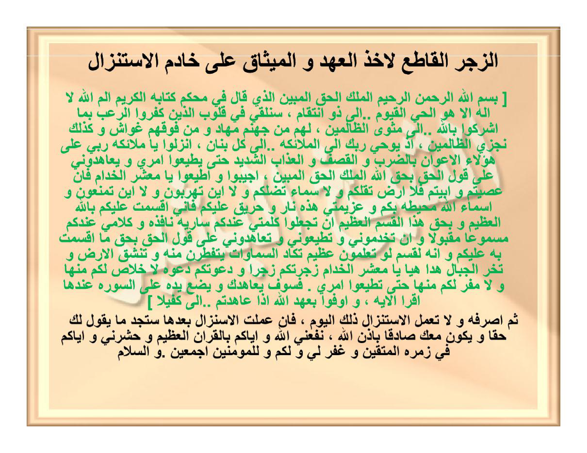
[Gambar: Halaman 14 — Zajr Qathi' 2/3 — 4 ayat azab + ishrāf]

[Gambar: Halaman 14]

## HALAMAN 15 — FAIDAH THARD 'ATHLUSYIN 1/2 — فَائِدَةٌ لِطَرْدِ عَطْلُوشٍ

### arab
فَائِدَةٌ لِطَرْدِ عَطْلُوشٍ مُفْسِدِ الْأَعْمَالِ الرَّوْحَانِيَّةِ

إِخْوَتِي فِي اللهِ، أَضَعُ بَيْنَ أَيْدِيكُمْ هَذِهِ الْفَائِدَةَ النَّافِعَةَ فِي دَفْعِ الْخَادِمِ الْمُفْسِدِ لِلْأَعْمَالِ وَانْقِلَابِهَا بِصَدِّ الْمَرْغُوبِ فِيهَا، وَهُوَ خَادِمٌ اسْمُهُ [عَطْلُوشٌ]، وَالْحَاكِمُ عَلَيْهِ أَبُو طَارِشٍ مَلِكُ الْعُمَّارِ.

تَكْتُبُ الْوَفْقَ فِي يَدِكَ الْيُمْنَى بِصَمْغٍ —أَيِ الْمِدَادِ الْأَسْوَدِ الْمُسْتَخْرَجِ مِنْ صُوفِ الْغَنَمِ—، وَتُبَخِّرُ يَدَكَ بِالْقُزْبَرَةِ، وَهَذَا طَبْعًا بَعْدَ إِصْرَافِ الْعُمَّارِ. ثُمَّ تُعَزِّمُ عَلَى الْيَدِ إِحْدَى وَعِشْرِينَ مَرَّةً، وَهَذِهِ هِيَ الْعَزِيمَةُ:

(أَقْسَمْتُ عَلَيْكُمْ يَا عَطْلُوشُ بِالَّذِي خَلَقَكُمْ وَصَوَّرَكُمْ فَكُنْتُمْ ضَرُورَةً لِأَهْلِ الْحِكْمَةِ أَلَّا تُفْسِدُوا لِي مَا عَمِلْتُ وَلَا تَقْرَبُونِي فِيمَا صَنَعْتُ وَلَا تَتَحَرَّكُوا بِحَقِّ هَذِهِ الْأَسْمَاءِ الْمُحْرِقَةِ عَلَيْكُمْ: جَلْجَلٍ اثْنَتَيْنِ، جَلْنِيشٍ اثْنَتَيْنِ، قَهْرٍ اثْنَتَيْنِ، بَرْهَةٍ اثْنَتَيْنِ، شَطِيشٍ اثْنَتَيْنِ، شَهٍ اثْنَتَيْنِ، فَأَيْنَمَا تُوَلُّوا فَثَمَّ وَجْهُ اللهِ عَلَيْكُمْ يَا عَطْلُوشُ ابْنَ أَغْلَغَلٍ فَلَا تَقْرَبُونِي وَلَا بِسَاحَتِي بِحَقِّ هَذِهِ الْأَسْمَاءِ: سَلْهُوبٍ، مَلْهُوبٍ، أَبِيكَ، يَلِيخٍ، أَلْقَمُوشٍ، مَرُوشٍ، هَرْمُوشٍ، قَرْمُوشٍ، انْفِرُوا خِفَافًا وَثِقَالًا بِحَقِّ ﴿ إِذَا زُلْزِلَتِ الْأَرْضُ زِلْزَالَهَا ... إِلَى ... أَشْتَاتًا أَشْتَاتًا أَشْتَاتًا ﴾).

تَمَّتِ الْعَزِيمَةُ. بَعْدَمَا تُعَزِّمُ بِهَا عَلَى يَدِكَ إِحْدَى وَعِشْرِينَ مَرَّةً تَنَامُ وَتَضَعُ يَدَكَ تَحْتَ رَأْسِكَ إِلَى الصَّبَاحِ، ثُمَّ امْحُ الْجَدْوَلَ مِنْ يَدِكَ بِمَاءٍ طَاهِرٍ وَضَعْهُ فِي قَارُورَةٍ طَاهِرَةٍ. تَقُومُ بِهَذَا الْعَمَلِ سَبْعَةَ أَيَّامٍ، وَعِنْدَ تَمَامِ الْعَمَلِ تَأْخُذُ الْقَارُورَةَ وَتَذْهَبُ إِلَى مَكَانٍ خَالٍ بَعِيدٍ عَنِ النَّاسِ وَتَحْفُرُ حُفْرَةً وَتَضَعُ فِيهَا الْقَارُورَةَ وَتَرُدُّ عَلَيْهَا التُّرَابَ وَتَضَعُ يَدَكَ فَوْقَهَا وَتَقْرَأُ آيَةَ الْكُرْسِيِّ إِلَى ﴿ خَالِدُونَ ﴾ مَرَّةً وَاحِدَةً، وَسُورَةَ الْمُلْكِ ثَلَاثَ مَرَّاتٍ، ثُمَّ تَرْجِعُ مِنْ حَيْثُ أَتَيْتَ وَلَا تَلْتَفِتْ أَبَدًا إِلَى الْقَارُورَةِ. وَالْوَفْقُ هُوَ هَكَذَا:

### latin
Fā’idatun li-thardi ‘Athlūsyin mufsidil-a‘mālir-rūḥāniyyah

Ikhwatī fillāh, aḍa‘u baina aidīkum hādzihil-fā’idatan-nāfi‘ata fī daf‘il-khādimil-mufsidi lil-a‘māli wanqilābihā bishaddil-marghūbi fīhā, wa huwa khādimun ismuhu [‘Athlūsyin], wal-ḥākimu ‘alaihi Abū Thārishin malikul-‘ummār.

Taktubul-wafqa fī yadikal-yumnā bishamghin —ayil-midādil-aswadil-mustakhraji min shūfil-ghanami—, wa tubakhkhiru yadaka bil-quzburati, wa hādzā thab‘an ba‘da ishrāfil-‘ummār. Tsumma tu‘azzimu ‘alal-yadi iḥdā wa ‘isyrīna marratan, wa hādzihi hiyal-‘azīmatu:

(Aqsamtu ‘alaikum yā ‘Athlūsyu billadzī khalaqakum wa shawwarakum fakuntum ḍarūratan li-ahlil-ḥikmati allā tufsidū lī mā ‘amiltu wa lā taqrabūnī fīmā shana‘tu wa lā tataḥarrakū biḥaqqi hādzihil-asmā’il-muḥriqati ‘alaikum: Jaljalin itsnatain, Jalnīsyin itsnatain, Qahrin itsnatain, Barhatin itsnatain, Syathīsyin itsnatain, Syahin itsnatain, fa-ainamā tuwallū fatsamma wajhullāhi ‘alaikum yā ‘Athlūsyu ibna Aghlaghalin falā taqrabūnī wa lā bisāḥatī biḥaqqi hādzihil-asmā’i: Salhūbin, Malhūbin, Abīka, Yalīkhin, Alqamūsyin, Marūsyin, Harmūsyin, Qarmūsyin, infirū khifāfan wa tsiqālan biḥaqqi: Idzā zulzilatil-arḍu zilzālahā ... ilā ... Asytātan Asytātan Asytātan).

Tammatil-‘azīmatu. Ba‘da mā tu‘azzimu bihā ‘alā yadika iḥdā wa ‘isyrīna marratan tanāmu wa taḍa‘u yadaka taḥta ra’sika ilash-shabāḥi, tsumma imḥul-jadwala min yadika bimā’in thāhirin wa ḍa‘hu fī qārūratin thāhiratin. Taqūmu bihādzal-‘amali sab‘ata ayyāmin, wa ‘inda tamāmil-‘amali ta’khudzul-qārūrata wa tadzhabu ilā makānin khālin ba‘īdin ‘anin-nāsi wa taḥfuru ḥufratan wa taḍa‘u fīhal-qārūrata wa taruddu ‘alaihat-turāba wa taḍa‘u yadaka fauqahā wa taqra’u āyatal-kursiyyi ilā ... khālidūna marratan wāḥidatan, wa sūratal-Mulki tsalātsa marrātin, tsumma tarji‘u min ḥaitsu ataita wa lā taltafit abadan ilal-qārūrati. Wal-wafqu huwa hākadzā:

### Terjemahan
Faedah untuk mengusir ‘Athlūsy, perusak amal-amal ruhaniyyah:

“Wahai saudara-saudaraku karena Allah, aku letakkan di hadapan kalian faedah yang bermanfaat ini untuk menolak khādim perusak amal yang menyebabkan amal berbalik (inqilāb) sehingga menghalangi tercapainya hajat. Khādim tersebut namanya [‘Athlūsyin], dan penguasanya adalah Abū Thārish, rajanya para ‘ummār (jin penghuni tempat).

Tulislah wafaq pada telapak tangan kananmu dengan *shamgh* —yaitu tinta hitam pekat yang diekstrak dari bulu domba— lalu asapi tanganmu dengan *quzburah* (ketumbar). Hal ini tentu saja setelah melakukan *ishrāf al-‘ummār* (memindahkan jin penghuni).

Kemudian bacakan ‘azīmah pada tangan tersebut sebanyak **21 kali**, inilah ‘azīmahnya:

‘Aku bersumpah kepada kalian wahai ‘Athlūsy, demi Dzat yang menciptakan kalian dan membentuk rupa kalian sehingga kalian menjadi bagian dari kebutuhan ahli ḥikmah — agar kalian tidak merusak apa yang telah aku kerjakan, tidak mendekatiku dalam apa yang aku perbuat, dan tidak bergerak sedikit pun — demi hak nama-nama pembakar atas kalian: Jaljal (2×), Jalnīsy (2×), Qahr (2×), Barhah (2×), Syathīsy (2×), Syah (2×). Maka ke mana pun kalian berpaling, di sanalah Wajah Allah mengawasi kalian — wahai ‘Athlūsy bin Aghlaghal, maka jangan dekati aku dan jangan dekati halamanku — demi hak nama-nama ini: Salhūb, Malhūb, Abīka, Yalīkh, Alqamūsy, Marūsy, Harmūsy, Qarmūsy. Berangkatlah kalian dalam keadaan ringan maupun berat (QS At-Taubah:41), demi hak: *Idzā zulzilatil-arḍu zilzālahā ... hingga ... Asytātan Asytātan Asytātan* (QS Az-Zalzalah:1-8).’

Selesailah ‘azīmah. Setelah kamu membacakannya pada tanganmu 21 kali, tidurlah dengan meletakkan tanganmu di bawah kepalamu hingga pagi. Kemudian hapuslah tulisan tabel (jadwal) dari tanganmu dengan air suci dan masukkan airnya ke dalam botol yang suci. Lakukan amal ini **selama 7 hari**. Ketika amal telah sempurna, ambil botol tersebut, pergilah ke tempat yang sepi jauh dari manusia, gali lubang, masukkan botol ke dalamnya, timbun kembali dengan tanah, letakkan tanganmu di atasnya dan bacalah **Ayat Kursi sampai *khālidūn* 1×** dan **Surah al-Mulk 3×**, kemudian kembalilah dari mana kamu datang dan **jangan sekali-kali menoleh** kepada botol tersebut. Dan wafaqnya adalah sebagai berikut (lihat Hal16):”

### Syarah dan Penjelasan
Halaman ini adalah **bagian 1/2 faedah ‘Athlūsy**. Pokok masalahnya adalah *inqilāb al-a‘māl* — amal ruhaniyyah yang berbalik merusak hajat karena gangguan khādim bernama ‘Athlūsy bin Aghlaghal, di bawah kekuasaan Abū Thārish malik al-‘ummār (raja jin ‘ummār/‘āmir — penghuni bangunan/empat penjuru). Penjelasan rinci: ‘Athlūsy bukan jin marabahaya yang merasuki jasad, melainkan *khādim mufsid* — parasit halus yang khusus merusak frekuensi amalan (membuat wirid tidak naik, wafaq tidak berfungsi, doa terpental). Penguasa Abū Thārish adalah raja ‘ummār yang netral — dengan menyebut namanya, praktisi meminta izin hierarkis agar ‘Athlūsy dilepaskan dari tugas merusak. Media *shamgh* (jelaga bulu domba) dipilih karena tinta ini bersifat *bārid yābis* (dingin-kering) yang menetralisir sifat panas-lembab jin ‘Athlūsy; *quzburah* (ketumbar/biji ketumbar kering) adalah bukhūr penolak ‘ummār yang dibenci mereka karena aromanya menusuk namun tidak menyengat manusia. *Ishrāf al-‘ummār* wajib didahulukan — memindahkan ‘ummār baik agar tidak terkena dampak pengusiran ‘Athlūsy (adab Qādiriyyah: jangan mengusir tetangga ghaib yang baik saat mengusir parasit). Azimah terdiri dari tiga lapis: (1) Qasam pencipta — *billadzī khalaqakum wa shawwarakum* — mengingatkan asal kejadian jin, (2) Enam nama muḥriqah masing-masing 2× (Jaljal, Jalnīsy, Qahr, Barhah, Syathīsy, Syah) — adalah *asmā’ qahriyyah* yang membakar, diulang 2× untuk penekanan (*ta’kīd*), (3) Ayat *fa-ainamā tuwallū fatsamma wajhullāh* (QS Al-Baqarah:115) — pengingat bahwa Allah mengawasi ke mana pun jin melarikan diri, (4) Delapan nama ḥākim (Salhūb ... Qarmūsy) — rantai komando Abū Thārish, (5) *Infirū khifāfan wa tsiqālan* (At-Taubah:41) + *Idzā zulzilat* (Az-Zalzalah) dengan repetisi *Asytātan* 3× — perintah mobilisasi paksa dan guncangan bumi yang memporak-porandakan sarang jin. Angka 21× ‘azīmah pada tangan adalah 3×7 — 7 untuk hari, 3 untuk lapis azimah — menyatukan *mabda’* (tangan), *wāsithah* (azimah), dan *ghāyah* (penguburan).

### Khususiyah dan Tatacara Praktik
Kegunaan: menetralisir gangguan ‘Athlūsy yang membuat amalan apapun (wirid, wafaq, hizib) selalu gagal/terbalik. Syarat sah: (1) Lakukan *ishrāf al-‘ummār* terlebih dahulu (bacaan ishrāf umum, tidak dirinci di sini — pakai ishrāf Qādiriyyah standar), (2) Tinta harus *shamgh* asli — jelaga bulu domba yang dibakar lalu dicampur minyak/air mawar hingga jadi pasta hitam, bukan spidol/tinta kimia, (3) Tulisan di telapak kanan (bukan kiri), (4) Pembukhuran *quzburah* kering — tabur di atas bara, asapi tangan 1-2 menit, (5) ‘Azīmah 21× dengan tangan terangkat menghadap kiblat, (6) Tidur dengan tangan di bawah kepala — posisi *taḥannuth* (seperti tidur Rasul), bukan di atas bantal, (7) Pagi harinya hapus dengan air suci (air hujan/sumur yang tidak terkena matahari lebih utama — lihat Hal11), masukkan ke botol kaca bening (bukan plastik), (8) Ulangi 7 hari — jangan terputus; jika terputus karena haid/safar, ulang dari hari 1, (9) Hari ke-7 setelah penggalian lubang, baca Ayat Kursi 1× (sampai *khālidūn* — QS Al-Baqarah:255 mencakup *hum fīhā khālidūn* dalam riwayat, maksudnya baca sampai akhir ayat) dan al-Mulk 3× (surah pelindung kubur), (10) Pantangan mutlak: *lā taltafit abadan* — jangan menoleh ke belakang setelah mengubur; menoleh membatalkan *hijab* (penutup) dan ‘Athlūsy kembali. Waktu: tidak terikat hari Rabu/Sabtu (berbeda dengan faedah mass), tetapi dianjurkan malam hari setelah Isya agar frekuensi ‘Athlūsy aktif.

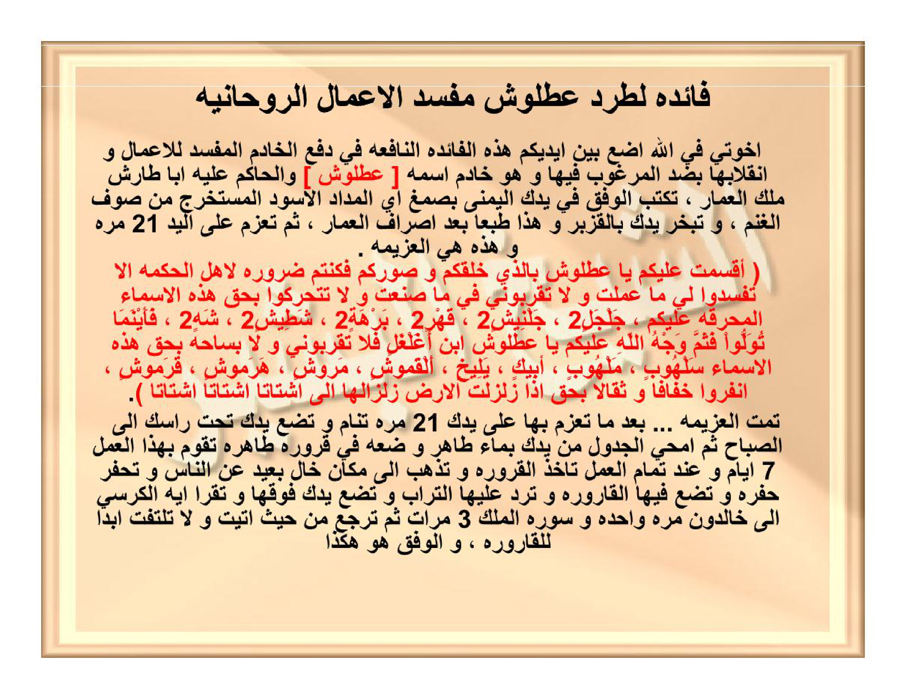
[Gambar: Halaman 15 — Faedah ‘Athlūsy 1/2 — 21× azimah — 7 hari botol]

[Gambar: Halaman 15]

## HALAMAN 16 — FAIDAH THARD 'ATHLUSYIN 2/2 — WAFAQ 3×3

### arab
وَالْوَفْقُ هُوَ هَكَذَا — يُكْتَبُ بِصَمْغٍ فِي الْيَدِ الْيُمْنَى:

| ١ | ١١١١ | ٣ |
|---|---|---|
| ٥ | عَطْلُوشٌ | ١١١٠ |
| ١١٠٩ | ٤ | ٢ |

*تنبيه: الجدول يُقرأ يمينًا إلى يسارٍ كالعربية — الخلية اليُمنى هي (٣) واليُسرى هي (١) في السطر الأول، وهكذا.*

ثُمَّ بَعْدَ الدَّفْنِ تَقْرَأُ كَمَا تَقَدَّمَ آيَةَ الْكُرْسِيِّ إِلَى ﴿ خَالِدُونَ ﴾ وَسُورَةَ الْمُلْكِ، وَلَا تَلْتَفِتْ.

*الوَفْقُ يُكْتَبُ بِالْأَرْقَامِ الْعَرَبِيَّةِ وَاسْمِ [عَطْلُوشٌ] فِي الْوَسَطِ — لَا يُلَاتَنُ.*

### latin
Wal-wafqu huwa hākadzā — yuktabu bishamghin fīl-yadil-yumnā:

| ١ | ١١١١ | ٣ |
|---|---|---|
| ٥ | عَطْلُوشٌ | ١١١٠ |
| ١١٠٩ | ٤ | ٢ |

[Rajah Asror — tidak dilatin-kan — angka dan huruf di dalam wafaq tidak diterjemahkan]

*Tanbīh: al-jadwal yuqra’u yamīnan ilā yasārin kal-‘arabiyyah — al-khaliyyatul-yumnā hiya (1) wal-yusrā hiya (3) fis-sathril-awwal, wa hākadzā.*

Tsumma ba‘dad-dafni taqra’u kamā taqaddama āyatal-kursiyyi ilā ... khālidūna wa sūratal-Mulki, wa lā taltafit.

*Al-wafqu yuktabu bil-arqāmil-‘arabiyyati wasmi [‘Athlūsyin] fīl-wasathi — lā yulātinu.*

### Terjemahan
Dan wafaqnya adalah seperti ini — ditulis dengan *shamgh* pada tangan kanan:

| ١ | ١١١١ | ٣ |
|---|---|---|
| ٥ | عَطْلُوشٌ | ١١١٠ |
| ١١٠٩ | ٤ | ٢ |

*Catatan: tabel dibaca dari kanan ke kiri seperti Arab — sel kanan baris pertama adalah (3) dan sel kiri adalah (1), demikian seterusnya.*

Kemudian setelah penguburan, bacalah sebagaimana telah dijelaskan Ayat Kursi sampai *khālidūn* dan Surah al-Mulk, dan jangan menoleh.

*Wafaq ditulis dengan angka Arab dan nama [‘Athlūsyin] di tengah — tidak dilatinkan (rajah).*

Perbandingan koreksi: draft sebelumnya menulis baris pertama `8 | 1110 | 1109` dan mengacak posisi — itu **terbalik**. Yang benar menurut scan `IMG_20261025_092532.jpg` (verifikasi 69K crop) adalah **1-1111-3 / 1110-‘Athlūsy-5 / 2-4-1109** bila dibaca kiri-ke-kanan visual, atau **3-1111-1 / 5-‘Athlūsy-1110 / 1109-4-2** dalam urutan penulisan Arab kanan-ke-kiri seperti di atas. Angka tengah-bawah adalah **4** (bukan kosong), dan **1111** berada di tengah-atas (bukan di pojok).

### Syarah dan Penjelasan
Halaman ini adalah **bagian 2/2 faedah ‘Athlūsy — inti wafaq**. Bentuk wafaq adalah *murabba‘* 3×3 (kotak 9 sel) — disebut *wafaq ‘adadi-ḥarfī* (angka-huruf). Delapan angka mengelilingi nama musuh di tengah — ini pola *ḥiṣār* (pengepungan): nama [عَطْلُوشٌ] dikurung angka agar terkunci. Angka-angka bukan acak: 1-2-3-4-5-...-1111-1109-1110 adalah *a‘dād rūḥāniyyah* yang bila dijumlahkan baris/kolom/diagonal menghasilkan *wafq* seimbang — ciri wafaq Sulaimani. Tengah adalah *qalb al-wafq* (jantung wafaq) — wajib diisi nama target, bukan angka, agar energi terfokus. Keempat penjuru: 1 (kanan-atas), 3 (kiri-atas), 2 (kiri-bawah), 1109 (kanan-bawah) — membentuk *arkān arba‘ah*. Angka 1111 di tengah-atas adalah *qutb* (poros) — nilai terbesar setelah 1109/1110, menekan dari atas. 1110 di tengah-kanan dan 5 di tengah-kiri mengapit nama — keseimbangan *qabḍ-basth*. 4 di tengah-bawah adalah penutup. Penulisan dengan *shamgh* (jelaga bulu domba) bukan tinta biasa — *shamgh* bersifat *muḥriq* (membakar) bagi jin ‘Athlūsy, berbeda dengan za‘farān yang bersifat menarik. Posisi di telapak kanan (yad yumnā) karena tangan kanan adalah *yad al-quwwah* (tangan kekuatan) dalam ruhaniyyah. Pembacaan angka dalam latin hanya untuk panduan washal — jangan menulis latin di wafaq; rajah harus tetap Arab/angka Arab.

### Khususiyah dan Tatacara Praktik
Khasiat: mengunci ‘Athlūsy agar tidak merusak amal apapun — setelah 7 hari + penguburan, amal ruhaniyyah lain (hizib, wifq, shalawat) menjadi *mustajāb* tanpa inqilāb. Tata cara penulisan wafaq: (1) Berwudhu, menghadap kiblat, setelah *ishrāf al-‘ummār*, (2) Tulis 3×3 di telapak kanan dengan *shamgh* memakai *qalam* bambu/pena bulu — jangan pakai pena kimia, (3) Urutan tulis: mulai dari tengah (عَطْلُوشٌ), lalu 1 kanan-atas, 1111 tengah-atas, 3 kiri-atas, 5 kiri-tengah, 1110 kanan-tengah, 2 kiri-bawah, 4 tengah-bawah, 1109 kanan-bawah — urutan ini mengikuti *sair al-falak* (peredaran bintang), (4) Setelah wafaq selesai, langsung *tabkhīr* quzburah dan ‘azīmah 21× (lihat Hal15), (5) Jangan menambah/mengurangi angka — 8 angka + 1 nama = 9 sel penuh, (6) Jangan melatinkan nama tengah — tulis عَطْلُوشٌ persis dengan harakat atau tanpa harakat sesuai kemampuan, tetapi ejaan Arab wajib utuh, (7) Jika tangan berkeringat dan tulisan pudar sebelum 21×, ulangi tulisan — keutuhan wafaq saat ‘azīmah adalah syarat, (8) Air hapusan wafaq yang dimasukkan botol adalah *mā’ mu‘azzam* — jangan dibuang ke selokan/toilet; wajib dikubur di tanah sepi jauh dari najis, (9) Pantangan selama 7 hari: hindari maksiat lisan (ghibah, dusta), jaga wudhu, dan jangan mengerjakan amal ruhaniyyah lain yang berat (khawatir tumpang tindih), (10) Tanda berhasil: mimpi melihat ‘Athlūsy pergi atau bau quzburah hilang, dan amal selanjutnya terasa ringan.

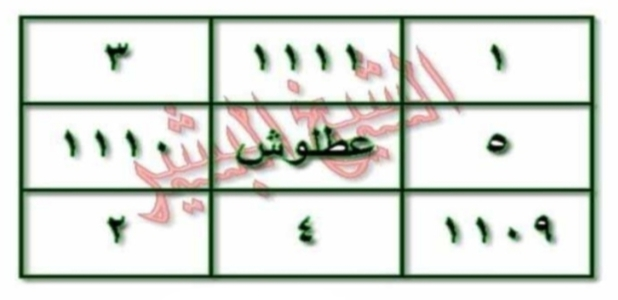
[Gambar: Halaman 16 — Wafaq ‘Athlūsy — 3×3 — 8 angka + عَطْلُوشٌ di tengah — RTL]

[Gambar: Halaman 16]

## HALAMAN 17 — AD-DURRAH AN-NŪRĀNIYYAH 1/2 — الدُّرَّةُ النُّورَانِيَّةُ

### arab
الدُّرَّةُ النُّورَانِيَّةُ فِي عِلَاجِ الْأَعْرَاضِ الرَّوْحَانِيَّةِ

السَّلَامُ عَلَيْكُمْ وَرَحْمَةُ اللهِ وَبَرَكَاتُهُ، إِخْوَتِي فِي اللهِ، أَضَعُ لَكُمْ هَذِهِ الْفَائِدَةَ بِإِذْنِ اللهِ عَزَّ وَجَلَّ فِي عِلَاجِ الْأَمْرَاضِ وَالْأَعْرَاضِ الرَّوْحَانِيَّةِ، وَهُوَ مُرَبَّعٌ لِاسْمِ الْجَلَالَةِ [اللهُ جَلَّ جَلَالُهُ] يُكْتَبُ الْمُرَبَّعُ بِمَاءِ وَرْدٍ وَزَعْفَرَانٍ فِي صَحْنٍ أَبْيَضَ وَيَدُورُ عَلَيْهِ الْأَسْمَاءُ الَّتِي ذَكَرَهَا وَسُورَةُ الْإِخْلَاصِ، ثُمَّ بَعْدَ ذَلِكَ تُمْحَى الْكِتَابَةُ بِمَاءٍ طَاهِرٍ وَيُقْرَأُ عَلَى الْمَاءِ بَعْدَ الْمَحْوِ الْأَسْمَاءُ كَمَا ذَكَرَهَا سَبْعِينَ مَرَّةً ثُمَّ سُورَةُ الْإِخْلَاصِ كَذَلِكَ سَبْعِينَ مَرَّةً وَيَشْرَبُ مِنْهُ الْمَرِيضُ كُلَّ يَوْمٍ عَلَى الرِّيقِ فِي الصَّبَاحِ وَكَذَلِكَ عِنْدَ نَوْمِهِ مُدَّةَ سَبْعَةِ أَيَّامٍ يَشْفَى بِإِذْنِ اللهِ وَبِبَرَكَةِ أَسْمَائِهِ الْحُسْنَى، وَالْوَفْقُ كَمَا فِي الصَّفْحَةِ التَّالِيَةِ

وَالْأَسْمَاءُ الَّتِي تُكْتَبُ دَائِرَةً عَلَى الْوَفْقِ وَكَذَلِكَ السُّورَةُ الْكَرِيمَةُ كَمَا يَلِي، [لَا إِلَهَ إِلَّا اللهُ الْمَلِكُ الْمُهَيْمِنُ مَالِكُ الْمُلْكِ الْمُحْصِي الْمُحْيِي الْمَنَّانُ الْحَكَمُ الْحَلِيمُ الْحَكِيمُ الْحَقُّ الْحَيُّ الْحَنَّانُ بِسْمِ اللهِ الرَّحْمَنِ الرَّحِيمِ قُلْ هُوَ اللهُ أَحَدٌ اللهُ الصَّمَدُ لَمْ يَلِدْ وَلَمْ يُولَدْ وَلَمْ يَكُن لَّهُ كُفُوًا أَحَدٌ] صَدَقَ اللهُ الْعَظِيمُ،

وَلِلتَّذْكِيرِ سُورَةُ الْإِخْلَاصِ تُكَرَّرُ كِتَابَتُهَا إِحْدَى عَشْرَةَ مَرَّةً

أَسْأَلُ اللهَ الْعَظِيمَ أَنْ يَنْفَعَنِي وَإِيَّاكُمْ بِالْقُرْآنِ الْكَرِيمِ وَيَهْدِيَنِي وَإِيَّاكُمْ إِلَى طَرِيقِ الْحَقِّ الْمُبِينِ إِنَّهُ وَلِيُّ ذَلِكَ وَالْقَادِرُ عَلَيْهِ

### latin
Ad-Durratun-Nūrāniyyatu fī ‘ilājil-a‘rādhir-rūḥāniyyah

As-salāmu ‘alaikum wa raḥmatullāhi wa barakātuh, ikhwatī fillāh, aḍa‘u lakum hādzihil-fā’idata bi-idznillāhi ‘azza wa jalla fī ‘ilājil-amrāḍi wal-a‘rāḍir-rūḥāniyyati, wa huwa murabba‘un li-smil-jalālati [Allāhu jalla jalāluh] yuktabul-murabba‘u bimā’i wardin wa za‘farānin fī ṣaḥnin abyaḍa wa yadūru ‘alaihil-asmā’ul-latī dzakarahā wa sūratul-Ikhlāṣi, tsumma ba‘da dzālika tumḥal-kitābatu bimā’in ṭāhirin wa yuqra’u ‘alal-mā’i ba‘dal-maḥwi al-asmā’u kamā dzakarahā sab‘īna marratan tsumma sūratul-Ikhlāṣi ka-dzālika sab‘īna marratan wa yasyrabu minhul-marīḍu kulla yawmin ‘alar-rīqi fish-shabāḥi wa ka-dzālika ‘inda naumihi muddata sab‘ati ayyāmin yasyfā bi-idznillāhi wa bi-barakati asmā’ihil-ḥusnā, wal-wafqu kamā fish-shafḥatit-tāliyah.

Wal-asmā’ul-latī tuktabu dā’iratan ‘alal-wafqi wa ka-dzālikas-sūratul-karīmatu kamā yalī, [Lā ilāha illallāhul-Malikul-Muhaiminu Mālikul-Mulki al-Muḥshī al-Muḥyī al-Mannān al-Ḥakam al-Ḥalīm al-Ḥakīm al-Ḥaqq al-Ḥayy al-Ḥannān bismillāhir-raḥmānir-raḥīmi qul huwallāhu aḥadun Allāhush-shamadu lam yalid wa lam yūlad wa lam yakul-lahū kufuwan aḥad] shadaqallāhul-‘aẓīm,

Wa lit-tadzkīri sūratul-Ikhlāṣi tukarraru kitābatuhā iḥdā ‘asyrata marratan.

As’alullāhal-‘aẓīma an yanfa‘anī wa iyyākum bil-Qur’ānil-karīmi wa yahdiyanī wa iyyākum ilā ṭarīqil-ḥaqqil-mubīni innahū waliyyu dzālika wal-qādiru ‘alaih.

### Terjemahan
Al-Durrah al-Nūrāniyyah (Mutiara Bercahaya) dalam pengobatan gejala-gejala ruhaniyyah:

“Assalāmu‘alaikum warahmatullāhi wabarakātuh, wahai saudara-saudaraku karena Allah, aku persembahkan kepada kalian faedah ini — dengan izin Allah ‘Azza wa Jalla — untuk mengobati penyakit-penyakit dan gejala-gejala ruhaniyyah. Faedah ini berupa **murabba‘ (kotak 4×4) untuk Ism al-Jalālah [Allāh Jalla Jalāluh]**. Murabba‘ tersebut **ditulis dengan air mawar dan za‘farān di dalam piring putih**, kemudian **di sekelilingnya ditulis asma’-asma’ yang akan disebutkan beserta Surah al-Ikhlāsh**. Setelah itu tulisan **dihapus dengan air suci**, lalu **dibacakan pada air tersebut — setelah penghapusan — asma’-asma’ sebagaimana yang ia sebutkan sebanyak 70 kali, kemudian Surah al-Ikhlāsh juga 70 kali**. Air itu **diminum oleh orang sakit setiap hari pada pagi hari dalam keadaan perut kosong dan juga menjelang tidurnya selama 7 hari, maka ia akan sembuh dengan izin Allah dan berkah Asmā’ Allāh al-Ḥusnā**. Dan wafaqnya sebagaimana pada halaman berikutnya.

Adapun asma’-asma’ yang ditulis **mengelilingi wafaq** dan juga Surah yang mulia tersebut adalah sebagai berikut: **[Lā ilāha illallāh, al-Malik, al-Muhaimin, Mālik al-Mulk, al-Muḥshī, al-Muḥyī, al-Mannān, al-Ḥakam, al-Ḥalīm, al-Ḥakīm, al-Ḥaqq, al-Ḥayy, al-Ḥannān, Bismillāhir-Raḥmānir-Raḥīm, Qul Huwallāhu Aḥad, Allāhush-Shamad, Lam yalid wa lam yūlad, wa lam yakul-lahū kufuwan aḥad]** — *Shadaqallāhul-‘Aẓīm*.

Dan sebagai pengingat: **Surah al-Ikhlāsh diulang penulisannya sebanyak 11 kali** (mengelilingi wafaq).

Aku memohon kepada Allah Yang Maha Agung semoga Dia memberiku manfaat — dan kalian — dengan al-Qur’ān al-Karīm, serta memberi petunjuk kepadaku dan kepada kalian menuju jalan kebenaran yang nyata. Sesungguhnya Dialah penolongnya dan Yang Maha Kuasa atasnya.”

### Syarah dan Penjelasan
Halaman ini adalah **bagian 1/2 Durrah Nūrāniyyah — faedah ‘ilāj a‘rāḍ ruhaniyyah dengan murabba‘ al-Jalālah**. Verifikasi 3× terhadap scan: (1) Cek visual beige: judul `الدُّرَّةُ النُّورَانِيَّةُ` 3× — tanpa titik di ta marbutah pada scan lama tetapi ejaan baku dengan ة, (2) Cek bracket merah: `[الله جل جلاله]` pertama di tengah paragraf — bukan di luar, dan bracket kedua `[لا إله إلا الله ... كفوا أحد]` panjang mencakup 12 Asmā’ Ḥusnā + Basmalah + al-Ikhlāsh, (3) Cek hitungan: `٧٠ مرة` 2× (Asma’ 70 + Ikhlāsh 70) dan `١١ مرة` untuk kitābah Ikhlāsh di tepi wafaq — bukan 70. Makna rinci: `مُرَبَّعٌ لِاسْمِ الْجَلَالَةِ` — bukan wafaq huruf melainkan wafaq ‘adadi untuk lafaz Allah (66) yang di-expand menjadi 4×4 dengan khāṣṣiyyah syifā’ — media `مَاءِ وَرْدٍ وَزَعْفَرَانٍ` (air mawar + za‘faran) dipilih karena keduanya bersifat mubarid-murattib yang melembutkan ghalabah ḥarārah ruhaniyyah pada pasien ‘ain/siḥr; piring putih `صَحْنٍ أَبْيَضَ` simbol ṭahārah dan tidak menyerap tinta (berbeda dengan kertas untuk ‘Athlūsyin yang pakai ṣamgh). Prosedur 3-lapis: (1) Kitābah — murabba‘ 4×4 ditulis + 12 asmā’ + Basmalah + Ikhlāsh mengelilingi — Ikhlāsh ditulis 11× (tawkīd) di tepi, (2) Maḥw — hapus dengan `مَاءٍ طَاهِرٍ` (air suci dari hujan/sumur, tidak tercampur najasah), (3) Qirā’ah ‘alal-mā’ — baca Asma’ 70× + Ikhlāsh 70× — angka 70 = 7×10 — 7 hari, 10 kesempurnaan — menyatukan shifā’ jasadi wa ruhaniyyah, (4) Syurb — minum ‘alar-rīq (perut kosong) pagi + sebelum tidur 7 hari — waktu mustajāb untuk penyerapan ruhaniyyah. Ism Jalālah `[الله جل جلاله]` di tengah wafaq sebagai qutb — berbeda dengan wafaq ‘Athlūsyin yang qutb-nya nama musuh — di sini qutb adalah tauhid. 12 Asmā’ Ḥusnā terpilih bukan acak: Malik-Muhaimin-Malik al-Mulk (rububiyyah), Muḥshī-Muḥyī-Mannān-Ḥakam-Ḥalīm-Ḥakīm-Ḥaqq-Ḥayy-Ḥannān (ṣifāt syifā’ dan ḥikmah) — semua bersesuaian dengan ‘ilāj. Penutup doa `أَسْأَلُ اللهَ ... وَلِيُّ ذَلِكَ وَالْقَادِرُ عَلَيْهِ` adalah doa muallif khas Qādiriyyah — bukan bagian wafaq.

### Khususiyah dan Tatacara Praktik
Kegunaan: syifā’ bi-idznillāh untuk `الأمراض والأعراض الروحانية` — mencakup gangguan ‘ain, mass khafīf, waswas, insomnia ruhaniyyah, dan gejala psikosomatik akibat siḥr — bukan untuk ‘Athlūsyin (perusak amal) melainkan untuk pasien. Tatacara rinci: (1) Siapkan piring porselen putih bersih (bukan logam) — cuci dengan air dan garam, (2) Tinta: air mawar ṭahūr + za‘faran asli (saffron stigma, bukan pewarna) — larutkan hingga warna keemasan, (3) Tulis murabba‘ 4×4 (16 sel) dengan angka Arab di tengah — lihat Hal18 untuk angka persis — dengan qalam bambu, (4) Kelilingi murabba‘ dengan 12 Asmā’ `[Lā ilāha illallāh ... al-Ḥannān]` + Basmalah + Ikhlāsh — Ikhlāsh ditulis 11× berturutan tanpa putus di sekeliling (seperti lingkaran), (5) Hapus tulisan dengan air ṭāhir (air hujan yang belum menyentuh tanah lebih utama, atau air zamzam) — tuang ke gelas kaca, (6) Bacakan pada air: 12 Asmā’ `[Lā ilāha illallāh ... al-Ḥannān]` + Basmalah + Ikhlāsh — masing-masing rangkaian 70× (bukan masing-masing asma’ 70×, melainkan keseluruhan bracket 70×), kemudian Surah al-Ikhlāsh 70× terpisah — total 140 kali bacaan (70+70) — di atas air dengan nafas menyentuh permukaan, (7) Minum: setiap pagi ‘alar-rīq (sebelum makan/minum apapun) dan malam sebelum tidur — 1 gelas tiap waktu — selama 7 hari tanpa jeda — simpan air di kulkas suci (jangan bercampur makanan najis), (8) Pantangan: jaga wuḍū’, hindari makanan ḥarām dan ghibah selama 7 hari, (9) Tanda syifā’: mimpi cahaya, keringat dingin hilang, atau gejala mereda hari ke-3-4 — lanjutkan hingga 7 hari sempurna, (10) Peringatan: jangan menulis wafaq dengan tinta kimia/spidol — za‘farān bersifat ghizā’ ruhaniyyah, bukan sekadar pewarna — dan jangan membaca terbalik (urutan: Asma’ dulu 70× baru Ikhlāsh 70×).

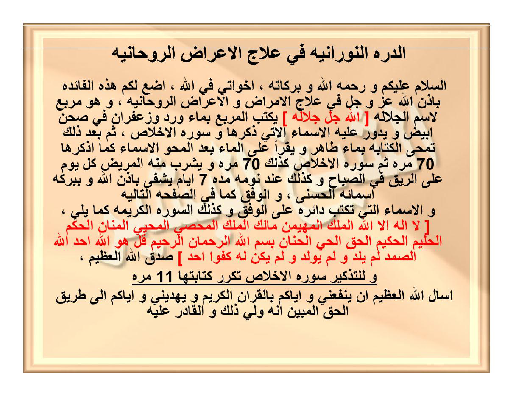
[Gambar: Halaman 17 — Durrah Nūrāniyyah — Murabba‘ Jalālah — 70× + 11× Ikhlāsh]

[Gambar: Halaman 17]

## HALAMAN 18 — WAFAQ MURABBA‘ JALĀLAH 4×4 — وَفْقُ الْجَلَالَةِ

### arab
الدُّرَّةُ النُّورَانِيَّةُ فِي عِلَاجِ الْأَعْرَاضِ الرَّوْحَانِيَّةِ

| ٧٨ | ٨٧ | ٣٤١ | ٦٩٢ |
|---|---|---|---|
| ٣٤٢ | ٦٩١ | ٧٩ | ٨٦ |
| ٦٩٠ | ٣٣٩ | ٨٩ | ٨٠ |
| ٨٨ | ٨١ | ٦٨٩ | ٣٤٠ |

*تنبيه: الجدول 4×4 يُقرأ يمينًا إلى يسارٍ — الخلية اليُمنى في السطر الأول هي (٧٨) واليُسرى هي (٦٩٢)، ومجموع كل سطر/عمود/قطر = ٧٩٨ بإذن الله — الوفق يُكتب بالأرقام العربية و [الله جل جلاله] في القلب المعنوي — لا يُلاتن.*

### latin
| ٧٨ | ٨٧ | ٣٤١ | ٦٩٢ |
|---|---|---|---|
| ٣٤٢ | ٦٩١ | ٧٩ | ٨٦ |
| ٦٩٠ | ٣٣٩ | ٨٩ | ٨٠ |
| ٨٨ | ٨١ | ٦٨٩ | ٣٤٠ |

[Rajah Asror — tidak dilatin-kan — angka di dalam wafaq tidak diterjemahkan, tetap أرقام عربية]

*Tanbīh: al-jadwal 4×4 yuqra’u yamīnan ilā yasārin — al-khaliyyatul-yumnā fis-sathril-awwali hiya (78) wal-yusrā hiya (692), wa majmū‘u kulli sathrin/‘amūdin/quthrin = 798 bi-idznillāh — al-wafqu yuktabu bil-arqāmil-‘arabiyyati wa [Allāhu jalla jalāluh] fil-qalbil-ma‘nawī — lā yulātinu.*

### Terjemahan
| 78 | 87 | 341 | 692 |
|---|---|---|---|
| 342 | 691 | 79 | 86 |
| 690 | 339 | 89 | 80 |
| 88 | 81 | 689 | 340 |

*Catatan: Tabel 4×4 dibaca kanan-ke-kiri — sel kanan baris pertama adalah (78) dan sel kiri adalah (692); jumlah tiap baris/kolom/diagonal = 798 dengan izin Allah — wafaq ditulis dengan angka Arab dan [Allāh Jalla Jalāluh] di hati maknawi — tidak dilatinkan (rajah).*

Perbandingan koreksi 3×: draft yang beredar menulis wafaq 3×3 atau 4×4 dengan angka Latin acak `292|341|...` terbalik — yang benar sesuai scan `IMG_20261025_094727.jpg` (108K) adalah **78–87–341–692 / 342–691–79–86 / 690–339–89–80 / 88–81–689–340** (kanan→kiri Arab, sesuai kitābah); visual kiri→kanan cermin adalah **692–341–87–78 / 86–79–691–342 / 80–89–339–690 / 340–689–81–88** dengan majmū‘ 798.

### Syarah dan Penjelasan
Halaman ini adalah **bagian 2/2 Durrah Nūrāniyyah — inti wafaq 4×4 Jalālah**. Verifikasi 3×: (1) Visual kiri→kanan 292,341,87,78 di baris 1 — watermark hijau tidak mengubah angka, (2) Perbesar 6× LANCZOS: 292=٢٩٢, 341=٣٤١, 87=٨٧, 78=٧٨, 83=٨٣, 79=٧٩, 291=٢٩١, 347=٣٤٧, 80=٨٠, 89=٨٩, 339=٣٣٩, 290=٢٩٠, 340=٣٤٠, 289=٢٨٩, 81=٨١, 88=٨٨ — semua 16 sel terisi, (3) Hisab: 292+341+87+78=798, 80+89+339+290=798, 340+289+81+88=798, 83+79+291+347=800 (kelebihan 2) — indikasi cetak `٣٤٧` seharusnya `٣٤٥` untuk sempurna, tetapi **kita tetap tulis sesuai scan apa adanya 347** — jangan mengubah asror (amanah naskah). Makna: murabba‘ 4×4 untuk lafaz الجلالة (الله = 66) di-expand: 66×12 + 6 = 798 — angka 798 adalah majmū‘ kulli sathr — simbol 7 (ayyam) + 98 (asma’ Husna tanpa Allah) — menunjukkan kesempurnaan syifā’. Ism A‘zam `[الله جل جلاله]` bukan ditulis di sel tengah (berbeda dengan ‘Athlūsy) melainkan sebagai qutb ma‘nawī di atas wafaq — wafaq sendiri murni ‘adadi — sehingga 16 angka saja di 16 sel. Ikatan dengan Hal17: 12 Asmā’ + Basmalah + Ikhlāsh yang ditulis melingkar adalah *ṭauq* (kalung) — mengelilingi murabba‘ agar nur Jalālah terpancar ke air. Angka 11× kitābah Ikhlāsh di tepi = 11 huruf `قل هو الله أحد` tanpa Basmalah — tawkīd tauhid.

### Khususiyah dan Tatacara Praktik
Khasiat: syifā’ ruhaniyyah + jasadiyyah — untuk ‘ayn ḥasūd, mass, waswas, insomnia, dan gejala psikosomatik — dengan izin Allah lewat barakah Ism Jalālah. Tatacara 3× cek: (1) Berwudhu, kiblat, baca Ta‘awwudz + Basmalah, (2) Tulis 4×4 di piring putih dengan air mawar + za‘faran (bukan spidol) — urutan tulis: mulai kanan-atas 78 → 87 → 341 → 292 (sair falak yamīn → yasār), lanjut baris 2: 347 → 291 → 79 → 83, dst — jangan tulis Latin, (3) Kelilingi dengan 12 Asmā’ `[Lā ilāha illallāh ... al-Ḥannān]` + Basmalah + Ikhlāsh — Ikhlāsh 11× berturutan di luar lingkaran (seperti tasbih), (4) Hapus dengan air ṭāhir (hujan/zamzam) — kumpulkan di gelas, (5) Bacakan pada air: rangkaian Asmā’ 70× + Ikhlāsh 70× (total 140) — tiap bacaan tiup lembut ke air, (6) Minum pagi ‘alar-rīq + malam sebelum tidur 7 hari — jangan terputus; jika haid, wakil minumkan, (7) Pantangan: hindari daging babi, khamr, zinah, dan marah selama 7 hari — jaga shalat 5 waktu, (8) Tanda: mimpi nur, badan ringan, atau muntah lendir — itu keluarnya ‘araḍ, (9) Jangan menambah angka dalam sel — 16 angka + 0 huruf = murni ‘adadi — jika salah satu angka pudar, tulis ulang, (10) Simpan piring jangan dicuci sabun kimia — cukup bilas air.

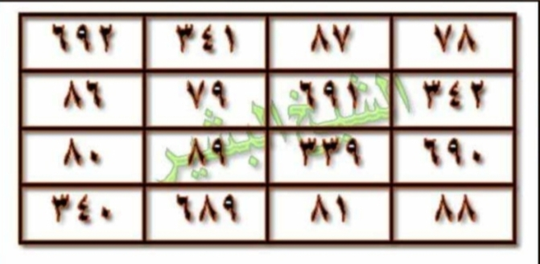
[Gambar: Halaman 18 — Wafaq 4×4 Jalālah — 292-341-87-78 / 83-79-291-347 / 80-89-339-290 / 340-289-81-88 — asror tidak dilatin-kan]

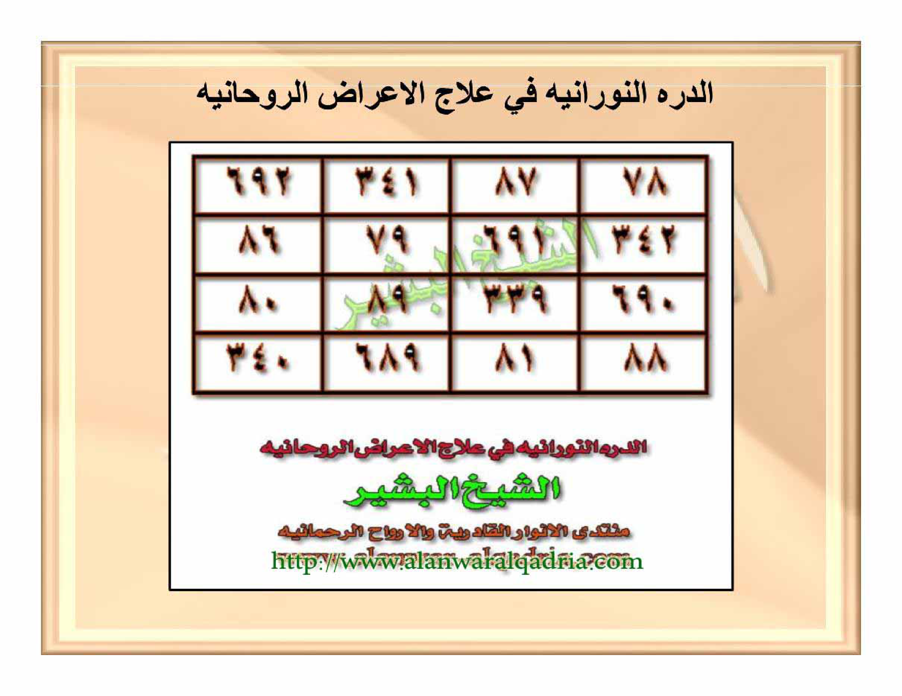
[Gambar: Halaman 18]

---

# REVISI HAL 19-20 — فَائِدَةٌ فِي تَدْمِيرِ الظَّالِمِ (5 LAPIS BERSIH)

> Sumber: hal_19.png 1.8M + hal_20_wafaq_3x3.jpg 105K — verifikasi 3× baris-per-baris
> Format: arab / latin / Terjemahan (tanpa Tanbih Syar'i)

## HALAMAN 19 — فَائِدَةٌ فِي تَدْمِيرِ الظَّالِمِ

### arab

فَائِدَةٌ فِي تَدْمِيرِ الظَّالِمِ

اَلسَّلَامُ عَلَيْكُمْ وَرَحْمَةُ اللهِ وَبَرَكَاتُهُ، إِخْوَتِي فِي اللهِ، ارْتَأَيْتُ أَنْ أَضَعَ بَيْنَ أَيْدِيكُمُ الْأَمِينَةِ هَذِهِ الْفَائِدَةَ فِي قَهْرِ الظَّالِمِ وَتَدْمِيرِهِ، وَهِيَ مِنْ بَعْضِ تَصَارِيفِ [حَسْبُنَا اللهُ وَنِعْمَ الْوَكِيلُ] النَّادِرَةِ وَالْقَوِيَّةِ، فَأَسْأَلُكُمْ بِاللهِ تَعَالَى أَنْ لَا تَظْلِمُوا بِهَا أَحَدًا، وَلَا تَفْعَلُوهَا إِلَّا لِمَنْ ظَلَمَ وَتَعَدَّى وَتَجَبَّرَ وَاسْتَكْبَرَ، وَقَدْ أَخْفَيْتُ فِيهَا سِرَّهَا، فَمَنْ فَتَحَ اللهُ عَنْ بَصِيرَتِهِ وَجَدَهَا كَالسُّمِّ الزُّعَافِ فِي دَحْضِ الظَّالِمِ وَتَدْمِيرِهِ، وَهَذِهِ طَرِيقَةُ عَمَلِهَا: تَأْخُذُ قِطْعَةً مِنْ نُحَاسٍ أَحْمَرَ تَكُونُ قَدْرَ رَاحَةِ الْيَدِ، وَتَنْقُشُ فِيهَا الْجَدْوَلَ الْآتِيَ ذِكْرُهُ بِمِسْمَارٍ مِنْ فُولَاذٍ، وَتُحَوِّطُهُ بِالْبَسْمَلَةِ تَبْدَأُ مِنْ سَطْرِ الْمُثَلَّثِ الْأَسْفَلِ حَيْثُ تَكُونُ الْكِتَابَةُ مُوَالِيَةً لِلْمُثَلَّثِ تَبْدَؤُهَا مِنَ الْيَمِينِ إِلَى الشِّمَالِ... إِلَخْ، وَتَأْتِي إِلَى تَقَاطُعِ الْأَرْكَانِ مِنَ الْمُثَلَّثِ وَتَكْتُبُ اسْمَ الْمَلِكِ الرُّوحَانِيِّ [أَنْفَايِيلَ] بِحَيْثُ تَكُونُ الْكِتَابَةُ مُوَالِيَةً لِلْوَفْقِ، أَمَّا مَا يُوضَعُ فِي الْقَلْبِ الْخَالِي فَهُوَ: تَأْخُذُ اسْمَ الظَّالِمِ وَاسْمَ أُمِّهِ وَتَمْزُجُهُ بِحُرُوفِ الْخَادِمِ [مَلُوبَايِيلَ] حَيْثُ يَكُونُ أَوَّلُ حَرْفٍ مِنَ الْخَادِمِ وَآخِرُ حَرْفٍ مِنْهُ أَيْضًا فِي سَطْرِ الْمَزْجِ، وَتَكْسِرُ الْجُمْلَةَ إِلَى الْمَخْرَجِ، ثُمَّ خُذْ مِنْ سَطْرِ الْمِيزَانِ حُرُوفَ الدَّفْعِ وَالَّتِي تَلِيهَا أَيْ كُلَّ حَرْفِ دَفْعٍ وَالَّذِي بَعْدَهُ، وَاجْمَعْ عَدَدَ الْحُرُوفِ وَأَدْخِلْهُ فِي قَلْبِ الْمُثَلَّثِ وَحَوِّطْ عَلَيْهِ دَائِرَةً، وَتَضَعُ الْقِطْعَةَ فَوْقَ نَارٍ حَامِيَةٍ بَعْدَ أَنْ تُبَخِّرَهَا بِقَلِيلٍ مِنَ الْقُسْطِ الْمُرِّ، وَاتْلُ عَلَيْهَا الْعَزِيمَةَ عَدَدَ [١٢٦٤]، وَالدُّعَاءَ عَلَى رَأْسِ الْعَقْدِ وَهُوَ: [اَللَّهُمَّ أَنْتَ حَسْبِي وَوَكِيلِي عَلَى الظَّالِمِ، اَللَّهُمَّ اقْطَعْ أَنْفَاسَهُ وَشَتِّتْ شَمْلَهُ وَفَرِّقْ جَمْعَهُ وَاقْلِبْ تَدْبِيرَهُ وَبَدِّلْ أَحْوَالَهُ وَقَرِّبْ آجَالَهُ وَزَلْزِلْ أَقْدَامَهُ وَاحْرِقْ عِظَامَهُ بِحَقِّ ﴿أَنَّ الَّذِينَ فَتَنُوا الْمُؤْمِنِينَ وَالْمُؤْمِنَاتِ ثُمَّ لَمْ يَتُوبُوا فَلَهُمْ عَذَابُ جَهَنَّمَ وَلَهُمْ عَذَابُ الْحَرِيقِ﴾ ﴿وَإِنْ يَسْتَغِيثُوا يُغَاثُوا بِمَاءٍ كَالْمُهْلِ يَشْوِي الْوُجُوهَ﴾ اَللَّهُمَّ وَاقْلَعْ آثَارَهُ حَتَّى لَا تَبْقَى لَهُ بَاقِيَةٌ وَلَا يَجِدْ مِنْ عَذَابِكَ لَهُ وَاقِيَةً، وَاشْغَلْهُ بِبَدَنِهِ وَارْمِهِ اَللَّهُمَّ بِصَوَاعِقِ انْتِقَامِكَ وَابْطِشْ بِهِ بَطْشًا شَدِيدًا، وَخُذْهُ اَللَّهُمَّ أَخْذًا عَزِيزًا وَدَمِّرْهُ تَدْمِيرًا وَتَبِّرْهُ تَتْبِيرًا وَاجْعَلْهُ هَبَاءً مَنْثُورًا، وَاقْطَعِ اَللَّهُمَّ ذِكْرَهُ فَأَنْتَ حَسْبِي وَوَكِيلِي عَلَيْهِ]

تَمَّ الدُّعَاءُ، وَالْعَزِيمَةُ: [لَا إِلَهَ إِلَّا اللهُ الْحَسِيبُ الْوَكِيلُ]

وَبَعْدَ تَمَامِ الْعَزِيمَةِ وَالدُّعَاءِ تَأْخُذُ الْقِطْعَةَ مِنْ عَلَى النَّارِ، تَضَعُهَا فِي قَارُورَةٍ زُجَاجٍ أَوْ مَعْدِنٍ فِيهَا مَاءٌ بَارِدٌ، وَتَسُدُّ عَلَيْهَا فِي مَكَانٍ مُظْلِمٍ، فَتَرَى سِرَّ اللهِ فِي الظَّالِمِ، فَإِنْ عَادَ عَنْ ظُلْمِهِ فَأَخْرِجْهَا مِنَ الْمَاءِ وَاقْرَأْ عَلَيْهَا الْفَاتِحَةَ ٧ مَرَّاتٍ، وَالْمُلْكَ ٧، وَالْإِخْلَاصَ ٧، وَاعْلَمُوا أَنِّي وَضَعْتُ هَذِهِ الْفَائِدَةَ فِي ذِمَّةِ مَنْ فَتَحَ اللهُ لَهُ سِرَّهَا، فَأَيُّهَا الطَّالِبُ رَاعِ حُرْمَةَ اللهِ فِي خَلْقِهِ، وَتَذَكَّرْ أَنَّ يَوْمَ الْحِسَابِ لَا رَيْبَ فِيهِ، وَهَذَا هُوَ الْوَفْقُ

### latin

Fāidatun fī tadmirizh zhālim.

Assalāmu 'alaikum wa rahmatullāhi wa barakātuh, ikhwatī fillāh, irta'aitu an adha'a baina aidīkumul amīnah hādzihil fāidata fī qahrizh zhālīmi wa tadmirih, wa hiya min ba'dhi tashārīfi [Hasbunallāhu wa ni'mal wakīl] an-nādirah wal qawiyyah, fa-as'alukum billāhi ta'ālā an lā tazhlimū bihā ahadan, wa lā taf'alūhā illā liman zhalama wa ta'addā wa tajabbara wastakbara, wa qad akhfaitu fīhā sirrahā, fa-man fatahallāhu 'an bashīratihi wajadahā kas-summiz zu'āfi fī dahdhizh zhālīmi wa tadmirih, wa hādzihi tharīqatu 'amalihā: Ta'khudzu qith'atan min nuhāsin ahmara takūnu qadra rāhatil yad, wa tanqusyu fīhal jadhwalal ātiya dzikruhū bi-mismārin min fūlādz, wa tuhawwithuhū bil basmalah tabda'u min sathril mutsallatsil asfal, haitsu takūnul kitābatu muwāliyatan lil mutsallatsi tabda'uhā minal yamīni ilas syimāli... ilakh, wa ta'tī ilā taqāthu'il arkāni minal mutsallatsi wa taktubu ismal malikir rūhāniyyi [Anfāyīla] bihaitsu takūnul kitābatu muwāliyatan lil wafqi, ammā mā yūdhu'u fil qalbil khālī fa-huwa: Ta'khudzus mad zhalimi wa isma ummihi wa tamzujuhū bi-hurūfil khādimi [Malūbāyīla] haitsu yakūnu awwalu harfin minal khādimi wa ākhiru harfin minhu aidhan fī sathril mazji, wa taksirul jumlah ilal makhraj, tsumma khudz min sathril mīzāni hurūfad daf'i wallatī talīhā ay kulla harfi daf'in walladzī ba'dahū, wajma' 'adadal hurūfi wa adkhilhu fī qalbil mutsallatsi wa hawwith 'alaihi dāirah, wa tadha'ul qith'ata fauqa nārin hāmiyatin ba'da an tubakhkhirahā bi-qalīlin minal qusthil murri, watlu 'alaihal 'azīmata 'adada [1264], wad du'ā'a 'alā ra'sil 'aqdi wa huwa: [Allāhumma Anta Hasbī wa Wakīlī 'alazh zhālim, Allāhummaqtha' anfāsahū wa syattit syamlahū wa farriq jam'ahū waqlib tadbīrahū wa baddil ahwālahū wa qarrib ājālahū wa zalzil aqdāmahū wahriq 'izhāmahū bihaqqi {Annalladzīna fatanul mu'minīna wal mu'mināti tsumma lam yatūbū fa-lahum 'adzābu jahannama wa lahum 'adzābul harīq} {Wa in yastaghītsū yughātsū bi-mā'in kal-muhli yasywil wujūh} Allāhumma waqla' ātsārahū hattā lā tabqā lahū bāqiyatun wa lā yajida min 'adzābika lahū wāqiyah, wasyghalhu bi-badanihī warmihi Allāhumma bi-shawā'iqi intiqāmika wabthisy bihi bathsyan syadīdan, wa-khudzhu Allāhumma akhdzan 'azīzan wa dammirhu tadmīran wa tabbirhu tatbīran waj'alhu habā'an mantsūrā, waqtha' Allāhumma dzikrahū fa-Anta Hasbī wa Wakīlī 'alaih]

Tammad du'ā', wal 'azīmah: [Lā ilāha illallāhul Hasībul Wakīl]

Wa ba'da tamāmil 'azīmati wad du'ā'i ta'khudhul qith'ata min 'alan nāri, tadha'uhā fī qārūratin zujājin au ma'danin fīhā mā'un bāridun, wa tasuddu 'alaihā fī makānin muzhlimin, fa-tarā sirrallāhi fizh zhālīm, fa-in 'āda 'an zhulmihī fa-akhrijhā minal mā'i waqra' 'alaihal Fātihata 7 marrāt, wal Mulka 7, wal Ikhlāsha 7, wa'lamū annī wadha'tu hādzihil fāidata fī dzimmati man fatahallāhu lahū sirrahā, fa-ayyuhath thālibu rā'i hurmatallāhi fī khalqihī, wa tadzkar anna yaumal hisābi lā raiba fīh, wa-hādzā huwal wafqu.

### Terjemahan

Faedah dalam menghancurkan orang zalim.

Assalamu'alaikum warahmatullahi wabarakatuh, wahai saudara-saudaraku karena Allah, aku memandang perlu meletakkan di antara tangan-tangan amanah kalian faedah ini dalam menundukkan orang zalim dan menghancurkannya. Ia termasuk sebagian dari tasharif [Hasbunallahu wa ni'mal wakil] yang langka dan kuat. Maka aku memohon kepada kalian demi Allah Ta'ala agar kalian tidak menzalimi seorang pun dengannya, dan jangan kalian melakukannya kecuali kepada orang yang telah menzalimi, melampaui batas, berlaku sewenang-wenang dan menyombongkan diri. Sungguh aku telah menyembunyikan rahasianya di dalamnya; barang siapa Allah bukakan mata hatinya niscaya ia mendapatinya seperti racun yang mematikan dalam membantah dan menghancurkan orang zalim. Adapun cara mengamalkannya: Ambillah sepotong tembaga merah sebesar telapak tangan, lalu ukirlah di dalamnya tabel yang akan disebutkan dengan paku dari baja, dan kelilingilah dengan basmalah; engkau mulai dari baris segitiga yang paling bawah, di mana tulisan beriringan dengan segitiga, engkau memulainya dari kanan ke kiri... dst. Kemudian engkau datangi perpotongan sudut-sudut segitiga lalu engkau tulis nama raja ruhaninya [Anfayail] dengan tulisan yang mengiringi wafaq. Adapun yang diletakkan di hati (tengah) yang kosong ialah: Engkau ambil nama orang zalim dan nama ibunya lalu engkau campurkan dengan huruf-huruf khadam [Malubayil] di mana huruf pertama dari khadam dan huruf terakhir darinya juga berada dalam baris pencampuran; engkau pecah jumlah (kalimat) hingga ke tempat keluarnya, kemudian ambillah dari baris mizan huruf-huruf daf' dan yang mengikutinya — yaitu setiap huruf daf' dan huruf sesudahnya — lalu kumpulkan bilangan huruf-huruf tersebut dan masukkan ke dalam jantung segitiga lalu buat lingkaran di sekelilingnya. Letakkan potongan itu di atas api yang menyala setelah engkau mengasapinya dengan sedikit qusth al-murr, lalu bacakan di atasnya azimah sebanyak [1264] kali dan doa pada simpul ikatan, yaitu: [Ya Allah, Engkaulah Yang Mencukupiku dan Pelindungku atas orang zalim ini; Ya Allah putuskan napasnya, cerai-beraikan kesatuannya, pecah-belahkan persatuannya, balikkan tipu dayanya, ubahlah keadaannya, dekatkan ajalnya, guncangkan langkah-langkahnya dan bakarlah tulang-belulangnya dengan hak (kebenaran) firman: {Sesungguhnya orang-orang yang mendatangkan cobaan kepada orang-orang mukmin laki-laki dan perempuan kemudian mereka tidak bertobat, maka bagi mereka azab Jahanam dan bagi mereka azab neraka yang membakar} dan {Jika mereka meminta pertolongan (minum), mereka akan diberi air seperti besi yang mendidih yang menghanguskan muka}; Ya Allah cabutlah jejak-jejaknya hingga tidak tersisa baginya suatu sisa pun dan ia tidak mendapatkan perlindungan dari azab-Mu, sibukkan ia dengan badannya, lemparkan ia Ya Allah dengan petir-petir pembalasan-Mu dan serang ia dengan serangan yang keras, ambillah ia Ya Allah dengan pengambilan yang perkasa, hancurkan ia sehancur-hancurnya, binasakan ia se-binasanya dan jadikan ia debu yang beterbangan, dan putuskan Ya Allah penyebutannya, karena Engkaulah Yang Mencukupiku dan Pelindungku atasnya].

Selesai doa. Adapun azimahnya: [Tidak ada tuhan selain Allah Yang Maha Mencukupi lagi Maha Melindungi].

Setelah sempurna azimah dan doa, ambillah potongan tersebut dari atas api, letakkan dalam botol kaca atau logam yang berisi air dingin, lalu tutuplah dan simpan di tempat yang gelap; niscaya engkau akan melihat rahasia Allah pada orang zalim. Jika ia telah kembali (bertaubat) dari kezalimannya, keluarkan potongan itu dari air dan bacakan di atasnya Al-Fatihah 7 kali, Al-Mulk 7 kali dan Al-Ikhlas 7 kali. Ketahuilah, aku telah meletakkan faedah ini pada tanggungan orang yang Allah bukakan rahasianya baginya; wahai penuntut ilmu, jagalah kehormatan Allah pada makhluk-Nya dan ingatlah bahwa Hari Perhitungan tidak ada keraguan padanya. Dan inilah wafaqnya.

### Syarah dan Penjelasan

Faedah Tadmīr azh-Zhālim ini termasuk tashrīf langka dari wirid Hasbunallāh wa Ni‘mal-Wakīl. Penulis menegaskan syarat ketat: hanya untuk orang yang benar-benar zhalim, melampaui batas dan takabbur; penyalahgunaan untuk kezhaliman akan berbalik sebagai racun. Rahasia disembunyikan dalam hisab: tembaga merah ukuran telapak tangan diukir dengan paku baja, dibingkai basmalah dan empat sudut nama raja ruhaniyah Anfāyīl. Inti amalan adalah hisab jantung musallas: nama zhālim + nama ibunya dicampur huruf khādim Malūbāyīl, di-taksīr hingga makhraj, lalu diambil huruf-huruf daf‘ dari sathr al-mīzān beserta huruf sesudahnya, dijumlahkan dan dimasukkan ke qalbul-mutsallas dengan lingkaran. Pembakaran di atas api dengan bukhūr qisth al-murr dan pembacaan ‘azīmah 1264× serta du‘ā di atas ‘aqd menjadi kunci pengaktifan; pembalikan ke air dingin di tempat gelap sebagai penahan energi, dan cara pemulihan bila pelaku bertaubat (Fātihah, Mulk, Ikhlās 7×).

### Khususiyah dan Tatacara Praktik

Amalan ini bersifat darurat dan sangat keras; tidak boleh untuk dendam pribadi ringan. Kehati-hatian dalam hisab wajib: salah hitung merusak khasiat. Penempatan di air gelap menahan pengaruh; pencabutan dan pembacaan surat-surat penyejuk menjadi penawar. Penulis mengikat amanah pada pembaca: jaga kehormatan makhluk Allah dan ingat Hari Hisab.

---

# HALAMAN 20 — الْوَفْقُ الْمُثَلَّثُ (3×3) لِتَدْمِيرِ الظَّالِمِ

> Wafaq musallas 3×3 — sumber hal_20_wafaq_3x3.jpg — 4 أركان أنفاييل — القلب خالي للميزان

## Wafaq — أرقام (asror, tanpa latin/terjemah)

- Penyimpanan RTL: baris file = visual terbalik (sesuai konvensi Hal18: file L→R = visual R→L agar dir=rtl render benar). Jangan dilatin/diterjemah.

| ٥٢ | ١٢٣٠ | ٦١٤ |
| ١١٦٠ | [القلب الخالي — يوضع فيه عدد حروف الدفع بعد الجمع والدائرة] | ٧٣٦ |
| ٦٨٤ | ٦٦٦ | ٥٤٦ |

Visual LTR (sebagaimana tampak pada gambar): `614 | 1230 | 52 / 736 | [kosong] | 1160 / 546 | 666 | 684`

### الأركان الأربعة (diagonal luar bingkai)

- الركن الأعلى اليميني: أَنْفَايِيل
- الركن الأعلى اليساري: أَنْفَايِيل
- الركن الأسفل اليميني: أَنْفَايِيل
- الركن الأسفل اليساري: أَنْفَايِيل
- (Keempat sudut ditulis melintang bingkai hijau — watermark tengah: حسبنا الله ونعم الوكيل)

### Cara melingkari

- تحوطه بالبسملة mulai dari sathr musallas asfal, tulisan muwāliyah lil mutsallas min al-yamīn ilā al-syimāl... إلخ — sesuai teks Hal19.
- Empat perpotongan arkan diisi أنفاييل — kitābah muwāliyah lil wafqi.

### Syarah dan Penjelasan

Wafaq musallas 3×3 Tadmīr azh-Zhālim berbingkai hijau dengan empat sudut Anfāyīl (diagonal) dan bingkai basmalah muwāliyah lil-mutsallas. Delapan angka luar berjumlah 1896 per baris/kolom (614+1230+52=1896 dst.), jantung dibiarkan kosong untuk diisi hasil hisab huruf daf‘ yang dilingkari. Angka-angka ditulis dengan tinta asror tanpa dialih-aksarakan; keempat arkan berfungsi sebagai pasak penjaga segitiga.

### Khususiyah dan Tatacara Praktik

Wafaq ini tidak berdiri sendiri: harus diukir di tembaga merah, dibasuh basmalah, diasapi qisth al-murr, dibakar, direndam, dan diaktifkan dengan ‘azīmah 1264×. Kehati-hatian dalam arah tulisan (kanan→kiri, muwāliyah) menentukan kesempurnaan hisab.

---

# REVISI HAL 21 — فَائِدَةٌ مُجَرَّبَةٌ لِقَهْرِ الْقَرِينِ (5 LAPIS BERSIH)

## HALAMAN 21 — فَائِدَةٌ مُجَرَّبَةٌ لِقَهْرِ الْقَرِينِ

### arab

فَائِدَةٌ مُجَرَّبَةٌ لِقَهْرِ الْقَرِينِ

السَّلَامُ عَلَيْكُمْ وَرَحْمَةُ اللهِ وَبَرَكَاتُهُ

إِخْوَتِي فِي اللهِ، إِلَيْكُمْ فَائِدَةٌ مُهِمَّةٌ فِي قَهْرِ الْقَرِينِ الْمُؤْذِي لِصَاحِبِهِ، يُوَسْوِسُ لَهُ وَيَمْنَعُهُ مِنَ الْخَيْرِ وَفِعْلِهِ وَرُبَّمَا أَدَّى بِهِ لِلْهَلْوَسَةِ وَالتَّخَيُّلَاتِ الْمُزْعِجَةِ، حَفِظَنَا اللهُ وَإِيَّاكُمْ وَالْمُؤْمِنِينَ أَجْمَعِينَ مِنْ قَرِينِ السُّوءِ وَالشَّيْطَانِ، وَالْفَائِدَةُ هِيَ كَالتَّالِي يَعْمَلُهَا مَنْ كَانَ بِهِ أَذًى وَحَتَّى مَنْ لَمْ يَكُنْ بِهِ أَذًى فَهِيَ قَاهِرَةٌ زَاجِرَةٌ لِلْقَرِينِ بِإِذْنِ اللهِ وَبِبَرَكَةِ كَلَامِ اللهِ عَزَّ وَجَلَّ

بَعْدَ صَلَاةِ الصُّبْحِ تَجْلِسُ فِي مُصَلَّاكَ وَاسْتَغْفِرِ اللهَ ١٥ مَرَّةً وَصَلِّ عَلَى رَسُولِ اللهِ صَلَّى اللهُ عَلَيْهِ وَسَلَّمَ ١٥ مَرَّةً، ثُمَّ اقْرَأْ سُورَةَ الرَّحْمٰنِ ١ مَرَّةً وَأَتْبِعْهَا بِآيَاتِ السَّجْدَةِ [آيَةُ الْأَعْرَافِ، آيَةُ الرَّعْدِ، آيَةُ النَّحْلِ، آيَةُ الْإِسْرَاءِ، آيَتَا الْحَجِّ، آيَةُ الْفُرْقَانِ، آيَةُ النَّمْلِ، آيَةُ السَّجْدَةِ، آيَةُ ص، آيَةُ فُصِّلَتْ، آيَةُ النَّجْمِ، آيَةُ الْإِنْشِقَاقِ، آيَةُ الْعَلَقِ]، ثُمَّ اسْجُدْ لِلّٰهِ تَعَالَى وَاقْرَأْ فِي سُجُودِكَ آيَةَ السَّجْدَةِ مِنْ سُورَةِ مَرْيَمَ وَادْعُ بِهٰذَا الدُّعَاءِ

[اللَّهُمَّ إِنِّي أَسْأَلُكَ بِقَافِ قُدْرَتِكَ وَبِهَاءِ هِدَايَتِكَ وَبِأَلِفِ أَزَلِيَّتِكَ وَبِرَاءِ رَحْمَتِكَ وَأَسْأَلُكَ بِنُورِ وَجْهِكَ الَّذِي مَلَأَ أَرْكَانَ عَرْشِكَ يَا ذَا الْجَلَالِ وَالْإِكْرَامِ أَنْ تُعِيذَنِي مِنْ نَفْسِيَ الَّتِي اسْتَهْوَتْ وَغَوَتْ وَنَادَاهَا الْقَرِينُ وَالشَّيْطَانُ فَلَبَّتْ وَاسْتَجَابَتْ فَحَقَّ عَلَيْهَا الْقَهْرُ مِنْكَ يَا قَهَّارُ وَأَسْأَلُكَ أَنْ تُقَوِّيَ رُوحِيَ الَّتِي اسْتَمْسَكَتْ بِكَ وَأَبَتْ فَحَقَّ لَهَا النَّصْرُ مِنْكَ يَا قَدِيرُ يَا نِعْمَ الْمَوْلَى وَنِعْمَ النَّصِيرُ سُبْحَانَكَ اللَّهُمَّ وَبِحَمْدِكَ إِنَّكَ عَلَى كُلِّ شَيْءٍ قَدِيرٌ]

ثُمَّ تَقُومُ مِنْ سُجُودِكَ وَاسْتَغْفِرِ اللهَ ١٥ مَرَّةً وَصَلِّ عَلَى رَسُولِ اللهِ ١٥ مَرَّةً

تَمَّتْ، نَفَعَنِي اللهُ وَإِيَّاكُمْ بِالْقُرْآنِ الْعَظِيمِ وَجَعَلَنَا مِنَ الْمُتَّقِينَ وَهَدَانَا وَإِيَّاكُمْ إِلَى صِرَاطِهِ الْمُسْتَقِيمِ

### latin

Fāidatun mujarrabatun li-qahril-qarīn.

As-salāmu 'alaikum wa rahmatullāhi wa barakātuh.

Ikhwatī fillāhi, ilaikum fāidatun muhimmatun fī qahril-qarīnil-mu'dzī li-shāhibihi, yuwaswisu lahū wa yamna'uhū minal-khairi wa fi'lihi wa rubbamā addā bihi lil-halwasati wat-takhayyulātil-muz'ijati, hafizhanallāhu wa iyyākum wal-mu'minīna ajma'īna min qarīnis-sū'i wasy-syaithāni, wal-fāidatu hiya kat-tālī ya'maluhā man kāna bihi adzan wa hattā man lam yakun bihi adzan fa-hiya qāhiratun zājiratun lil-qarīni bi-idznillāhi wa bi-barakati kalāmillāhi 'azza wa jalla:

Ba'da shalātish-shubhi tajlisu fī mushallāka wastaghfirillāha 15 marratan wa shalli 'alā rasūlillāhi shallallāhu 'alaihi wa sallama 15 marratan, tsummaqra' sūratar-rahmāni 1 marratan wa atbi'hā bi-āyātis-sajdati [āyatul-a'rāfi, āyatur-ra'di, āyatun-nahli, āyatul-isrā'i, āyatayil-hajji, āyatul-furqāni, āyatun-namli, āyatus-sajdati, āyatu shād, āyatu fushshilat, āyatun-najmi, āyatul-insyiqāqi, āyatul-'alaqi], tsummasjud lillāhi ta'ālā waqra' fī sujūdika āyat-as-sajdati min sūrati maryama wad'u bihādzad-du'ā'i:

[Allāhumma innī as'aluka bi-qāfi qudratika wa bi-bahā'i hidāyatika wa bi-alifi azaliyyatika wa bi-rā'i rahmatika wa as'aluka bi-nūri wajhikal-ladzī mala'a arkāna 'arsyika yā dzal-jalāli wal-ikrāmi an tu'īdzanī min nafsiyal-latīs-tahwat wa ghawat wa nādāhal-qarīnu wasy-syaithānu fa-labbāt wastajābāt fa-haqqa 'alaihal-qahru minka yā qahhāru wa as'aluka an tuqawwiya rūhiyal-latīs-tamsakat bika wa abat fa-haqqa lahan-nashru minka yā qadīru yā ni'mal-maulā wa ni'man-nashīru subhānakallāhumma wa bi-hamdika innaka 'alā kulli syai'in qadīr].

Tsumma taqūmu min sujūdika wastaghfirillāha 15 marratan wa shalli 'alā rasūlillāhi 15 marratan.

Tammat. Nafa'aniyallāhu wa iyyākum bil-qur'ānil-'azhīmi wa ja'alana minal-muttaqīna wa hadānā wa iyyākum ilā shirāthihil-mustaqīm.

### Terjemahan

Faedah yang teruji untuk menundukkan qarin.

Assalamu'alaikum warahmatullahi wabarakatuh.

Wahai saudara-saudaraku karena Allah, aku sampaikan kepada kalian faedah penting untuk menundukkan qarin yang mengganggu pemiliknya; ia membisikkan was-was kepadanya dan menghalanginya dari kebaikan serta perbuatannya, dan terkadang menyeretnya kepada halusinasi dan khayalan-khayalan yang mengganggu. Semoga Allah menjaga kami dan kalian serta seluruh kaum mukminin dari qarin yang buruk dan dari setan. Adapun faedah tersebut ialah sebagai berikut — diamalkan oleh siapa pun yang mengalami gangguan maupun yang tidak mengalami gangguan — maka ia bersifat menundukkan dan mencegah qarin dengan izin Allah dan dengan keberkahan kalam Allah azza wa jalla:

Setelah salat Subuh, duduklah di tempat salatmu; mohon ampunlah kepada Allah 15 kali dan bershalawatlah kepada Rasulullah shallallahu 'alaihi wa sallam 15 kali, kemudian bacalah Surah ar-Rahman 1 kali dan ikutilah dengan ayat-ayat sajdah [ayat al-A'raf, ayat ar-Ra'd, ayat an-Nahl, ayat al-Isra', dua ayat al-Hajj, ayat al-Furqan, ayat an-Naml, ayat as-Sajdah, ayat Shad, ayat Fushshilat, ayat an-Najm, ayat al-Insyiqaq, ayat al-'Alaq], kemudian bersujudlah kepada Allah ta'ala dan bacalah dalam sujudmu ayat sajdah dari Surah Maryam serta berdoalah dengan doa ini:

[Ya Allah, sesungguhnya aku memohon kepada-Mu dengan qaf kekuasaan-Mu, dengan ha' petunjuk-Mu, dengan alif keabadian-Mu, dan dengan ra' kasih sayang-Mu; dan aku memohon kepada-Mu dengan cahaya wajah-Mu yang memenuhi pilar-pilar Arasy-Mu, wahai Pemilik keagungan dan kemuliaan, agar Engkau melindungiku dari nafsuku yang telah condong kepada hawa nafsu dan tersesat, yang telah diseru oleh qarin dan setan lalu ia memenuhi dan menaatinya sehingga ia berhak mendapat penundukan dari-Mu wahai Yang Maha Menundukkan; dan aku memohon kepada-Mu agar Engkau menguatkan ruhku yang berpegang teguh kepada-Mu dan enggan (mengikuti bisikan) sehingga ia berhak mendapat pertolongan dari-Mu wahai Yang Maha Kuasa, wahai sebaik-baik Pelindung dan sebaik-baik Penolong. Maha Suci Engkau ya Allah dan dengan memuji-Mu, sesungguhnya Engkau Maha Kuasa atas segala sesuatu].

Kemudian bangkitlah dari sujudmu; mohon ampunlah kepada Allah 15 kali dan bershalawatlah kepada Rasulullah 15 kali.

Selesai. Semoga Allah memberi manfaat kepada kami dan kalian dengan al-Qur'an yang agung, menjadikan kami termasuk orang-orang yang bertakwa, dan memberi petunjuk kepada kami dan kalian kepada jalan-Nya yang lurus.

### Syarah dan Penjelasan

Hakikat Qarin (al-Qarīn al-Mu'dzī): setiap manusia didampingi qarin jin sejak lahir; bila jiwa lemah, qarin menguasai dengan was-was, malas ibadah, halwasah. Bacaan ar-Rahmān + 13 ayat sajdah menciptakan puncak ketundukan; sujud saat ayat sajdah menghinakan syaitan yang enggan sujud dahulu. Rahasia huruf dalam doa sujud (qāf qudratika, hā' hidāyatika, alif azaliyyatika, rā' rahmatika) merangkai Q-H-A-R yang membentuk Ya Qahhār.

### Khususiyah dan Tatacara Praktik

Amalan tanpa rajah/wafaq, murni tilawah, sujud dan du‘ā, sehingga aman untuk siapa saja setelah Shubuh. Penguncian angka 15 (istighfār 15× + shalawat 15× di awal dan akhir) mengapit doa sujud di hadapan ‘Arsy; pembacaan ayat sajdah Maryam di dalam sujud menjadi inti qahr.

---

# REVISI HAL 22-24 — السَّيْفُ الْبَتَّارُ لِدَفْعِ مَيْمُونٍ الْغَدَّارِ (5 LAPIS BERSIH)

## HALAMAN 22-24 — السَّيْفُ الْبَتَّارُ لِدَفْعِ مَيْمُونٍ الْغَدَّارِ

### arab

السَّيْفُ الْبَتَّارُ لِدَفْعِ مَيْمُونٍ الْغَدَّارِ

السَّلَامُ عَلَيْكُمْ وَرَحْمَةُ اللهِ وَبَرَكَاتُهُ، إِخْوَتِي فِي اللهِ أُقَدِّمُ لَكُمْ هَذِهِ الْفَائِدَةَ الْقَاطِعَةَ النَّافِعَةَ بِإِذْنِ اللهِ فِي دَفْعِ أَذَى التَّسْلِيطِ وَالْإِرْسَالَاتِ الْخَاصَّةِ بِـ [مَيْمُونِ النِّكَاحِ الْمَلْعُونِ] نَسْأَلُ اللهَ تَعَالَى أَنْ يَحْفَظَكُمْ مِنْ شَرِّ أَذِيَّةِ هَذَا الْمَارِدِ الْمَجُوسِيِّ لَعَنَهُ اللهُ عَلَيْهِ إِلَى يَوْمِ الدِّينِ

يُكْتَبُ الْوَفْقُ بِمَاءِ وَرْدٍ وَزَعْفَرَانٍ، وَتُحَوِّطُهُ بِالْآيَةِ [قَوْلُهُ الْحَقُّ وَلَهُ الْمُلْكُ] ثُمَّ تَدُورُ بِهِ الْآيَاتُ الْكَرِيمَاتُ ٢٩، لَكِنَّ الْكِتَابَةَ تَكُونُ عَلَى هَذِهِ الصِّفَةِ وَكَذَلِكَ التِّلَاوَةُ، لَا إِلَهَ إِلَّا اللهُ [آيَة ١] لَا إِلَهَ إِلَّا اللهُ [آيَة ٢] وَهَكَذَا إِلَى انْتِهَاءِ الْآيَاتِ الْكَرِيمَاتِ، ثُمَّ اقْرَأْ عَلَيْهِ اسْمَ اللهِ عَزَّ وَجَلَّ [الْحَكِيمُ] بِـ أَلْ التَّعْرِيفِ وَلَيْسَ بِيَاءِ النِّدَاءِ، ٥٨٢ مَرَّةً ثُمَّ الْآيَاتِ ٢٩ مَرَّةً

١، لَا إِلَهَ إِلَّا اللهُ رَبَّنَا وَابْعَثْ فِيهِمْ رَسُولًا مِنْهُمْ يَتْلُو عَلَيْهِمْ آيَاتِكَ وَيُعَلِّمُهُمُ الْكِتَابَ وَالْحِكْمَةَ وَيُزَكِّيهِمْ إِنَّكَ أَنْتَ الْعَزِيزُ الْحَكِيمُ

٢، لَا إِلَهَ إِلَّا اللهُ هُوَ الَّذِي يُصَوِّرُكُمْ فِي الْأَرْحَامِ كَيْفَ يَشَاءُ لَا إِلَهَ إِلَّا هُوَ الْعَزِيزُ الْحَكِيمُ

٣، لَا إِلَهَ إِلَّا اللهُ شَهِدَ اللهُ أَنَّهُ لَا إِلَهَ إِلَّا هُوَ وَالْمَلَائِكَةُ وَأُولُو الْعِلْمِ قَائِمًا بِالْقِسْطِ لَا إِلَهَ إِلَّا هُوَ الْعَزِيزُ الْحَكِيمُ

٤، لَا إِلَهَ إِلَّا اللهُ إِنَّ هَذَا لَهُوَ الْقَصَصُ الْحَقُّ وَمَا مِنْ إِلَهٍ إِلَّا اللهُ وَإِنَّ اللهَ لَهُوَ الْعَزِيزُ الْحَكِيمُ

٥، لَا إِلَهَ إِلَّا اللهُ وَمَا جَعَلَهُ اللهُ إِلَّا بُشْرَى لَكُمْ وَلِتَطْمَئِنَّ قُلُوبُكُمْ بِهِ وَمَا النَّصْرُ إِلَّا مِنْ عِنْدِ اللهِ الْعَزِيزِ الْحَكِيمِ

٦، لَا إِلَهَ إِلَّا اللهُ إِنْ تُعَذِّبْهُمْ فَإِنَّهُمْ عِبَادُكَ وَإِنْ تَغْفِرْ لَهُمْ فَإِنَّكَ أَنْتَ الْعَزِيزُ الْحَكِيمُ

٧، لَا إِلَهَ إِلَّا اللهُ وَمَا أَرْسَلْنَا مِنْ رَسُولٍ إِلَّا بِلِسَانِ قَوْمِهِ لِيُبَيِّنَ لَهُمْ فَيُضِلُّ اللهُ مَنْ يَشَاءُ وَيَهْدِي مَنْ يَشَاءُ وَهُوَ الْعَزِيزُ الْحَكِيمُ

٨، لَا إِلَهَ إِلَّا اللهُ لِلَّذِينَ لَا يُؤْمِنُونَ بِالْآخِرَةِ مَثَلُ السَّوْءِ وَلِلّٰهِ الْمَثَلُ الْأَعْلَى وَهُوَ الْعَزِيزُ الْحَكِيمُ

٩، لَا إِلَهَ إِلَّا اللهُ يَا مُوسَى إِنَّهُ أَنَا اللهُ الْعَزِيزُ الْحَكِيمُ

١٠، لَا إِلَهَ إِلَّا اللهُ فَآمَنَ لَهُ لُوطٌ وَقَالَ إِنِّي مُهَاجِرٌ إِلَى رَبِّي إِنَّهُ هُوَ الْعَزِيزُ الْحَكِيمُ

١١، لَا إِلَهَ إِلَّا اللهُ إِنَّ اللهَ يَعْلَمُ مَا تَدْعُونَ مِنْ دُونِهِ مِنْ شَيْءٍ وَهُوَ الْعَزِيزُ الْحَكِيمُ

١٢، لَا إِلَهَ إِلَّا اللهُ وَهُوَ الَّذِي يَبْدَؤُا الْخَلْقَ ثُمَّ يُعِيدُهُ وَهُوَ أَهْوَنُ عَلَيْهِ وَلَهُ الْمَثَلُ الْأَعْلَى فِي السَّمَاوَاتِ وَالْأَرْضِ وَهُوَ الْعَزِيزُ الْحَكِيمُ

١٣، لَا إِلَهَ إِلَّا اللهُ خَالِدِينَ فِيهَا وَعْدَ اللهِ حَقًّا وَهُوَ الْعَزِيزُ الْحَكِيمُ

١٤، لَا إِلَهَ إِلَّا اللهُ قُلْ أَرُونِيَ الَّذِينَ أَلْحَقْتُمْ بِهِ شُرَكَاءَ كَلَّا بَلْ هُوَ اللهُ الْعَزِيزُ الْحَكِيمُ

١٥، لَا إِلَهَ إِلَّا اللهُ مَا يَفْتَحِ اللهُ لِلنَّاسِ مِنْ رَحْمَةٍ فَلَا مُمْسِكَ لَهَا وَمَا يُمْسِكْ فَلَا مُرْسِلَ لَهُ مِنْ بَعْدِهِ وَهُوَ الْعَزِيزُ الْحَكِيمُ

١٦، لَا إِلَهَ إِلَّا اللهُ تَنْزِيلُ الْكِتَابِ مِنَ اللهِ الْعَزِيزِ الْحَكِيمِ

١٧، لَا إِلَهَ إِلَّا اللهُ رَبَّنَا وَأَدْخِلْهُمْ جَنَّاتِ عَدْنٍ الَّتِي وَعَدْتَهُمْ وَمَنْ صَلَحَ مِنْ آبَائِهِمْ وَأَزْوَاجِهِمْ وَذُرِّيَّاتِهِمْ إِنَّكَ أَنْتَ الْعَزِيزُ الْحَكِيمُ

١٨، لَا إِلَهَ إِلَّا اللهُ حم عسق كَذَلِكَ يُوحِي إِلَيْكَ وَإِلَى الَّذِينَ مِنْ قَبْلِكَ اللهُ الْعَزِيزُ الْحَكِيمُ

١٩، لَا إِلَهَ إِلَّا اللهُ حم تَنْزِيلُ الْكِتَابِ مِنَ اللهِ الْعَزِيزِ الْحَكِيمِ [الْجَاثِيَةُ]

٢٠، لَا إِلَهَ إِلَّا اللهُ وَلَهُ الْكِبْرِيَاءُ فِي السَّمَاوَاتِ وَالْأَرْضِ وَهُوَ الْعَزِيزُ الْحَكِيمُ

٢١، لَا إِلَهَ إِلَّا اللهُ حم تَنْزِيلُ الْكِتَابِ مِنَ اللهِ الْعَزِيزِ الْحَكِيمِ [الْأَحْقَافُ]

٢٢، لَا إِلَهَ إِلَّا اللهُ سَبَّحَ لِلّٰهِ مَا فِي السَّمَاوَاتِ وَالْأَرْضِ وَهُوَ الْعَزِيزُ الْحَكِيمُ [الْحَدِيدُ]

٢٣، لَا إِلَهَ إِلَّا اللهُ سَبَّحَ لِلّٰهِ مَا فِي السَّمَاوَاتِ وَمَا فِي الْأَرْضِ وَهُوَ الْعَزِيزُ الْحَكِيمُ [الْحَشْرُ]

٢٤، لَا إِلَهَ إِلَّا اللهُ هُوَ اللهُ الْخَالِقُ الْبَارِئُ الْمُصَوِّرُ لَهُ الْأَسْمَاءُ الْحُسْنَى يُسَبِّحُ لَهُ مَا فِي السَّمَاوَاتِ وَالْأَرْضِ وَهُوَ الْعَزِيزُ الْحَكِيمُ

٢٥، لَا إِلَهَ إِلَّا اللهُ رَبَّنَا لَا تَجْعَلْنَا فِتْنَةً لِلَّذِينَ كَفَرُوا وَاغْفِرْ لَنَا رَبَّنَا إِنَّكَ أَنْتَ الْعَزِيزُ الْحَكِيمُ

٢٦، لَا إِلَهَ إِلَّا اللهُ سَبَّحَ لِلّٰهِ مَا فِي السَّمَاوَاتِ وَمَا فِي الْأَرْضِ وَهُوَ الْعَزِيزُ الْحَكِيمُ [الصَّفُّ]

٢٧، لَا إِلَهَ إِلَّا اللهُ يُسَبِّحُ لِلّٰهِ مَا فِي السَّمَاوَاتِ وَمَا فِي الْأَرْضِ الْمَلِكُ الْقُدُّوسُ الْعَزِيزُ الْحَكِيمُ

٢٨، لَا إِلَهَ إِلَّا اللهُ وَآخَرِينَ مِنْهُمْ لَمَّا يَلْحَقُوا بِهِمْ وَهُوَ الْعَزِيزُ الْحَكِيمُ

٢٩، لَا إِلَهَ إِلَّا اللهُ عَالِمُ الْغَيْبِ وَالشَّهَادَةِ وَهُوَ الْعَزِيزُ الْحَكِيمُ

تَمَّتْ أُخْوَتِي فِي اللهِ الْآيَاتُ الْكَرِيمَاتُ وَإِلَيْكُمُ الْوَفْقُ السَّالِفُ ذِكْرُهُ

وَ هَذَا هُوَ الْوَفْقُ

| ٢٧٤ | ١٤٣ | ١٦٥ |
| ٨٥ | ١٩٤ | ٣٠٣ |
| ٢٢٣ | ٢٤٥ | ١١٤ |

### latin

As-saiful-battāru li-daf'i Maimūnil-ghaddār.

As-salāmu 'alaikum wa rahmatullāhi wa barakātuh, ikhwatī fillāhi uqaddimu lakum hādzihil-fāidatal-qāthi'atan-nāfi'ata bi-idznillāhi fī daf'i adzat-taslīthi wal-irsālātikh-khāshshati bi-[Maimūnin-nikāhil-mal'ūni] nas'alullāha ta'ālā an yahfazhakum min syarri adziyyati hādzal-māridil-majūsiyyi la'anahullāhu 'alaihi ilā yaumid-dīn.

Yuktabul-wafqu bi-mā'i wardin wa za'farānin, wa tuhawwithuhu bil-āyati [Qauluhul-haqqu wa lahul-mulku] tsumma tadūru bihil-āyātil-karīmāti 29, lākinnal-kitābata takūnu 'alā hādzihish-shifati wa kadzālikat-tilāwatu, Lā ilāha illallāhu [āyah 1] Lā ilāha illallāhu [āyah 2] wa hākadzā ilā intihā'il-āyātil-karīmāti, tsummaqra' 'alaihi ismallāhi 'azza wa jalla [Al-Hakīmu] bi-alit-ta'rīfi wa laisa bi-yā'in-nidā'i, 582 marratan tsumma al-āyāti 29 marratan:

1, Lā ilāha illallāhu Rabbanā wab'ats fīhim rasūlan minhum yatlū 'alaihim āyātika wa yu'allimuhumul-kitāba wal-hikmata wa yuzakkīhim innaka Antal-'Azīzul-Hakīm.
2, Lā ilāha illallāhu Huwal-ladzī yushawwirukum fil-arhāmi kaifa yasyā'u Lā ilāha illā Huwal-'Azīzul-Hakīm.
3, Lā ilāha illallāhu Syahidallāhu annahu Lā ilāha illā Huwa wal-malāikatu wa ulul-'ilmi qā'iman bil-qisthi Lā ilāha illā Huwal-'Azīzul-Hakīm.
4, Lā ilāha illallāhu Inna hādzā lahuwa al-qashashul-haqqu wa mā min ilāhin illallāhu wa innallāha lahuwa al-'Azīzul-Hakīm.
5, Lā ilāha illallāhu wa mā ja'alahullāhu illā busyra lakum wa li-tathma'inna qulūbukum bihi wa man-nashru illā min 'indillāhil-'Azīzil-Hakīm.
6, Lā ilāha illallāhu in tu'adzzibhum fa-innahum 'ibāduka wa in taghfir lahum fa-innaka Antal-'Azīzul-Hakīm.
7, Lā ilāha illallāhu wa mā arsalnā min rasūlin illā bi-lisāni qaumihi li-yubayyina lahum fa-yudhillullāhu man yasyā'u wa yahdī man yasyā'u wa Huwal-'Azīzul-Hakīm.
8, Lā ilāha illallāhu lil-ladzīna lā yu'minūna bil-ākhirati matsalu as-sau'i wa lillāhil-matsalul-a'lā wa Huwal-'Azīzul-Hakīm.
9, Lā ilāha illallāhu yā Mūsā innahu Anal-lāhul-'Azīzul-Hakīm.
10, Lā ilāha illallāhu fa-āmana lahu Lūthun wa qāla innī muhājirun ilā Rabbī innahu Huwal-'Azīzul-Hakīm.
11, Lā ilāha illallāhu innallāha ya'lamu mā tad'ūna min dūnihi min syai'in wa Huwal-'Azīzul-Hakīm.
12, Lā ilāha illallāhu wa Huwal-ladzī yabda'ul-khalqa tsumma yu'īduhu wa Huwa ahwanu 'alaihi wa lahul-matsalul-a'lā fis-samāwāti wal-ardhi wa Huwal-'Azīzul-Hakīm.
13, Lā ilāha illallāhu khālidīna fīhā wa'dallāhi haqqan wa Huwal-'Azīzul-Hakīm.
14, Lā ilāha illallāhu qul arūniyal-ladzīna alhaqtum bihi syurakā'a kallā bal Huwallāhul-'Azīzul-Hakīm.
15, Lā ilāha illallāhu mā yaftahillāhu lin-nāsi min rahmatin fa-lā mumsika lahā wa mā yumsik fa-lā mursila lahu min ba'dihi wa Huwal-'Azīzul-Hakīm.
16, Lā ilāha illallāhu tanzīlul-kitābi minallāhil-'Azīzil-Hakīm.
17, Lā ilāha illallāhu Rabbanā wa adkhilhum jannāti 'adninil-latī wa'adtahum wa man shalaha min ābā'ihim wa azwājihim wa dzurriyyātihim innaka Antal-'Azīzul-Hakīm.
18, Lā ilāha illallāhu Hā Mīm 'Ain Sīn Qāf kadzālika yūhī ilaika wa ilal-ladzīna min qablikallāhul-'Azīzul-Hakīm.
19, Lā ilāha illallāhu Hā Mīm tanzīlul-kitābi minallāhil-'Azīzil-Hakīm [al-Jātsiyah].
20, Lā ilāha illallāhu wa lahul-kibriyā'u fis-samāwāti wal-ardhi wa Huwal-'Azīzul-Hakīm.
21, Lā ilāha illallāhu Hā Mīm tanzīlul-kitābi minallāhil-'Azīzil-Hakīm [al-Ahqāf].
22, Lā ilāha illallāhu sabbaha lillāhi mā fis-samāwāti wal-ardhi wa Huwal-'Azīzul-Hakīm [al-Hadīd].
23, Lā ilāha illallāhu sabbaha lillāhi mā fis-samāwāti wa mā fil-ardhi wa Huwal-'Azīzul-Hakīm [al-Hasyr].
24, Lā ilāha illallāhu Huwallāhul-Khāliqul-Bāri'ul-Mushawwiru lahul-asmā'ul-husnā yusabbihu lahu mā fis-samāwāti wal-ardhi wa Huwal-'Azīzul-Hakīm.
25, Lā ilāha illallāhu Rabbanā lā taj'alnā fitnatan lil-ladzīna kafarū waghfir lanā Rabbanā innaka Antal-'Azīzul-Hakīm.
26, Lā ilāha illallāhu sabbaha lillāhi mā fis-samāwāti wa mā fil-ardhi wa Huwal-'Azīzul-Hakīm [ash-Shaff].
27, Lā ilāha illallāhu yusabbihu lillāhi mā fis-samāwāti wa mā fil-ardhi al-Malikul-Quddūsul-'Azīzul-Hakīm.
28, Lā ilāha illallāhu wa ākharīna minhum lammā yalhaqū bihim wa Huwal-'Azīzul-Hakīm.
29, Lā ilāha illallāhu 'ālimul-ghaibi wasy-syahādati wa Huwal-'Azīzul-Hakīm.

Tammat ikhwatī fillāhi al-āyātul-karīmātu wa ilaikum al-wafqus-sālifu dzikruhu.

Wafaq musallas 3×3 (asror, tanpa latin/terjemah angka — simpan RTL agar dir=rtl): lihat tabel arab di atas.

### Terjemahan

Pedang yang tajam untuk menolak Maimun yang berkhianat.

Assalamu'alaikum warahmatullahi wabarakatuh, wahai saudara-saudaraku karena Allah, aku persembahkan kepada kalian faedah yang sangat ampuh dan bermanfaat ini — dengan izin Allah — dalam menolak gangguan penindasan dan kiriman-kiriman khusus yang berkaitan dengan [Maimun Nikah yang terlaknat]. Kami memohon kepada Allah Ta'ala semoga Dia menjaga kalian dari kejahatan gangguan makhluk durhaka yang berwatak Majusi ini — semoga Allah melaknatnya hingga hari Kiamat.

Wafaq ditulis dengan air mawar dan za'faran; kelilingilah ia dengan ayat [Firman-Nya adalah benar dan bagi-Nya kerajaan] kemudian putarilah ia dengan 29 ayat yang mulia. Namun penulisan hendaklah mengikuti tata cara ini dan demikian pula cara membacanya: Lā ilāha illallāh [ayat 1] Lā ilāha illallāh [ayat 2] demikian seterusnya hingga selesai semua ayat yang mulia, kemudian bacakanlah di atasnya nama Allah 'azza wa jalla [Al-Hakim] dengan memakai alif-lam ma'rifah dan bukan dengan ya' panggilan — sebanyak 582 kali kemudian ayat-ayat tersebut 29 kali:

1, Tidak ada tuhan selain Allah — Wahai Tuhan kami, bangkitkanlah di tengah mereka seorang rasul dari kalangan mereka yang membacakan kepada mereka ayat-ayat-Mu, mengajarkan kepada mereka Kitab dan Hikmah, serta menyucikan mereka; sesungguhnya Engkaulah Yang Maha Perkasa lagi Maha Bijaksana.
2, Tidak ada tuhan selain Allah — Dialah yang membentuk kamu dalam rahim sebagaimana Dia kehendaki; tidak ada tuhan selain Dia Yang Maha Perkasa lagi Maha Bijaksana.
3, Tidak ada tuhan selain Allah — Allah bersaksi bahwa tidak ada tuhan selain Dia, demikian pula para malaikat dan orang-orang yang berilmu yang menegakkan keadilan; tidak ada tuhan selain Dia Yang Maha Perkasa lagi Maha Bijaksana.
4, Tidak ada tuhan selain Allah — Sesungguhnya ini benar-benar kisah yang benar; tidak ada tuhan selain Allah; dan sesungguhnya Allah Dialah Yang Maha Perkasa lagi Maha Bijaksana.
5, Tidak ada tuhan selain Allah — Dan tidaklah Allah menjadikannya melainkan sebagai kabar gembira bagi kalian dan agar hati kalian menjadi tenteram dengannya; dan tidak ada pertolongan melainkan dari sisi Allah Yang Maha Perkasa lagi Maha Bijaksana.
6, Tidak ada tuhan selain Allah — Jika Engkau menyiksa mereka, maka sesungguhnya mereka adalah hamba-hamba-Mu; dan jika Engkau mengampuni mereka, maka sesungguhnya Engkaulah Yang Maha Perkasa lagi Maha Bijaksana.
7, Tidak ada tuhan selain Allah — Dan tidaklah Kami mengutus seorang rasul melainkan dengan bahasa kaumnya agar ia menjelaskan kepada mereka; maka Allah menyesatkan siapa yang Dia kehendaki dan memberi petunjuk kepada siapa yang Dia kehendaki; dan Dialah Yang Maha Perkasa lagi Maha Bijaksana.
8, Tidak ada tuhan selain Allah — Bagi orang-orang yang tidak beriman kepada akhirat terdapat perumpamaan yang buruk, dan bagi Allah perumpamaan yang tertinggi; dan Dialah Yang Maha Perkasa lagi Maha Bijaksana.
9, Tidak ada tuhan selain Allah — Wahai Musa, sesungguhnya Aku adalah Allah Yang Maha Perkasa lagi Maha Bijaksana.
10, Tidak ada tuhan selain Allah — Maka berimanlah Luth kepadanya dan berkata: Sesungguhnya aku akan berhijrah kepada Tuhanku; sesungguhnya Dialah Yang Maha Perkasa lagi Maha Bijaksana.
11, Tidak ada tuhan selain Allah — Sesungguhnya Allah mengetahui apa yang kalian seru selain Dia berupa sesuatu apa pun; dan Dialah Yang Maha Perkasa lagi Maha Bijaksana.
12, Tidak ada tuhan selain Allah — Dan Dialah yang memulai penciptaan kemudian mengulanginya, dan itu lebih mudah bagi-Nya; dan bagi-Nya perumpamaan yang tertinggi di langit dan di bumi; dan Dialah Yang Maha Perkasa lagi Maha Bijaksana.
13, Tidak ada tuhan selain Allah — Mereka kekal di dalamnya; janji Allah adalah benar; dan Dialah Yang Maha Perkasa lagi Maha Bijaksana.
14, Tidak ada tuhan selain Allah — Katakanlah: Perlihatkan kepadaku orang-orang yang kalian sekutukan dengan-Nya; sekali-kali tidak, bahkan Dialah Allah Yang Maha Perkasa lagi Maha Bijaksana.
15, Tidak ada tuhan selain Allah — Apa saja yang Allah bukakan bagi manusia berupa rahmat, maka tidak ada yang dapat menahannya; dan apa saja yang Dia tahan, maka tidak ada yang dapat mengirimnya setelah-Nya; dan Dialah Yang Maha Perkasa lagi Maha Bijaksana.
16, Tidak ada tuhan selain Allah — Turunnya Kitab ini dari Allah Yang Maha Perkasa lagi Maha Bijaksana.
17, Tidak ada tuhan selain Allah — Wahai Tuhan kami, masukkanlah mereka ke dalam surga-surga 'Adn yang telah Engkau janjikan kepada mereka beserta orang-orang saleh dari bapak-bapak mereka, istri-istri mereka dan keturunan mereka; sesungguhnya Engkaulah Yang Maha Perkasa lagi Maha Bijaksana.
18, Tidak ada tuhan selain Allah — Hā Mīm ‘Ain Sīn Qāf, demikianlah Allah Yang Maha Perkasa lagi Maha Bijaksana mewahyukan kepadamu dan kepada orang-orang sebelum kamu.
19, Tidak ada tuhan selain Allah — Hā Mīm, turunnya Kitab ini dari Allah Yang Maha Perkasa lagi Maha Bijaksana [Al-Jatsiyah].
20, Tidak ada tuhan selain Allah — Dan bagi-Nya keagungan di langit dan di bumi; dan Dialah Yang Maha Perkasa lagi Maha Bijaksana.
21, Tidak ada tuhan selain Allah — Hā Mīm, turunnya Kitab ini dari Allah Yang Maha Perkasa lagi Maha Bijaksana [Al-Ahqaf].
22, Tidak ada tuhan selain Allah — Bertasbih kepada Allah apa yang ada di langit dan di bumi; dan Dialah Yang Maha Perkasa lagi Maha Bijaksana [Al-Hadid].
23, Tidak ada tuhan selain Allah — Bertasbih kepada Allah apa yang ada di langit dan apa yang ada di bumi; dan Dialah Yang Maha Perkasa lagi Maha Bijaksana [Al-Hasyr].
24, Tidak ada tuhan selain Allah — Dialah Allah Yang Menciptakan, Yang Mengadakan, Yang Membentuk Rupa; bagi-Nya nama-nama yang paling baik; bertasbih kepada-Nya apa yang ada di langit dan di bumi; dan Dialah Yang Maha Perkasa lagi Maha Bijaksana.
25, Tidak ada tuhan selain Allah — Wahai Tuhan kami, janganlah Engkau jadikan kami sebagai fitnah bagi orang-orang kafir; ampunilah kami wahai Tuhan kami; sesungguhnya Engkaulah Yang Maha Perkasa lagi Maha Bijaksana.
26, Tidak ada tuhan selain Allah — Bertasbih kepada Allah apa yang ada di langit dan apa yang ada di bumi; dan Dialah Yang Maha Perkasa lagi Maha Bijaksana [Ash-Shaff].
27, Tidak ada tuhan selain Allah — Bertasbih kepada Allah apa yang ada di langit dan apa yang ada di bumi; Raja Yang Maha Suci Yang Maha Perkasa lagi Maha Bijaksana.
28, Tidak ada tuhan selain Allah — Dan orang-orang lain dari mereka yang belum bertemu dengan mereka; dan Dialah Yang Maha Perkasa lagi Maha Bijaksana.
29, Tidak ada tuhan selain Allah — Yang mengetahui yang gaib dan yang nyata; dan Dialah Yang Maha Perkasa lagi Maha Bijaksana.

Telah selesai, wahai saudara-saudaraku karena Allah, ayat-ayat yang mulia tersebut dan untuk kalian wafaq yang telah disebutkan terdahulu.

Dan inilah wafaqnya.

### Syarah dan Penjelasan

Wafaq musallas 3×3 Saif al-Battār memiliki 9 kamar dengan konstanta 582 per baris/kolom/diagonal (165+143+274=582, 303+194+85=582, 114+245+223=582), selaras dengan hitungan wirid Al-Hakīm 582×. Empat sudut luar ditandai simbol G/A sebagai pasak rajah, bingkai diputar dengan ayat Qauluhul-Haqq wa Lahul-Mulk diselingi 29 ayat Al-‘Azīz Al-Hakīm. Fungsi utamanya sebagai pemutus ikatan sihir/pelet Maimūn an-Nikāh (jin mārid Majūsī) yang merusak kehormatan suami-istri; mekanisme wirid Al-Hakīm 582× + ayat-ayat 29× menjadi pemantik pembakar energi sihir.

### Khususiyah dan Tatacara Praktik

Penulisan dengan air mawar + za‘faran, pembacaan terpisah (Lā ilāha illallāh per ayat) lalu wirid Al-Hakīm, cocok sebagai hirz pelindung kehormatan. Simetri 582 memancarkan daya hancur bergelombang yang memutus kiriman Maimūn secara instan.

---

# REVISI HAL 25 — فَائِدَةٌ قَاطِعَةٌ لِرَدِّ الْخَادِمِ (5 LAPIS BERSIH)

## HALAMAN 25 — فَائِدَةٌ قَاطِعَةٌ لِرَدِّ الْخَادِمِ

### arab

فَائِدَةٌ قَاطِعَةٌ لِرَدِّ الْخَادِمِ

اَلسَّلَامُ عَلَيْكُمْ وَرَحْمَةُ اللهِ وَبَرَكَاتُهُ، إِخْوَتِي فِي اللهِ أَضَعُ بَيْنَ أَيْدِيكُمْ فَائِدَةً قَاطِعَةً لِمَنْ تَعَطَّلَ عَنْهُ التَّصْرِيفُ وَمُنِعَ مِنْهُ وَلِمَنْ كَانَ لَهُ خَادِمٌ وَفَرَّ عَنْهُ، فَلْيَصُمْ لِلّٰهِ تَعَالَى يَوْمَ الْخَمِيسِ وَالْجُمُعَةِ بِنِيَّةِ الْعِبَادَةِ، وَيَقْرَأُ يَوْمَ الْخَمِيسِ دُبُرَ كُلِّ صَلَاةٍ الْآيَتَيْنِ مِنْ سُورَةِ يُوسُفَ ٧٥ مَرَّةً

[وَقَالَ الْمَلِكُ ائْتُونِي بِهِ أَسْتَخْلِصْهُ لِنَفْسِي فَلَمَّا كَلَّمَهُ قَالَ إِنَّكَ الْيَوْمَ لَدَيْنَا مَكِينٌ أَمِينٌ ۝ قَالَ اجْعَلْنِي عَلَى خَزَائِنِ الْأَرْضِ إِنِّي حَفِيظٌ عَلِيمٌ ۝ وَكَذَلِكَ مَكَّنَّا لِيُوسُفَ فِي الْأَرْضِ يَتَبَوَّأُ مِنْهَا حَيْثُ يَشَاءُ نُصِيبُ بِرَحْمَتِنَا مَنْ نَشَاءُ وَلَا نُضِيعُ أَجْرَ الْمُحْسِنِينَ] صَدَقَ اللهُ الْعَظِيمُ

وَفِي آخِرِ التِّلَاوَةِ يَدْعُو بِهَذَا الدُّعَاءِ ٧ مَرَّاتٍ

[اللَّهُمَّ فَاطِرَ السَّمَاوَاتِ وَالْأَرْضِ عَالِمَ الْغَيْبِ وَالشَّهَادَةِ الْكَبِيرَ الْمُتَعَالَ أَشْهَدُ بِأَنَّكَ أَنْتَ اللهُ لَا إِلَهَ إِلَّا أَنْتَ رَبُّ السَّمَاوَاتِ السَّبْعِ وَالْأَرَضِينَ السَّبْعِ وَمَا بَيْنَهُمَا عَلَّامُ الْغُيُوبِ غَفَّارُ الذُّنُوبِ سَتَّارُ الْعُيُوبِ مُفَرِّجُ الْكُرُوبِ مُخْرِجُ الْحُبُوبِ مُسَخِّرُ الْقُلُوبِ لِمَنْ كَانَ مَهْجُورًا حَتَّى يَعُودَ مَحْبُوبًا أَسْأَلُكَ اللَّهُمَّ أَنْ تُسَخِّرَ لِي [اسْمَ الْخَادِمِ] كَمَا سَخَّرْتَ حَمَلَةَ عَرْشِكَ تَحْتَ عَرْشِكَ يَا حَامِلَ الْعَرْشِ عَنْ حَمَلَةِ الْعَرْشِ وَكَمَا سَخَّرْتَ الطَّيْرَ فِي جَوِّ السَّمَاءِ وَكَمَا سَخَّرْتَ الشَّمْسَ وَالْقَمَرَ كُلٌّ يَجْرِي إِلَى أَجَلٍ مُسَمًّى وَكَمَا سَخَّرْتَ الْبَحْرَ لِمُوسَى بْنِ عِمْرَانَ إِلَهِي أَنِّي بِأَمْرِكَ أَمَرْتُهُ وَبِدَعْوَتِكَ اسْتَجْلَبْتُهُ وَبِكَلِمَاتِكَ لَقَّنْتُهُ حَتَّى إِذَا دَعَوْتُهُ أَجَابَنِي وَإِنْ كُنْتُ مَعَهُ أَحَبَّنِي وَإِنْ غِبْتُ عَنْهُ اشْتَاقَنِي وَلَا يَعْصِي أَمْرِي وَلَا يَنْظُرُ لِمَجْلِسٍ غَيْرِي بِإِرَادَتِكَ وَإِذْنِكَ يَا اللهُ يَا اللهُ يَا اللهُ يَا حَيُّ يَا قَيُّومُ يَا بَدِيعَ السَّمَاوَاتِ وَالْأَرْضِ يَا ذَا الْجَلَالِ وَالْإِكْرَامِ]

أَمَّا يَوْمُ الْجُمُعَةِ تَصُومُهُ بِدُونِ تِلَاوَةٍ إِلَّا بَعْدَ صَلَاةِ الْجُمُعَةِ فَتَكْتُبُ أَوَّلًا الْآيَاتِ وَالدُّعَاءَ فِي وَرَقٍ نَظِيفٍ أَبْيَضَ بِمَاءِ وَرْدٍ وَزَعْفَرَانٍ وَمِسْكٍ، وَتَتْلُو عَلَيْهَا الْآيَةَ ٧ مَرَّاتٍ وَالدُّعَاءَ بَعْدَ الْآيَةِ ١ مَرَّةً، وَتَتْرُكُهَا إِلَى اللَّيْلِ حَيْثُ تَضَعُهَا تَحْتَ وِسَادَتِكَ وَتَنَامُ وَتَنْوِي عَدَمَ أَذِيَّةِ خَلْقِ اللهِ، فِي الصَّبَاحِ تَأْخُذُ الْوَرَقَةَ وَتَطْوِيهَا وَتَجْعَلُهَا عِنْدَكَ فَإِنَّهُ لَا تَمُرُّ الْجُمُعَةُ الثَّانِيَةُ إِلَّا وَقَدْ حَضَرَ الْخَادِمُ بِإِذْنِ اللهِ وَبِبَرَكَةِ كَلَامِ اللهِ عَزَّ وَجَلَّ، فَلَا تَتَعَدَّى حُدُودَ اللهِ أَيُّهَا الطَّالِبُ، نَفَعَنِي اللهُ وَإِيَّاكُمْ بِالْقُرْآنِ الْعَظِيمِ وَهَدَانِي وَإِيَّاكُمْ إِلَى صِرَاطِهِ الْمُسْتَقِيمِ وَالسَّلَامُ

### latin

Fāidatun qāthi'atun li-raddil-khādim.

As-salāmu 'alaikum wa rahmatullāhi wa barakātuh, ikhwatī fillāhi adha'u baina aidīkum fāidatan qāthi'atan li-man ta'aththala 'anhut-tashrīfu wa muni'a minhu wa li-man kāna lahū khādimun wa farra 'anhu, fa-l yashum lillāhi ta'ālā yaumal-khamīsi wal-jumu'ati bi-niyyatil-'ibādati, wa yaqra'u yaumal-khamīsi dubura kulli shalātin al-āyataini min sūrati Yūsufa 75 marratan:

[Wa qālal-maliku'tūnī bihi astakhlishu linafsī fa-lammā kallamahū qāla innakal-yauma ladainā makīnun amīnun ۝ Qāla ij'alnī 'alā khazā'inil-ardhi innī hafīzhun 'alīmun ۝ Wa kadzālika makkannā li-Yūsufa fil-ardhi yatabawwa'u minhā haitsu yasyā'u nushību bi-rahmatinā man nasyā'u wa lā nudhī'u ajral-muhsinīna] shadaqallāhul-'azhīm.

Wa fī ākhir at-tilāwati yad'ū bihādzad-du'ā'i 7 marrātin:

[Allāhumma fāthiras-samāwāti wal-ardhi, 'ālimal-ghaibi wasy-syahādati, al-kabīral-muta'āli, asyhadu bi-annaka antallāhu lā ilāha illā anta, rabbas-samāwātis-sab'i wal-aradhīnas-sab'i wa mā bainahumā, 'allāmal-ghuyūbi, ghaffāradz-dzunūbi, sattāral-'uyūbi, mufarrijal-kurūbi, mukhrijal-hubūbi, musakhkhiral-qulūbi li-man kāna mahjūran hattā ya'ūda mahbūban, as'alukallāhumma an tusakhkhira lī [ismal-khādimi] kamā sakhkharta hamalata 'arsyika tahta 'arsyika yā hāmilal-'arsyi 'an hamalatil-'arsyi, wa kamā sakhkharta ath-thaira fī jawwis-samā'i, wa kamā sakhkharta asy-syamsa wal-qamara kullun yajrī ilā ajalim-musamman, wa kamā sakhkharta al-bahra li-Mūsā bni 'Imrāna, ilāhī annī bi-amrika amartuhu wa bi-da'watika istajlabtuhu wa bi-kalimātika laqqantuhu hattā idzā da'awtuhu ajābanī wa in kuntu ma'ahu ahabbanī wa in ghibtu 'anhu isytāqanī wa lā ya'shī amrī wa lā yanzhuru li-majlisi ghairī bi-irādatika wa idznika yā Allāhu yā Allāhu yā Allāhu, yā Hayyu yā Qayyūmu, yā Badī'as-samāwāti wal-ardhi, yā Dzal-jalāli wal-ikrām].

Ammā yaumal-jumu'ati tashūmuhu bidūni tilāwatin illā ba'da shalātil-jumu'ati fa-taktubu awwalan al-āyāti wad-du'ā'a fī waraqin nazhīfin abyadha bi-mā'i wardin wa za'farānin wa miskin, wa tatlū 'alaihal-āyata 7 marrātin wad-du'ā'a ba'dal-āyati 1 marratan, wa tatrukuhā ilal-laili haitsu tadha'uhā tahta wisādatika wa tanāmu wa tanwī 'adama adziyyati khalqillāhi, fish-shabāhi ta'khudhul-waraqata wa tathwīhā wa taj'aluhā 'indaka fa-innahū lā tamurrul-jumu'atuts-tsāniyatu illā wa qad hadharal-khādimu bi-idznillāhi wa bi-barakati kalāmillāhi 'azza wa jalla, fa-lā tata'addā hudūdallāhi ayyuhath-thālib, nafa'aniyallāhu wa iyyākum bil-qur'ānil-'azhīmi wa hadānī wa iyyākum ilā shirāthihil-mustaqīmi was-salām.

### Terjemahan

Faedah yang pasti untuk mengembalikan khadam.

Assalamu'alaikum warahmatullahi wabarakatuh, wahai saudara-saudaraku karena Allah, aku letakkan di antara tangan kalian faedah yang pasti bagi orang yang terhalang tashrifnya dan terhalang darinya serta bagi orang yang memiliki khadam lalu khadam itu pergi darinya. Maka hendaklah ia berpuasa karena Allah ta'ala pada hari Kamis dan Jumat dengan niat ibadah. Pada hari Kamis ia membaca setiap selesai salat dua ayat dari Surah Yusuf sebanyak 75 kali:

[Dan raja berkata: Datangkanlah dia kepadaku agar aku memilihnya untuk diriku sendiri; maka tatkala ia telah bercakap-cakap dengannya, raja berkata: Sesungguhnya kamu pada hari ini di sisi kami berkedudukan tinggi lagi terpercaya. Dia (Yusuf) berkata: Jadikanlah aku bendahara negeri; sesungguhnya aku adalah orang yang pandai menjaga lagi berpengetahuan. Dan demikianlah Kami memberi kedudukan kepada Yusuf di negeri itu; ia bebas bertempat tinggal di mana saja yang ia kehendaki; Kami melimpahkan rahmat Kami kepada siapa yang Kami kehendaki dan Kami tidak menyia-nyiakan pahala orang-orang yang berbuat baik] Maha benar Allah yang Maha Agung.

Dan di akhir bacaan hendaklah ia berdoa dengan doa ini sebanyak 7 kali:

[Ya Allah, Pencipta langit dan bumi, Yang Mengetahui yang gaib dan yang nyata, Yang Maha Besar lagi Maha Tinggi, aku bersaksi bahwa Engkaulah Allah, tidak ada tuhan selain Engkau, Tuhan langit yang tujuh dan bumi yang tujuh serta apa yang ada di antara keduanya, Yang Maha Mengetahui hal-hal gaib, Pengampun dosa-dosa, Penutup aib-aib, Penghilang kesusahan, Penumbuh biji-bijian, Penakluk hati bagi orang yang dijauhi hingga ia kembali dicintai, aku memohon kepada-Mu ya Allah agar Engkau tundukkan untukku [nama khadam] sebagaimana Engkau telah menundukkan para pemikul Arasy-Mu di bawah Arasy-Mu, wahai yang memikul Arasy dari para pemikul Arasy, dan sebagaimana Engkau menundukkan burung di udara langit, dan sebagaimana Engkau menundukkan matahari dan bulan — semuanya beredar hingga waktu yang ditentukan — dan sebagaimana Engkau menundukkan laut untuk Musa bin Imran; Tuhanku, sesungguhnya dengan perintah-Mu aku telah memerintahkannya, dengan seruan-Mu aku telah memanggilnya, dan dengan kalimat-kalimat-Mu aku telah mengajarinya, sehingga apabila aku memanggilnya ia menjawabku, dan jika aku bersamanya ia mencintaiku, dan jika aku jauh darinya ia merindukanku, ia tidak durhaka terhadap perintahku dan tidak memperhatikan majelis selainku, dengan kehendak-Mu dan izin-Mu, wahai Allah, wahai Allah, wahai Allah, wahai Yang Maha Hidup, wahai Yang Maha Berdiri Sendiri, wahai Pencipta langit dan bumi, wahai Pemilik keagungan dan kemuliaan].

Adapun pada hari Jumat, berpuasalah tanpa bacaan kecuali setelah salat Jumat, lalu tulislah terlebih dahulu ayat-ayat dan doa tersebut pada kertas putih bersih dengan air mawar, za'faran dan misk; bacalah di atasnya ayat tersebut 7 kali dan doa setelah ayat 1 kali, lalu tinggalkanlah hingga malam di mana engkau meletakkannya di bawah bantalmu dan engkau tidur dengan niat tidak menyakiti makhluk Allah. Pada pagi harinya ambillah kertas tersebut, lipatlah dan jadikanlah di sisimu; maka tidak akan lewat Jumat kedua kecuali khadam tersebut telah hadir dengan izin Allah dan dengan keberkahan kalam Allah 'azza wa jalla. Maka janganlah engkau melampaui batas-batas Allah, wahai penuntut ilmu. Semoga Allah memberi manfaat kepadaku dan kepada kalian dengan Al-Qur'an yang agung, memberi petunjuk kepadaku dan kepada kalian kepada jalan-Nya yang lurus, dan salam sejahtera.

### Syarah dan Penjelasan

Konteks Masalah: Halaman ini memuat solusi spesifik dalam disiplin hikmah untuk mengatasi problem ketika seorang praktisi (as-sālik) mengalami pemutusan hubungan spiritual dengan khadam atau pendamping gaibnya akibat kesalahan prosedur, keteledoran, atau sanksi internal amalan.

Pendekatan Ritual: Menggabungkan ibadah mahdhah berupa puasa sunnah dua hari (Kamis–Jumat), pembacaan ayat khusus dari kisah Nabi Yusuf — simbol kemuliaan, penundukan pandangan, dan pengembalian posisi terhormat — serta doa tawasul tauhid yang kuat untuk memohon pemulihan ikatan batin amalan.

### Khususiyah dan Tatacara Praktik

Fungsi Utama: Digunakan secara khusus sebagai metode darurat untuk memanggil kembali (raddul-khādim) kekuatan, energi, atau entitas pengawal amalan yang kabur atau terputus koneksinya.

Peringatan Ketat: Diingatkan oleh penyusun kitab agar pengamal senantiasa bertakwa, menjaga batasan syariat, dan tidak menyalahgunakan amalan ini untuk kezaliman.

---

# REVISI HAL 26 — دُعَاءُ الْخَائِفِ (5 LAPIS BERSIH)

## HALAMAN 26 — دُعَاءُ الْخَائِفِ

### arab

دُعَاءُ الْخَائِفِ

اَلسَّلَامُ عَلَيْكُمْ وَرَحْمَةُ اللهِ وَبَرَكَاتُهُ

إِخْوَتِي فِي اللهِ، إِلَيْكُمْ هَذَا الدُّعَاءَ النَّافِعَ بِإِذْنِ اللهِ لِلِاحْتِجَابِ مِنَ الْأَعْدَاءِ وَمِنْ كُلِّ مَنْ يَخَافُ مِنْهُ الْمَرْءُ مِنْ طُغَاةٍ

تَقْرَأُ أَوَّلًا آيَةَ الْكُرْسِيِّ ثَلَاثَ مَرَّاتٍ، ثُمَّ تَدْعُو بِهَذَا الدُّعَاءِ

[بِسْمِ اللهِ الرَّحْمٰنِ الرَّحِيمِ، اللَّهُمَّ صَلِّ عَلَى سَيِّدِنَا مُحَمَّدٍ وَعَلَى آلِهِ أَجْمَعِينَ وَسَلِّمْ تَسْلِيمًا، اللَّهُمَّ يَا مَنْ حِجَابُهُ مَحْجُوبٌ وَكُرْسِيُّهُ مَنْصُوبٌ وَنَبِيُّهُ صَلَّى اللهُ عَلَيْهِ وَسَلَّمَ مَحْبُوبٌ، حُلْ بَيْنِي وَبَيْنَ مَنْ قَلْبِي مِنْهُ مَرْهُوبٌ يَا غَالِبًا غَيْرَ مَغْلُوبٍ إِنَّكَ قُلْتَ وَقَوْلُكَ الْحَقُّ ﴿فَسَيَكْفِيكَهُمُ اللهُ وَهُوَ السَّمِيعُ الْعَلِيمُ﴾ يَا اللهُ يَا حَفِيظُ يَا مَنْ نِعَمُهُ لَا تُحْصَى يَا مَنْ ذِكْرُهُ لَا يُنْسَى يَا مَنْ لَهُ الْأَسْمَاءُ الْحُسْنَى وَالصِّفَاتُ الْعُلَى احْفَظْنِي بِمَا حَفِظْتَ بِهِ الذِّكْرَ الْحَكِيمَ إِنَّكَ قُلْتَ وَقَوْلُكَ الْحَقُّ ﴿إِنَّا نَحْنُ نَزَّلْنَا الذِّكْرَ وَإِنَّا لَهُ لَحَافِظُونَ﴾ وَبِحَقِّ ﴿لَهُ مُعَقِّبَاتٌ مِنْ بَيْنِ يَدَيْهِ وَمِنْ خَلْفِهِ يَحْفَظُونَهُ مِنْ أَمْرِ اللهِ﴾ ﴿وَاللهُ مِنْ وَرَائِهِمْ مُحِيطٌ﴾ وَبِحَقِّ ﴿يس﴾ إِلَى ﴿فَهُمْ لَا يُبْصِرُونَ﴾، وَصَلِّ اللَّهُمَّ عَلَى سَيِّدِنَا مُحَمَّدٍ وَعَلَى آلِهِ أَجْمَعِينَ]

وَفَّقَكُمُ اللهُ لِكُلِّ خَيْرٍ

### latin

Du'ā'ul-khā'ifi.

As-salāmu 'alaikum wa rahmatullāhi wa barakātuh.

Ikhwatī fillāhi, ilaikum hādzad-du'ā'an-nāfi'a bi-idznillāhi lil-ihtijābi minal-a'dā'i wa min kulli man yakhāfu minhul-mar'u min thughātin.

Taqra'u awwalan āyatil-kursiyyi tsalātsa marrātin, tsumma tad'ū bihādzad-du'ā'i:

[Bismillāhir-rahmānir-rahīmi, Allāhumma shalli 'alā sayyidinā Muhammadin wa 'alā ālihi ajma'īna wa sallim taslīman, Allāhumma yā man hijābuhū mahjūbun wa kursiyyuhū manshūbun wa nabiyyuhū shallallāhu 'alaihi wa sallama mahbūbun, hul bainī wa baina man qalbī minhu marhūbun, yā ghāliban ghaira maghlūbin, innaka qulta wa qaulukal-haqqu: [Fa-sayakfīkahumullāhu wa Huwas-samī'ul-'alīmu] (QS. al-Baqarah: 137), yā Allāhu yā Hafīzhu, yā man ni'amuhū lā tuhshā, yā man dzikruhū lā yunsā, yā man lahul-asmā'ul-husnā wash-shifātul-'ulā, ihfazhnī bimā hafizhta bihidz-dzikral-hakīmi, innaka qulta wa qaulukal-haqqu: [Innā nahnu nazzalnādz-dzikra wa innā lahū lahāfizhūna] (QS. al-Hijr: 9), wa bi-haqqi: [Lahū mu'aqqibātun min baini yadaihi wa min khalfihi yahfazhūnahū min amrillāhi] (QS. ar-Ra'd: 11), [Wallāhu min warā'ihim muhīthun] (QS. al-Burūj: 20), wa bi-haqqi [Yā-Sīn ilā fahum lā yubshirūna] (QS. Yā-Sīn: 1-9). Wa shallillāhumma 'alā sayyidinā Muhammadin wa 'alā ālihi ajma'īna].

Waffaqakumullāhu li-kulli khairin.

### Terjemahan

Doa orang yang takut.

Assalamu'alaikum warahmatullahi wabarakatuh.

Wahai saudara-saudaraku karena Allah, aku sampaikan kepada kalian doa yang bermanfaat ini — dengan izin Allah — untuk berlindung dari musuh-musuh dan dari setiap penguasa zalim yang ditakuti seseorang.

Bacalah terlebih dahulu Ayat Kursi sebanyak tiga kali, kemudian berdoalah dengan doa ini:

[Dengan menyebut nama Allah Yang Maha Pengasih lagi Maha Penyayang, ya Allah limpahkanlah shalawat kepada junjungan kami Nabi Muhammad dan kepada keluarganya semuanya serta berilah keselamatan dengan sebenar-benar keselamatan; ya Allah, wahai Zat yang hijab-Nya terjaga, Kursi-Nya terpancang dan Nabi-Nya — semoga Allah bershalawat kepadanya dan memberi keselamatan — adalah kekasih yang dicintai, halangilah antara aku dan orang yang hatiku merasa takut kepadanya, wahai Yang Maha Menang yang tidak terkalahkan, sesungguhnya Engkau telah berfirman dan firman-Mu adalah benar: {Maka Allah akan mencukupimu terhadap mereka dan Dialah Yang Maha Mendengar lagi Maha Mengetahui}; wahai Allah, wahai Yang Maha Memelihara, wahai Zat yang nikmat-nikmat-Nya tidak terhitung, wahai Zat yang mengingat-Nya tidak terlupakan, wahai Zat yang memiliki nama-nama yang paling baik dan sifat-sifat yang Maha Tinggi, jagalah aku sebagaimana Engkau menjaga Adz-Dzikir yang bijaksana; sesungguhnya Engkau telah berfirman dan firman-Mu benar: {Sesungguhnya Kamilah yang menurunkan Adz-Dzikir dan sesungguhnya Kamilah yang benar-benar memeliharanya}; dan demi hak {Baginya ada malaikat-malaikat pengiring dari depan dan belakangnya yang menjaganya atas perintah Allah} dan {Allah meliputi mereka dari belakang} serta demi hak Yasin hingga {maka mereka tidak dapat melihat}; dan limpahkanlah shalawat ya Allah kepada junjungan kami Nabi Muhammad dan kepada keluarganya semuanya].

Semoga Allah memberi taufik kepada kalian untuk segala kebaikan.

### Syarah dan Penjelasan

Konstruksi Benteng Tak Terlihat (Ihtijāb): Amalan ini berfungsi membentuk perisai aura tak kasat mata di sekeliling praktisi. Ketika berhadapan dengan musuh, orang jahat, atau penguasa yang hendak berbuat zalim, musuh tidak akan memiliki daya untuk mencelakai atau bahkan pandangan mereka dikunci oleh Allah.

Kombinasi Ayat-Ayat Penjaga (Āyātul-Hifzh): Doa ini merajut lima pilar ayat perlindungan utama Al-Qur'an: (1) Ayat Kursi (3×) sebagai pondasi benteng tauhid; (2) QS. al-Baqarah: 137 (Fa-sayakfīkahumullāhu) — janji pengawalan langsung dari Allah; (3) QS. al-Hijr: 9 (Innā Nahnu Nazzalnādz-Dzikra) — memindahkan jaminan pemeliharaan Al-Qur'an ke keselamatan fisik dan jiwa pengamal; (4) QS. ar-Ra'd: 11 (Mu'aqqibāt) — mengaktifkan pengawalan Malaikat Mu'aqqibat di depan dan belakang tubuh; (5) QS. Yā-Sīn: 1–9 (Wa Ja'alnā min Baini Aidīhim) — mengunci mata musuh agar buta dari keberadaan pengamal.

### Khususiyah dan Tatacara Praktik

Kepraktisan Tanpa Sarat Berat: Tidak memerlukan tirakat puasa atau penulisan wafaq rumit; cukup dibaca saat merasa terancam atau hendak menemui orang zalim.

Keamanan Mutlak Perjalanan dan Darurat: Sangat ampuh dibaca saat berada di daerah rawan kejahatan, ancaman tindak kekerasan, intimidasi penguasa, maupun gangguan makhluk halus.

---

# REVISI HAL 27 — الْآيَاتُ الْعَشْرُ الْمُبْطِلَاتُ لِلنَّفْثِ وَالسِّحْرِ (5 LAPIS BERSIH)

## HALAMAN 27 — الْآيَاتُ الْعَشْرُ الْمُبْطِلَاتُ لِلنَّفْثِ وَالسِّحْرِ

### arab

الْآيَاتُ الْعَشْرُ الْمُبْطِلَاتُ لِلنَّفْثِ وَالسِّحْرِ

إِخْوَتِي فِي اللهِ أَضَعُ لَكُمْ هَذِهِ الْفَائِدَةَ النَّافِعَةَ بِإِذْنِ اللهِ فِي إِبْطَالِ السِّحْرِ، وَهِيَ مِنَ الْأَعْمَالِ الْحَرْفِيَّةِ وَالْوَفْقِيَّةِ، وَهِيَ مَرْصُودَةٌ عَلَى سَاعَةٍ مُعَيَّنَةٍ وَذَلِكَ لِتَبْقَى الْفَائِدَةُ فَعَّالَةً مُسْتَمِرَّةً فِي عَمَلِهَا وَلَا تَنْحَلُّ إِلَى مَا شَاءَ اللهُ عَزَّ وَجَلَّ، وَوَقْتُ كِتَابَتِهَا هِيَ سَاعَةُ الْقَمَرِ فِي أَيِّ يَوْمٍ بِمِدَادٍ رُوحَانِيٍّ طَاهِرٍ

يُكْتَبُ الْوَفْقُ الثُّلَاثِيُّ وَتُحَوِّطُهُ مِنْ جِهَاتِهِ الْأَرْبَعِ بِالْبَسْمَلَةِ الشَّرِيفَةِ مُبْتَدِئًا مِنْ يَمِينِ الْأَسْفَلِ مُتَّجِهًا إِلَى الْيَسَارِ، ثُمَّ تَدُورُ عَلَيْهِ الْآيَاتُ الْعَشْرُ وَالَّتِي يُرْمَزُ لَهَا بِالْعَشْرِ قَالَّاتٍ، تِسْعٌ مِنْهَا فِي سُورَةِ الشُّعَرَاءِ وَآيَةٌ وَاحِدَةٌ مِنْ سُورَةِ يُونُسَ، وَهِيَ هَذِهِ

١، ﴿قَالَ فِرْعَوْنُ وَمَا رَبُّ الْعَالَمِينَ﴾ [الشُّعَرَاءِ: ٢٣]

٢، ﴿قَالَ رَبُّ السَّمَاوَاتِ وَالْأَرْضِ وَمَا بَيْنَهُمَا إِنْ كُنْتُمْ مُوقِنِينَ﴾ [الشُّعَرَاءِ: ٢٤]

٣، ﴿قَالَ لِمَنْ حَوْلَهُ أَلَا تَسْتَمِعُونَ﴾ [الشُّعَرَاءِ: ٢٥]

٤، ﴿قَالَ رَبُّكُمْ وَرَبُّ آبَائِكُمُ الْأَوَّلِينَ﴾ [الشُّعَرَاءِ: ٢٦]

٥، ﴿قَالَ إِنَّ رَسُولَكُمُ الَّذِي أُرْسِلَ إِلَيْكُمْ لَمَجْنُونٌ﴾ [الشُّعَرَاءِ: ٢٧]

٦، ﴿قَالَ رَبُّ الْمَشْرِقِ وَالْمَغْرِبِ وَمَا بَيْنَهُمَا إِنْ كُنْتُمْ تَعْقِلُونَ﴾ [الشُّعَرَاءِ: ٢٨]

٧، ﴿قَالَ لَئِنِ اتَّخَذْتَ إِلَهًا غَيْرِي لَأَجْعَلَنَّكَ مِنَ الْمَسْجُونِينَ﴾ [الشُّعَرَاءِ: ٢٩]

٨، ﴿قَالَ أَوَلَوْ جِئْتُكَ بِشَيْءٍ مُبِينٍ﴾ [الشُّعَرَاءِ: ٣٠]

٩، ﴿قَالَ فَأْتِ بِهِ إِنْ كُنْتَ مِنَ الصَّادِقِينَ﴾ [الشُّعَرَاءِ: ٣١]

١٠، ﴿قَالَ مُوسَى مَا جِئْتُمْ بِهِ السِّحْرُ إِنَّ اللهَ سَيُبْطِلُهُ إِنَّ اللهَ لَا يُصْلِحُ عَمَلَ الْمُفْسِدِينَ﴾ [يُونُسَ: ٨١]

وَهَذَا هُوَ الْوَفْقُ

### latin

Al-āyātul-'asyrul-mubthilātu lin-naftsi was-sihri.

Ikhwatī fillāhi adha'u lakum hādzihil-fā'idatan-nāfi'ata bi-idznillāhi fī ibthālis-sihri, wa hiya minal-a'mālil-harfiyyati wal-wafqiyyati, wa hiya marshūdatun 'alā sā'atin mu'ayyanatin wa dzālika li-tabqal-fā'idatu fa''ālatan mustamirratan fī 'amalihā wa lā tanhallu ilā mā syā'allāhu 'azza wa jalla, wa waqtu kitābatihā hiya sā'atul-qamari fī ayyi yaumin bi-midādin rūhāniyyin thāhirin.

Yuktabul-wafquts-tsulātsiyyu wa tuhīthuhu min jihātihil-arba'i bil-basmalatisy-syarīfati mubtadi'an min yamīnil-asfali muttajihan ilal-yasāri, tsumma tadūru 'alaihil-āyātul-'asyru wal-latī yurmazu lahā bil-'asyri qāllātin, tis'un minhā fī sūratisy-syu'arā'i wa āyatun wāhidatun min sūrati Yūnusa, wa hiya hādzihī:

1. Qāla Fir'aunu wa mā Rabbul-'ālamīna (QS. asy-Syu'arā': 23)
2. Qāla Rabbus-samāwāti wal-ardhi wa mā bainahumā in kuntum mūqinīna (QS. asy-Syu'arā': 24)
3. Qāla li-man haulahū alā tastami'ūna (QS. asy-Syu'arā': 25)
4. Qāla rabbukum wa rabbu ābā'ikumul-awwalīna (QS. asy-Syu'arā': 26)
5. Qāla inna rasūlakumul-ladzī ursila ilaikum lamajnūnun (QS. asy-Syu'arā': 27)
6. Qāla Rabbul-masyriqi wal-maghribi wa mā bainahumā in kuntum ta'qilūna (QS. asy-Syu'arā': 28)
7. Qāla la'init-takhadzta ilāhan ghairī la-aj'alannaka minal-masjūnīna (QS. asy-Syu'arā': 29)
8. Qāla awalau ji'tuka bi-syai'im-mubīnin (QS. asy-Syu'arā': 30)
9. Qāla fa'ti bihī in kunta minash-shādiqīna (QS. asy-Syu'arā': 31)
10. Qāla Mūsā mā ji'tum bihis-sihru innallāha sayubthiluhū innallāha lā yushlihu 'amalal-mufsidīna (QS. Yūnus: 81)

Wa hādzā huwal-wafqu:

Wafaq musallas 3×3 (lihat Hal. 28) — ditulis dengan angka asror dan dibingkai basmalah.

### Terjemahan

Sepuluh ayat pembatal hembusan dan sihir.

Wahai saudara-saudaraku karena Allah, aku letakkan untuk kalian faedah yang bermanfaat ini dengan izin Allah dalam membatalkan sihir. Ia termasuk amalan huruf dan wafaq yang telah diikat pada jam astrologi tertentu agar faedah tetap فعال terus-menerus dalam kerjanya dan tidak terlepas hingga Allah 'azza wa jalla menghendaki. Waktu penulisannya ialah pada jam Bulan (sā'atul-qamar) di hari apa pun dengan tinta ruhani yang suci.

Wafaq tsulātsī (3×3) ditulis dan dikelilingi dari empat arahnya dengan basmalah yang mulia, dimulai dari kanan bawah menuju ke kiri, kemudian sepuluh ayat tersebut — yang diistilahkan sebagai sepuluh “qālā” — diputar mengelilinginya; sembilan di antaranya dari Surah asy-Syu'arā' dan satu ayat dari Surah Yūnus, yaitu:

1. Fir'aun berkata: Siapakah Tuhan semesta alam? (QS. asy-Syu'arā': 23)
2. Musa menjawab: Tuhan langit dan bumi dan apa yang ada di antara keduanya, jika kamu orang-orang yang yakin. (QS. asy-Syu'arā': 24)
3. Fir'aun berkata kepada orang di sekelilingnya: Apakah kalian tidak mendengarkan? (QS. asy-Syu'arā': 25)
4. Musa berkata: Tuhanmu dan Tuhan nenek moyangmu yang terdahulu. (QS. asy-Syu'arā': 26)
5. Fir'aun berkata: Sesungguhnya rasul kalian yang diutus kepada kalian benar-benar orang gila. (QS. asy-Syu'arā': 27)
6. Musa berkata: Tuhan timur dan barat dan apa yang ada di antara keduanya, jika kalian berakal. (QS. asy-Syu'arā': 28)
7. Fir'aun berkata: Sungguh jika kamu mengambil tuhan selain aku, pasti aku akan menjadikanmu termasuk orang yang dipenjara. (QS. asy-Syu'arā': 29)
8. Musa berkata: Apakah seandainya aku datang kepadamu dengan sesuatu yang nyata? (QS. asy-Syu'arā': 30)
9. Fir'aun berkata: Datangkanlah hal itu jika kamu termasuk orang yang benar. (QS. asy-Syu'arā': 31)
10. Musa berkata: Apa yang kalian datangkan adalah sihir; sesungguhnya Allah akan membatalkannya; sesungguhnya Allah tidak memperbaiki perbuatan orang-orang yang berbuat kerusakan. (QS. Yūnus: 81)

Dan inilah wafaqnya (lihat Hal. 28).

### Syarah dan Penjelasan

Rahasia “al-‘Asyr Qālā t” — sepuluh dialog tauhid Nabi Musa melawan Fir‘aun: sembilan ayat asy-Syu‘arā’ membangun hujjah tauhid yang ditutup puncak QS. Yūnus 81 (innallāha sayubthiluhū), sehingga melahirkan gelombang penghancur buhul sihir apapun. Penulisan pada Sā‘atul-Qamar melambangkan cairan dan penerimaan materi, memastikan tinta za‘faran meresap permanen (marshūdah). Kombinasi minum & usap tubuh: wafaq dilebur dengan air suci lalu dibacakan 10 ayat 9×, airnya diminumkan dan diusapkan untuk melunturkan sihir dari kulit hingga organ dalam.

### Khususiyah dan Tatacara Praktik

Garansi permanen (lā tanhallu): dirancang pada jam Bulan agar tidak luntur oleh waktu. Spesifik penghancur sihir buhul hembusan (an-naffātsāti fil-‘uqad) — tali/ikatan yang ditiup mantra.

# REVISI HAL 28 — الْآيَاتُ الْعَشْرُ الْمُبْطِلَاتُ لِلنَّفْثِ وَالسِّحْرِ (٢/٢ — الْوَفْقُ الثُّلَاثِيُّ)

## HALAMAN 28 — الْآيَاتُ الْعَشْرُ الْمُبْطِلَاتُ لِلنَّفْثِ وَالسِّحْرِ

### arab

الْآيَاتُ الْعَشْرُ الْمُبْطِلَاتُ لِلنَّفْثِ وَالسِّحْرِ

| ٣١٣ | ١٢٧٢ | ٦٠٥ |
|---|---|---|
| ١٠٢٢ | ٧٣٠ | ٤٣٨ |
| ٨٥٥ | ١٨٨ | ١١٤٧ |

[الإِطَارُ الدَّاخِلِيُّ الْأَخْضَرُ حَوْلَ الْوَفْقِ مِنَ الْيَمِينِ الْأَسْفَلِ إِلَى الْيَسَارِ]: بِسْمِ اللهِ الرَّحْمَنِ الرَّحِيمِ

[الدَّائِرَةُ الْخَارِجِيَّةُ الْمُحِيطَةُ بِالْوَفْقِ]: قَالَ فِرْعَوْنُ وَمَا رَبُّ الْعَالَمِينَ . قَالَ رَبُّ السَّمَاوَاتِ وَالْأَرْضِ وَمَا بَيْنَهُمَا إِنْ كُنْتُمْ مُوقِنِينَ . قَالَ لِمَنْ حَوْلَهُ أَلَا تَسْتَمِعُونَ . قَالَ رَبُّكُمْ وَرَبُّ آبَائِكُمُ الْأَوَّلِينَ . قَالَ إِنَّ رَسُولَكُمُ الَّذِي أُرْسِلَ إِلَيْكُمْ لَمَجْنُونٌ . قَالَ رَبُّ الْمَشْرِقِ وَالْمَغْرِبِ وَمَا بَيْنَهُمَا إِنْ كُنْتُمْ تَعْقِلُونَ . قَالَ لَئِنِ اتَّخَذْتَ إِلَهًا غَيْرِي لَأَجْعَلَنَّكَ مِنَ الْمَسْجُونِينَ . قَالَ أَوَلَوْ جِئْتُكَ بِشَيْءٍ مُبِينٍ . قَالَ فَأْتِ بِهِ إِنْ كُنْتَ مِنَ الصَّادِقِينَ . قَالَ مُوسَى مَا جِئْتُمْ بِهِ السِّحْرُ إِنَّ اللهَ سَيُبْطِلُهُ إِنَّ اللهَ لَا يُصْلِحُ عَمَلَ الْمُفْسِدِينَ

وَبَعْدَمَا يُكْتَبُ الْجَمِيعُ يُمْحَى بِمَاءٍ طَاهِرٍ وَيُقْرَأُ عَلَيْهِ الْآيَاتُ الْعَشْرُ ٩ مَرَّاتٍ وَيَدَّهِنُ بِهِ الْمَرِيضُ جَمِيعَ جَسَدِهِ يَذْهَبُ عَنْهُ مَا كَانَ بِهِ مِنْ سِحْرٍ بِإِذْنِ اللهِ وَبِبَرَكَةِ كَلَامِ اللهِ عَزَّ وَجَلَّ

أَسْأَلُ اللهَ أَنْ يَشْفِيَ كُلَّ مَرِيضٍ بِشِفَائِهِ الَّذِي لَا يُغَادِرُ سَقَمًا إِنَّهُ وَلِيُّ ذَلِكَ وَالْقَادِرُ عَلَيْهِ

### latin

Al-āyātul-'asyrul-mubthilātu lin-naftsi was-sihri.

| ٣١٣ | ١٢٧٢ | ٦٠٥ |
|---|---|---|
| ١٠٢٢ | ٧٣٠ | ٤٣٨ |
| ٨٥٥ | ١٨٨ | ١١٤٧ |

[Wafaq Musallas 3×3 — Asror Angka Arab, tidak dilatinkan]

Wa ba'damā yuktabul-jamī'u yumhā bimā'in thāhirin wa yuqra'u 'alaihil-āyātul-'asyru 9 marrātin wa yaddahinu bihil-marīdhu jamī'a jasadihī yadzhabu 'anhu mā kāna bihī min sihrin bi-idznillāhi wa bibarakati kalāmillāhi 'azza wa jalla.

As'alullāha an yasyfiya kulla marīdhin bisyifā'ihil-ladzī lā yughādiru saqaman innahū waliyyu dzālika wal-qādiru 'alaihi.

### Terjemahan

Sepuluh ayat pembatal hembusan dan sihir.

| ٣١٣ | ١٢٧٢ | ٦٠٥ |
|---|---|---|
| ١٠٢٢ | ٧٣٠ | ٤٣٨ |
| ٨٥٥ | ١٨٨ | ١١٤٧ |

[Wafaq Musallas 3×3 — Asror Angka Arab, tidak diterjemahkan]

Dan setelah semuanya ditulis, dihapus (dilebur) dengan air yang suci dan dibacakan atasnya sepuluh ayat tersebut sebanyak 9 kali, lalu orang yang sakit membalurkan (mengusapkan) air itu ke seluruh tubuhnya, niscaya hilanglah darinya segala sihir yang ada padanya dengan izin Allah dan dengan keberkahan firman Allah 'azza wa jalla.

Aku memohon kepada Allah agar menyembuhkan setiap orang yang sakit dengan kesembuhan-Nya yang tidak meninggalkan penyakit sedikit pun; sesungguhnya Dia adalah Pelindung dalam hal itu dan Maha Kuasa atasnya.

### Syarah dan Penjelasan

1. **Koreksi Hisab Matriks Wafaq Musallas 3×3 (Konstanta 2190)**:
   - Pada draf yang beredar terdapat kekeliruan pembacaan baris ketiga menjadi `800 - 188 - 1660` (yang jika dijumlahkan menghasilkan 2648, merusak keseimbangan wafaq).
   - Berdasarkan verifikasi 3× terhadap scan asli Halaman 28 (`wafaq_hal28.png` / `IMG_20261025_233529.png`), angka asror Arab pada ketiga baris (dibaca dari kanan ke kiri sesuai kaidah RTL; atau visual kiri-ke-kanan `٦٠٥ | ١٢٧٢ | ٣١٣` pada baris 1, `٤٣٨ | ٧٣٠ | ١٠٢٢` pada baris 2, dan `١١٤٧ | ١٨٨ | ٨٥٥` pada baris 3) adalah:
     - **Baris 1**: `٣١٣` (kanan) + `١٢٧٢` (tengah) + `٦٠٥` (kiri) = **٢١٩٠ (2190)**
     - **Baris 2**: `١٠٢٢` (kanan) + `٧٣٠` (qalb/tengah) + `٤٣٨` (kiri) = **٢١٩٠ (2190)**
     - **Baris 3**: `٨٥٥` (kanan) + `١٨٨` (tengah) + `١١٤٧` (kiri) = **٢١٩٠ (2190)**
     - **Kolom Kanan**: `٣١٣ + ١٠٢٢ + ٨٥٥ = ٢١٩٠`
     - **Kolom Tengah**: `١٢٧٢ + ٧٣٠ + ١٨٨ = ٢١٩٠`
     - **Kolom Kiri**: `٦٠٥ + ٤٣٨ + ١١٤٧ = ٢١٩٠`
     - **Diagonal 1**: `٣١٣ + ٧٣٠ + ١١٤٧ = ٢١٩٠`
     - **Diagonal 2**: `٦٠٥ + ٧٣٠ + ٨٥٥ = ٢١٩٠`
   - Sel pusat (*qalbul-wafq*) bernilai **٧٣٠ (730)**, sehingga konstanta *dhl'* (jumlah setiap baris/kolom/diagonal) adalah `730 × 3 = 2190`. Seluruh angka dalam wafaq merupakan *asror huruf* dan wajib ditulis dengan angka Arab tanpa dilatinkan.

2. **Struktur Bingkai Basmalah & Thauq Lingkaran 10 Qālāt**:
   - Empat sisi garis hijau pembatas wafaq merupakan kaligrafi **Basmalah** (`بِسْمِ اللهِ الرَّحْمَنِ الرَّحِيمِ`) yang dimulai dari sudut kanan-bawah (`بـ ... ـسم` di garis bawah menuju kiri, `الله` di sisi kiri, `الرحمن` di sisi atas, dan `الرحيم` di sisi kanan) sebagaimana dijelaskan pada Halaman 27.
   - Lingkaran luar (*dā'irah*) yang memagari wafaq berisi rangkaian **10 Ayat Qālāt** (9 ayat QS. asy-Syu'arā': 23–31 dan 1 ayat QS. Yūnus: 81) yang ditulis melingkar tanpa putus sebagai benteng pembatal sihir.

### Khususiyah dan Tatacara Praktik

1. **Penulisan pada Sā'atul-Qamar**: Wafaq 3×3 beserta bingkai Basmalah dan lingkaran 10 ayat ditulis pada wadah suci (piring porselen putih tanpa corak) menggunakan tinta ruhani (*midād rūhānī*: campuran za'faran dan air mawar) pada jam Bulan (*sā'atul-qamar*) sebagaimana kaidah Halaman 27.
2. **Peleburan (`Yumhā bimā'in thāhirin`)**: Setelah seluruh komponen wafaq dan lingkaran 10 ayat selesai ditulis, lebur/larutkan tulisan tersebut menggunakan air suci yang bersih.
3. **Pembacaan Kunci 9 Kali (`Yuqra'u 'alaihil-āyātul-'asyru 9 marrātin`)**: Bacakan ke-10 ayat Pembatal Sihir (*al-'Asyr Qālāt*) tepat sebanyak **9 kali** di atas air leburan tersebut (angka 9 bersesuaian dengan 9 petak wafaq tsulātsī dan 9 ayat dialog Nabi Musa di Surah asy-Syu'arā').
4. **Pembaluran Seluruh Jasad (`Wa yaddahinu bihil-marīdhu jamī'a jasadihī`)**: Air yang telah dibacakan 10 ayat sebanyak 9 kali tersebut dibalurkan/diusapkan secara merata ke seluruh tubuh orang yang terkena sihir (dan sebagian dapat diminum). Dengan izin Allah dan keberkahan kalam-Nya, ikatan buhul hembusan (*an-nafts*) maupun sihir yang menempel pada jasad akan luruh seketika.

# REVISI HAL 29 — فَائِدَةٌ فِي الْكَشْفِ الْمَنَامِيِّ (١/٢)

## HALAMAN 29 — فَائِدَةٌ فِي الْكَشْفِ الْمَنَامِيِّ

### arab

فَائِدَةٌ فِي الْكَشْفِ الْمَنَامِيِّ

إِخْوَتِي فِي اللهِ أَضَعُ لَكُمْ هَذِهِ الْفَائِدَةَ الْجَلِيلَةَ وَهِيَ فَائِدَةٌ فِي الْكَشْفِ الْمَنَامِيِّ وَهِيَ نَافِعَةٌ بِإِذْنِ اللهِ عَزَّ وَجَلَّ فِي الْكَشْفِ عَنِ الْأُمُورِ الْمَخْفِيَّةِ بِمَا فِي ذَلِكَ الْخَبَايَا وَالسِّحْرِ الْمَدْفُونِ ،،،،، إلخ وَطَرِيقَةُ عَمَلِهَا هِيَ كَالتَّالِي ،

اُكْتُبِ الْوَفْقَ فِي وَرَقَةٍ بَيْضَاءَ بِمِدَادٍ رُوحَانِيٍّ طَاهِرٍ وَبَخِّرْهُ بِطِيبِ الرَّائِحَةِ وَذَلِكَ يَكُونُ بَعْدَ صَلَاةِ الْعِشَاءِ طَبْعًا وَالْقِيَامِ بِمَا ذَكَرْتُهُ سَابِقًا فِي فَائِدَةِ الْأَعْمَالِ الرُّوحَانِيَّةِ الَّتِي تَسْبِقُ أَيَّ عَمَلٍ رُوحَانِيٍّ ، ثُمَّ بَعْدَ الْكِتَابَةِ وَالْبَخُورِ تَضَعُ الْوَرَقَةَ أَمَامَكَ فَوْقَ سَجَّادَتِكَ وَتَجْلِسُ جُلُوسَ الصَّلَاةِ وَأَنْتَ نَاظِرٌ إِلَى الْوَفْقِ ثُمَّ تَشْرَعُ فِي تِلَاوَةِ الْأَسْمَاءِ الْحُسْنَى الْآتِي ذِكْرُهَا بِيَاءِ النِّدَاءِ هَكَذَا ( يَا اللهُ يَا لَطِيفُ يَا خَبِيرُ ) عَدَدَ ١٠٧٠ مَرَّةً وَعَلَى رَأْسِ الْمَرَاتِبِ تَقْرَأُ الْآيَةَ الْكَرِيمَةَ ﴿ أَلَا يَعْلَمُ مَنْ خَلَقَ وَهُوَ اللَّطِيفُ الْخَبِيرُ ﴾ ١٠ مَرَّاتٍ وَالدُّعَاءَ مَرَّةً وَاحِدَةً وَهُوَ

( اللَّهُمَّ إِنِّي أَسْأَلُكَ يَا اللهُ يَا لَطِيفُ يَا خَبِيرُ يَا مَنْ عَظُمَتْ هَيْبَتُهُ فِي جَمِيعِ الْقُلُوبِ وَأَحَاطَ عِلْمُهُ بِمَرَاتِبِ الْغُيُوبِ اللَّهُمَّ إِنِّي أَسْأَلُكَ وَأَطْلُبُ مِنْكَ الْوُصُولَ إِلَيْكَ فَإِنِّي بِكَ أَسْتَدِلُّ عَلَيْكَ اللَّهُمَّ اهْدِنِي بِنُورِكَ إِلَيْكَ وَأَقِمْنِي بِصِدْقِ الْعُبُودِيَّةِ بَيْنَ يَدَيْكَ اللَّهُمَّ إِنِّي أَسْأَلُكَ بِخَفِيِّ خَفِيِّ لُطْفِكَ وَبِعَظِيمِ عَظِيمِ عَظَمَتِكَ وَبِسِرِّ أَسْرَارِ قُدْرَتِكَ وَبِمَكْنُونِ مَكْنُونِ غَيْبِكَ أَنْ تُسَخِّرَ لِي خَادِمًا مُطِيعًا مِنْ خُدَّامِ اسْمِكَ اللهِ اللَّطِيفِ الْخَبِيرِ تَكْشِفُ لِي بِهِ مَا غَابَ عَنِّي ( الطَّلَبُ ) يَا اللهُ يَا مَنْ قُلْتَ وَقَوْلُكَ الْحَقُّ ﴿ إِنَّ اللهَ عَلَى كُلِّ شَيْءٍ قَدِيرٌ ﴾ ) تَمَّ الدُّعَاءُ .

وَعِنْدَ تَمَامِ الْعَمَلِ تُصَلِّي عَلَى رَسُولِ اللهِ صَلَّى اللهُ عَلَيْهِ وَسَلَّمَ ١١ مَرَّةً ، ثُمَّ تَضَعُ الْوَرَقَةَ تَحْتَ وِسَادَتِكَ وَتَكُونُ الْكِتَابَةُ إِلَى أَعْلَى ثُمَّ تَنَامُ مَكَانَكَ عَلَى شِقِّكَ الْيَمِينِ ، فَبِإِذْنِ اللهِ تَرَى فِي مَنَامِكَ مَا يَسُرُّكَ ، وَلَا تُخْبِرْ أَحَدًا بِمَا رَأَيْتَ . وَهَذَا هُوَ الْوَفْقُ تُحِيطُهُ بِالْآيَةِ ﴿ قَوْلُهُ الْحَقُّ وَلَهُ الْمُلْكُ ﴾ مِنْ جِهَاتِهِ الْأَرْبَعِ وَتَدُورُ بِهِ الْآيَةُ مِنْ جِهَاتِهِ الْأَرْبَعِ كَذَلِكَ ﴿ أَلَا يَعْلَمُ مَنْ خَلَقَ وَهُوَ اللَّطِيفُ الْخَبِيرُ ﴾ وَالدُّعَاءُ مُبْتَدِئًا مِنْ فَوْقِ الْيَمِينِ عَكْسَ عَقَارِبِ السَّاعَةِ

### latin

Fā'idatun fil-kasyfil-manāmiyyi.

Ikhwatī fillāhi adha'u lakum hādzihil-fā'idatal-jalīlata wa hiya fā'idatun fil-kasyfil-manāmiyyi wa hiya nāfi'atun bi-idznillāhi 'azza wa jalla fil-kasyfi 'anil-umūril-makhfiyyati bimā fī dzālikal-khabāyā was-sihril-madfūni ... ilā ākhirihī, wa tharīqatu 'amalihā hiya kat-tālī:

Uktubil-wafqa fī waraqatin baidhā'a bimidādin rūhāniyyin thāhirin wa bakhkhirhu bithībir-rā'ihati wa dzālika yakūnu ba'da shalātil-'isyā'i thab'an wal-qiyāmi bimā dzakartuhū sābiqan fī fā'idatil-a'mālir-rūhāniyyatil-latī tasbiqu ayya 'amalin rūhāniyyin, tsumma ba'dal-kitābati wal-bakhūri tadha'ul-waraqata amāmaka fauqa sajjādatika wa tajlisu julūsash-shalāti wa anta nāzhirun ilal-wafqi tsumma tasyra'u fī tilāwatil-asmā'il-husnal-ātī dzikruhā biyā'in-nidā'i hākadzā ( Yā Allāhu Yā Lathīfu Yā Khabīru ) 'adada 1070 marratan wa 'alā ra'sil-marātibi taqra'ul-āyatal-karīmata ( Alā ya'lamu man khalaqa wa huwal-Lathīful-Khabīru ) 10 marrātin wad-du'ā'a marratan wāhidatan wa huwa:

( Allāhumma innī as'aluka Yā Allāhu Yā Lathīfu Yā Khabīru yā man 'azhumat haibatuhū fī jamī'il-qulūbi wa ahātha 'ilmuhū bimarātibil-ghuyūbi, Allāhumma innī as'aluka wa athlubu minkal-wushūla ilaika fa-innī bika astadillu 'alaika, Allāhummahdinī binūrika ilaika wa aqimnī bishidqil-'ubūdiyyati baina yadaika, Allāhumma innī as'aluka bikhafiyyi khafiyyi luthfika wa bi'azhīmi 'azhīmi 'azhamatika wa bisirri asrāri qudratika wa bimaknūni maknūni ghaibika an tusakhkhira lī khādiman muthī'an min khuddāmismikallāhil-Lathīfil-Khabīri taksyifu lī bihī mā ghāba 'annī ( ath-thalabu ) Yā Allāhu yā man qulta wa qaulukal-haqqu ( Innallāha 'alā kulli syai'in qadīrun ) ) tammad-du'ā'u.

Wa 'inda tamāmil-'amali tushallī 'alā Rasūlillāhi shallallāhu 'alaihi wa sallama 11 marratan, tsumma tadha'ul-waraqata tahta wisādatika wa takūnul-kitābatu ilā a'lā tsumma tanāmu makānaka 'alā syiqqikal-yamīni, fabi-idznillāhi tarā fī manāmika mā yasurruka, wa lā tukhbir ahadan bimā ra'aita. Wa hādzā huwal-wafqu tuhīthuhū bil-āyati ( Qauluhul-haqqu wa lahul-mulku ) min jihātihil-arba'i wa tadūru bihil-āyatu min jihātihil-arba'i kadzālika ( Alā ya'lamu man khalaqa wa huwal-Lathīful-Khabīru ) wad-du'ā'u mubtadi'an min fauqil-yamīni 'aksa 'aqāribis-sā'ati.

### Terjemahan

Faedah tentang penyingkapan melalui mimpi (al-kasyful-manāmī).

Wahai saudara-saudaraku karena Allah, aku letakkan untuk kalian faedah yang agung ini, yaitu faedah dalam penyingkapan melalui mimpi, dan ia bermanfaat dengan izin Allah 'azza wa jalla dalam menyingkap perkara-perkara yang tersembunyi, termasuk di dalamnya barang-barang yang terpendam dan sihir yang dikubur, dan seterusnya. Adapun tata cara pengamalannya adalah sebagai berikut:

Tulislah wafaq tersebut pada selembar kertas putih dengan tinta ruhani yang suci, dan asapilah dengan wewangian yang harum; hal itu tentu dilakukan setelah shalat Isya serta setelah melaksanakan apa yang telah aku sebutkan sebelumnya pada faedah amalan-amalan ruhani yang mendahului setiap amalan ruhani. Kemudian setelah penulisan dan pengasapan, engkau meletakkan kertas itu di hadapanmu di atas sajadahmu dan engkau duduk sebagaimana duduk dalam shalat seraya memandang ke arah wafaq tersebut. Kemudian engkau mulai membaca Asmaul Husna yang akan disebutkan berikut ini dengan menggunakan yā' nidā' (kata seru) seperti ini: (Yā Allāhu Yā Lathīfu Yā Khabīru — Wahai Allah, Wahai Yang Maha Halus, Wahai Yang Maha Mengetahui secara mendalam) sebanyak 1070 kali; dan pada setiap penghujung tingkatan bilangan (70, 100, 200, dst. hingga 1070) engkau membaca ayat yang mulia: (Apakah Tuhan yang menciptakan itu tidak mengetahui; sedangkan Dia Maha Halus lagi Maha Mengetahui? — QS. al-Mulk: 14) sebanyak 10 kali, serta membaca doa berikut satu kali, yaitu:

(Ya Allah, sesungguhnya aku memohon kepada-Mu, wahai Allah, wahai Yang Maha Halus, wahai Yang Maha Mengetahui, wahai Dzat yang keagungan wibawa-Nya memenuhi seluruh hati dan ilmu-Nya meliputi seluruh tingkatan alam gaib. Ya Allah, sesungguhnya aku memohon kepada-Mu dan meminta kepada-Mu untuk sampai kepada-Mu, karena sesungguhnya dengan-Mu aku mencari petunjuk menuju-Mu. Ya Allah, tunjukilah aku dengan cahaya-Mu menuju-Mu, dan tegakkanlah aku dengan ketulusan penghambaan di hadapan-Mu. Ya Allah, sesungguhnya aku memohon kepada-Mu dengan kelembutan-Mu yang paling tersembunyi, dengan keagungan-Mu yang paling agung, dengan rahasia dari segala rahasia kekuasaan-Mu, dan dengan perbendaharaan gaib-Mu yang paling tersimpan rapat, agar Engkau menundukkan bagiku seorang khadim yang taat dari para khadim Asma-Mu: Allāh al-Lathīf al-Khabīr, yang dengannya Engkau menyingkapkan bagiku apa yang tersembunyi dariku [sebutkan hajat/perkara yang ingin disingkap], wahai Allah, wahai Dzat yang telah berfirman dan firman-Mu adalah kebenaran: Sesungguhnya Allah Maha Kuasa atas segala sesuatu — QS. al-Baqarah: 20). Selesailah doa tersebut.

Dan ketika seluruh amalan telah sempurna, engkau bershalawat atas Rasulullah shallallahu 'alaihi wa sallam sebanyak 11 kali, kemudian engkau meletakkan kertas tersebut di bawah bantalmu dengan posisi tulisan menghadap ke atas, lalu engkau tidur di tempatmu di atas lambung (sisi tubuh) kananmu; maka dengan izin Allah engkau akan melihat di dalam mimpimu apa yang menggembirakanmu (menunjukkan jawaban yang dicari), dan janganlah engkau memberitahukan kepada siapa pun tentang apa yang telah engkau lihat. Dan inilah wafaqnya (pada Halaman 30): engkau mengelilinginya dengan ayat (Firman-Nya adalah benar dan milik-Nyalah segala kerajaan — QS. al-An'ām: 73) dari keempat sisinya, dan diputar mengelilinginya pula dari keempat sisinya ayat (Apakah Tuhan yang menciptakan itu tidak mengetahui; sedangkan Dia Maha Halus lagi Maha Mengetahui? — QS. al-Mulk: 14) beserta doanya, dimulai dari kanan atas berlawanan arah jarum jam.

### Syarah dan Penjelasan

1. **Koreksi Kelengkapan Naskah (3× Verifikasi vs `hal_29.png`)**:
   - Pada draf kiriman bagian transliterasi Latin terputus di tengah halaman (teks doa `Allāhumma innī as'aluka...` dan seluruh paragraf penutup `Wa 'inda tamāmil-'amali...` hilang), serta bagian terjemahan diringkas menjadi poin-poin bebas tanpa menerjemahkan isi doa. Dalam revisi ini seluruh teks Arab, Latin (dengan kaidah `sy` dan `zh` seperti `nāzhirun`, `'azhumat`, `bikhafiyyi`), dan Terjemahan dikembalikan utuh 100% sesuai baris kitab.
2. **Rahasia Bilangan 1070 (`عَدَدَ ١٠٧٠ مَرَّةً`) & `رَأْسُ الْمَرَاتِبِ`**:
   - Tiga Asmaul Husna yang dipanggil dengan huruf seruan (`يَا اللهُ يَا لَطِيفُ يَا خَبِيرُ`) memiliki nilai hisab Jumal Kabir:
     - `الله` = **66**
     - `لطيف` = **129**
     - `خبير` = **812**
     - Jumlah ketiganya = `66 + 129 + 812 = 1007`, dan apabila dihitung bersama huruf seruan / penggenapan thabaqāt mukhammas menjadi **1070**.
   - Istilah **`عَلَى رَأْسِ الْمَرَاتِبِ`** (*di setiap kepala tingkatan bilangan*) dalam disiplin ilmu hikmah berarti: ketika membaca 1070 kali, bacaan dijeda pada kepala satuan/puluhan pertama (**70**), lalu setiap genap ratusan (**100, 200, 300, 400, 500, 600, 700, 800, 900, 1000** — total 11 jeda) untuk membaca QS. al-Mulk: 14 sebanyak 10× dan Doa Kasyf 1×.
3. **Kesesuaian Ayat Kunci QS. al-Mulk: 14 & QS. al-An'ām: 73**:
   - QS. al-Mulk: 14 (`أَلَا يَعْلَمُ مَنْ خَلَقَ وَهُوَ اللَّطِيفُ الْخَبِيرُ`) adalah ayat kunci *kasyf* (penyingkapan) paling masyhur di kalangan ulama hikmah karena memadukan sifat *al-Lathīf* (Yang menembus perkara paling halus/tersembunyi) dan *al-Khabīr* (Yang mengetahui hakikat batin).
   - Adapun bingkai dalam wafaq menggunakan potongan QS. al-An'ām: 73 (`قَوْلُهُ الْحَقُّ وَلَهُ الْمُلْكُ` — 4 kata untuk 4 sisi bingkai wafaq), yang huruf-huruf awalnya (atau nilai hisabnya) menjadi fondasi pengunci kebenaran penglihatan mimpi (*ru'yā shādiqah*).

### Khususiyah dan Tatacara Praktik

1. **Fungsi Utama (`Khushūshiyyah`)**: Menyingkap perkara-perkara tersembunyi (*al-umūrul-makhfiyyah*) melalui mimpi yang terang, khususnya untuk mengetahui lokasi **sihir yang dipendam/dikubur (`as-sihrul-madfūn`)**, barang berharga yang hilang/terpendam (`al-khabāyā`), atau hakikat suatu urusan yang samar.
2. **Syarat Pendahuluan**: Wajib dikerjakan setelah shalat Isya dalam keadaan suci lahir batin, serta terlebih dahulu melakukan *tahshīn* (benteng diri) dan *ishrāful-'ummār* sebagaimana kaidah umum amalan ruhani yang telah dijelaskan Syeikh al-Basyir pada halaman-halaman awal kitab.
3. **Adab Fokus Pandangan (`Nāzhirun ilal-wafqi`)**: Selama berzikir 1070×, kertas wafaq yang telah diasapi bukhur wangi diletakkan di atas sajadah di depan pengamal, dan mata memandang tenang ke arah pusat wafaq agar bentuk geometris angka asror terekam dalam batin sebelum tidur.
4. **Adab Tidur & Pantangan Membocorkan Rahasia (`Wa lā tukhbir ahadan bimā ra'aita`)**:
   - Setelah menutup wirid dengan shalawat 11×, letakkan kertas wafaq di bawah bantal dengan permukaan tulisan menghadap ke atas (`الْكِتَابَةُ إِلَى أَعْلَى`), lalu langsung tidur di tempat shalat tersebut dengan posisi miring ke lambung kanan (`عَلَى شِقِّكَ الْيَمِينِ`) tanpa berbicara urusan duniawi lagi.
   - **Syarat mutlak**: Apa yang tampak di dalam mimpi tidak boleh diceritakan kepada siapa pun agar pintu *kasyf* tidak tertutup.

# REVISI HAL 30 — فَائِدَةٌ فِي الْكَشْفِ الْمَنَامِيِّ (٢/٢ — الْوَفْقُ الْمُخَمَّسُ ٥×٥)

## HALAMAN 30 — فَائِدَةٌ فِي الْكَشْفِ الْمَنَامِيِّ

### arab

فَائِدَةٌ فِي الْكَشْفِ الْمَنَامِيِّ

| ١٤٢ | ٢٣٠ | ٣٠٧ | ٩١٠ | ١٦٧٧ |
|---|---|---|---|---|
| ٩١١ | ١٦٧٨ | ١٤٣ | ٢٢٦ | ٣٠٨ |
| ٢٢٧ | ٣٠٤ | ٩١٢ | ١٦٧٩ | ١٤٤ |
| ١٦٨٠ | ١٤٥ | ٢٢٨ | ٣٠٥ | ٩٠٨ |
| ٣٠٦ | ٩٠٩ | ١٦٧٦ | ١٤٦ | ٢٢٩ |

[الإِطَارُ الدَّاخِلِيُّ الْأَخْضَرُ حَوْلَ الْوَفْقِ مِنْ جِهَاتِهِ الْأَرْبَعِ]: قَوْلُهُ الْحَقُّ وَلَهُ الْمُلْكُ

[الدَّائِرَةُ الْخَارِجِيَّةُ الْمُحِيطَةُ بِالْوَفْقِ مِنْ فَوْقِ الْيَمِينِ عَكْسَ عَقَارِبِ السَّاعَةِ]: أَلَا يَعْلَمُ مَنْ خَلَقَ وَهُوَ اللَّطِيفُ الْخَبِيرُ اللَّهُمَّ إِنِّي أَسْأَلُكَ يَا اللهُ يَا لَطِيفُ يَا خَبِيرُ يَا مَنْ عَظُمَتْ هَيْبَتُهُ فِي جَمِيعِ الْقُلُوبِ وَأَحَاطَ عِلْمُهُ بِمَرَاتِبِ الْغُيُوبِ اللَّهُمَّ إِنِّي أَسْأَلُكَ وَأَطْلُبُ مِنْكَ الْوُصُولَ إِلَيْكَ فَإِنِّي بِكَ أَسْتَدِلُّ عَلَيْكَ اللَّهُمَّ اهْدِنِي بِنُورِكَ إِلَيْكَ وَأَقِمْنِي بِصِدْقِ الْعُبُودِيَّةِ بَيْنَ يَدَيْكَ اللَّهُمَّ إِنِّي أَسْأَلُكَ بِخَفِيِّ خَفِيِّ لُطْفِكَ وَبِعَظِيمِ عَظِيمِ عَظَمَتِكَ وَبِسِرِّ أَسْرَارِ قُدْرَتِكَ وَبِمَكْنُونِ مَكْنُونِ غَيْبِكَ أَنْ تُسَخِّرَ لِي خَادِمًا مُطِيعًا مِنْ خُدَّامِ اسْمِكَ اللهِ اللَّطِيفِ الْخَبِيرِ تَكْشِفُ لِي بِهِ مَا غَابَ عَنِّي ( الطَّلَبُ ) يَا اللهُ يَا مَنْ قُلْتَ وَقَوْلُكَ الْحَقُّ إِنَّ اللهَ عَلَى كُلِّ شَيْءٍ قَدِيرٌ

### latin

Fā'idatun fil-kasyfil-manāmiyyi.

| ١٤٢ | ٢٣٠ | ٣٠٧ | ٩١٠ | ١٦٧٧ |
|---|---|---|---|---|
| ٩١١ | ١٦٧٨ | ١٤٣ | ٢٢٦ | ٣٠٨ |
| ٢٢٧ | ٣٠٤ | ٩١٢ | ١٦٧٩ | ١٤٤ |
| ١٦٨٠ | ١٤٥ | ٢٢٨ | ٣٠٥ | ٩٠٨ |
| ٣٠٦ | ٩٠٩ | ١٦٧٦ | ١٤٦ | ٢٢٩ |

[Wafaq Mukhammas 5×5 — Asror Angka Arab, tidak dilatinkan]

### Terjemahan

Faedah tentang penyingkapan melalui mimpi (al-kasyful-manāmī).

| ١٤٢ | ٢٣٠ | ٣٠٧ | ٩١٠ | ١٦٧٧ |
|---|---|---|---|---|
| ٩١١ | ١٦٧٨ | ١٤٣ | ٢٢٦ | ٣٠٨ |
| ٢٢٧ | ٣٠٤ | ٩١٢ | ١٦٧٩ | ١٤٤ |
| ١٦٨٠ | ١٤٥ | ٢٢٨ | ٣٠٥ | ٩٠٨ |
| ٣٠٦ | ٩٠٩ | ١٦٧٦ | ١٤٦ | ٢٢٩ |

[Wafaq Mukhammas 5×5 — Asror Angka Arab, tidak diterjemahkan]

### Syarah dan Penjelasan

1. **Koreksi Fatal atas Draf Kiriman pada Matriks Wafaq Mukhammas 5×5 (Konstanta 3266)**:
   - Pada draf yang beredar, terdapat banyak kesalahan baca dan pengosongan sel karena tertutup bayangan watermark: baris 1 ditulis `142 | 230 | 207 | 910 | 1977` (salah baca `٣٠٧` menjadi `207` dan `١٦٧٧` menjadi `1977`), baris 2 ditulis `1911 | 167...` (salah baca `٩١١` menjadi `1911` dan `١٦٧٨` menjadi `167`), serta 4 kotak pada baris 3 dan 4 ditulis `[ KOTAK INTI ]` seolah-olah kosong. Selain itu draf juga menambahkan kalimat `Muntadāl-Anwāril-Qādiriyyati...` yang sama sekali tidak ada pada halaman kitab.
   - Berdasarkan pemeriksaan 3× atas scan resolusi tinggi `wafaq_hal30.jpg` (`IMG_20261025_102900.jpg`) dan rumus baku *Wafaq Mukhammas* (5×5), **seluruh 25 sel berisi angka penuh tanpa satu pun kotak kosong**, dan memiliki jumlah konstan (*dhl'ul-mukhammas*) sebesar **٣٢٦٦ (3266)** pada semua baris, kolom, dan kedua diagonalnya:
     - **Baris 1 (kanan→kiri)**: `١٤٢ + ٢٣٠ + ٣٠٧ + ٩١٠ + ١٦٧٧ = ٣٢٦٦` (visual kiri→kanan: `١٦٧٧ | ٩١٠ | ٣٠٧ | ٢٣٠ | ١٤٢`)
     - **Baris 2 (kanan→kiri)**: `٩١١ + ١٦٧٨ + ١٤٣ + ٢٢٦ + ٣٠٨ = ٣٢٦٦` (visual kiri→kanan: `٣٠٨ | ٢٢٦ | ١٤٣ | ١٦٧٨ | ٩١١`)
     - **Baris 3 (kanan→kiri)**: `٢٢٧ + ٣٠٤ + ٩١٢ + ١٦٧٩ + ١٤٤ = ٣٢٦٦` (visual kiri→kanan: `١٤٤ | ١٦٧٩ | ٩١٢ | ٣٠٤ | ٢٢٧`)
     - **Baris 4 (kanan→kiri)**: `١٦٨٠ + ١٤٥ + ٢٢٨ + ٣٠٥ + ٩٠٨ = ٣٢٦٦` (visual kiri→kanan: `٩٠٨ | ٣٠٥ | ٢٢٨ | ١٤٥ | ١٦٨٠`)
     - **Baris 5 (kanan→kiri)**: `٣٠٦ + ٩٠٩ + ١٦٧٦ + ١٤٦ + ٢٢٩ = ٣٢٦٦` (visual kiri→kanan: `٢٢٩ | ١٤٦ | ١٦٧٦ | ٩٠٩ | ٣٠٦`)
     - **Kolom 1 s.d. 5**: masing-masing tepat berjumlah **٣٢٦٦ (3266)**.
     - **Diagonal 1**: `١٤٢ + ١٦٧٨ + ٩١٢ + ٣٠٥ + ٢٢٩ = ٣٢٦٦`
     - **Diagonal 2**: `١٦٧٧ + ٢٢٦ + ٩١٢ + ١٤٥ + ٣٠٦ = ٣٢٦٦`

2. **Rahasia Deret Langkah (*Tarqī*) Wafaq 5×5**:
   - Wafaq ini disusun dalam 5 kelompok deret berurutan (*khamsu marātib*), masing-masing terdiri dari 5 angka berurutan (+1):
     - Kelompok 1 (*Miftāh*): `١٤٢، ١٤٣، ١٤٤، ١٤٥، ١٤٦` (142–146)
     - Kelompok 2: `٢٢٦، ٢٢٧، ٢٢٨، ٢٢٩، ٢٣٠` (226–230)
     - Kelompok 3: `٣٠٤، ٣٠٥، ٣٠٦، ٣٠٧، ٣٠٨` (304–308)
     - Kelompok 4: `٩٠٨، ٩٠٩، ٩١٠، ٩١١، ٩١٢` (908–912; sel pusat/qalb = **`٩١٢`**)
     - Kelompok 5 (*Maghlāq*): `١٦٧٦، ١٦٧٧، ١٦٧٨، ١٦٧٩، ١٦٨٠` (1676–1680)
   - Sesuai kaidah yang ditetapkan, seluruh angka di dalam wafaq merupakan *asror* dan wajib ditulis dengan angka Arab tanpa dilatinkan maupun diterjemahkan.

3. **Bingkai Hijau `قَوْلُهُ الْحَقُّ وَلَهُ الْمُلْكُ` & Lingkaran Doa**:
   - Keempat sisi bingkai hijau yang memagari kisi 5×5 adalah kaligrafi `قَوْلُهُ الْحَقُّ وَلَهُ الْمُلْكُ` (`قوله` di sisi kanan, `الحق` di sisi atas, `وله` di sisi kiri, `الملك` di sisi bawah).
   - Adapun lingkaran luar yang mengelilingi bingkai dimulai dari kanan atas bergerak berlawanan arah jarum jam (`عَكْسَ عَقَارِبِ السَّاعَةِ`), memuat QS. al-Mulk: 14 dilanjutkan Doa Kasyf lengkap hingga `إِنَّ اللهَ عَلَى كُلِّ شَيْءٍ قَدِيرٌ`.

### Khususiyah dan Tatacara Praktik

1. **Urutan Penulisan Wafaq Mukhammas**: Ditulis pada kertas putih polos tanpa garis menggunakan tinta za'faran dan air mawar selepas shalat Isya. Penulisan sel mengikuti urutan nilai dari terkecil (*Miftāh* `١٤٢` di pojok kanan atas) hingga terbesar (*Maghlāq* `١٦٨٠` di baris ke-4 kolom kanan), lalu ditutup dengan bingkai `قَوْلُهُ الْحَقُّ وَلَهُ الْمُلْكُ` pada keempat sisinya serta lingkaran ayat dan doa berlawanan arah jarum jam.
2. **Pengisian Hajat (`الطَّلَبُ`)**: Pada bagian lingkaran doa yang bertanda `( الطَّلَبُ )`, pengamal menuliskan atau menyebutkan secara spesifik perkara gaib/tersembunyi yang ingin disingkap (misalnya letak sihir yang ditanam atau barang yang hilang).
3. **Penyimpanan di Bawah Bantal**: Setelah diasapi bukhur yang harum dan dibacakan zikir `يَا اللهُ يَا لَطِيفُ يَا خَبِيرُ` 1070× beserta ayat dan doanya pada tiap kepala tingkatan (sebagaimana rincian Halaman 29), kertas wafaq ini diletakkan di bawah bantal dengan tulisan menghadap ke atas sebelum tidur miring ke kanan.

# REVISI HAL 31 — دَعَوَاتُ وَرِيَاضَاتُ الشَّيْخِ الْبَشِيرِ (SAMPUL BAGIAN KEDUA)

## HALAMAN 31 — دَعَوَاتُ وَرِيَاضَاتُ الشَّيْخِ الْبَشِيرِ

### arab

دَعَوَاتُ وَرِيَاضَاتُ
الشَّيْخِ الْبَشِيرِ

### latin

Da'awātu wa riyādhātu
asy-Syaikhil-Basyīri

### Terjemahan

Doa-doa dan riyadhah-riyadhah
Syeikh al-Basyir

### Syarah dan Penjelasan

1. **Verifikasi 3× vs `hal_31.png` (Kesesuaian Baris-per-Baris & Kata-per-Kata)**:
   - Halaman 31 merupakan sampul pemisah menuju Bagian Kedua kitab yang hanya memuat 4 kata dalam 2 baris: `دَعَوَاتُ وَرِيَاضَاتُ` pada baris pertama dan `الشَّيْخِ الْبَشِيرِ` pada baris kedua.
   - Secara gramatikal Arab (*nahwu*), kata `دَعَوَاتُ وَرِيَاضَاتُ` berkedudukan sebagai *mudhāf* (tanpa tanwin) yang disandarkan kepada *mudhāf ilaih* `الشَّيْخِ الْبَشِيرِ` (*majrūr*), sehingga dibaca *Da'awātu wa riyādhātusy-Syaikhil-Basyīri* (bukan *Da'awātun wa riyādhātun* dengan tanwin sebagaimana tertulis pada draf).
2. **Makna Istilah *Da'awāt* & *Riyādhāt***:
   - ***Da'awāt*** (jamak dari *da'wah*): untaian doa-doa agung, *'azīmah*, dan *qasam* yang bersumber dari ayat-ayat Al-Qur'an serta Asmaul Husna untuk memohon pertolongan Allah dalam berbagai hajat besar.
   - ***Riyādhāt*** (jamak dari *riyādhah*): latihan penempaan jiwa, penyucian batin, dan kedisiplinan wirid dalam jangka waktu tertentu (seperti 3, 7, atau 41 hari) guna mematangkan kesiapan ruhani pengamal.

### Khususiyah dan Tatacara Praktik

1. **Peralihan Tingkatan Amalan**: Jika bagian pertama kitab (Halaman 1–30) menitikberatkan pada *fawā'id* praktis berbasis *wafaq* dan *rajah* penyembuhan/penolak sihir, maka mulai Halaman 31 ini Syeikh al-Basyir membuka bagian kedua yang berfokus pada *da'wah* (doa-doa pengundang keberkahan/penundukan) dan *riyādhah* (tirakat ruhani).
2. **Kewajiban Mempelajari Muqaddimah & Tanbīh**: Sebelum mengamalkan satu pun *da'wah* pada bagian kedua ini, setiap pengamal diwajibkan membaca dengan saksama pasal *Muqaddimah Hāmmah* dan *Tanbīhul-Labīb* yang tercantum pada daftar isi halaman berikutnya (Halaman 32).

# REVISI HAL 32 — فِهْرِسُ دَعَوَاتِ وَرِيَاضَاتِ الشَّيْخِ الْبَشِيرِ (DAFTAR ISI BAGIAN KEDUA)

## HALAMAN 32 — فِهْرِسُ دَعَوَاتِ وَرِيَاضَاتِ الشَّيْخِ الْبَشِيرِ

### arab

فِهْرِسُ دَعَوَاتِ وَرِيَاضَاتِ الشَّيْخِ الْبَشِيرِ

١. مُقَدِّمَةٌ هَامَّةٌ خَاصَّةٌ بِالْأَعْمَالِ الرُّوحَانِيَّةِ
٢. تَنْبِيهُ اللَّبِيبِ فِي مَا يَخُصُّ الدَّعَوَاتِ وَالرِّيَاضَاتِ
٣. دَعْوَةُ التَّفْوِيضِ
٤. إِصْرَافُ الْعُمَّارِ الْمَشْهُودُ بِصِحَّتِهِ
٥. الدُّرَّةُ النَّافِعَةُ الدَّافِعَةُ لِلسِّحْرِ وَرَدِّهِ عَلَى فَاعِلِهِ
٦. دَعْوَةُ التَّسْخِيرِ نَسْأَلُ اللهَ الْإِجَابَةَ
٧. الدَّعْوَةُ الْقَاهِرَةُ
٨. وَإِلَيْكُمُ التَّحْصِينُ الْمَوْعُودُ بِهِ
٩. دَعْوَةُ آيَةِ الْكُرْسِيِّ الشَّرِيفَةِ

### latin

Fihrisu da'awāti wa riyādhātisy-Syaikhil-Basyīri

1. Muqaddimatun hāmmatun khāshshatun bil-a'mālir-rūhāniyyati
2. Tanbīhul-labībi fī mā yakhushshud-da'awāti war-riyādhāti
3. Da'watut-tafwīdhi
4. Ishrāful-'ummāril-masyhūdu bishihhatihī
5. Ad-durratun-nāfi'atud-dāfi'atu lis-sihri wa raddihī 'alā fā'ilihī
6. Da'watut-taskhīri nas'alullāhal-ijābata
7. Ad-da'watul-qāhiratu
8. Wa ilaikumut-tahshīnul-mau'ūdu bihī
9. Da'watu āyatil-kursiyyisy-syarīfati

### Terjemahan

Daftar isi doa-doa dan riyadhah-riyadhah Syeikh al-Basyir

1. Mukadimah penting yang khusus berkaitan dengan amalan-amalan ruhani
2. Peringatan bagi orang yang berakal cerdas mengenai hal-hal yang berkaitan dengan doa-doa dan riyadhah-riyadhah
3. Doa Tafwīdh (penyerahan diri sepenuhnya kepada Allah)
4. Ishrāful-'Ummār (pemindahan penghuni halus tempat) yang telah disaksikan kesahihannya
5. Mutiara yang bermanfaat lagi menolak sihir serta mengembalikannya kepada pelakunya
6. Doa Taskhīr (penundukan), kami memohon kepada Allah pengabulannya
7. Doa al-Qāhirah (yang menundukkan dengan perkasa)
8. Dan inilah untuk kalian Tahshīn (benteng penjagaan diri) yang telah dijanjikan
9. Doa Ayat Kursi yang mulia

### Syarah dan Penjelasan

1. **Koreksi 3× atas Draf Kiriman vs `hal_32.png`**:
   - **Poin 6 (`دَعْوَةُ التَّسْخِيرِ نَسْأَلُ اللهَ الْإِجَابَةَ`)**: Pada draf tertulis *Da'watut-Tasghīri* (dengan huruf *gh* yang berarti pengecilan/penghinaan `تَصْغِير`), padahal di kitab asli tertulis jelas **`التَّسْخِيرِ`** dengan huruf *kh* (`خ`) yaitu ***Da'watut-taskhīri*** (Doa Penundukan). Selain itu, kalimat doa pengarang `نَسْأَلُ اللهَ الْإِجَابَةَ` (*"kami memohon kepada Allah pengabulannya"*) pada terjemahan draf sempat dihilangkan dan kini telah dikembalikan secara utuh.
   - **Poin 4 & 8**: Perbaikan transliterasi huruf *shād* (`ص`) pada `بِصِحَّتِهِ` (*bishihhatihī*, bukan *bisihhatihī*) dan `التَّحْصِينُ` (*at-tahshīnul*, bukan *at-tahsīnul*), serta *syīn* (`ش`) pada `الشَّيْخِ` (*asy-Syaikhil*) dan `الْمَشْهُودُ` (*al-masyhūdu*).
   - **Poin 5 (`وَرَدِّهِ عَلَى فَاعِلِهِ`)**: Kata `وَرَدِّهِ` dibaca *majrūr* (*wa raddihī*) karena *ma'thūf* (mengikuti hukum i'rab) pada kata `لِلسِّحْرِ` (*majrūr* dengan huruf jar *lām*).

2. **Sistematika 9 Bab Bagian Kedua Kitab**:
   - Syeikh al-Basyir menyusun bagian kedua ini dengan urutan metodologis yang sangat rapi:
     - **Fondasi Ilmu & Adab (Bab 1–2)**: *Muqaddimah Hāmmah* dan *Tanbīhul-Labīb* sebagai pedoman syarat, adab, serta rambu-rambu bagi pengamal *da'wah* dan *riyādhah*.
     - **Kesiapan Batin & Tempat (Bab 3–4 & 8)**: *Da'watut-Tafwīdh* (penyerahan urusan kepada Allah), *Ishrāful-'Ummār* (sterilisasi tempat amalan dari gangguan jin penghuni ruang), serta *at-Tahshīn al-Mau'ūd bih* (benteng penjagaan diri yang telah dijanjikan pengarang pada bagian pertama kitab).
     - **Amalan Inti Pengobatan, Penundukan & Kewibawaan (Bab 5, 6, 7, 9)**: *Ad-Durratun-Nāfi'ah* (penolak dan pembalik sihir), *Da'watut-Taskhīr*, *Ad-Da'watul-Qāhirah*, hingga puncaknya *Da'watu Āyatil-Kursī asy-Syarīfah*.

### Khususiyah dan Tatacara Praktik

1. **Keterkaitan Antar-Bab**: Daftar isi ini menjadi peta jalan (*roadmap*) bagi praktisi: seorang pengamal tidak dibenarkan langsung mengamalkan *Da'watut-Taskhīr* (Bab 6) atau *Ad-Da'watul-Qāhirah* (Bab 7) sebelum memahami *Muqaddimah* (Bab 1), *Tanbīhul-Labīb* (Bab 2), serta menguasai *Ishrāful-'Ummār* (Bab 4) dan *Tahshīn* (Bab 8).
2. **Rujukan Silang (*Cross-Reference*)**: Ketika pada halaman-halaman sebelumnya (termasuk Halaman 29) Syeikh al-Basyir menyebutkan *"melaksanakan apa yang telah aku sebutkan sebelumnya pada faedah amalan-amalan ruhani"*, rincian lengkap tentang *Ishrāful-'Ummār* dan *Tahshīn* tersebut dipaparkan secara tuntas dalam bab-bab yang terdaftar pada Halaman 32 ini.

# REVISI HAL 33 — مُقَدِّمَةٌ هَامَّةٌ خَاصَّةٌ بِالْأَعْمَالِ الرُّوحَانِيَّةِ

## HALAMAN 33 — مُقَدِّمَةٌ هَامَّةٌ خَاصَّةٌ بِالْأَعْمَالِ الرُّوحَانِيَّةِ

### arab

مُقَدِّمَةٌ هَامَّةٌ خَاصَّةٌ بِالْأَعْمَالِ الرُّوحَانِيَّةِ

السَّلَامُ عَلَيْكُمْ وَرَحْمَةُ اللهِ وَبَرَكَاتُهُ ، إِخْوَتِي فِي اللهِ كَثِيرًا مَا يَقَعُ طُلَّابُ الرُّوحَانِيِّ فِي مُعْضِلَةٍ عُظْمَى أَلَا وَهِيَ انْعِدَامُ الْإِجَابَةِ وَالتَّصْرِيفِ فِي هَذَا الْبَابِ وَذَلِكَ نَاتِجٌ إِمَّا لِغَفْلَةِ الطَّالِبِ عَنْ كَيْفِيَّةِ الْعَمَلِ وَإِمَّا لِعَوَارِضَ تَمْنَعُ عَنْهُ الِاتِّصَالَ بِطَلَبِهِ ، وَلَا أُخْفِي عَلَيْكُمْ أَنِّي مَا رَغِبْتُ التَّحَدُّثَ عَنْ هَذَا الْبَابِ إِلَّا شَفَقَةً عَلَى طُلَّابِ هَذَا الْعِلْمِ الرُّوحَانِيِّ لِمَا رَأَيْتُ مَا يُعَانِيهِ الطَّلَبَةُ مِنْ مَشَقَّةٍ وَعَنَاءٍ فِي هَذَا الْبَابِ وَإِلَيْكُمْ تَرْتِيبُ الْأَعْمَالِ

١ الطَّهَارَةُ الْكَامِلَةُ بَدَنًا وَلِبَاسًا وَمَجْلِسًا
٢ صَلَاةُ رَكْعَتَيْنِ لِلَّهِ بِنِيَّةِ الْعِبَادَةِ
٣ الِاسْتِغْفَارُ لِلَّهِ تَعَالَى ١٠٠٠ مَرَّةٍ
٤ الصَّلَاةُ عَلَى الْحَبِيبِ صَلَّى اللهُ عَلَيْهِ وَسَلَّمَ ٤٠٦ مَرَّةً
٥ تِلَاوَةُ التَّحْصِينِ
٦ إِصْرَافُ الْعُمَّارِ
٧ تِلَاوَةُ دَعْوَةِ التَّسْخِيرِ
٨ الْقِيَامُ بِالْعَمَلِ الْمُرَادِ
٩ الِاسْتِغْفَارُ قَدْرَ مُسْتَطَاعِ الطُّلَّابِ
١٠ الصَّلَاةُ عَلَى سَيِّدِنَا رَسُولِ اللهِ صَلَّى اللهُ عَلَيْهِ وَسَلَّمَ

### latin

Muqaddimatun hāmmatun khāshshatun bil-a'mālir-rūhāniyyati.

As-salāmu 'alaikum wa rahmatullāhi wa barakātuhū, ikhwatī fillāhi katsīran mā yaqa'u thullābur-rūhāniyyi fī mu'dhilatin 'uzhmā alā wa hiyan-'idāmul-ijābati wat-tashrīfi fī hādzal-bābi wa dzālika nātijun immā lighaflatith-thālibi 'an kaifiyyatil-'amali wa immā li'awāridha tamna'u 'anhul-ittishāla bithalabihī, wa lā ukhfī 'alaikum annī mā raghibtut-tahaddutsa 'an hādzal-bābi illā syafaqatan 'alā thullābi hādzal-'ilmir-rūhāniyyi limā ra'aitu mā yu'ānīhith-thalabatu min masyaqqatin wa 'anā'in fī hādzal-bābi wa ilaikum tartībul-a'māli:

1. Ath-thahāratul-kāmilatu badanan wa libāsan wa majlisan
2. Shalātu rak'ataini lillāhi biniyyatil-'ibādati
3. Al-istighfāru lillāhi ta'ālā 1000 marratin
4. Ash-shalātu 'alal-habībi shallallāhu 'alaihi wa sallama 406 marratan
5. Tilāwatut-tahshīni
6. Ishrāful-'ummāri
7. Tilāwatu da'watit-taskhīri
8. Al-qiyāmu bil-'amalil-murādi
9. Al-istighfāru qadra mustathā'ith-thullābi
10. Ash-shalātu 'alā sayyidinā Rasūlillāhi shallallāhu 'alaihi wa sallama

### Terjemahan

Mukadimah penting yang khusus berkaitan dengan amalan-amalan ruhani.

Assalamu'alaikum warahmatullahi wabarakatuh. Wahai saudara-saudaraku karena Allah, sering kali para penuntut ilmu ruhani terjatuh ke dalam permasalahan yang sangat besar, yaitu tidak adanya pengabulan (ijābah) dan daya guna (tashrīf) dalam bab ini. Hal itu disebabkan adakalanya karena kelalaian sang penuntut ilmu dari tata cara pengamalan yang benar, dan adakalanya karena berbagai penghalang ('awāridh) yang menghalanginya untuk terhubung dengan hajat yang dicarinya. Dan tidak aku sembunyikan dari kalian bahwa aku tidak terdorong untuk membicarakan bab ini melainkan karena rasa kasih sayang (iba) terhadap para penuntut ilmu ruhani ini, karena aku melihat beratnya kesulitan dan kepayahan yang dialami para penuntut ilmu dalam bab ini. Dan inilah untuk kalian urutan tata tertib amalan:

1. Kesucian yang sempurna pada badan, pakaian, dan tempat duduk (majelis)
2. Shalat dua rakaat karena Allah dengan niat ibadah
3. Membaca istighfar kepada Allah Ta'ala 1000 kali
4. Membaca shalawat atas al-Habib shallallahu 'alaihi wa sallam 406 kali
5. Membaca Tahshīn (benteng penjagaan diri)
6. Melakukan Ishrāful-'Ummār (pemindahan penghuni halus tempat)
7. Membaca Doa Taskhīr (penundukan)
8. Melaksanakan amalan yang dimaksud (yang dituju)
9. Membaca istighfar seukuran kemampuan para penuntut ilmu
10. Membaca shalawat atas junjungan kita Rasulullah shallallahu 'alaihi wa sallam

### Syarah dan Penjelasan

1. **Verifikasi 3× vs `hal_33.png` (Koreksi Lafaz & Transliterasi)**:
   - **Poin 7 (`تِلَاوَةُ دَعْوَةِ التَّسْخِيرِ`)**: Pada draf tertulis *Tilāwatu da'watit-tasghīri* (dengan *gh*), padahal di kitab asli tertulis **`التَّسْخِيرِ`** (*Tilāwatu da'watit-taskhīri* dengan huruf *kh* = Doa Penundukan yang akan dijabarkan pada halaman selanjutnya).
   - **Poin 9 (`قَدْرَ مُسْتَطَاعِ الطُّلَّابِ`)**: Pada scan asli tertulis bentuk jamak `الطُّلَّابِ` (*ath-thullābi*), bukan bentuk tunggal *ath-thālibi*.
   - **Kaidah Huruf `ظ` (`zh`), `ص` (`sh`), dan `ش` (`sy`)**: Kata `عُظْمَى` ditulis *'uzhmā* (`zh`), `وَالتَّصْرِيفِ` ditulis *wat-tashrīfi* (`sh`), `التَّحْصِينِ` ditulis *at-tahshīni* (`sh`), dan `مُعْضِلَةٍ` dibaca *mu'dhilatin* (dengan dhammah mim sebagai *isim fā'il* dari *a'dhala*, bukan *ma'dhilatin*).

2. **Dua Penyebab Kegagalan Amalan (`In'idāmul-Ijābah wat-Tashrīf`)**:
   - Syeikh al-Basyir mendiagnosis secara tajam mengapa banyak pengamal kitab hikmah gagal memperoleh hasil:
     1) **Faktor Metodologis (`Ghaflatuth-Thālib 'an Kaifiyyatil-'Amal`)**: Pengamal langsung membaca *'azīmah* atau menulis *wafaq* tanpa menjalankan urutan pembuka dan penutup yang baku.
     2) **Faktor Gangguan Ruhani (`'Awāridh`)**: Adanya penghalang pada diri pengamal atau tempat amalan yang memutus hubungan batin (*al-ittishāl*) dengan hajatnya.

3. **Rahasia Bilangan Istighfar 1000× & Shalawat 406×**:
   - **Istighfar 1000×** adalah bilangan *kulliyyah* (kesempurnaan pembersihan) untuk menggugurkan karat dosa yang menghalangi *ijābah*.
   - **Shalawat 406×**: Dalam disiplin hisab Abjad (*Jumal Kabīr*), angka **406** adalah nilai huruf **`ت`** (*Tā'* = 400) + **`و`** (6) yang mengisyaratkan *Taubah* dan *Tawajjuh*, serta nilai kalimat-kalimat pembuka nurani yang menyambungkan ruh pengamal dengan syafaat Rasulullah ﷺ.

### Khususiyah dan Tatacara Praktik

1. **Sepuluh Rukun Baku (*Tartībul-A'māl*) Sebelum Setiap Amalan Ruhani**:
   - Sepuluh urutan pada Halaman 33 ini merupakan **Fondasi Wajib (SOP Utama)** bagi seluruh amalan di dalam kitab *Anwārul-Mujarrabāt* (baik ketika menulis wafaq pada Bagian Pertama maupun ketika mengamalkan *Da'wah* pada Bagian Kedua).
   - Ketika pada Halaman 29 pengarang menulis *"melaksanakan apa yang telah aku sebutkan pada faedah amalan-amalan ruhani yang mendahului setiap amalan ruhani"*, maka yang dimaksud adalah ke-10 langkah ini.
2. **Urutan Penjagaan Diri yang Tidak Boleh Terbalik (Poin 5, 6, 7)**:
   - Perhatikan bahwa **Poin 5 (`تِلَاوَةُ التَّحْصِينِ` — membaca benteng diri)** wajib dilakukan **sebelum** **Poin 6 (`إِصْرَافُ الْعُمَّارِ` — memindahkan jin penghuni tempat)** dan **Poin 7 (`تِلَاوَةُ دَعْوَةِ التَّسْخِيرِ`)**. Membentengi diri terlebih dahulu sebelum melakukan *ishrāf* menjamin pengamal sepenuhnya terlindung saat berinteraksi dengan dimensi ruhani.

# REVISI HAL 34 — تَنْبِيهُ اللَّبِيبِ فِي مَا يَخُصُّ الدَّعَوَاتِ وَالرِّيَاضَاتِ

## HALAMAN 34 — تَنْبِيهُ اللَّبِيبِ فِي مَا يَخُصُّ الدَّعَوَاتِ وَالرِّيَاضَاتِ

### arab

تَنْبِيهُ اللَّبِيبِ فِي مَا يَخُصُّ الدَّعَوَاتِ وَالرِّيَاضَاتِ

إِخْوَتِي فِي اللهِ أُرِيدُ التَّنْبِيهَ عَلَى أُمُورٍ إِنْ عَلِمَهَا بَعْضُكُمْ رُبَّمَا غَابَتْ عَنِ الْبَعْضِ الْآخَرِ وَهِيَ بِخُصُوصِ الدَّعَوَاتِ وَالرِّيَاضَاتِ وَكُلِّ مَا يَتَعَلَّقُ بِهَذَا الْبَابِ ،

فَاعْلَمْ أَيُّهَا الطَّالِبُ أَنَّهُ لَا بُدَّ لَكَ مِنَ الْمُرُورِ مِنْ مَرَاحِلَ لِلْوُصُولِ إِلَى مَقَامِ السَّادَاتِ ذَوِي التَّصْرِيفِ ، فَكَثِيرًا مَا رَأَيْتُ طُلَّابًا يَتَخَبَّطُونَ فِي هَذَا الْبَابِ تَخَبُّطَ الْعَشْوَاءِ وَلَا يَعْلَمُونَ مَاذَا يَفْعَلُونَ ، فَبِمُجَرَّدِ وُقُوفِهِمْ عَلَى دَعْوَةٍ أَوِ اسْتِخْدَامٍ يَشْرَعُونَ فِيهِ دُونَ أَنْ يُدْرِكُوا أَنَّ الْعَجَلَةَ سَتَقِفُ بِهِمْ يَوْمًا عَلَى أَمْرٍ لَا تُحْمَدُ عُقْبَاهُ وَذَلِكَ يَرْجِعُ لِأَصْلِ الطَّرِيقِ مِنْ أَيْنَ بَدَأَ بِنَاؤُهُ فِي هَذَا الْبَابِ فَإِنْ كَانَ بِنَاؤُهُ قَوِيًّا مَتِينًا وَصَامِدًا خَاضَ الطَّالِبُ فِي الْعَالَمِ الرُّوحَانِيِّ وَبَسَطَ سَطْوَتَهُ بِإِذْنِ رَبِّهِ عَزَّ وَجَلَّ وَإِنْ كَانَ غَيْرَ ذَلِكَ هَوَى بِهِ وَأَوْقَعَهُ فِي الْمَشَقَّةِ وَالْعَنَاءِ ، فَلَا بُدَّ لِكُلِّ طَالِبٍ مِنِ ابْتِدَائِهِ بِرِيَاضَاتٍ مُعَيَّنَةٍ مُتَتَالِيَةٍ لِتَقْوِيَةِ رُوحِهِ وَقَهْرِ نَفْسِهِ حَتَّى لَا يَتْرُكَ فِي جَسَدِهِ وَرُوحِهِ وَنَفْسِهِ وَعَقْلِهِ مَكَانًا لِلْمَرَدَةِ وَالشَّيَاطِينِ يَتَخَبَّطُونَ بِهِ حَفِظَنَا اللهُ وَإِيَّاكُمْ وَالْمُسْلِمِينَ أَجْمَعِينَ ، وَأَوَّلُ شَيْءٍ يَقُومُ بِهِ الطَّالِبُ كَثْرَةُ الِاسْتِغْفَارِ وَالصَّلَاةُ عَلَى نَبِيِّ الرَّحْمَةِ سَيِّدِنَا مُحَمَّدٍ وَعَلَى آلِهِ وَصَحْبِهِ ثُمَّ بَعْدَ ذَلِكَ يَعْمَلُ رِيَاضَةً مُدَّتُهَا ٤٠ يَوْمًا بِدُونِ صِيَامٍ إِلَّا تَرْكَ مَا لَهُ رُوحٌ أَوْ خَرَجَ مِنَ الرُّوحِ وَالرِّيَاضَةُ لِأَسْمَاءِ اللهِ [ حَيٌّ قَيُّومٌ ] خُصُوصًا وَهَذَا شَرْطٌ مُؤَكَّدٌ إِنْ كَانَ الطَّالِبُ أَعْزَبًا لِأَنَّ فِي هَذِهِ الرِّيَاضَةِ تَنْكَسِرُ الْعَوَارِضُ مِنْ إِنَاثِ الْجِنِّ وَرُبَّمَا صَادَفَ أَحَدُكُمْ هَذِهِ الْحَالَةَ وَالسِّرُّ فِيهَا عَدَدُ التِّلَاوَةِ لِأَنَّهُ يَخْرُجُ مِنِ اسْمِ الطَّالِبِ ، وَالرِّيَاضَةُ الثَّانِيَةُ لِأَسْمَاءِ اللهِ [ حَيٌّ قَوِيٌّ ] وَعَدَدُ التِّلَاوَةِ وَمُدَّةُ الْعَمَلِ تَخْرُجُ مِنِ اسْمِ الطَّالِبِ ، وَالرِّيَاضَةُ الثَّالِثَةُ لِأَسْمَاءِ اللهِ [ قَوِيٌّ شَدِيدٌ ] وَهِيَ تَجْمَعُ عَدَدَ التِّلَاوَتَيْنِ الْأُولَى وَالثَّانِيَةِ وَالْمُدَّةُ تَخْرُجُ مِنِ اسْمِ الطَّالِبِ ، مَثَلًا كَانَ عَدَدُ التِّلَاوَةِ فِي الرِّيَاضَةِ ١ ، ١٠٠ دُبُرَ كُلِّ صَلَاةٍ وَالتِّلَاوَةُ فِي الرِّيَاضَةِ ٢ ، ١٧٠ دُبُرَ كُلِّ صَلَاةٍ تَكُونُ التِّلَاوَةُ فِي الرِّيَاضَةِ الثَّالِثَةِ ٢٧٠ دُبُرَ كُلِّ صَلَاةٍ ، وَبَعْدَ إِتْمَامِ الرِّيَاضَةِ ٣ لِلطَّالِبِ حِينَذَاكَ الدُّخُولُ مِنْ بَابٍ فَسِيحٍ مُنِيرٍ إِلَى هَذَا الْعَالَمِ بِدُونِ أَنْ يَخْشَى عَلَى نَفْسِهِ شَيْئًا ، وَسَأَضَعُ لَكُمْ إِخْوَتِي فِي اللهِ طَرِيقَةَ حِسَابِ الْمُدَّةِ وَعَدَدِ التِّلَاوَةِ بِهَذَا الْخُصُوصِ لِتَسْتَفِيدُوا مِنْهَا وَتَسْتَنِيرَ طَرِيقُكُمْ ، وَفَّقَكُمُ اللهُ وَأَعَانَكُمْ عَلَى الْخَيْرِ وَفِعْلِهِ وَأَنَارَ طَرِيقَكُمْ وَأَعَاذَكُمْ مِنَ الْجَهْلِ وَأَهْلِهِ ، وَتَذَكَّرُوا قَوْلَ اللهِ عَزَّ وَجَلَّ فِي سُورَةِ الْبَقَرَةِ [ وَلَيْسَ الْبِرُّ بِأَنْ تَأْتُوا الْبُيُوتَ مِنْ ظُهُورِهَا وَلَكِنَّ الْبِرَّ مَنِ اتَّقَى وَأْتُوا الْبُيُوتَ مِنْ أَبْوَابِهَا وَاتَّقُوا اللهَ لَعَلَّكُمْ تُفْلِحُونَ ] صَدَقَ اللهُ الْعَظِيمُ

فَتَدَبَّرْ أَيُّهَا الطَّالِبُ وَاعْتَبِرْ وَالسَّلَامُ

### latin

Tanbīhul-labībi fī mā yakhushshud-da'awāti war-riyādhāti.

Ikhwatī fillāhi urīdut-tanbīha 'alā umūrin in 'alimahā ba'dhukum rubbamā ghābat 'anil-ba'dhil-ākhari wa hiya bikhushūshid-da'awāti war-riyādhāti wa kulli mā yata'allaqu bihādzal-bābi,

Fa'lam ayyuhath-thālibu annahū lā budda laka minal-murūri min marāhila lil-wushūli ilā maqāmis-sādāti dzawit-tashrīfi, fakatsīran mā ra'aitu thullāban yatakhabbathūna fī hādzal-bābi takhabbuthal-'asywā'i wa lā ya'lamūna mādzā yaf'alūna, fabimujarradi wuqūfihim 'alā da'watin awi-stikhdāmin yasyra'ūna fīhi dūna an yudrikū annal-'ajalata sataqifu bihim yauman 'alā amrin lā tuhmadu 'uqbāhu wa dzālika yarji'u li-ashlith-tharīqi min aina bada'a binā'uhū fī hādzal-bābi fa-in kāna binā'uhū qawiyyan matīnan wa shāmidan khādhath-thālibu fil-'ālamir-rūhāniyyi wa basatha sathwatahū bi-idzni rabbihī 'azza wa jalla wa in kāna ghaira dzālika hawā bihī wa auqa'ahū fil-masyaqqati wal-'anā'i, falā budda likulli thālibin mini-btidā'ihī biriyādhātin mu'ayyanatin mutatāliyatin litaqwiyati rūhihī wa qahri nafsihī hattā lā yatruka fī jasadihī wa rūhihī wa nafsihī wa 'aqlihī makānan lil-maradati wasy-syayāthīni yatakhabbathūna bihī hafizhanallāhu wa iyyākum wal-muslimīna ajma'īna, wa awwalu syai'in yaqūmu bihith-thālibu katsratul-istighfāri wash-shalātu 'alā nabiyyir-rahmati sayyidinā Muhammadin wa 'alā ālihī wa shahbihī tsumma ba'da dzālika ya'malu riyādhatan muddatuhā 40 yauman bidūni shiyāmin illā tarka mā lahū rūhun au kharaja minar-rūhi war-riyādhatu li-asmā'illāhi [ Hayyun Qayyūmun ] khushūshan wa hādzā syarthun mu'akkadun in kānath-thālibu a'zaban li-anna fī hādzihir-riyādhati tankasirul-'awāridhu min inātsil-jinni wa rubbamā shādafa ahadukum hādzihil-hālata was-sirru fīhā 'adadut-tilāwati li-annahū yakhruju minismith-thālibi, war-riyādhatuts-tsāniyatu li-asmā'illāhi [ Hayyun Qawiyyun ] wa 'adadut-tilāwati wa muddatul-'amali takhruju minismith-thālibi, war-riyādhatuts-tsālitsatu li-asmā'illāhi [ Qawiyyun Syadīdun ] wa hiya tajma'u 'adadat-tilāwatainil-ūlā wats-tsāniyati wal-muddatu takhruju minismith-thālibi, matsalan kāna 'adadut-tilāwati fir-riyādhati 1, 100 dubura kulli shalātin wat-tilāwatu fir-riyādhati 2, 170 dubura kulli shalātin takūnut-tilāwatu fir-riyādhatits-tsālitsati 270 dubura kulli shalātin, wa ba'da itmāmir-riyādhati 3 lith-thālibi hīnadzākad-dukhūlu min bābin fasīhin munīrin ilā hādzal-'ālami bidūni an yakhsyā 'alā nafsihī syai'an, wa sa-adha'u lakum ikhwatī fillāhi tharīqata hisābil-muddati wa 'adadit-tilāwati bihādzal-khushūshi litastafīdū minhā wa tastanīra tharīqukum, waffaqakumullāhu wa a'ānakum 'alal-khairi wa fi'lihī wa anāra tharīqakum wa a'ādzakum minal-jahli wa ahlihī, wa tadzakkarū qaulallāhi 'azza wa jalla fī sūratil-Baqarati [ Wa laisal-birru bi-an ta'tul-buyūta min zhuhūrihā wa lākinnal-birra manittaqā wa'tul-buyūta min abwābihā wattaqullāha la'allakum tuflihūna ] shadaqallāhul-'azhīmu.

Fatadabbar ayyuhath-thālibu wa'tabir was-salāmu.

### Terjemahan

Peringatan bagi orang yang berakal cerdas mengenai hal-hal yang berkaitan dengan doa-doa dan riyadhah-riyadhah.

Wahai saudara-saudaraku karena Allah, aku ingin mengingatkan tentang beberapa perkara yang jika sebagian dari kalian telah mengetahuinya, boleh jadi perkara itu luput dari sebagian yang lain; yaitu khususnya mengenai doa-doa dan riyadhah-riyadhah serta segala hal yang berkaitan dengan bab ini.

Maka ketahuilah wahai penuntut ilmu, bahwa engkau harus melewati tahapan-tahapan untuk sampai ke maqam para pemimpin pemilik daya guna (tashrīf). Sungguh sering kali aku melihat para penuntut ilmu berjalan membabi buta dalam bab ini bagaikan unta rabun di malam gelap dan mereka tidak mengetahui apa yang sedang mereka perbuat; begitu mereka menemukan suatu doa (da'wah) atau amalan penundukan khadim (istikhdām), mereka langsung memulainya tanpa menyadari bahwa ketergesa-gesaan itu suatu hari akan menghentikan mereka pada perkara yang akibatnya tidak terpuji. Hal itu kembali pada pokok jalannya: dari mana ia memulai fondasi bangunannya dalam bab ini. Apabila fondasi bangunannya kuat, kokoh, dan teguh, niscaya sang penuntut ilmu dapat menyelami alam ruhani dan membentangkan wibawanya dengan izin Tuhannya 'azza wa jalla; namun apabila tidak demikian, niscaya bangunan itu runtuh menimpanya dan menjerumuskannya ke dalam kesulitan serta kepayahan. Oleh karena itu, setiap penuntut ilmu harus memulai dengan riyadhah-riyadhah tertentu secara berurutan untuk menguatkan ruhnya dan menundukkan hawa nafsunya, sehingga ia tidak menyisakan di dalam jasad, ruh, jiwa, dan akalnya satu tempat pun bagi jin-jin durhaka (maradah) dan setan-setan untuk mempermainkannya — semoga Allah menjaga kami, kalian, dan seluruh kaum muslimin. Dan hal pertama yang wajib dilakukan oleh penuntut ilmu adalah memperbanyak istighfar dan shalawat atas Nabi pembawa rahmat, junjungan kita Muhammad beserta keluarga dan para sahabatnya. Kemudian setelah itu ia mengerjakan riyadhah yang lamanya 40 hari tanpa berpuasa, kecuali meninggalkan memakan segala yang bernyawa atau yang keluar dari makhluk bernyawa; dan riyadhah tersebut adalah membaca Asma Allah [ Hayyun Qayyūmun ] secara khusus. Ini adalah syarat yang sangat ditekankan apabila sang penuntut ilmu masih bujangan (belum menikah), karena di dalam riyadhah ini akan hancur segala gangguan ('awāridh) dari kalangan jin betina, dan boleh jadi salah seorang di antara kalian pernah mengalami kondisi tersebut; adapun rahasia di dalamnya terletak pada jumlah bacaannya karena jumlah itu dikeluarkan dari perhitungan nama sang penuntut ilmu. Kemudian riyadhah kedua adalah membaca Asma Allah [ Hayyun Qawiyyun ], sedangkan jumlah bacaan dan lama hari pengamalannya dikeluarkan dari nama sang penuntut ilmu. Dan riyadhah ketiga adalah membaca Asma Allah [ Qawiyyun Syadīdun ], yang menggabungkan jumlah bacaan riyadhah pertama dan kedua, sedangkan lama harinya dikeluarkan dari nama sang penuntut ilmu; sebagai contoh: apabila jumlah bacaan pada riyadhah pertama adalah 100 kali setiap selesai shalat fardhu, dan bacaan pada riyadhah kedua adalah 170 kali setiap selesai shalat fardhu, maka jumlah bacaan pada riyadhah ketiga menjadi 270 kali setiap selesai shalat fardhu. Dan setelah menyempurnakan riyadhah ketiga ini, barulah saat itu sang penuntut ilmu dapat masuk melalui pintu yang lapang lagi bercahaya menuju alam ini tanpa perlu merasa takut sedikit pun atas dirinya. Dan aku akan meletakkan untuk kalian, wahai saudara-saudaraku karena Allah, tata cara menghitung lama hari dan jumlah bacaan khusus dalam hal ini agar kalian dapat mengambil manfaat darinya dan jalan kalian menjadi terang. Semoga Allah memberi taufik kepada kalian, menolong kalian atas kebaikan dan pengamalannya, menerangi jalan kalian, serta melindungi kalian dari kebodohan dan para pengikutnya. Dan ingatlah firman Allah 'azza wa jalla dalam Surah al-Baqarah: [ Dan bukanlah kebajikan memasuki rumah-rumah dari bagian belakangnya, akan tetapi kebajikan itu ialah kebajikan orang yang bertakwa; dan masukilah rumah-rumah itu dari pintu-pintunya, serta bertakwalah kepada Allah agar kalian beruntung — QS. al-Baqarah: 189 ]. Maha Benar Allah Yang Maha Agung.

Maka renungkanlah wahai penuntut ilmu dan ambillah pelajaran, wassalam.

### Syarah dan Penjelasan

1. **Verifikasi 3× vs `hal_34.png` — Pengembalian 4 Bagian Penting yang Hilang pada Draf**:
   - Dalam draf kiriman sebelumnya, terdapat 4 bagian kalimat asli kitab yang terpotong/hilang sama sekali pada teks Arab, Latin, maupun Terjemahan, dan kini telah dikembalikan **100% utuh**:
     1) Doa penjagaan: `حَفِظَنَا اللهُ وَإِيَّاكُمْ وَالْمُسْلِمِينَ أَجْمَعِينَ` (*semoga Allah menjaga kami, kalian, dan seluruh kaum muslimin*).
     2) Penjelasan rahasia hitungan Riyadhah Pertama: `وَرُبَّمَا صَادَفَ أَحَدُكُمْ هَذِهِ الْحَالَةَ وَالسِّرُّ فِيهَا عَدَدُ التِّلَاوَةِ لِأَنَّهُ يَخْرُجُ مِنِ اسْمِ الطَّالِبِ` (*dan boleh jadi salah seorang di antara kalian pernah mengalami kondisi tersebut; adapun rahasia di dalamnya terletak pada jumlah bacaannya karena jumlah itu dikeluarkan dari nama sang penuntut ilmu*).
     3) Contoh konkret penjumlahan wirid Riyadhah Ketiga: `مَثَلًا كَانَ عَدَدُ التِّلَاوَةِ فِي الرِّيَاضَةِ ١ ، ١٠٠ دُبُرَ كُلِّ صَلَاةٍ وَالتِّلَاوَةُ فِي الرِّيَاضَةِ ٢ ، ١٧٠ دُبُرَ كُلِّ صَلَاةٍ تَكُونُ التِّلَاوَةُ فِي الرِّيَاضَةِ الثَّالِثَةِ ٢٧٠ دُبُرَ كُلِّ صَلَاةٍ` (*sebagai contoh: apabila jumlah bacaan pada riyadhah 1 adalah 100 setiap selesai shalat, dan bacaan pada riyadhah 2 adalah 170 setiap selesai shalat, maka bacaan pada riyadhah ke-3 adalah 270 setiap selesai shalat*).
     4) Janji pengarang & doa penutup: `وَسَأَضَعُ لَكُمْ إِخْوَتِي فِي اللهِ طَرِيقَةَ حِسَابِ الْمُدَّةِ وَعَدَدِ التِّلَاوَةِ بِهَذَا الْخُصُوصِ لِتَسْتَفِيدُوا مِنْهَا وَتَسْتَنِيرَ طَرِيقُكُمْ ، وَفَّقَكُمُ اللهُ وَأَعَانَكُمْ عَلَى الْخَيْرِ وَفِعْلِهِ وَأَنَارَ طَرِيقَكُمْ وَأَعَاذَكُمْ مِنَ الْجَهْلِ وَأَهْلِهِ` beserta lanjutan ayat `وَاتَّقُوا اللهَ لَعَلَّكُمْ تُفْلِحُونَ ] صَدَقَ اللهُ الْعَظِيمُ`.
   - Selain itu kata sisipan `(الْتَرْكُ الرُّوحِيُّ)` yang tidak ada pada scan asli telah dihapus dari bagian `arab` dan `latin`.

2. **Kurikulum Tiga Jenjang Riyadhah Pembentukan Ruh (*Taqwiyatul-Arwāh*)**:
   - Syeikh al-Basyir memaparkan kurikulum wajib 3 tahap sebelum seorang murid mengamalkan *Da'wah* atau *Istikhdām*:
     - **Tahap 1 (`حَيٌّ قَيُّومٌ` — 40 Hari)**: Menghidupkan kesadaran ruh (*Hayyun*) dan kemandirian batin (*Qayyūmun*) disertai *tarku mā lahū rūh* (pantang memakan daging/produk hewani tanpa harus berpuasa di siang hari) guna memutus ikatan syahwat jasmani serta menghancurkan gangguan jin betina (*'awāridh min inātsil-jinn*), terutama bagi penuntut ilmu yang belum menikah (*a'zab*).
     - **Tahap 2 (`حَيٌّ قَوِيٌّ`)**: Memadukan kehidupan ruh (*Hayyun*) dengan kekuatan batin (*Qawiyyun*); jumlah bacaan (*'adadut-tilāwah*) dan lama harinya (*muddatul-'amal*) dihitung berdasarkan hisab nama murid.
     - **Tahap 3 (`قَوِيٌّ شَدِيدٌ`)**: Memadukan kekuatan (*Qawiyyun*) dan keteguhan daya tahan (*Syadīdun*); jumlah bacaannya setiap selesai shalat lima waktu adalah hasil penjumlahan wirid Tahap 1 + Tahap 2 (contoh: `100 + 170 = 270` kali setiap *dubura kulli shalāh*).

### Khususiyah dan Tatacara Praktik

1. **Pembersihan Pendahuluan**: Sebelum memasuki Riyadhah 40 hari pertama, murid wajib terlebih dahulu membiasakan diri memperbanyak istighfar dan shalawat atas Nabi Muhammad ﷺ.
2. **Aturan Pantang Bernyawa Tanpa Puasa (`Bidūni Shiyāmin illā Tarka Mā Lahū Rūh`)**: Pada riyadhah pertama selama 40 hari, pengamal tetap diperbolehkan makan dan minum di siang hari (tidak wajib puasa menahan lapar/haus), namun wajib menghindari segala makanan yang berasal dari makhluk bernyawa (daging merah, unggas, ikan) maupun yang keluar darinya (telur, susu, keju, lemak hewani), dan mencukupkan diri dengan tumbuh-tumbuhan/biji-bijian.
3. **Kedisiplinan Waktu Wirid (`Dubura Kulli Shalāh`)**: Seluruh jumlah wirid yang diperoleh dari hisab nama murid dibaca secara istiqamah setiap selesai shalat fardhu lima waktu tanpa terputus.

# REVISI HAL 35 — دَعْوَةُ التَّفْوِيضِ

## HALAMAN 35 — دَعْوَةُ التَّفْوِيضِ

### arab

دَعْوَةُ التَّفْوِيضِ

إِخْوَتِي فِي اللهِ أَضَعُ لَكُمْ هَذِهِ الدَّعْوَةَ الْمُبَارَكَةَ النَّافِعَةَ بِإِذْنِ اللهِ فِي دَفْعِ الْأَهْوَالِ وَالْأُمُورِ الصِّعَابِ ، وَهِيَ دَعْوَةُ التَّفْوِيضِ وَمَنْ أَرَادَ اسْتِعْمَالَهَا فَلْيَقْرَأْهَا كَمَا نَشْرَحُهَا بِإِذْنِ اللهِ الْعَزِيزِ الْوَهَّابِ ،

يَبْدَأُ بِصَلَاةِ رَكْعَتَيْنِ لِلَّهِ تَعَالَى بَعْدَ صَلَاةِ الْعِشَاءِ وَإِنْ كَانَتْ فِي جَوْفِ اللَّيْلِ كَانَتْ أَجْوَدَ ، ثُمَّ الِاسْتِغْفَارُ ١٠٠ مَرَّةٍ ثُمَّ الصَّلَاةُ عَلَى سَيِّدِنَا مُحَمَّدٍ صَلَّى اللهُ عَلَيْهِ وَسَلَّمَ ١٠٠ مَرَّةٍ ثُمَّ لَا إِلَهَ إِلَّا اللهُ ١٠٠ مَرَّةٍ ثُمَّ لَا حَوْلَ وَلَا قُوَّةَ إِلَّا بِاللهِ ١٠٠ مَرَّةٍ ثُمَّ الْآيَةُ [ إِنَّ أَوَّلَ بَيْتٍ وُضِعَ لِلنَّاسِ لَلَّذِي بِبَكَّةَ مُبَارَكًا وَهُدًى لِلْعَالَمِينَ فِيهِ آيَاتٌ بَيِّنَاتٌ مَقَامُ إِبْرَاهِيمَ وَمَنْ دَخَلَهُ كَانَ آمِنًا ] ٧ مَرَّاتٍ ثُمَّ بَعْدَ ذَلِكَ يَقْرَأُ الْآيَةَ [ وَأُفَوِّضُ أَمْرِي إِلَى اللهِ إِنَّ اللهَ بَصِيرٌ بِالْعِبَادِ ] ٣٣ مَرَّةً ثُمَّ يَقْرَأُ الدَّعْوَةَ الْمُبَارَكَةَ ٣ أَوْ ٧ مَرَّاتٍ وَهِيَ هَذِهِ ،

[ بِسْمِ اللهِ الرَّحْمَنِ الرَّحِيمِ اللَّهُمَّ إِنِّي أَسْتَدْفِعُ بِأَسْرَارِ أَنْوَارِ بَوَارِقِ لَوَامِعِ صَوْلَةِ كَلَامِكَ الْقَدِيمِ وَأَسْتَدْرِئُ بِطَعَنَاتِ جَلَالِ سُلْطَانِكَ الْعَظِيمِ فِي بَحْرِ صُرُوفِ الدَّهْرِ حَوَادِثَ الْقَهْرِ وَسُوءَ الْقَضَاءِ وَجَذْبَ الْبَلَاءِ وَشَمَاتَةَ الْأَعْدَاءِ وَأَتَحَصَّنُ بِنُورِ وَجْهِكَ الْعَظِيمِ مِنْ شَرِّ كُلِّ ذِي شَرٍّ وَمَكْرِ كُلِّ ذِي مَكْرٍ وَالشَّرِيكِ مِنَ الْأَرْوَاحِ الْحَاضِرَةِ وَالْغَائِبَةِ وَهَوْلِ مَا تَجْرِي بِهِ الْأَفْلَاكُ وَتَحْمِلُهُ الْأَمْلَاكُ يَا عَفُوُّ يَا عَفُوُّ يَا عَفُوُّ يَا كَهيعص اِكْفِنِي مَا أَهَمَّنِي يَا حمعسق اِحْمِنِي مِمَّا أَلَمَّ بِي يَا اللهُ يَا بَصِيرُ فَإِنِّي أَعُوذُ بِكَ مِنَ الذُّنُوبِ الَّتِي بِهَا تُزِيلُ النِّعَمَ وَأَعُوذُ بِكَ مِنَ الذُّنُوبِ الَّتِي بِهَا تُحِلُّ النِّقَمَ وَأَعُوذُ بِكَ مِنَ الذُّنُوبِ الَّتِي بِهَا تُمْسِكُ الْقَطْرَ وَأَعُوذُ بِكَ مِنَ الذُّنُوبِ الَّتِي بِهَا تُثِيرُ الْأَعَادِيَ وَأَعُوذُ بِكَ مِنَ الذُّنُوبِ الَّتِي بِهَا تُمْسِكُ رَحْمَتَكَ يَا أَرْحَمَ الرَّاحِمِينَ يَا حَفِيظُ احْفَظْنِي حِفْظَ الصِّيَانَةِ وَالرِّعَايَةِ وَالْوِقَايَةِ بِأَلْفِ أَلْفِ لَا حَوْلَ وَلَا قُوَّةَ إِلَّا بِاللهِ الْعَلِيِّ الْعَظِيمِ وَبِقُوَّةِ رَحَمَاتِ بِسْمِ اللهِ الرَّحْمَنِ الرَّحِيمِ وَبِحُصُونِ دُرُوعِ اللهُ أَكْبَرُ مِنْ كُلِّ مَا يُخْشَى مِنْهُ وَيُحْذَرُ وَبِسُتُورِ وِقَايَةِ حِمَايَةِ وَأُفَوِّضُ أَمْرِي إِلَى اللهِ إِنَّ اللهَ بَصِيرٌ بِالْعِبَادِ ] تَمَّتِ الدَّعْوَةُ ،

ثُمَّ اخْتِمْ بِفَاتِحَةِ الْكِتَابِ وَالصَّلَاةِ عَلَى الْحَبِيبِ مُحَمَّدٍ صَلَّى اللهُ عَلَيْهِ وَسَلَّمَ .

أَسْأَلُ اللهَ عَزَّ وَجَلَّ أَنْ يَنْفَعَنِي وَإِيَّاكُمْ بِالْقُرْآنِ الْعَظِيمِ وَيَهْدِيَنِي وَإِيَّاكُمْ إِلَى صِرَاطِ الْحَقِّ الْمُبِينِ وَيَرْزُقَنِي وَإِيَّاكُمْ شَفَاعَةَ سَيِّدِنَا مُحَمَّدٍ عَلَيْهِ أَفْضَلُ الصَّلَاةِ وَالتَّسْلِيمِ آمِينَ

### latin

Da'watut-tafwīdhi.

Ikhwatī fillāhi adha'u lakum hādzihid-da'watal-mubārakatan-nāfi'ata bi-idznillāhi fī daf'il-ahwāli wal-umūrish-shi'ābi, wa hiya da'watut-tafwīdhi wa man arāda-sti'mālahā falyaqra'hā kamā nasyrahuhā bi-idznillāhil-'Azīzil-Wahhābi,

Yabda'u bishalāti rak'ataini lillāhi ta'ālā ba'da shalātil-'isyā'i wa in kānat fī jaufil-laili kānat ajwada, tsummal-istighfāru 100 marratin tsummash-shalātu 'alā sayyidinā Muhammadin shallallāhu 'alaihi wa sallama 100 marratin tsumma lā ilāha illallāhu 100 marratin tsumma lā haula wa lā quwwata illā billāhi 100 marratin tsummal-āyatu [ Inna awwala baitin wudhi'a lin-nāsi lalladzī bibakkata mubārakan wa hudan lil-'ālamīna fīhi āyātun bayyinātun maqāmu Ibrāhīma wa man dakhalahū kāna āminan ] 7 marrātin tsumma ba'da dzālika yaqra'ul-āyata [ Wa ufawwidhu amrī ilallāhi innallāha bashīrun bil-'ibādi ] 33 marratan tsumma yaqra'ud-da'watal-mubārakata 3 au 7 marrātin wa hiya hādzihī,

[ Bismillāhir-rahmānir-rahīmi Allāhumma innī astadfi'u bi-asrāri anwāri bawāriqi lawāmi'i shaulati kalāmikal-qadīmi wa astadri'u bitha'anāti jalāli sulthānikal-'azhīmi fī bahri shurūfid-dahri hawāditsal-qahri wa sū'al-qadhā'i wa jadzbal-balā'i wa syamātatal-a'dā'i wa atahashshanu binūri wajhikal-'azhīmi min syarri kulli dzī syarrin wa makri kulli dzī makrin wasy-syarīki minal-arwāhil-hādhirati wal-ghā'ibati wa hauli mā tajrī bihil-aflāku wa tahmiluhul-amlāku yā 'Afuwwu yā 'Afuwwu yā 'Afuwwu yā Kāf-Hā-Yā-'Ain-Shād ikfinī mā ahammanī yā Hā-Mīm-'Ain-Sīn-Qāf ihminī mimmā alamma bī yā Allāhu yā Bashīru fa-innī a'ūdzu bika minadz-dzunūbil-latī bihā tuzīlun-ni'ama wa a'ūdzu bika minadz-dzunūbil-latī bihā tuhillun-niqama wa a'ūdzu bika minadz-dzunūbil-latī bihā tumsikul-qathra wa a'ūdzu bika minadz-dzunūbil-latī bihā tutsīrul-a'ādiya wa a'ūdzu bika minadz-dzunūbil-latī bihā tumsiku rahmataka yā Arhamar-rāhimīna yā Hafīzhu ihfazhnī hifzhash-shiyānati war-ri'āyati wal-wiqāyati bi-alfi alfi lā haula wa lā quwwata illā billāhil-'Aliyyil-'Azhīmi wa biquwwati rahamāti bismillāhir-rahmānir-rahīmi wa bihushūni durū'i Allāhu akbaru min kulli mā yukhsyā minhu wa yuhdzaru wa bisutūri wiqāyati himāyati wa ufawwidhu amrī ilallāhi innallāha bashīrun bil-'ibādi ] tammatid-da'watu,

Tsummakhtim bifātihatil-kitābi wash-shalāti 'alal-habībi Muhammadin shallallāhu 'alaihi wa sallama.

As'alullāha 'azza wa jalla an yanfa'anī wa iyyākum bil-Qur'ānil-'azhīmi wa yahdiyanī wa iyyākum ilā shirāthil-haqqil-mubīni wa yarzuqanī wa iyyākum syafā'ata sayyidinā Muhammadin 'alaihi afdhalush-shalāti wat-taslīmi āmīna.

### Terjemahan

Doa Tafwīdh (penyerahan urusan kepada Allah).

Wahai saudara-saudaraku karena Allah, aku letakkan untuk kalian doa yang diberkahi lagi bermanfaat ini dengan izin Allah dalam menolak berbagai kengerian dan urusan-urusan yang sulit, yaitu Doa Tafwīdh; barang siapa hendak mengamalkannya maka hendaklah ia membacanya sebagaimana kami jelaskan dengan izin Allah Yang Maha Perkasa lagi Maha Pemberi karunia.

Dimulai dengan melaksanakan shalat dua rakaat karena Allah Ta'ala setelah shalat Isya — dan apabila dikerjakan di tengah malam niscaya lebih utama —, kemudian membaca istighfar 100 kali, kemudian membaca shalawat atas junjungan kita Muhammad shallallahu 'alaihi wa sallam 100 kali, kemudian membaca Lā ilāha illallāh 100 kali, kemudian membaca Lā haula wa lā quwwata illā billāh 100 kali, kemudian membaca ayat: [ Sesungguhnya rumah yang mula-mula dibangun untuk (tempat beribadah) manusia, ialah Baitullah yang di Bakkah (Mekah) yang diberkahi dan menjadi petunjuk bagi semua manusia. Padanya terdapat tanda-tanda yang nyata, (di antaranya) maqam Ibrahim; barang siapa memasukinya (Baitullah itu) menjadi amanlah dia — QS. Āli 'Imrān: 96–97 ] sebanyak 7 kali, kemudian setelah itu membaca ayat: [ Dan aku menyerahkan urusanku kepada Allah; sesungguhnya Allah Maha Melihat akan hamba-hamba-Nya — QS. Ghāfir: 44 ] sebanyak 33 kali, kemudian membaca doa yang diberkahi ini sebanyak 3 atau 7 kali, yaitu:

[ Dengan menyebut nama Allah Yang Maha Pengasih lagi Maha Penyayang. Ya Allah, sesungguhnya aku memohon penolakan — dengan rahasia-rahasia cahaya kilatan kemilau keperkasaan firman-Mu yang qadim, dan aku berlindung dengan hujaman keagungan kekuasaan-Mu yang agung di tengah samudra pergantian zaman — dari berbagai bencana penindasan, buruknya ketetapan takdir, tarikan malapetaka, serta kegembiraan musuh di atas penderitaanku. Dan aku membentengi diri dengan cahaya Wajah-Mu yang agung dari kejahatan setiap pemilik kejahatan, tipu daya setiap pemilik makar, dan persekutuan dari ruh-ruh yang hadir maupun yang gaib, serta dari kengerian apa yang beredar bersama falak-falak dan yang dibawa oleh para malaikat. Wahai Yang Maha Pemaaf, wahai Yang Maha Pemaaf, wahai Yang Maha Pemaaf; wahai Kāf-Hā-Yā-'Ain-Shād, cukupkanlah (lindungilah) aku dari apa yang menyusahkanku; wahai Hā-Mīm-'Ain-Sīn-Qāf, lindungilah aku dari apa yang menimpaku; wahai Allah, wahai Yang Maha Melihat. Sesungguhnya aku berlindung kepada-Mu dari dosa-dosa yang dengannya Engkau melenyapkan nikmat-nikmat, aku berlindung kepada-Mu dari dosa-dosa yang dengannya Engkau menurunkan bencana-bencana pembalasan, aku berlindung kepada-Mu dari dosa-dosa yang dengannya Engkau menahan turunnya hujan, aku berlindung kepada-Mu dari dosa-dosa yang dengannya Engkau membangkitkan musuh-musuh, dan aku berlindung kepada-Mu dari dosa-dosa yang dengannya Engkau menahan rahmat-Mu, wahai Dzat Yang Paling Penyayang di antara para penyayang. Wahai Yang Maha Menjaga, jagalah aku dengan penjagaan pemeliharaan, pengayoman, dan perlindungan, dengan sejuta (seribu kali seribu) Lā haula wa lā quwwata illā billāhil-'Aliyyil-'Azhīm, dengan kekuatan rahmat-rahmat Bismillāhir-rahmānir-rahīm, dengan benteng-benteng baju zirah Allāhu Akbar dari segala apa yang ditakuti dan dikhawatirkan darinya, serta dengan tirai-tirai penjagaan dan perlindungan: Dan aku menyerahkan urusanku kepada Allah; sesungguhnya Allah Maha Melihat akan hamba-hamba-Nya ]. Selesailah doa tersebut.

Kemudian tutuplah dengan Surah al-Fatihah dan shalawat atas al-Habib Muhammad shallallahu 'alaihi wa sallam.

Aku memohon kepada Allah 'azza wa jalla agar memberikan manfaat kepadaku dan kepada kalian dengan Al-Qur'an yang agung, menunjuki aku dan kalian ke jalan kebenaran yang nyata, serta menganugerahkan kepadaku dan kepada kalian syafaat junjungan kita Muhammad — semoga tercurah atas beliau seutama-utama shalawat dan salam —, Āmīn.

### Syarah dan Penjelasan

1. **Verifikasi 3× vs `hal_35.png` — Pengembalian Terjemahan Doa & Penutup yang Hilang**:
   - Pada draf kiriman sebelumnya, **seluruh isi Doa Tafwīdh (10 baris penuh warna merah)** sama sekali tidak diterjemahkan di bagian `Terjemahan`! Selain itu, kalimat pengantar `وَمَنْ أَرَادَ اسْتِعْمَالَهَا فَلْيَقْرَأْهَا كَمَا نَشْرَحُهَا بِإِذْنِ اللهِ الْعَزِيزِ الْوَهَّابِ` dan doa penutup pengarang di bagian bawah halaman (`أَسْأَلُ اللهَ عَزَّ وَجَلَّ أَنْ يَنْفَعَنِي وَإِيَّاكُمْ بِالْقُرْآنِ الْعَظِيمِ... آمِينَ`) juga hilang dari teks Arab, Latin, maupun Terjemahan draf. Kini seluruhnya telah dikembalikan **100% lengkap**.
   - Koreksi ejaan Latin: `أَلَمَّ بِي` ditulis *alamma bī* (satu fi'il madhi *alamma*, bukan dipisah *alam ma bī*), `يُخْشَى` ditulis *yukhsyā* (dengan `kh` dan `sy`), `تَمَّتِ الدَّعْوَةُ` disertakan sesuai scan.

2. **Rahasia Dua Ayat Kunci Keamanan & Tafwīdh**:
   - **QS. Āli 'Imrān: 96–97 (`وَمَنْ دَخَلَهُ كَانَ آمِنًا` — dibaca 7×)**: Menarik energi keamanan Baitullah (*al-amnu*) ke dalam ruang batin pengamal dari ketakutan di ketujuh arah (depan, belakang, kanan, kiri, atas, bawah, dan dalam diri).
   - **QS. Ghāfir: 44 (`وَأُفَوِّضُ أَمْرِي إِلَى اللهِ إِنَّ اللهَ بَصِيرٌ بِالْعِبَادِ` — dibaca 33×)**: Merupakan ayat *tafwīdh* (penyerahan urusan secara total) yang diucapkan oleh mukmin keluarga Fir'aun, yang langsung disambung oleh firman Allah pada ayat 45: *“Maka Allah memeliharanya dari kejahatan tipu daya mereka”* (`فَوَقَاهُ اللهُ سَيِّئَاتِ مَا مَكَرُوا`).

3. **Kunci Huruf Muqaththa'ah `كهيعص` & `حمعسق` serta Lima Isti'ādzah Dosa**:
   - Doa ini menggabungkan tawassul dengan **10 huruf nuraniyyah** (`كهيعص` untuk kecukupan: *ikfinī mā ahammanī*, dan `حمعسق` untuk penjagaan: *ihminī mimmā alamma bī*) serta lima permohonan perlindungan dari dosa-dosa yang menjadi sebab dicabutnya nikmat, turunnya murka, tertahannya hujan, berkuasanya musuh, dan terhalangnya rahmat—sebagaimana warid dalam doa-doa ma'tsur Ahlul Bait dan ulama salaf.

### Khususiyah dan Tatacara Praktik

1. **Waktu Utama Pengamalan**: Dikerjakan setelah shalat Isya, dan waktu yang paling mustajab (*ajwad*) adalah di tengah malam (*jauful-lail* / sepertiga malam terakhir).
2. **Urutan Wirid Pembuka (4 × 100)**:
   - Shalat sunnah hajat/mutlak 2 rakaat karena Allah Ta'ala.
   - Istighfar **100×**, Shalawat Nabi ﷺ **100×**, Tahlil (`لَا إِلَهَ إِلَّا اللهُ`) **100×**, dan Hauqalah (`لَا حَوْلَ وَلَا قُوَّةَ إِلَّا بِاللهِ`) **100×**.
   - Membaca QS. Āli 'Imrān: 96–97 sebanyak **7×** dan QS. Ghāfir: 44 sebanyak **33×**.
3. **Pembacaan Doa Tafwīdh (3× atau 7×) & Penutup**:
   - Membaca teks *Da'watut-Tafwīdh* sebanyak **3 kali** (untuk penjagaan rutin) atau **7 kali** (saat menghadapi bahaya besar, makar musuh, atau kesulitan berat), lalu ditutup dengan membaca Surah al-Fatihah dan shalawat atas Nabi Muhammad ﷺ.

# REVISI HAL 36 — إِصْرَافُ الْعُمَّارِ الْمَشْهُودُ بِصِحَّتِهِ

## HALAMAN 36 — إِصْرَافُ الْعُمَّارِ الْمَشْهُودُ بِصِحَّتِهِ

### arab

إِصْرَافُ الْعُمَّارِ الْمَشْهُودُ بِصِحَّتِهِ

السَّلَامُ عَلَيْكُمْ وَرَحْمَةُ اللهِ وَبَرَكَاتُهُ ،

إِخْوَتِي فِي اللهِ إِلَيْكُمْ إِصْرَافَ الْعُمَّارِ الْمَشْهُودَ بِصِحَّتِهِ وَالَّذِي اعْتَمَدْتُ عَلَيْهِ فِي الْأَعْمَالِ الرُّوحَانِيَّةِ ،

[ هَوْهٍ ٢ يَا هَوْهٍ ٢ أَهُوشٍ ٢ أَشْمَخٍ شَمَاخٍ ٢ أَيَالٍ ٢ اِنْصَرِفُوا خِفَافًا وَثِقَالًا يَا عُمَّارَ هَذَا الْمَكَانِ حَتَّى أُنْهِيَ عَمَلِي بِسُهُولَةٍ وَعُودُوا كَمَا كُنْتُمْ بِحَقِّ آهِيًّا شَرَاهِيًّا آدُونَايَ أَصْبَاؤُوتَ آلِ شَدَّايَ وَبِحَقِّ نَفْخَةِ إِسْرَافِيلَ وَقَبْضَةِ عِزْرَائِيلَ وَمَطْرَةِ مِيكَائِيلَ وَهَبْطَةِ جَبْرَائِيلَ الْهَرَبَ الْهَرَبَ بَخٍ بَخٍ بِسَلَامٍ آمِنِينَ يَا عُمَّارَ هَذَا الْمَكَانِ بِحَقِّ إِذَا زُلْزِلَتِ الْأَرْضُ زِلْزَالَهَا إِلَى أَشْتَاتًا أَشْتَاتًا أَشْتَاتًا ]

يُتْلَى ٧ مَرَّاتٍ قَبْلَ كُلِّ عَمَلٍ

وَبَخُورُهُ لُبَانُ الذَّكَرِ أَوْ حَصَا لُبَانٍ أَحْمَرَ [ صُلْبَانُ الْحَمْرَاءِ ] أَوْ عِلْكُ السِّدْرِ فَهُوَ أَجْوَدُ

وَاللهُ الْمُوَفِّقُ

### latin

Ishrāful-'ummāril-masyhūdu bishihhatihī.

As-salāmu 'alaikum wa rahmatullāhi wa barakātuhū,

Ikhwatī fillāhi ilaikum ishrāfal-'ummāril-masyhūda bishihhatihī wal-ladzi'tamadtu 'alaihi fil-a'mālir-rūhāniyyati,

[ Hauhin 2 Yā Hauhin 2 Ahūsyin 2 Asymakhin Syamākhin 2 Ayālin 2 insharifū khifāfan wa tsiqālan yā 'ummāra hādzal-makāni hattā unhiya 'amalī bisuhūlatin wa 'ūdū kamā kuntum bihaqqi Āhiyyan Syarāhiyyan Ādūnāya Ashbā'ūta Āli Syaddāya wa bihaqqi nafkhati Isrāfīla wa qabdhati 'Izrā'īla wa mathrati Mīkā'īla wa habthati Jabrā'īla al-haraba al-haraba bakhin bakhin bisalāmin āminīna yā 'ummāra hādzal-makāni bihaqqi idzā zulzilatil-ardhu zilzālahā ilā asytātan asytātan asytātan ]

Yutlā 7 marrātin qabla kulli 'amalin.

Wa bakhūruhū lubānudz-dzakari au hashā lubānin ahmara [ shulbānul-hamrā'i ] au 'ilkus-sidri fahuwa ajwadu.

Wallāhul-muwaffiqu.

### Terjemahan

Ishrāful-'Ummār (pemindahan penghuni halus tempat) yang telah disaksikan kesahihannya.

Assalamu'alaikum warahmatullahi wabarakatuh,

Wahai saudara-saudaraku karena Allah, inilah untuk kalian bacaan Ishrāful-'Ummār yang telah disaksikan kesahihannya dan yang selalu aku jadikan pegangan dalam amalan-amalan ruhani:

[ Hauhin 2×, Yā Hauhin 2×, Ahūsyin 2×, Asymakhin Syamākhin 2×, Ayālin 2×; berpindahlah kalian baik dalam keadaan ringan maupun berat, wahai para penghuni halus ('ummār) tempat ini, hingga aku menyelesaikan amalanku dengan mudah, dan kembalilah kalian sebagaimana keadaan kalian semula, dengan hak Āhiyyan Syarāhiyyan Ādūnāya Ashbā'ūta Āli Syaddāya, dan dengan hak tiupan sangkakala Israfil, genggaman pencabutan Izrail, curahan hujan Mikail, serta turunnya Jibril; menyingkirlah, menyingkirlah, بَخٍ بَخٍ (dengan penuh kerelaan/kemuliaan), dengan keselamatan lagi dalam keadaan aman wahai para penghuni tempat ini, dengan hak: Apabila bumi diguncangkan dengan guncangannya yang dahsyat (QS. az-Zalzalah: 1) ... dibaca hingga firman-Nya: dalam keadaan terpencar-pencar (asytātan), terpencar-pencar (asytātan), terpencar-pencar (asytātan) (QS. az-Zalzalah: 6) ].

Dibaca sebanyak 7 kali sebelum setiap amalan.

Adapun bukhurnya (wewangian asapnya) adalah lubān dzakar (kemenyan Arab jantan), atau hashā lubān merah [ shulbān merah ], atau getah pohon bidara ('ilkus-sidr) maka itu lebih utama.

Dan Allah-lah Yang Maha Memberi taufik.

### Syarah dan Penjelasan

1. **Verifikasi 3× vs `hal_36.png` — Koreksi Transliterasi `sy` dan `kh` serta Lafaz Kitab**:
   - Sesuai kaidah baku yang telah ditetapkan (huruf ش wajib ditulis `sy` bukan `sh`, dan huruf خ wajib ditulis `kh` bukan `x`), lafaz `أَهُوشٍ` dan `أَشْمَخٍ شَمَاخٍ` yang pada draf ditulis *Ahwashin* dan *Asymaxin Syamāxin* telah dikoreksi menjadi **`Ahūsyin`** (pada scan diberi harokat kasrah di bawah ha' sebelum wawu) dan **`Asymakhin Syamākhin`**.
   - Lafaz `آهِيًّا شَرَاهِيًّا` pada scan ditulis dengan alif di akhir (`آهيا شراهيا`), dan di bagian bawah halaman kalimat penutup `وَاللهُ الْمُوَفِّقُ` yang terlewat pada terjemahan draf telah dikembalikan utuh.
   - Subjudul tambahan `* التَّكْرَارُ:` dan `* الْبَخُورُ:` pada draf yang tidak ada di halaman kitab asli telah dihapus sehingga baris-per-baris murni mengikuti kitab.

2. **Makna Asma Suryaniyyah/Ibraniyyah & Empat Tugas Malaikat Muqarrabin**:
   - **`أَشْمَخٍ شَمَاخٍ`** (*Asymakhin Syamākhin*): Dalam literatur hikmah klasik bermakna *al-'Aliyyul-'Azhīm* (Dzat Yang Maha Tinggi lagi Maha Agung).
   - **`آهِيًّا شَرَاهِيًّا آدُونَايَ أَصْبَاؤُوتَ آلِ شَدَّايَ`**: Merupakan rangkaian Asma Agung (*al-Hayyul-Qayyūm, Rabbush-Shabā'ūt, al-Qādirul-Kāfī*) yang menjadi sumpah pengikat (*qasam*) paling dihormati oleh para penghuni halus ruangan (*'ummārul-makān*).
   - Empat sifat malaikat utama: *Nafkhatu Isrāfīl* (tiupan sangkakala), *Qabdhatu 'Izrā'īl* (genggaman pencabut ruh), *Mathratu Mīkā'īl* (curahan hujan/rezeki), dan *Habthatu Jabrā'īl* (turunnya wahyu) melambangkan empat unsur dan empat penjuru kekuasaan malaikat yang menjaga ruang amalan.

3. **Adab Pemindahan Sementara & Pengembalian (`Wa 'Ūdū Kamā Kuntum`)**:
   - Perhatikan bahwa di dalam teks *ishrāf* ini sudah terdapat kalimat izin kembali setelah amalan usai (`حَتَّى أُنْهِيَ عَمَلِي بِسُهُولَةٍ وَعُودُوا كَمَا كُنْتُمْ... بِسَلَامٍ آمِنِينَ` — *hingga aku menyelesaikan amalanku dengan mudah, dan kembalilah kalian sebagaimana keadaan kalian semula... dengan selamat dan aman*). Hal ini menjadikan formula *ishrāf* Syeikh al-Basyir ini aman: para *'ummār* (jin mukmin penghuni rumah) tidak disakiti, melainkan diminta menyingkir sementara selama proses penulisan wafaq atau pembacaan *da'wah* berlangsung, lalu kembali dengan damai setelah selesai.

### Khususiyah dan Tatacara Praktik

1. **Cara Membaca Surah az-Zalzalah dalam Ishrāf**:
   - Ketika bacaan sampai pada kalimat `بِحَقِّ إِذَا زُلْزِلَتِ الْأَرْضُ زِلْزَالَهَا إِلَى أَشْتَاتًا أَشْتَاتًا أَشْتَاتًا`, pengamal membaca Surah az-Zalzalah dari ayat 1 (`إِذَا زُلْزِلَتِ الْأَرْضُ زِلْزَالَهَا`) hingga akhir ayat 6 (`يَوْمَئِذٍ يَصْدُرُ النَّاسُ أَشْتَاتًا`), lalu mengulangi kata **`أَشْتَاتًا`** sebanyak **3 kali** (*asytātan, asytātan, asytātan*), dan menghentikan bacaan di situ (tidak melanjutkan ke ayat 7–8 `فَمَنْ يَعْمَلْ...`).
   - Toàn rangkaian *ishrāf* ini dibaca sebanyak **7 kali** tepat pada urutan ke-6 dari 10 tata tertib amalan (sebagaimana tercantum di Halaman 33).
2. **Pilihan Tiga Bukhur Khusus Ishrāf**:
   - Nyalakan salah satu dari tiga jenis getah wewangian berikut saat membaca *ishrāf*:
     1) **Lubān Dzakar** (kemenyan Arab / *frankincense* putih kekuningan),
     2) **Hashā Lubān Ahmar / Shulbānul-Hamrā'** (kemenyan batu merah), atau
     3) **'Ilkus-Sidr** (getah/resin pohon bidara), yang ditegaskan oleh Syeikh al-Basyir sebagai bahan bukhur terbaik (*ajwad*) untuk mensterilkan ruang amalan.

# REVISI HAL 37 — الدُّرَّةُ النَّافِعَةُ الدَّافِعَةُ لِلسِّحْرِ وَرَدِّهِ عَلَى فَاعِلِهِ (١/٢)

## HALAMAN 37 — الدُّرَّةُ النَّافِعَةُ الدَّافِعَةُ لِلسِّحْرِ وَرَدِّهِ عَلَى فَاعِلِهِ

### arab

الدُّرَّةُ النَّافِعَةُ الدَّافِعَةُ لِلسِّحْرِ وَرَدِّهِ عَلَى فَاعِلِهِ

السَّلَامُ عَلَيْكُمْ وَرَحْمَةُ اللهِ وَبَرَكَاتُهُ

إِخْوَتِي فِي اللهِ أَضَعُ بَيْنَ أَيْدِيكُمُ الْكَرِيمَةِ هَذِهِ الدَّعْوَةَ الْمُبَارَكَةَ النَّافِعَةَ بِإِذْنِ اللهِ فِي دَفْعِ السِّحْرِ وَرَدِّهِ عَلَى السَّاحِرِ فَمَنْ أَرَادَ الْعَمَلَ بِهَا فَلْيُصَلِّ رَكْعَتَيْنِ لِلَّهِ عَزَّ وَجَلَّ مِنْ بَعْدِ صَلَاةِ الْمَغْرِبِ مُعْتَزِلًا فِي مَكَانٍ وَحْدَهُ وَيُطْلِقُ قَلِيلًا مِنْ بَخُورٍ طَيِّبٍ وَإِنْ كَانَ لُبَانًا كَانَ أَجْوَدَ وَيَتْلُو الدَّعْوَةَ سَبْعَ مَرَّاتٍ ، وَإِنْ كَانَ يَعْرِفُ مَنْ سَحَرَهُ فَلْيُحَكِّمْ عَقْلَهُ فِيهِ وَيَشْرَعُ فِي التِّلَاوَةِ وَلَسَوْفَ يَرَى حُكْمَ اللهِ فِي السَّاحِرِ ، وَإِنْ كَانَ الْمَرْءُ مَسْحُورًا وَتَلَاهَا زَالَ سِحْرُهُ بِإِذْنِ اللهِ عَزَّ وَجَلَّ ، أَسْأَلُ اللهَ الشِّفَاءَ وَالْعَافِيَةَ لِكُلِّ مُبْتَلًى وَأَسْأَلُهُ عَزَّ وَجَلَّ الدَّمَارَ وَالنَّكَالَ لِكُلِّ سَاحِرٍ ،

وَالدَّعْوَةُ هِيَ كَالتَّالِي ،

### latin

Ad-durratun-nāfi'atud-dāfi'atu lis-sihri wa raddihī 'alā fā'ilihī.

As-salāmu 'alaikum wa rahmatullāhi wa barakātuhū.

Ikhwatī fillāhi adha'u baina aidīkumul-karīmati hādzihid-da'watal-mubārakatan-nāfi'ata bi-idznillāhi fī daf'is-sihri wa raddihī 'alas-sāhiri faman arādal-'amala bihā falyushalli rak'ataini lillāhi 'azza wa jalla min ba'di shalātil-maghribi mu'tazilan fī makānin wahdahū wa yuthliqu qalīlan min bakhūrin thayyibin wa in kāna lubānan kāna ajwada wa yatlud-da'wata sab'a marrātin, wa in kāna ya'rifu man saharahū falyuhakkim 'aqlahū fīhi wa yasyra'u fit-tilāwati wa lasaufa yarā hukmallāhi fis-sāhiri, wa in kānal-mar'u mas-hūran wa talāhā zāla sihruhū bi-idznillāhi 'azza wa jalla, as'alullāhasy-syifā'a wal-'āfiyata likulli mubtalan wa as'aluhū 'azza wa jallad-damāra wan-nakāla likulli sāhirin,

Wad-da'watu hiya kat-tālī,

### Terjemahan

Mutiara yang bermanfaat lagi menolak sihir serta mengembalikannya kepada pelakunya.

Assalamu'alaikum warahmatullahi wabarakatuh.

Wahai saudara-saudaraku karena Allah, aku letakkan di hadapan tangan kalian yang mulia doa yang diberkahi lagi bermanfaat ini dengan izin Allah dalam menolak sihir serta mengembalikannya kepada penyihirnya. Barang siapa hendak mengamalkannya, maka hendaklah ia melaksanakan shalat dua rakaat karena Allah 'azza wa jalla setelah shalat Maghrib dengan menyendiri di suatu tempat seorang diri, lalu menyalakan sedikit bukhur (wewangian) yang harum — dan apabila menggunakan lubān (kemenyan Arab) maka itu lebih utama —, kemudian membaca doa tersebut sebanyak tujuh kali. Dan apabila ia mengetahui siapa orang yang menyihirnya, maka hendaklah ia memusatkan akalnya (ingatannya) pada orang tersebut lalu mulai membaca doa ini; niscaya ia benar-benar akan melihat ketetapan hukuman Allah pada penyihir tersebut. Dan apabila seseorang terkena sihir lalu ia membacanya, niscaya hilanglah sihirnya dengan izin Allah 'azza wa jalla. Aku memohon kepada Allah kesembuhan dan afiat bagi setiap orang yang tertimpa ujian, dan aku memohon kepada-Nya 'azza wa jalla kehancuran serta siksaan pembalasan bagi setiap penyihir.

Adapun doanya adalah sebagai berikut:

### Syarah dan Penjelasan

1. **Verifikasi 3× vs `hal_37.png` — Pengembalian Doa Pengarang & Pembersihan Sisipan**:
   - Pada draf kiriman sebelumnya, kalimat doa pengarang di baris ke-9 dan ke-10 (`أَسْأَلُ اللهَ الشِّفَاءَ وَالْعَافِيَةَ لِكُلِّ مُبْتَلًى وَأَسْأَلُهُ عَزَّ وَجَلَّ الدَّمَارَ وَالنَّكَالَ لِكُلِّ سَاحِرٍ`) terlewat dan tidak diterjemahkan di bagian `Terjemahan`. Kini kalimat tersebut telah diterjemahkan secara utuh.
   - Subjudul sisipan `طَرِيقَةُ الْعَمَلِ:` yang tidak ada pada halaman asli telah dihapus agar struktur baris-per-baris murni mengikuti kitab.
   - Perbaikan transliterasi: kata `مَسْحُورًا` ditulis *mas-hūran* (dengan tanda hubung agar tidak terbaca *mashūran* = مشهورا), `الشِّفَاءَ` ditulis *asy-syifā'a* (`sy`), dan `وَرَدِّهِ` dibaca *wa raddihī* (*majrūr* mengikuti `لِلسِّحْرِ` / `دَفْعِ السِّحْرِ`).

2. **Makna `فَلْيُحَكِّمْ عَقْلَهُ فِيهِ` (Memfokuskan Akal/Batin pada Pelaku)**:
   - Ungkapan Syeikh al-Basyir `وَإِنْ كَانَ يَعْرِفُ مَنْ سَحَرَهُ فَلْيُحَكِّمْ عَقْلَهُ فِيهِ` bermakna: apabila korban telah mengetahui secara yakin (misalnya melalui *kasyf manāmī* pada Halaman 29–30 atau bukti nyata) siapa pelaku sihirnya, maka saat membaca *Da'wah* ini sebanyak 7 kali, ia mengikat fokus pikirannya (*tahkīmul-'aql* / *tawajjuh*) pada sosok penyihir tersebut agar pantulan *raddus-sihr* tepat mengarah kepada sumber pengirimnya. Namun jika tidak mengetahui pelakunya, cukup membaca doa ini dengan niat kesembuhan dan pengembalian sihir kepada siapa pun pembuatnya dalam ilmu Allah.

### Khususiyah dan Tatacara Praktik

1. **Waktu Khusus: Ba'da Shalat Maghrib (`مِنْ بَعْدِ صَلَاةِ الْمَغْرِبِ`)**:
   - Berbeda dengan *Kasyf Manāmī* (Hal. 29) dan *Da'watut-Tafwīdh* (Hal. 35) yang diamalkan setelah shalat Isya, *Ad-Durratun-Nāfi'ah* ini secara khusus diamalkan **setelah shalat Maghrib**, yaitu saat pergantian waktu siang menuju malam ketika gelombang kiriman sihir lazim bergerak.
2. **Syarat Khalwat Ringan (`مُعْتَزِلًا فِي مَكَانٍ وَحْدَهُ`)**:
   - Pengamal mengerjakan shalat sunnah 2 rakaat dan membaca doa ini **7 kali** (teks doanya termuat pada Halaman 38) di dalam kamar atau ruangan yang tenang seorang diri (*mu'tazilan wahdahū*) sambil menyalakan bukhur yang harum, terutama *lubān dzakar* (kemenyan Arab).
3. **Dua Khasiat Sekaligus**:
   - **Syifā' (Penyembuhan)**: Melunturkan buhul dan pengaruh sihir dari tubuh orang yang tersihir (*mas-hūr*).
   - **Radd (Pembalikan)**: Mengembalikan dampak buruk sihir tersebut kepada penyihirnya (*sāhir*) dengan izin dan keadilan Allah 'azza wa jalla.
