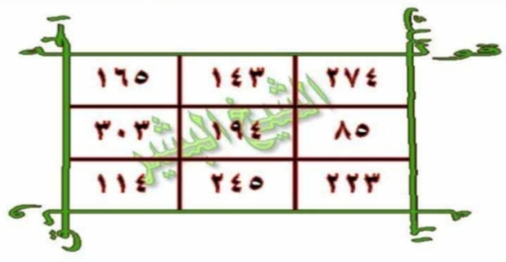

## HALAMAN 12 — FAIDAH QATHI'AH LI'ILAJ AL-MASS (WAFQ) — فَائِدَةٌ قَاطِعَةٌ لِعِلَاجِ الْمَسِّ (الوَفْق)

### arab
فَائِدَةٌ قَاطِعَةٌ لِعِلَاجِ الْمَسِّ

[ وَفْقٌ لِعِلَاجِ الْمَسِّ ]

| ٢٧ | ١٨ | ١٢٠٩ | ٦٠٠ |
| ٦١٨ | ١٢٠٠ | ١٩١ | ٦٠٩١ |

كِتَابَةُ الْآيَاتِ وَالسُّوَرِ تَبْدَأُ مِنْ فَوْقِ الْوَفْقِ مِنْ جِهَةِ الْيَمِينِ اتِّجَاهًا إِلَى الْيَسَارِ، وَفَّقَكُمُ اللهُ لِمَا يُحِبُّهُ وَيَرْضَاهُ.

### latin
Fā'idatun qāthi'atul-li'ilājil-massi

[ Wafqul-li'ilājil-massi ]

(Angka Arab Wafaq: 600 - 1209 - 18 - 27 / 6091 - 191 - 1200 - 618)

Kitābatul-āyāti was-suwari tabda'u min fauqil-wafqi min jihatil-yamīni ittijāhan ilal-yasāri, waffaqakumullāhu limā yuhibbuhū wa yardhāhu.

### Terjemahan
Faedah Ampuh untuk Mengobati Kesurupan / Al-Mass (Visualisasi Wafaq):

[ Wafaq Pengobatan Kesurupan / Al-Mass ]

| ٢٧ (27) | ١٨ (18) | ١٢٠٩ (1209) | ٦٠٠ (600) |
| ٦١٨ (618) | ١٢٠٠ (1200) | ١٩١ (191) | ٦٠٩١ (6091) |

“Penulisan ayat-ayat dan surat-surat (5 surat di Hal11) dimulai dari bagian atas wafaq dari sebelah kanan melingkar menuju ke sebelah kiri (searah tulisan Arab / berlawanan jarum jam). Semoga Allah memberi taufik kepada kalian pada apa yang dicintai dan diridai-Nya.”

### Syarah dan Penjelasan
Struktur Wafaq ‘Adad Khāsh 2×4 (8 kotak): Dua baris × empat kolom, angka 600,1209,18,27 (baris 1) dan 6091,191,1200,618 (baris 2) — hasil takhrij Abjad dari Surat Al-Jin & Ayat Nur + Asmāul Husna. Arah Tadwīr: 5 surat/ayat (Asy-Syams, Ikhlas, Nur, Hajj, Jin) ditulis melingkari luar wafaq mulai kanan atas ke kiri. Tinta Za’faran+Misk+Ward dilebur dengan air hujan/sumur, digosok sabbābah 7×.

### Khususiyah dan Tatacara Praktik
Bentuk Rajah Angka Unik 2×4 jarang ditemukan — dirancang mengunci aura piring (shaḥn naqiyy). Kecepatan (sarī’atun-nafādz): kombinasi angka wafaq + 5 surat/ayat saat mahw 7× terbukti cepat menetralkan jin di syaraf dan melebur benteng penutup harta karun. Rajah angka tidak diterjemahkan — angka Arab ditulis apa adanya, arah penulisan dari kanan ke kiri.

[Gambar: Wafaq 2×4 — 600,1209,18,27 / 6091,191,1200,618 — FINAL 300 DPI]

