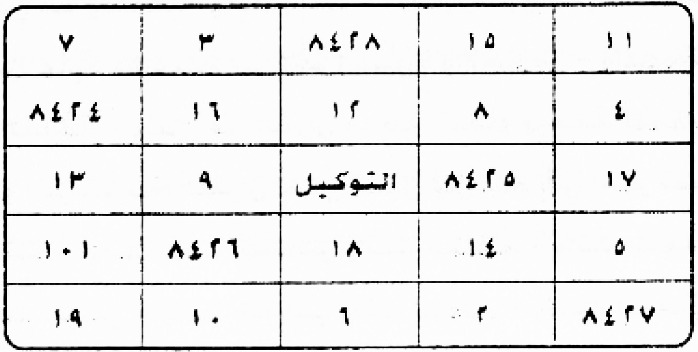
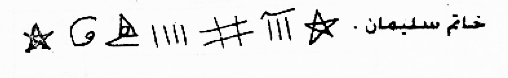
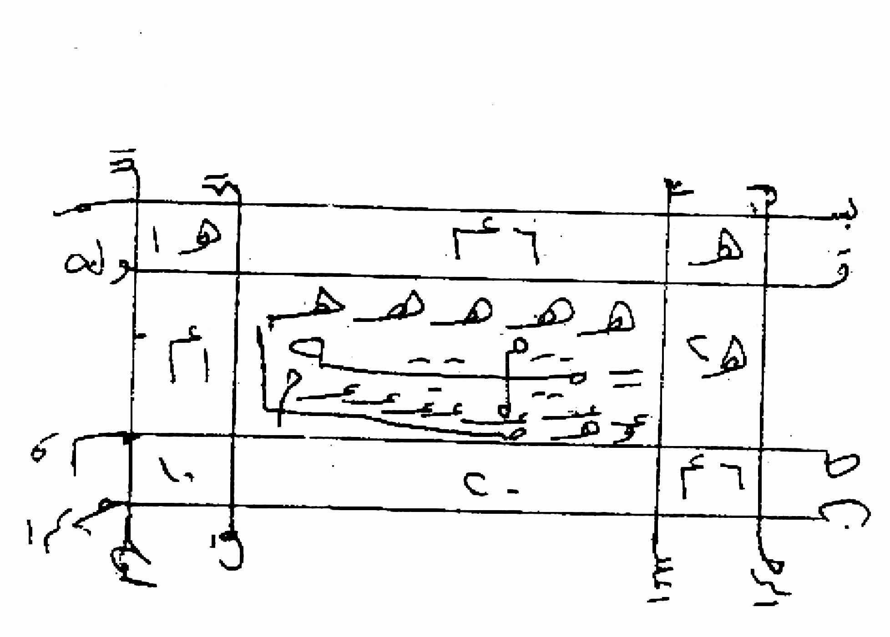
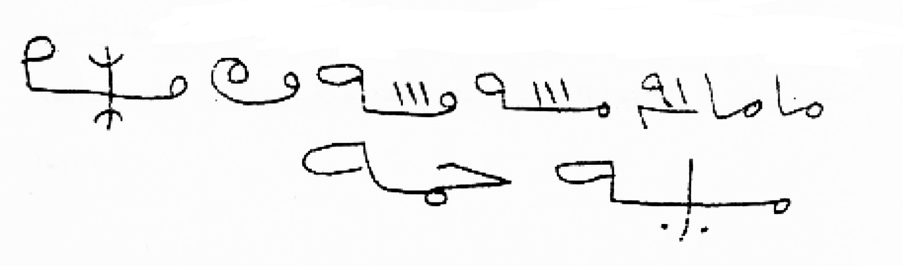
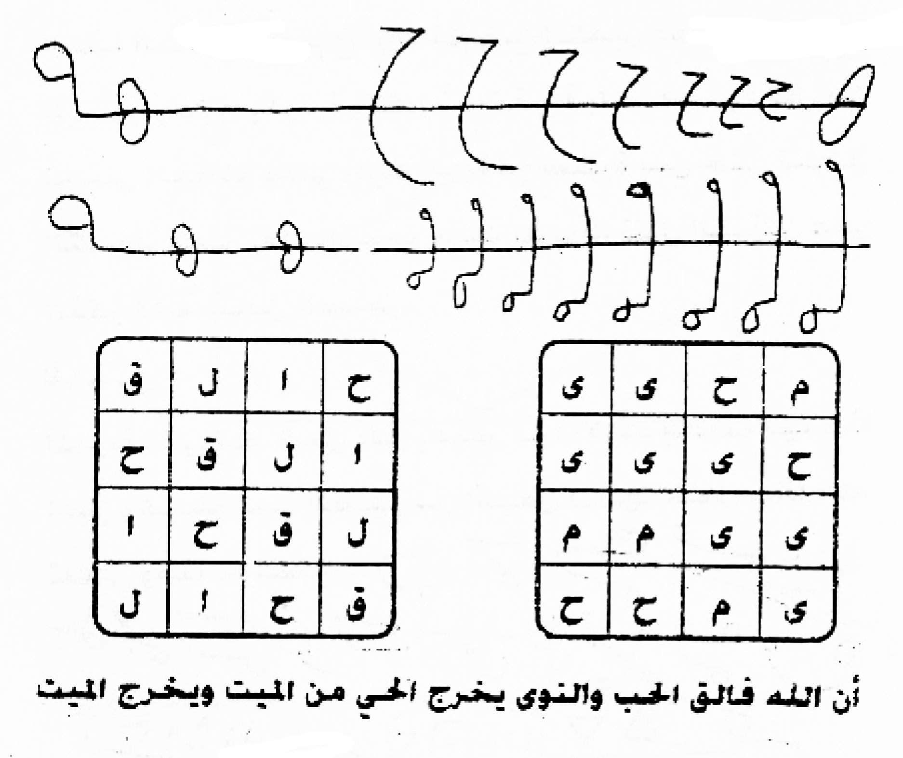

# AL-QORIN WAR RIYADHAH — PILOT REVISI STANDAR 123 ARTIKEL

> Cakupan pilot: SAMPUL, M01–M05, M58, M65–M67, M69, M122. Ini contoh penyelesaian mengikuti `../STANDAR_MUTLAK_AL_QORIN_123.md`, bukan edisi final 123 unit.

> Dokumen ini adalah revisi terjemahan dokumenter. Metode yang dinisbatkan kepada penulis kitab tidak disajikan sebagai anjuran, terapi, atau jaminan hasil, dan bukan pengganti penanganan medis.

> Catatan sumber (apa adanya): Rajah diperiksa: hal.65–73 (9 dari 23 halaman). Wafaq berpetak: hal.66 & 69; hal.65 & 67 salinan linear; hal.68, 70, 71, 73 tanpa wafaq berpetak; hal.72 tanpa rajah sama sekali.
> Catatan: teks kiriman pengguna; koreksi bersifat usulan. Praktik dinisbatkan kepada penulis kitab — tidak dianjurkan, tidak disahkan, tanpa jaminan khasiat.

## SAMPUL

### 1. Arab

الْقَرِينُ وَالرِّيَاضَاتُ الرُّوحَانِيَّةُ

تَأْلِيفُ الْأُسْتَاذِ الْكَبِيرِ

مُحَمَّد سَامِي مُحَمَّد أَحْمَد

عُضْوُ الِاتِّحَادِ الْعَالَمِيِّ لِلْفَلَكِيِّينَ الرُّوحَانِيِّينَ

الْمَقَرُّ بَارِيس

النَّاشِرُ

دَارُ الْفِكْرِ وَالثَّقَافَةِ

مُحَمَّد سَامِي مُحَمَّد أَحْمَد

### 2. Latin

Alqariinu war riyaadhaatur ruuhaaniyyah.

Ta'liiful ustaadzil kabiir.

Muhammad Saamii Muhammad Ahmad.

'Udhwul ittihaadil 'aalamiyyi lil falakiyyinar ruuhaaniyyiin.

Almaqarru Baariis.

Annaasyir.

Daarul fikri wats tsaqaafah.

Muhammad Saamii Muhammad Ahmad.

### 3. Terjemahan

Al-Qarin dan latihan-latihan ruhani.

Karangan guru besar:

Muhammad Sami Muhammad Ahmad.

Anggota Persatuan Internasional para ahli falak ruhani.

Kantor pusat: Paris.

Penerbit:

Dar al-Fikr wa al-Tsaqafah.

Muhammad Sami Muhammad Ahmad.

### 4. Metode, Penentuan Jam, dan Catatan Penyunting

#### 1. Metode

Tidak ada petunjuk praktik pada halaman ini: tidak ditemukan kata perintah kerja (اكتب/اقرأ/احمل/بخور/صم/صل) pada bagian ARAB. Isi halaman berupa penjelasan, pujian, atau daftar nama, jadi bagian ini secara eksplisit menyatakan «tidak ada praktik».

#### 2. Penentuan Jam

«tidak ada hitungan di halaman ini»

#### Catatan penyunting

Judul الرياضيات dalam ekstrak diperbaiki editorial menjadi الرياضات, berdasarkan pemakaian berulang رياضات/الرياضة dan uraian latihan dalam kiriman yang sama; bukan “matematika”. Bentuk asli tetap disimpan pada lapisan sumber.

Gelar adalah teks sampul, bukan verifikasi gelar akademik.

Nama diri tanpa akhiran kasus/tanwin rekaan; سامى/احمد dinormalisasi ejaan menjadi سامي/أحمد.

Organisasi/lokasi belum diverifikasi.

### 5. Khususiyah — Waktu : Media : Bukhur

Waktu: tidak disebutkan dalam sumber unit ini : Media: tidak disebutkan dalam sumber unit ini : Bukhur: tidak disebutkan dalam sumber unit ini

## M01 — PARAGRAF PUJIAN PERTAMA

### 1. Arab

بِسْمِ اللَّهِ الرَّحْمَنِ الرَّحِيمِ

مُقَدِّمَةٌ

الْحَمْدُ لِلَّهِ الَّذِي رَفَعَ حُجُبَ أَسْتَارِ الْأَسْرَارِ عَنْ حَقَائِقِ بَصَائِرِ الْمُقَرَّبِينَ

وَنَوَّرَ بِنُورِ الْهِدَايَةِ الْإِيمَانِيَّةِ مِشْكَاةَ قُلُوبِ الْعَارِفِينَ

وَشَرَحَ بِسِرِّ الْمَوَاهِبِ الرَّبَّانِيَّةِ بَوَاطِنَ صُدُورِ الْمُحَقِّقِينَ

وَأَسْكَرَ مِنْ خَالِصِ صِرْفِ مَحَبَّتِهِ جَوَاهِرَ أَرْوَاحِ الْمُحِبِّينَ

وَهَدَى إِلَى أَقْرَبِ وَسِيلَةٍ سُلُوكَ مَقَامَاتِ الْمُخْلِصِينَ

وَثَبَّتَ عَلَى صِرَاطِ الْحَقِيقَةِ أَقْدَامَ السَّالِكِينَ

وَرَقَّى عَلَى مَنَابِرِ الْحِكَمِ النُّورَانِيَّةِ ذَوَاتِ أَفْكَارِ الْمُهْتَدِينَ

وَنَزَّهَ فِي حَدِيقَةِ رِيَاضِ حَضْرَةِ قُدْسِ أُنْسِهِ لُبَابَ عُقُولِ الْمُتَرَبِّينَ

وَتَقَرَّبَ بِمَحْضِ أَلْطَافِ عِنَايَةِ رَحْمَتِهِ بِخُضُوعِ خُشُوعِ الْمُنَاجِينَ

### 2. Latin

Bismillaahir rahmaanir rahiim.

Muqaddimah.

Alhamdulillahil ladzii rafa'a hujuba astaaril asraari 'an haqaa'iqi bashaa'iril muqarrabiin.

Wa nawwara binuuril hidaayatil iimaaniyyati misykaata quluubil 'aarifiin.

Wa syaraha bisirril mawaahibir rabbaaniyyati bawaathina shuduuril muhaqqiqiin.

Wa askara min khaalishi shirfi mahabbatihi jawaahira arwaahil muhibbiin.

Wa hadaa ilaa aqrabi wasiilatin suluuka maqaamaatil mukhlishiin.

Wa tsabbata 'alaa shiraathil haqiiqati aqdaamas saalikiin.

Wa raqqaa 'alaa manaabiril hikamin nuuraaniyyati dzawaati afkaaril muhtadiin.

Wa nazzaha fii hadiiqati riyaadhi hadhrati qudsi unsihi lubaaba 'uquulil mutarabbiin.

Wa taqarraba bimahdhi althaafi 'inaayati rahmatihi bikhudhuu'i khusyuu'il munaajiin.

### 3. Terjemahan

Dengan nama Allah Yang Maha Pengasih lagi Maha Penyayang.

Pendahuluan.

Segala puji bagi Allah yang mengangkat hijab-hijab penutup rahasia dari hakikat-hakikat pandangan batin orang-orang yang didekatkan.

Dan Dia menerangi relung hati para arif dengan cahaya petunjuk keimanan.

Dan Dia melapangkan bagian-bagian terdalam dada para ahli tahkik dengan rahasia karunia rabbani.

Dan Dia memabukkan inti ruh para pencinta dengan kemurnian cinta-Nya yang murni.

Dan Dia membimbing perjalanan maqam-maqam orang-orang ikhlas menuju sarana yang paling dekat.

Dan Dia meneguhkan kaki-kaki para salik di atas jalan hakikat.

Dan Dia menaikkan wujud-wujud pikiran orang-orang yang mendapat petunjuk ke mimbar-mimbar hikmah bercahaya.

Dan Dia menyenangkan inti akal orang-orang yang dididik di taman kebun hadirat kesucian keakraban-Nya.

Dan Dia mendekat dengan kemurnian kelembutan pemeliharaan rahmat-Nya, dengan ketundukan kekhusyukan orang-orang yang bermunajat.

### 4. Metode, Penentuan Jam, dan Catatan Penyunting

#### 1. Metode

Tidak ada petunjuk praktik pada halaman ini: tidak ditemukan kata perintah kerja (اكتب/اقرأ/احمل/بخور/صم/صل) pada bagian ARAB. Isi halaman berupa penjelasan, pujian, atau daftar nama, jadi bagian ini secara eksplisit menyatakan «tidak ada praktik».

#### 2. Penentuan Jam

«tidak ada hitungan di halaman ini»

#### Catatan penyunting

Ekstrak berbunyi الرحيمة; bentuk الرحيم di sini koreksi bacaan formula basmalah dan kecocokan sifat, bukan klaim bahwa cetakan asli terbaca demikian.

بصاير→بصائر modernisasi hamzah, bukan verifikasi nuqthah cetakan asli.

Koreksi editorial بواطنى→بواطن menghapus ya akhir yang merusak idhafah dengan صدور; bukan menyatakan huruf kiriman tidak terbaca. Ini usulan koreksi, bukan penghapusan kata sumber.

Usulan rangkaian قدسي انسة الباب→قدس أنسه لباب: menghapus ya berlebih, menormalkan hamzah dan dhamir ه, serta membaca لباب sebagai objek نزّه agar عقول menjadi mudhaf ilayh. Rangkaian ini usulan editorial yang lebih besar; tingkat kepastiannya terbatas, bukan fakta ejaan sumber.

Usulan بخض→بمحض berdasarkan ungkapan maḥḍ kemurnian dan idhafah ألطاف; huruf mim dipulihkan dan kha dibaca ha.

المناحين→المناجين usulan ح→ج: مناجين isim fa‘il III ناجى, orang bermunajat. Usulan ini dipilih dari bentuk ekstrak dan qarinah khusyuk; bukan kepastian, bukan mengambil bacaan dari terjemahan lama.

### 5. Khususiyah — Waktu : Media : Bukhur

Waktu: tidak disebutkan dalam sumber unit ini : Media: tidak disebutkan dalam sumber unit ini : Bukhur: tidak disebutkan dalam sumber unit ini

## M02 — LANJUTAN PUJIAN

### 1. Arab

وَهُوَ الَّذِي تَفَرَّدَ بِسِرِّ الْوَحْدَانِيَّةِ وَتَوَحَّدَ بِتَحْقِيقِ الْحَقِيقَةِ الْأَحَدِيَّةِ

وَاتَّصَفَ بِعِزَّةِ اللَّهِ الصَّمَدِيَّةِ وَتَنَزَّهَ عَنْ شَبَهِ الْمُلْحِدِينَ

### 2. Latin

Wa huwal ladzii tafarrada bisirril wahdaaniyyati wa tawahhada bitahqiiqil haqiiqatil ahadiyyah.

Wattashafa bi'izzatillaahish shamadiyyati wa tanazzaha 'an syabahil mulhidiin.

### 3. Terjemahan

Dialah yang tersendiri dengan rahasia keesaan dan tunggal dengan perwujudan hakikat keesaan.

Dan Dia bersifat dengan kemuliaan Allah yang bersifat shamadiyyah serta Mahasuci dari keserupaan dengan orang-orang yang menyimpang.

### 4. Metode, Penentuan Jam, dan Catatan Penyunting

#### 1. Metode

Tidak ada petunjuk praktik pada halaman ini: tidak ditemukan kata perintah kerja (اكتب/اقرأ/احمل/بخور/صم/صل) pada bagian ARAB. Isi halaman berupa pujian/penjelasan, jadi bagian ini menyatakan «tidak ada praktik».

#### 2. Penentuan Jam

«tidak ada hitungan di halaman ini»

#### Catatan penyunting

Usulan توجد→توحد (ج→ح) dan يتحقيق→بتحقيق (ي→ب), didukung kesejajaran tafarrada/tawaḥḥada dan kebutuhan ba pada mashdar.

Harakat/arti adalah bacaan editorial yang dinyatakan, bukan menyebut teks tidak terbaca.

الملحدين dipertahankan persis menurut ekstrak, tidak diganti المحدثين atau diterjemahkan “makhluk”.

Catatan tashih: kemunculan «صم» pada kata «الصمدية» bukan kata perintah, jadi tidak dihitung sebagai praktik.

### 5. Khususiyah — Waktu : Media : Bukhur

Waktu: tidak disebutkan dalam sumber unit ini : Media: tidak disebutkan dalam sumber unit ini : Bukhur: tidak disebutkan dalam sumber unit ini

## M03 — SYAHADAT DAN ALASAN PENULISAN

### 1. Arab

الَّذِي من رِوَاقِ التَّكْوِينِ عَلَى اخْتِلَافِ أَطْوَارِ مَقَامَاتِ الْقَاصِدِينَ

وَبَسَطَ سَاحَةَ التَّحْكِيمِ بِصَفَاءِ جَوَاهِرِ أَنْفَاسِ أَرْوَاحِ الْمُتَمَكِّنِينَ الْقَدِيرُ الَّذِي وَسَمَ سُلْطَانَ الْعَقْلِ بية الْعَجْزِ وَأَخْرَسَ فَصِيحَاتِ الْأَلْسُنِ بِيَدِ الْقَهْرِ

أَحْمَدُهُ حَمْدَ الْمُقَرَّبِينَ وَأُؤْمِنُ إِيمَانَ الْعَارِفِينَ وَأَهْتَدِي هِدَايَةَ الْمُرِيدِينَ

وَأَشْهَدُ أَنْ لَا إِلَهَ إِلَّا اللَّهُ وَحْدَهُ لَا شَرِيكَ لَهُ شَهَادَةً مِنِّي بِرِقِّهِ عُبُودِيَّتِي إِلَيْهِ وَأَعْتَمِدُ فِي أَفْعَالِي وَأَقْوَالِي عَلَيْهِ

وَأَشْهَدُ أَنَّ مُحَمَّدًا عَبْدُهُ وَرَسُولُهُ الَّذِي اخْتَارَهُ مِنْ جَوَاهِرِ الْمُرْسَلِينَ وَخُلَاصَةِ أَنْوَارِ الصِّدِّيقِينَ وَحَقِيقَةِ حَقَائِقِ الشُّهَدَاءِ وَلَطَائِفِ أَسْرَارِ الصَّالِحِينَ

صَلَّى اللَّهُ عَلَيْهِ حَامِلِي الْقُرْآنِ وَتَعَاقَبَ الْجَدِيدَانِ

وَبَعْدُ فَإِنَّ جَمَاعَةً مِنَ الْمُحِبِّينَ الصَّادِقِينَ وَالْمُخْلِصِينَ الْخَالِصِينَ رَغِبُوا أَنْ أُبَيِّنَ لَهُمْ كَيْفِيَّةَ الرِّيَاضَاتِ وَتَرْبِيَةَ أَسْرَارِهَا فِي اصوال الْمَوْجُودَاتِ وَمَا سِرُّ الْبِدَايَاتِ مِنْهَا وَالنِّهَايَاتِ

فَأَجَبْتُهُمْ إِلَى ذَلِكَ إِجَابَةَ مَنْ وَثِقَ بِحَبْلِ مَوْلَاهُ فِي سِرِّ سِرِّهِ وَعَلَانِيَتِهِ وَنَجْوَاهُ بَعْدَ أَنْ اتَّخَذْتُ عُبُودِيَّةَ الذُّلِّ بَيَانَ الِاسْتِخَارَةِ

### 2. Latin

Alladzii [من: vokalisasi belum ditetapkan] riwaaqit takwiini 'alakhtilaafi athwaari maqaamaatil qaashidiin.

Wa basatha saahatat tahkiimi bishafaa'i jawaahiri anfaasi arwaahil mutamakkininal qadiirul ladzii wasama sulthaanal 'aqli [بية: bacaan belum ditetapkan] al'ajzi wa akhrasa fashiihaatil alsuni biyadil qahr.

Ahmaduhu hamdal muqarrabiina wa u'minu iimaanal 'aarifiina wa ahtadii hidaayatal muriidiin.

Wa asyhadu an laa ilaaha illallaahu wahdahu laa syariika lahu syahaadatan minnii biriqqihi 'ubuudiyyatii ilaihi wa a'tamidu fii af'aalii wa aqwaalii 'alaih.

Wa asyhadu anna Muhammadan 'abduhu wa rasuuluhul ladziikhtaarahu min jawaahiril mursaliina wa khulaashati anwaarish shiddiiqiina wa haqiiqati haqaa'iqisy syuhadaa'i wa lathaa'ifi asraarish shaalihiin.

Shallallaahu 'alaihi haamilil qur'aani wa ta'aaqabal jadiidaan.

Wa ba'du fa'inna jamaa'atan minal muhibbiinash shaadiqiina wal mukhlishiinal khaalishiina raghibuu an ubayyina lahum kaifiyyatar riyaadhaati wa tarbiyata asraarihaa fii [اصوال: bacaan belum ditetapkan] almawjuudaati wa maa sirrul bidaayaati minhaa wan nihaayaat.

Fa'ajabtuhum ilaa dzaalika ijaabata man watsiqa bihabli maulaahu fii sirri sirrihi wa 'alaaniyatihi wa najwaahu ba'da anittakhadztu 'ubuudiyyatadz dzulli bayaanal istikhaarah.

### 3. Terjemahan

Yang—hubungan kata «من» dengan “serambi penciptaan” belum pasti—menurut perbedaan fase-fase maqam orang-orang yang menuju-Nya.

Dan Dia membentangkan medan penetapan hukum dengan kejernihan permata napas ruh-ruh orang yang mantap; Yang Mahakuasa, yang menandai kekuasaan akal dengan «بية» ketidakmampuan [makna penghubung belum pasti], dan membungkam kefasihan lidah-lidah dengan tangan keperkasaan.

Aku memuji-Nya dengan pujian orang-orang yang didekatkan, beriman dengan iman para arif, dan menempuh petunjuk para murid.

Aku bersaksi bahwa tiada tuhan selain Allah semata, tiada sekutu bagi-Nya; suatu kesaksian dariku. Dengan kehambaan kepada-Nya, pengabdianku tertuju kepada-Nya [hubungan frasa belum mantap]. Aku bersandar kepada-Nya dalam perbuatan dan ucapanku.

Aku bersaksi bahwa Muhammad adalah hamba dan utusan-Nya yang Dia pilih dari permata para rasul, sari cahaya para siddiq, hakikat segala hakikat para syuhada, serta kelembutan rahasia orang-orang saleh.

Semoga Allah melimpahkan shalawat kepadanya; “para pembawa Al-Qur’an, dan kedua yang selalu baru silih berganti” [susunan penutup doa belum mantap].

Selanjutnya, sekelompok pencinta yang tulus dan orang-orang ikhlas yang murni menghendaki agar aku menjelaskan cara riyadhah dan pembinaan rahasianya dalam «اصوال» segala yang ada [makna kata ini belum ditetapkan], serta apa rahasia permulaan dan kesudahannya.

Maka kupenuhi permintaan itu sebagaimana orang yang percaya pada tali Tuannya, dalam rahasia terdalamnya, keterbukaannya, dan bisikannya, setelah aku menjadikan penghambaan kerendahan diri sebagai penjelasan istikharah.

### 4. Metode, Penentuan Jam, dan Catatan Penyunting

#### 1. Metode

Tidak ada petunjuk praktik pada halaman ini: tidak ditemukan kata perintah kerja (اكتب/اقرأ/احمل/بخور/صم/صل) pada bagian ARAB. Isi halaman berupa penjelasan, pujian, atau daftar nama, jadi bagian ini secara eksplisit menyatakan «tidak ada praktik».

#### 2. Penentuan Jam

«tidak ada hitungan di halaman ini»

#### Catatan penyunting

Huruf من jelas dalam ekstrak, tetapi مِنْ sebagai preposisi atau مَنَّ sebagai fi‘il tidak boleh dipilih hanya agar lancar. Karena itu من dipertahankan tanpa vokalisasi final; bukan kata tidak terbaca.

القدير pola فعيل dipertahankan, dibaca pujian tersendiri, kaitan nahwu belum final.

أؤمن IV آمن, إيمان mashdar, usulan أيمان→إيمان sesuai konteks beriman, bukan sumpah.

واهتدية→وأهتدي usulan menghapus ta akhir dan menormalkan hamzah; اهتدى VIII dari هدي, mendapat/menempuh petunjuk.

برقه dibaca usulan بِرِقِّهِ, riqq kehambaan, bukan برق kilat; tanpa menambah kata yang menghilangkan persoalan hubungan عبوديتي.

Usulan ويطائف→ولطائف (ي→ل), jamak لطيفة فعائل, sesuai idhafah أسرار.

جواهر/أنوار/حقائق/أسرار seluruhnya dipertahankan, bukan diringkas menjadi pujian umum.

Kedua bagian tetap menurut ekstrak; tidak diubah menjadi formula shalawat yang lebih lazim, tidak menambah وسلم yang tidak ada pada baris ini.

Usulan راغبوا→رغبوا (alif berlebih), agar menjadi kerja lampau I yang cocok أن أبين; بيّن II, menjelaskan.

تربيت dibaca usulan تربية, mashdar II ربّى, pembinaan, bukan otomatis ترتيب “susunan” dari terjemahan lama.

اصوال jelas sebagai ekstrak, kandidat أصول/أحوال belum dipilih.

Usulan بحل→بحبل menambahkan ba yang mungkin hilang, berdasarkan ungkapan kepercayaan pada tali/pegangan; tetap editorial, makna حل alternatif belum dipastikan.

Klaim istikharah adalah narasi penulis, bukan verifikasi hasilnya.

### 5. Khususiyah — Waktu : Media : Bukhur

Waktu: tidak disebutkan dalam sumber unit ini : Media: tidak disebutkan dalam sumber unit ini : Bukhur: tidak disebutkan dalam sumber unit ini

## M04 — PENUTUP MUKADIMAH

### 1. Arab

فَأَفَاضَ عَلَيَّ مِنْ أَنْوَارِ رَحْمَتِهِ قَبُولَ الْإِجَابَةِ وَكَشَفَ لِي عَنْ أَسْرَارِ أَبْوَابِ الْإِنَابَةِ

عَلَى رَبِّ الْعُلَمَاءِ الْمُتَقَدِّمِينَ وَالْأَئِمَّةِ وَالْمُهْتَدِينَ رَضِيَ اللَّهُ عَنْهُمْ

ذَكَرُوا ذَلِكَ عَلَى أَنْوَاعٍ مِنَ الْأَمْثِلَةِ وَاخْتِلَافِ أَطْوَارِ الْأَبْنِيَةِ وَلَمْ يُودِعُوهُ مِنَ الْأَذْكَارِ أَنْوَارًا

ثُمَّ إِنَّهُمْ ذَكَرُوا التَّدْرِيجَ عَلَى أَوْزَانِ الْقِسْطَاسِ وَلَمْ يُنَبِّهُوا عَلَى كَيْفِيَّةِ الِاحْتِرَازِ لِاخْتِلَالِ الْحَوَاسِّ

وَإِنَّنِي أُقَدِّمُ هَذِهِ الرِّيَاضَاتِ الرُّوحَانِيَّةَ الَّتِي لَيْسَ لَهَا مَثِيلٌ خِدْمَةً إِلَى الْمُؤْمِنِينَ فِي كُلِّ مَكَانٍ وَاللَّهُ الْمُوَفِّقُ

وَأَرْجُو مِنَ اللَّهِ أَنْ يَتَقَبَّلَ هَذَا الْكِتَابَ وَمَا فِيهِ بِقَبُولٍ حَسَنٍ

وَإِنِّي وَأَرْجُو مِنَ اللَّهِ أَنْ يَتَقَبَّلَنِي عِنْدَهُ وَيَتَقَبَّلَ هَذَا الْعَمَلَ مِنَ الْعَبْدِ الْفَقِيرِ إِلَى الْمَوْلَى الْجَلِيلِ

وَمَنْ يُرِيدُ أَنْ يَصِلَ إِلَى الْمُرَادِ فَلْيَبْدَأْ بِقِرَاءَةِ الْفَاتِحَةِ لِسَيِّدِنَا مُحَمَّدٍ وَآلِ الْبَيْتِ وَالْمُؤَلِّفِ وَلِلَّهِ الْحَمْدُ فِي الْأُولَى وَالْآخِرَةِ

الْمُؤَلِّفُ

مُحَمَّد سَامِي مُحَمَّد أَحْمَد

### 2. Latin

Fa afaadha 'alayya min anwaari rahmatihi qabuulal ijaabati wa kasyafa lii 'an asraari abwaabil inaabah.

'Alaa rabbil 'ulamaa'il mutaqaddimiina wal a'immati wal muhtadiina radhiyallaahu 'anhum.

Dzakaruu dzaalika 'alaa anwaa'in minal amtsilati wakhtilaafi athwaaril abniyati wa lam yuudi'uuhu minal adzkaari anwaaraa.

Tsumma innahum dzakaruut tadriija 'alaa awzaanil qisthaasi wa lam yunabbihuu 'alaa kaifiyyatil ihtiraazi likhtilaalil hawaass.

Wa innanii uqaddimu haadzihir riyaadhaatir ruuhaaniyyatal latii laisa lahaa matsiilun khidmatan ilal mu'miniina fii kulli makaanin wallaahul muwaffiq.

Wa arjuu minallaahi an yataqabbala haadzal kitaaba wa maa fiihi biqabuulin hasan.

Wa innii wa arjuu minallaahi an yataqabbalanii 'indahu wa yataqabbala haadzal 'amala minal 'abdil faqiiri ilal maulal jaliil.

Wa man yuriidu an yashila ilal muraadi falyabda' biqiraa'atil faatihati lisayyidinaa Muhammadin wa aalil baiti wal mu'allifi wa lillaahil hamdu fil uulaa wal aakhirah.

Almu'allif.

Muhammad Saamii Muhammad Ahmad.

### 3. Terjemahan

Maka Dia melimpahkan kepadaku, dari cahaya-cahaya rahmat-Nya, penerimaan atas permohonan itu, dan menyingkapkan bagiku rahasia pintu-pintu kembali kepada-Nya.

“Atas/pada Tuhan para ulama terdahulu, para imam, dan orang-orang yang mendapat petunjuk; semoga Allah meridai mereka.” Hubungan susunan pembuka frasa ini dengan kalimat sebelumnya belum mantap.

Mereka menyebutkan hal itu melalui beragam contoh dan perbedaan tahap bentuk-bentuk susunan, tetapi tidak menempatkan di dalamnya cahaya-cahaya dari zikir-zikir.

Kemudian mereka menyebutkan pentahapan menurut ukuran-ukuran neraca, tetapi tidak mengingatkan tentang cara berjaga terhadap terganggunya indra-indra.

Sesungguhnya aku menyajikan latihan-latihan ruhani ini, yang menurut pernyataanku tidak mempunyai tandingan, sebagai pelayanan bagi orang-orang beriman di setiap tempat. Allah-lah pemberi taufik.

Aku memohon kepada Allah agar Dia menerima kitab ini beserta isinya dengan penerimaan yang baik.

Dan sesungguhnya aku—dan aku memohon kepada Allah—agar Dia menerimaku di sisi-Nya dan menerima amal ini dari seorang hamba yang fakir kepada Sang Tuan Yang Mahaagung.

Siapa yang hendak mencapai tujuan, hendaklah ia memulai dengan membaca Al-Fatihah untuk junjungan kita Muhammad, keluarga beliau, dan pengarang. Segala puji bagi Allah pada kehidupan pertama dan kehidupan akhir.

Pengarang:

Muhammad Sami Muhammad Ahmad.

### 4. Metode, Penentuan Jam, dan Catatan Penyunting

#### 1. Metode

Penulis meminta pembaca memulai dengan Al-Fatihah yang ditujukan kepada Nabi Muhammad, keluarga beliau, dan pengarang. Ini petunjuk yang memang ada dalam sumber, bukan tambahan penerjemah. Bagian ini tidak menetapkan jumlah bacaan, waktu khusus, atau jaminan hasil; jangan menambahkannya.

#### 2. Penentuan Jam

«tidak ada hitungan di halaman ini»

#### Catatan penyunting

cetakan على dibaca عَلَيَّ berdasarkan dhamir لي sesudahnya; ini penetapan harakat, bukan penggantian huruf.

cetakan dibaca kerja على رب العلماء; tidak diam-diam diubah menjadi على رتب العلماء atau على يد العلماء. Rangkaian ini tetap problematis secara siyaq. Hubungan frasa jar-majrur dengan verba sebelumnya belum ditetapkan sebagai bacaan final.

gambar mendukung أطوار, bukan اطوال dalam ekstrak; أبنية dipertahankan sebagai bentuk-bentuk susunan, tidak diganti otomatis dengan أبنية fisik bangunan.

bacaan kerja gambar ينبهوا memperbaiki ekstrak ينهوا; bentuk رباعي نبّه II sesuai على كيفية. القسطاس dibaca neraca, bukan nama makhluk.

Lِـ pada لاختلال dipertahankan secara lafaz; terjemahan hubungan pencegahan mengikuti konteks احتراز.

الرياضات di sini jelas tanpa ya tambahan الرياضيات.

tidak menambah penilaian bahwa kitab sudah diterima Allah.

وإنّي وأرجو dipertahankan; waw kedua tidak diam-diam dihapus walau hubungan إنّ dengan khabarnya tidak lancar. Ini kejanggalan susunan, bukan kata tidak terbaca.

ويمن dalam ekstrak ditashih menjadi ومن sesuai gambar. فليبدء dimodernisasi hamzahnya menjadi فليبدأ, tanpa mengganti isi.

nama mengikuti baris tanda tangan gambar, bukan dinormalisasi menjadi nama orang lain. المؤلف isim fa‘il II ألّف. Rangkaian nama diberi harakat dasar, tanpa tambahan i‘rab/tanwin nama yang tidak dipastikan dari sumber.

### 5. Khususiyah — Waktu : Media : Bukhur

Waktu: tidak disebutkan dalam sumber unit ini : Media: tidak disebutkan dalam sumber unit ini : Bukhur: tidak disebutkan dalam sumber unit ini

## M05 — BAB PERTAMA, HALAMAN 5

### 1. Arab

الْبَابُ الْأَوَّلُ

الرِّيَاضِيَّاتُ الْكُبْرَى

اعْلَمْ أَيُّهَا الطَّالِبُ أَنَّ الْقِيَامَ بِالشَّرَائِعِ النَّبَوِيَّةِ وَمَجْمُوعَةٍ مِنْ حِكْمَةِ اللَّطَائِفِ الرَّبَّانِيَّةِ هُوَ جُنُودُهُ بَيْنَ أَحْشَائِكَ

وَأَنَّ الْعَالَمَ الْفَانِيَ لَيْسَتْ لَهَا بِهِ عَلَاقَةٌ وَلَا لِخِفَّةِ انْتِشَاتٍ لِيَطْمَئِنَّ قَلْبُهُ بِوَهْمِ الطَّلَبِ

وَلِيُسَكِّنْ حَوَاشِيَ هِمَّتِهِ مِنْ جَوْرِ الْهَرَبِ لِتَكُنْ تَكُونُ الْإِمَارَةَ أَمْرُهُ

وَمُوَاظَبَةُ إِرَادَتِهَا غَالِبَةٌ وَقَاهِرَةٌ وَذَلِكَ لِعِلَّتَيْنِ

إِحْدَاهُمَا أَنْ يَكُونَ عَقْلُهُ مَحْجُوبًا بِالشَّهَوَاتِ وَالْأُخْرَى أَنْ يَكُونَ إِيمَانُهُ مَحْجُوبًا تَحْتَ الْمُخَالَفَاتِ

فَإِذَا عَمِيَتْ بَصِيرَةُ الْعَقْلِ عَنْ مُشَاهَدَةِ أَرْوَاحِ الْإِيمَانِ بَقِيَتِ النَّفْسُ مَحْجُوبَةً عَنِ النُّورَيْنِ خَالِيَةً مِنَ السِّرَّيْنِ

فَيَدْخُلُ السَّاحَةَ الرِّيَاضَةَ بِغَايَةِ الْجِدِّ وَنِهَايَةِ الْجَهْدِ فَيَكُونُ عَلَى ثَلَاثَةِ أَقْسَامٍ

الْقِسْمُ الْأَوَّلُ: إِمَّا أَنْ يَقْضِيَ بِهِ عَمَلَهُ لِاخْتِلَالِ الْحَوَاسِّ فَيُخِلَّ بِالْأَعْمَالِ الشَّرْعِيَّةِ وَالْوَظَائِفِ الرَّبَّانِيَّةِ وَبِمَا رَأَى ذَلِكَ أَفْضَلَ وَهَذَا لَا يُفْتَحُ لَهُ فِي سَائِرِ الْأَعْمَالِ بَعْدُ

### 2. Latin

Albaabul awwal.

Arriyaadhiyyaatul kubraa.

I'lam ayyuhath thaalibu annal qiyaama bisy syaraa'i'in nabawiyyati wa majmuu'atin min hikmatil lathaa'ifir rabbaaniyyati huwa junuuduhu baina ahsyaa'ik.

Wa annal 'aalamal faaniya laisat lahaa bihi 'alaaqatun wa laa likhiffati intisyaatin liyathma'inna qalbuhu biwahmith thalab.

Wa liyusakkin hawaasyiya himmatihi min jauril harabi litakun takuunu al'imaarata amruhu.

Wa muwaazhabatu iraadatihaa ghaalibatun wa qaahiratun wa dzaalika li'illatain.

Ihdaahumaa an yakuuna 'aqluhu mahjuuban bisy syahawaati wal ukhraa an yakuuna iimaanuhu mahjuuban tahtal mukhaalafaat.

Fa idzaa 'amiyat bashiiratul 'aqli 'an musyaahadati arwaahil iimaani baqiyatin nafsu mahjuubatan 'anin nuuraini khaaliyatan minas sirrain.

Fa yadkhulus saahata arriyaadhata bighaayatil jiddi wa nihaayatil juhdi fa yakuunu 'alaa tsalaatsati aqsaam.

Alqismul awwalu: immaa an yaqdhiya bihi 'amalahu likhtilaalil hawaassi fa yukhilla bil a'maalisy syar'iyyati wal wazhaa'ifir rabbaaniyyati wa bimaa ra'aa dzaalika afdhala wa haadzaa laa yuftahu lahu fii saa'iril a'maali ba'd.

### 3. Terjemahan

Bab Pertama

Riyadhah besar — judul cetak secara harfiah berbunyi ‘ar-riyadhiyyat al-kubra’.

Ketahuilah, wahai pencari, bahwa menjalankan syariat-syariat kenabian beserta suatu himpunan hikmah kelembutan rabbani merupakan bala tentaranya di antara bagian-bagian dalammu.

Dan bahwa alam yang fana tidak mempunyai hubungan dengannya—demikian susunan ‘lahaa bihi’ dalam sumber—dan bukan pula demi ringannya ‘intisyaat’, agar hatinya menjadi tenang dengan angan-angan pencarian. Makna kata ‘intisyaat’ dan kaitan keseluruhan frasa ini belum mantap.

Dan hendaklah ia menenangkan sisi-sisi tekadnya dari kesewenang-wenangan pelarian. Penutupnya berbunyi ‘litakun takuunu al-imaarata amruhu’; secara leksikal memuat ‘agar/hendaklah menjadi’, ‘kepemimpinan’, dan ‘urusannya’, tetapi hubungan gramatikalnya belum dapat ditetapkan.

Dan ketekunan menghendakinya bersifat menguasai dan menundukkan. Hal itu disebabkan oleh dua sebab.

Yang pertama ialah akalnya terhijab oleh syahwat-syahwat. Yang lainnya ialah imannya terhijab di bawah pelanggaran-pelanggaran.

Apabila mata batin akal menjadi buta untuk menyaksikan ruh-ruh iman, jiwa tetap terhijab dari kedua cahaya dan kosong dari kedua rahasia.

Lalu ia memasuki medan riyadhah dengan kesungguhan penuh dan upaya sekuat-kuatnya; kemudian keadaannya terbagi menjadi tiga golongan.

Golongan pertama: adakalanya ia menuntaskan amalnya dengannya dalam keadaan indra-indranya terganggu, sehingga ia melalaikan amal-amal syariat dan tugas-tugas rabbani, serta menganggap hal itu lebih utama. Orang demikian, menurut penulis, tidak lagi dibukakan jalan dalam amal-amal lainnya sesudah itu.

### 4. Metode, Penentuan Jam, dan Catatan Penyunting

#### 1. Metode

Tidak ada petunjuk praktik pada halaman ini: tidak ditemukan kata perintah kerja (اكتب/اقرأ/احمل/بخور/صم/صل) pada bagian ARAB. Isi halaman berupa penjelasan, pujian, atau daftar nama, jadi bagian ini secara eksplisit menyatakan «tidak ada praktik».

#### 2. Penentuan Jam

«tidak ada hitungan di halaman ini»

#### Catatan penyunting

judul gambar memuat الرياضيات dengan ya; dipertahankan pada lapisan Arab, bukan diam-diam menjadi الرياضات. Makna latihan ditentukan siyaq الرياضة pada isi, bukan pembahasan matematika.

ومجموعة، هو جنوده dipertahankan menurut bacaan gambar; kesesuaian susunannya tidak dibuat seolah-olah tanpa persoalan.

bacaan kerja انْتِشَاتٍ mengikuti rangkaian انتشات yang tampak, bukan langsung menggantinya dengan انتشاء atau انتعاش. Harakat pada kata itu bersifat sementara, bukan penetapan leksem yang pasti.

bacaan kerja gambar حواشي، جور الهرب، لتكن تكون الامارة أمره dipertahankan secara transparan; jangan dipulihkan menjadi pepatah yang tidak ada di sumber.

بادراتها pada pembacaan awal dievaluasi sebagai بإرادتها/إرادتها dari gambar; bacaan utama إرادتها adalah usulan editorial, bukan kepastian huruf cetak.

ايمانه dipilih dari gambar; ejaan ekstrak yang berbeda tidak dipertahankan sebagai bunyi pasti.

السيرين pada ekstrak/pembacaan awal dibaca usulan السرّين, sejajar dengan النورين; ini keputusan editorial yang dinyatakan.

cetakan الساحة الرياضة dipertahankan pada Arab; ungkapan makna ‘medan riyadhah’ tidak berarti mengklaim cetak ساحة الرياضة yang mulus.

يقضي به عمله dan وبما رأى dibaca kerja menurut gambar; hubungan به dan وبما masih perlu audit lebih lanjut, tidak ditutupi dengan kata rekaan.

### 5. Khususiyah — Waktu : Media : Bukhur

Waktu: tidak disebutkan dalam sumber unit ini : Media: tidak disebutkan dalam sumber unit ini : Bukhur: tidak disebutkan dalam sumber unit ini

## M58 — Halaman 58, penutup doa dan wafaq مخمس (rajah)

### 1. Arab

وَبِحَقِّ صَفِيِّكَ نُوحٍ وَسَفِينَتِهِ وَمَاتَنَاسَلَ بَيْنَهُمَا مِنَ الْأَنْبِيَاءِ وَالْمُرْسَلِينَ اشْفِنِي بِشِفَائِكَ وَدَاوِنِي بِدَوَائِكَ وَعَافِنِي بِعَافِيَتِكَ وَبِمُعَافَاتِكَ فَإِنَّكَ لَا إِلَهَ إِلَّا أَنْتَ وَلَا رَبَّ سِوَاكَ وَاخْوِقْلَهُ وَصَلَّى اللَّهُ عَلَى سَيِّدِنَا مُحَمَّدٍ وَعَلَى آلِهِ وَصَحْبِهِ

«مُخَمَّسٌ لِجَمِيعِ الْأَمْرَاضِ يَحْىِ وَيُشْفَى»

[وَافَقَ ٥×٥: يُنْظَرُ الْجَدْوَلُ الْأَصْلِيُّ فِي صُورَةِ الصَّفْحَةِ ٥٨]

### 2. Latin

Wa bihaqqi shafiyyika nuuhin wa safiinatihi wa maa tanaasala bainahumaa minal anbiyaa-i wal mursaliina isyfinii bisyifaa-ika wa daawinii bidawaa-ika wa 'aafinii bi'aafiyatika wa bimu'aafaatika fa-innaka laa ilaaha illaa anta wa laa rabba siwaaka wakhwiqlahu wa shallal laahu 'alaa sayyidinaa muhammadin wa 'alaa aalihi wa shahbihi.

«Mukhammasun lijamii'il amraadhi yahyi wa yusyfaa». [Wafaq 5x5: lihat tabel aslinya pada gambar halaman 58.]

### 3. Terjemahan

Dan dengan hak orang pilihan-Mu Nuh serta bahteranya, dan (keturunan) yang beranak-pinak di antara keduanya dari para nabi dan rasul: sembuhkanlah aku dengan kesembuhan-Mu, obatilah aku dengan obat-Mu, sehatkanlah aku dengan kesehatan-Mu dan pemberian kesehatan-Mu, karena sesungguhnya Engkaulah yang tidak ada tuhan selain Engkau dan tidak ada tuhan selain Engkau. Semoga Allah melimpahkan selawat kepada tuan kami Muhammad, keluarganya, dan para sahabatnya.

Wafaq (rajah angka) 5×5 pada halaman 58, dengan judul «Mukhammas untuk segala penyakit, (semoga) ia hidup dan sembuh». Angka yang terbaca, baris demi baris (kanan ke kiri): ١١ | ١٥ | ٨٤٢٨ | ٣ | ٧ // ٤ | ٨ | ١٢ | ١٦ | ٨٤٢٤ // ١٧ | ٨٤٢٥ | التوكيل | ٩ | ١٣ // ٥ | ١٠٤ | ١٨ | ٨٤٢٦ | ١٠١ // ٨٤٢٧ | ٦ | ١٠ | ٢٠ | ١٩. Saya tidak menggambar ulang kotak, garis, dan susunan sel; bentuk aslinya wajib diambil dari gambar halaman 58.

### 4. Metode, Penentuan Jam, dan Catatan Penyunting

#### 1. Metode

Praktik dari sumber (halaman 58): menyelesaikan doa dengan qasam (نوح dan سفينته, إبراهيم, عيسى), lalu memuat **wafaq 5×5 («مخمس لجميع الأمراض»)** berisi angka dan kata «التوكيل». Wafaq ini TIDAK saya gambar ulang dan bentuk kotaknya hanya boleh diambil dari gambar asli halaman 58; angka yang terbaca saya catat sebagai catatan, bukan sebagai anjuran.

[Crop halaman 58 — crop presisi kiriman pengguna; nama berkas sama dengan halaman tujuan; bukan ekstraksi FINAL KHATAM dan bukan gambar ulang]

#### 2. Penentuan Jam

«tidak ada hitungan di halaman ini»

#### Catatan penyunting

«وَمَاتَنَاسَلَ» kemungkinan «وَمَا تَنَاسَلَ»; «وَاخْوِقْلَهُ» tidak jelas (mungkin doa penutup yang tercetak rusak) — dibiarkan dan ditandai, tidak saya karang.

«يَحِىّ» kemungkinan «يُحْيِي»; «ويشفى» bisa «وَيُشْفَى». Sel yang tidak pasti: sudut kiri-bawah (٢٠/١٩) dan «١٠٤» (bisa ١٤ atau ١٣٤); sel tengah bertuliskan «التوكيل». Angka ٨٤٢٤–٨٤٢٨ berulang dan tampak sebagai kode, bukan hasil hitungan yang dapat saya periksa. Wafaq ini praktik yang dinisbatkan kepada penulis, bukan jaminan medis, dan tidak disajikan sebagai anjuran. Harakat dan tanda baca Arab bersifat editorial; kata dan angka yang tidak pasti dibiarkan apa adanya dan dicatat di audit.

### 5. Khususiyah — Waktu : Media : Bukhur

Waktu: tidak disebutkan dalam sumber unit ini : Media: tidak disebutkan dalam sumber unit ini : Bukhur: tidak disebutkan dalam sumber unit ini

## M65 — Halaman 65, tulisan pengobatan dan lambang خاتم سليمان

### 1. Arab

( لِلتَّدَاوِي مِنَ الْمَرَضِ )

يُكْتَبُ فِي إِنَاءٍ صِينِيٍّ بِزَعْفَرَانٍ وَمَاءِ وَرْدٍ وَيُحْمَى بِمَاءِ بِئْرٍ لَا يَرَى النَّيِّرَيْنِ. بِسْمِ اللَّهِ الرَّحْمَنِ الرَّحِيمِ (ذَلِكَ تَخْفِيفٌ مِنْ رَبِّكُمْ وَرَحْمَةٌ) (يُرِيدُ اللَّهُ أَنْ يُخَفِّفَ عَنْكُمْ وَخُلِقَ الْإِنْسَانُ ضَعِيفًا) (وَلَهُ مَا سَكَنَ فِي اللَّيْلِ وَالنَّهَارِ وَهُوَ السَّمِيعُ الْعَلِيمُ * وَلَوْ شَاءَ لَجَعَلَهُ سَاكِنًا) (أَنْ يَشَأْ يَسْكُنِ الرِّيحَ فَيَظْلَلْنَ رَوَاكِدَ عَلَى ظَهْرِهَا)

الم الم المص المر الر المر كهيعص طه طسم الم الم الم الم الم يس ص حم حم عسق حم حم حم حم حم ق ن

بِسْمِ اللَّهِ الَّذِي لَا يَضُرُّ مَعَ اسْمِهِ شَيْءٌ فِي الْأَرْضِ وَلَا فِي السَّمَاءِ وَجُعِلَ فِيهِ رَحْمَةٌ وَشِفَاءٌ، اللَّهُمَّ اشْفِنِي أَنْتَ الشَّافِي الْمُعَافِي مِنْ كُلِّ عِلَّةٍ وَمَرَضٍ شِفَاءً لَا يُغَادِرُ سَقَمًا وَلَا أَلَمًا بِالَّذِي لَا حَوْلَ وَلَا قُوَّةَ إِلَّا بِاللَّهِ الْعَلِيِّ الْعَظِيمِ، وَصَلَّى اللَّهُ عَلَى سَيِّدِنَا مُحَمَّدٍ وَعَلَى آلِهِ وَصَحْبِهِ أَجْمَعِينَ.

خَاتَمُ سُلَيْمَانَ [رَسْمٌ وَنُقُوشٌ — تُنْظَرُ صُورَةُ الصَّفْحَةِ ٦٥]

### 2. Latin

«Lit tadaawii minal maradhi». Yuktabu fii inaa-in shiiniyyin biza'faraanin wa maa-i wardin wa yuhmaa bimaa-i bi'rin laa yarash niyyaraini. Bismillaahir rahmaanir rahiim (dzaalika takhfiifun min rabbikum wa rahmatun) (yuriidul laahu an yukhaffifa 'ankum wa khuliqal insaanu dha'iifan) (wa lahul maa sakana fil laili wan nahaari wa huwas samii'ul 'aliimu wa lau syaa-a laja'alahu saakinan) (an yasya' taskunir riihu fazhzhallna rawaakida 'alaa zhahrihaa).

Alif laam miim, alif laam miim shaad, alif laam miim raa, alif laam raa, alif laam miim raa, kaaf haa yaa 'ain shaad, thaa haa, thaa siin miim, alif laam miim (berulang lima kali), yaa siin, shaad, haa miim, haa miim 'ain siin qaaf, haa miim (berulang), qaaf, nuun. Bismillaahil ladzii laa yadhurru ma'asmihi syai-un fil ardhi wa laa fis samaa-i wa ju'ila fiihi rahmatun wa syifaa-un, Allaahummasyfinii antasy syaafii al-mu'aafii min kulli 'illatin wa maradhin syifaa-an laa yughaadiru saqaman wa laa alaman billadzii laa haula wa laa quwwata illaa billaahil 'aliyyil 'azhiimi, wa shallal laahu 'alaa sayyidinaa muhammadin wa 'alaa aalihi wa shahbihi ajma'iina. Khaatamu sulaimaana [gambar/lambang — lihat pindaian halaman 65].

### 3. Terjemahan

«Untuk berobat dari penyakit»: ditulis pada mangkuk porselen Cina dengan za‘faran dan air mawar, lalu dipanaskan dengan air sumur yang tidak pernah terkena matahari dan bulan. Dengan nama Allah Yang Maha Pengasih dan Maha Penyayang. «Itu adalah keringanan dari Tuhanmu dan rahmat»; «Allah hendak meringankan (beban)mu, dan manusia diciptakan dalam keadaan lemah»; «Dan milik-Nya apa yang diam (berada) pada malam dan siang, dan Dialah Yang Maha Mendengar lagi Maha Mengetahui; dan jika Dia menghendaki, Dia jadikan ia diam»; «Jika Dia menghendaki, Dia diamkan angin, sehingga (bahtera) itu tertahan di permukaannya».

Alif Lam Mim, Alif Lam Mim Shad, Alif Lam Mim Ra, Alif Lam Ra, Alif Lam Mim Ra, Kaf Ha Ya ‘Ain Shad, Tha Ha, Tha Sin Mim, Alif Lam Mim (lima kali), Ya Sin, Shad, Ha Mim, Ha Mim ‘Ain Sin Qaf, Ha Mim, Qaf, Nun. «Dengan nama Allah yang tidak ada sesuatu pun yang dapat membahayakan bersama nama-Nya, baik di bumi maupun di langit», dan dijadikan padanya rahmat dan kesembuhan. Ya Allah, sembuhkanlah aku; Engkaulah Yang Menyembuhkan, Yang Memberi kesehatan dari segala penyakit dan sakit, dengan kesembuhan yang tidak meninggalkan penyakit maupun rasa sakit, dengan (nama) Yang tiada daya dan kekuatan kecuali dengan (pertolongan) Allah Yang Mahatinggi lagi Mahaagung. Semoga Allah melimpahkan selawat kepada tuan kami Muhammad, keluarganya, dan para sahabatnya seluruhnya. خاتم سليمان: [gambar/lambang — lihat pindaian halaman 65].

### 4. Metode, Penentuan Jam, dan Catatan Penyunting

#### 1. Metode

(لِلتَّدَاوِي مِنَ الْمَرَضِ) — praktik: menulis pada mangkuk porselen Cina dengan za‘faran dan air mawar, lalu dipanaskan dengan air sumur yang tidak terkena dua benda bercahaya (matahari–bulan); disertai rangkaian huruf pembuka surah dan doa; di bagian bawah halaman tercetak lambang خاتم سليمان. Semua dinisbatkan pada penulis kitab; bukan anjuran medis dan tidak ada jaminan.

[Crop halaman 65 — crop presisi kiriman pengguna; nama berkas sama dengan halaman tujuan; bukan ekstraksi FINAL KHATAM dan bukan gambar ulang]

**RAJAH HAL.65 — خاتم سليمان — deretan lambang garis dan bintang di kaki halaman**

**WAFAQ HAL.65 — khatam Sulaiman, salinan linear (Amiri 14pt Bold) — usulan transparan, bukan pengesahan**

| **خاتم سليمان** | **☆ ❘❘❘ ⚏ ❘❘❘❘ △ ؟ ﮒ ☆** |
| :---: | :---: |

Transkripsi ini pencatatan bentuk, bukan rekonstruksi. Tiga sampai lima garis tegak dan pagar silang tidak dapat dipastikan sebagai angka Arab; tanda ؟ berarti belum pasti. Gambar adalah potongan pindaian asli, bukan gambar ulang. Bukan pengesahan dan tidak dianjurkan dipakai.

#### 2. Penentuan Jam

«tidak ada hitungan di halaman ini»

#### Catatan penyunting

«الْمَرَض» pada cetakan tampak «المورض»; saya baca «المرض» dan menyatakannya di sini. «يُحْمَى» bisa «يُحَمَّى»; «لَا يَرَى النَّيِّرَيْنِ» = tidak melihat matahari dan bulan. Kutipan: QS al-Baqarah 2:178/2:185, an-Nisa 4:28, al-An‘am 6:13 dan 6:18, dan potongan dari surah lain; rujukan ini bantuan saya, bukan koreksi teks.

Harakat dan tanda baca Arab bersifat editorial. Rajah, wafaq, dan lambang pada halaman ini TIDAK digambar ulang di sini; bentuk aslinya wajib diambil dari pindaian halaman yang bersangkutan.

rangkaian huruf pembuka surah ditulis terpisah tanpa harakat seperti tercetak; tidak saya sambung menjadi kata. «وَجُعِلَ فِيهِ» pada cetakan mungkin «وَجَعَلَ»; dipertahankan.

### 5. Khususiyah — Waktu : Media : Bukhur

Waktu: tidak disebutkan dalam sumber unit ini : Media: mangkuk porselen Cina; za‘faran dan air mawar; air sumur yang tidak terkena dua benda bercahaya (matahari–bulan); rangkaian huruf pembuka surah dan doa; lambang خاتم سليمان : Bukhur: tidak disebutkan dalam sumber unit ini

## M66 — Halaman 66, doa perlindungan dan rajah الشفاء

### 1. Arab

( التَّعَوُّذُ مِنْ كُلِّ مَكْرُوهٍ )

أَعُوذُ بِكَلِمَاتِ اللَّهِ التَّامَّةِ مِنْ كُلِّ شَيْطَانٍ وَهَامَّةٍ وَمِنْ شَرِّ كُلِّ عَيْنٍ لَامَّةٍ وَمِنْ شَرِّ النَّفَّاثَاتِ فِي الْعُقَدِ وَمِنْ شَرِّ حَاسِدٍ إِذَا حَسَدَ وَمِنْ شَرِّ مَنْ يَعْقِدُ بِالْأَمْرَاضِ وَمِنْ شَرِّ طَوَارِقِ اللَّيْلِ وَالنَّهَارِ إِلَّا طَارِقًا يَطْرُقُ بِخَيْرٍ مِنْكَ يَا رَحْمَنُ. أَعُوذُ بِعَفْوِكَ مِنْ عِقَابِكَ وَأَعُوذُ بِرِضَاكَ مِنْ سَخَطِكَ وَأَعُوذُ بِكَ مِنْكَ وَأَعُوذُ بِكَ إِلَيْكَ لَا أُحْصِي ثَنَاءً عَلَيْكَ

- لِلشِّفَاءِ مِنْ كُلِّ دَاءٍ وَجَمِيعِ الْأَسْقَامِ

لِلْأَمْرَاضِ الْأَذَى عَجَزَتْ عَنْهَا الْأَطِبَّاءُ تُكْتَبُ وَتُحْمَى وَتُشْفَى وَيُحْمَلُ، وَهَذَا مَا يُكْتَبُ وَمَعَهُ آيَاتُ الشِّفَاءِ وَمَا يُنَاسِبُ

[رَسْمٌ كَبِيرٌ: جَدْوَلُ حُرُوفٍ وَخُطُوطٌ — تُنْظَرُ صُورَةُ الصَّفْحَةِ ٦٦]

### 2. Latin

(At ta'awwudzu min kulli makruuhin). A'uudzu bikalimaatillaahit taammati min kulli syaithaanin wa haammatin wa min syarri kulli 'ainin laammatin wa min syarrin naffaatsaati fil 'uqadi wa min syarri haasidin idzaa hasada wa min syarri man ya'qidu bil amraadhi wa min syarri thawaariqil laili wan nahaari illaa thaariqan yathruqu bikhairin minka yaa rahmaanu. A'uudzu bi'afwika min 'iqaabika wa a'uudzu biridhaaka min sakhatika wa a'uudzu bika minka wa a'uudzu bika ilaika laa uhshii tsanaa-an 'alaika.

Lisy syifaa-i min kulli daa-in wa jamii'il asqaami. Lil amraadhil adzaa 'ajazat 'anhaa al-athibbaa-u tuktabu wa tuhmaa wa tusyfaa wa yuhmalu, wa haadzaa maa yuktabu wa ma'ahu aayaatusy syifaa-i wa maa yunaasibu. [Gambar besar: tabel huruf dan garis — lihat pindaian halaman 66.]

### 3. Terjemahan

(Perlindungan dari segala yang dibenci). Aku berlindung dengan kalimat-kalimat Allah yang sempurna dari setiap setan dan hewan berbisa, dari keburukan setiap mata yang menimpa, dari keburukan para peniup pada simpul-simpul ikatan, dari keburukan orang yang dengki apabila ia dengki, dari keburukan orang yang mengikat (menyihir) dengan penyakit, dan dari keburukan yang datang pada malam dan siang, kecuali yang datang membawa kebaikan dari-Mu, wahai Yang Maha Pengasih. Aku berlindung dengan pemaafan-Mu dari siksa-Mu, dengan keridaan-Mu dari murka-Mu, aku berlindung kepada-Mu dari (murka)-Mu, dan aku berlindung kepada-Mu menuju-Mu; aku tidak mampu menghitung pujian atas-Mu.

«Untuk kesembuhan dari segala penyakit dan seluruh sakit»: untuk penyakit-penyakit yang tidak mampu ditangani para tabib, ditulis, dipanaskan, dan (dikatakan) disembuhkan serta digantung; inilah yang ditulis, bersamanya ayat-ayat kesembuhan dan yang sesuai. [Di bawahnya tercetak rajah besar berisi kolom huruf dan garis — tidak saya gambar ulang; bentuk aslinya ada pada pindaian halaman 66.]

### 4. Metode, Penentuan Jam, dan Catatan Penyunting

#### 1. Metode

Praktik dari sumber (halaman 66): doa perlindungan dari segala yang dibenci (ta‘awwudz) dan bagian «untuk kesembuhan dari segala penyakit» yang ditulis, dipanaskan, dan digantung, disertai **rajah besar bergambar** (kolom-kolom berisi huruf dan garis). Rajah tidak digambar ulang; hanya dari pindaian. Dinisbatkan pada penulis, tanpa jaminan.

[Crop halaman 66 — crop presisi kiriman pengguna; nama berkas sama dengan halaman tujuan; bukan ekstraksi FINAL KHATAM dan bukan gambar ulang]

**RAJAH HAL.66 — wafaq berpetak — bingkai 1 tingkat, 3 lajur (sempit–lebar–sempit) × 3 baris; petak tengah berisi panel berbingkai ganda**

**WAFAQ HAL.66 — Amiri 14pt Bold — Tabel ini pencatatan bentuk per petak, bukan rekonstruksi dan bukan penafsiran. Urutan kolom mengikuti arah ba**

| **Lajur kanan (sempit)** | **Lajur tengah (lebar)** | **Lajur kiri (sempit)** |
| :---: | :---: | :---: |
| **«٥» — satu lambung berekor (angka ٥ gaya Maghribi) · keyakinan sedang** | **«٤» + «٦» — dua angka; urutan belum pasti (٤٦ / ٦٤) · keyakinan sedang** | **«١» + «٥» = ١٥ · keyakinan sedang · di luar bingkai kiri: «ورط» (؟)** |
| **«٢» + «٥» = ٢٥ (؟) · keyakinan rendah** | **PANEL BERPINGKAI GANDA: (a) lima tanda sejenis berjajar (segitiga-bulat berekor panjang); (b) kotak bergaris berisi dua baris tanda pendek + garis tegak berkait; (c) kotak kecil «١ ١» (؟). Tidak terbaca sebagai kata Arab · struktur sedang, isi rendah** | **«٤» + «١» = ٤١ (؟) · keyakinan rendah** |
| **«٤» + «٦» = ٤٦ · keyakinan sedang** | **«٤» + «٠» = ٤٠ (؟) · keyakinan rendah** | **«٤» + «١» (؟) · keyakinan rendah** |

Wafaq berpetak, bukan deret lambang. Yang dapat dipastikan dengan keyakinan sedang–tinggi: jumlah garis bingkai, 3 lajur × 3 baris, adanya panel berbingkai ganda di petak tengah, dan adanya angka (bukan kata) di petak-petak sisi. Yang rendah keyakinannya: nilai tiap angka dan urutan satuannya, serta isi panel. Tidak ada angka/huruf yang dikarang, tidak digambar ulang, tidak ditafsirkan sebagai ayat atau nama, bukan pengesahan, tidak dianjurkan dipakai. Revisi 2: pembacaan per sel menggantikan penanda «tidak terbaca» pada sel yang sebenarnya memuat angka.

#### 2. Penentuan Jam

«tidak ada hitungan di halaman ini»

#### Catatan penyunting

«هَامَّة» = hewan berbisa; «عَيْنٍ لَامَّة» = mata yang menimpa. Teks ini gabungan doa masyhur dan hadis; saya tidak memverifikasi sanadnya.

Harakat dan tanda baca Arab bersifat editorial. Rajah, wafaq, dan lambang pada halaman ini TIDAK digambar ulang di sini; bentuk aslinya wajib diambil dari pindaian halaman yang bersangkutan.

«الْأَذَى» di sini dipakai sebagai sifat penyakit; susunannya tidak baku dan dibiarkan. «تُشْفَى» bisa «يُشْفَى». Rajah pada halaman ini adalah gambar, bukan teks: saya hanya menyebut keberadaannya.

### 5. Khususiyah — Waktu : Media : Bukhur

Waktu: tidak disebutkan dalam sumber unit ini : Media: doa perlindungan (ta‘awwudz); bagian «untuk kesembuhan dari segala penyakit» yang ditulis; rajah besar bergambar (kolom-kolom berisi huruf dan garis) : Bukhur: tidak disebutkan dalam sumber unit ini

## M67 — Halaman 67, Fasal Keempat Belas: إبطال السحر وحل المربوط

### 1. Arab

الْفَصْلُ الرَّابِعَ عَشَرَ

إِبْطَالُ السِّحْرِ وَحَلُّ الْمَرْبُوطِ

اكْتُبِ الطَّلَاسِمَ الْآتِيَةَ فِي سَبْعِ وَرَقَاتٍ أَبْيَضَ وَضَعْ فِي كُلِّ وَرَقَةٍ جَاوِي وَلُبَانَ ذَكَرٍ وَمُسْتَكَى وَعُودَ الْقَلْيِ، وَرَفْعَةً فِي النَّارِ يَتَلَقَّى دُخَانُهَا الْمَسْحُورَ أَوِ الْمَرْبُوطَ وَاقْرَأْ عَلَيْهَا سُورَةَ يس (يس * وَالْقُرْآنِ الْحَكِيمِ) الْأُولَى وَالثَّانِيَةَ إِلَى (مُبِينٍ) الثَّانِيَةِ وَهَكَذَا إِلَى أَنْ تَنْتَهِيَ الْأَوْرَاقُ السَّبْعَةُ حَتَّى نِهَايَةِ السُّورَةِ فَإِنَّ الْمَسْحُورَ وَالْمَرْبُوطَ يَبْرَأُ بِإِذْنِ اللَّهِ تَعَالَى وَهَذِهِ هِيَ الْأَسْمَاءُ

[رَسْمٌ: سَطْرُ حُرُوفٍ وَأَشْكَالٍ — تُنْظَرُ صُورَةُ الصَّفْحَةِ ٦٧]

لِإِبْطَالِ السِّحْرِ وَصَرْفِ الْعَوَارِضِ وَحَلِّ الْمَرْبُوطِ:

اكْتُبِ الْآتِيَ فِي ثَلَاثِ وَرَقَاتٍ وَضَعْ فِيهِمُ الْبُخُورَ: حَبَّةَ الْبَرَكَةِ وَفَاسُوخَ مَغْرِبِيًّا وَشَجَرَةَ مَرْيَمَ وَمُسْتَكَةً وَكُنْدُرًا وَسِدْرًا نَاشِفًا وَتَبَخَّرْ بِهِمُ الْمَرِيضَ وَالْمَسْحُورَ وَالْمَرْبُوطَ وَلِلْعَوَارِضِ وَالرِّيحِ الْأَحْمَرِ وَنُخَلِّفُهُ فَإِنَّهُ يَبْرَأُ بِإِذْنِ اللَّهِ تَعَالَى وَهَذَا مَا

### 2. Latin

Al-fashlur raabi'a 'asyara: ibthaalus sihri wa hallul marbuuthi. Uktubith thalassimal aatiyata fii sab'i waraqaatin abyadha wa dha' fii kulli waraqatin jaawiyyun wa lubaanun dzakarun wa mustakaa wa 'uudul qaliyyi, wa raf'atan fin naari yatalaqqaa dukhaanuhaal mas-huura awil marbuutha waqra' 'alaihaa suurata yasiin (yasiin * wal qur-aanil hakiimi) al-uulaa wats tsaaniyata ilaa (mubiinin) ats tsaaniyati wa haakadzaa ilaa an tantahiyal awraaqus sab'atu hattaa nihaayatis suurati fa-innnal mas-huura wal marbuutha yabra-u bi-idznillaahi ta'aalaa wa haadzihi hiyal asmaa-u.

[Gambar: baris huruf dan bentuk — lihat pindaian halaman 67.] Libthaalis sihri wa sharfil 'awaaridhi wa hallil marbuuthi: uktubil aatiya fii tsalaatsi waraqaatin wa dha' fiihimul bukhuura: habbatal barakati wa faasuukha maghribiyyan wa syajarata maryama wa mustakatan wa kunduran wa sidran naasyifan wa tabakhkhar bihimul mariidha wal mas-huura wal marbuutha wa lil 'awaaridhi war riihil ahmari wa nukhallifuhu fa-innahu yabra-u bi-idznillaahi ta'aalaa wa haadzaa maa.

### 3. Terjemahan

Fasal keempat belas: membatalkan sihir dan melepaskan (orang) yang terikat. Tulislah «طلاسم» berikut pada tujuh lembar kertas putih, dan letakkan pada setiap lembar: jawi, lubbān (kemenyan jantan), mastika, dan kayu ‘ūd; lalu angkat ke api agar asapnya mengenai orang yang tersihir atau terikat, dan bacakan surah Yasin padanya — (Yasin, demi Al-Qur’an yang penuh hikmah) yang pertama dan yang kedua sampai (mubīn) yang kedua, dan demikian seterusnya sampai tujuh lembar itu habis hingga akhir surah — maka orang yang tersihir dan yang terikat akan sembuh dengan izin Allah—Mahatinggi—dan inilah nama-namanya.

[Di atas bagian ini tercetak rajah berisi huruf dan bentuk; tidak saya gambar ulang.] «Untuk membatalkan sihir, menolak ‘āridh, dan melepaskan yang terikat»: tulislah yang berikut pada tiga lembar kertas, dan letakkan padanya bahan bakaran: habbat al-barakah, fāsūkh Maghribi, pohon Maryam, mastika, kundur, dan sidr kering; lalu asapkan kepada orang sakit, yang tersihir, dan yang terikat, juga untuk ‘āridh dan angin merah; kami tinggalkan (sisanya) — karena ia akan sembuh dengan izin Allah—Mahatinggi—dan inilah yang «…» [bersambung ke segmen berikutnya]

### 4. Metode, Penentuan Jam, dan Catatan Penyunting

#### 1. Metode

Praktik dari sumber (halaman 67): menuliskan «طلاسم» pada tujuh lembar kertas putih, masing-masing dengan jawi, lubbān, mastika, dan ‘ūd; dibakar dan asapnya diarahkan ke orang yang tersihir/terikat sambil membaca surah Yasin sampai lembar habis; disertai rajah nama-nama. Lalu bagian kedua: menulis pada tiga lembar dengan campuran bahan (habbat al-barakah, fāsūkh Maghribi, pohon Maryam, mastika, kundur, sadab kering), dibakar dan diuapkan kepada pasien. Dinisbatkan pada penulis; bukan anjuran medis.

[Crop halaman 67 — crop presisi kiriman pengguna; nama berkas sama dengan halaman tujuan; bukan ekstraksi FINAL KHATAM dan bukan gambar ulang]

**RAJAH HAL.67 — asror huruf hijaiyah — deret dua baris (bukan wafaq berpetak)**

**WAFAQ HAL.67 — asror huruf, revisi 2 (Amiri 14pt Bold) — usulan transparan, bukan pengesahan**

| **م** | **ا** | **م** | **ا** | **ل** | **○❘❘❘○** | **○❘❘❘○** | **ۥ** | **✳** | **م** |
| :---: | :---: | :---: | :---: | :---: | :---: | :---: | :---: | :---: | :---: |
| **(ي ؟)** | **(ح/م ؟)** |  |  |  |  |  |  |  |  |

Pencatatan bentuk huruf dan titik, bukan tafsir makna asror. Yang dapat dipastikan: م (4×), ا (2×), ل (1×), semuanya tanpa titik. Keluarga bertitik ب ت ث · ج ح خ · د ذ · ر ز · ص ض · ط ظ · ع غ · ف ق tidak muncul. Dua unit ○❘❘❘○ memakai tiga GARIS MIRING, bukan titik bulat; bila dimaksud tiga titik, kandidatnya ش — ditandai (ش ؟) keyakinan rendah dan tidak dinormalkan. Baris 2 unsur 1 bertitik dua di bawah, kandidat (ي ؟) keyakinan rendah. Lambang ✳ (trisula/mistar) bukan huruf. Tidak ada rekonstruksi, tidak ada tafsir, bukan pengesahan, tidak dianjurkan dipakai.

#### 2. Penentuan Jam

«tidak ada hitungan di halaman ini»

#### Catatan penyunting

«طَلَاسِم» = rajahan/tulisan talismanic; «عُودَ الْقَلْي» bisa «العُود القَلْي/القَمَاري»; «وَرَفْعَةً» kemungkinan «وَرَفْعُهُ». «حَتَّى نِهَايَةِ» pada cetakan memakai kasrah pada ha’, dibiarkan.

Harakat dan tanda baca Arab bersifat editorial. Rajah, wafaq, dan lambang pada halaman ini TIDAK digambar ulang di sini; bentuk aslinya wajib diambil dari pindaian halaman yang bersangkutan.

«فَاسُوخ» (fāsūkh) adalah nama tumbuhan yang tidak saya pastikan identitasnya; «سِدْرًا نَاشِفًا» = sidr kering; «وَنُخَلِّفُهُ» bisa «وَنُخْلِفُهُ» (kami gantikan). Kalimat terakhir menggantung ke halaman 68 — saya pertahankan tanpa menambal.

### 5. Khususiyah — Waktu : Media : Bukhur

Waktu: tidak disebutkan dalam sumber unit ini : Media: tujuh lembar kertas putih; tiga lembar kertas; rajah nama-nama : Bukhur: jawi, lubbān, mastika, dan ‘ūd; habbat al-barakah, fāsūkh Maghribi, pohon Maryam, mastika, kundur, dan sadab kering

## M69 — Halaman 69, lanjutan ayat, uji pada ayam, dan dua wafaq

### 1. Arab

تَخْلُقُكُمْ مِنْ مَاءٍ مَهِينٍ فَجَعَلْنَاهُ فِي قَرَارٍ مَكِينٍ إِلَى قَدَرٍ مَعْلُومٍ فَقَدَرْنَا فَنِعْمَ الْقَادِرُونَ.

فَائِدَةٌ لِلْحَمْلِ مَرَّةً أُخْرَى:

وَإِذَا أَرَدْتَ التَّجْرِبَةَ عَلِّقْهَا عَلَى دَجَاجَةٍ فَإِنَّهَا تَبِيضُ وَهِيَ تَحْمِلُ لِأَنَّهَا سِرٌّ عَجِيبٌ وَهَذَا مَا تُكْتَبُ وَيُحْمَلُ بَعْدَ الطُّهْرِ مِنَ الْحَيْضِ

[رَسْمٌ: خُطُوطٌ وَأَشْكَالٌ — تُنْظَرُ صُورَةُ الصَّفْحَةِ ٦٩]

[جَدْوَلَانِ ٤×٤ حُرُوفٌ: (ف ج ا ح / ح ف ج ا / ا ح ف ج / ج ا ح ف) وَ(م و ح س / ح س و م / و م س ح / س ح م و) — تُنْظَرُ صُورَةُ الصَّفْحَةِ ٦٩]

أَنَّ اللَّهَ فَالِقُ الْحَبِّ وَالنَّوَى يُخْرِجُ الْحَيَّ مِنَ الْمَيِّتِ وَيُخْرِجُ الْمَيِّتَ

### 2. Latin

(Takhluqukum min maa-in mahiinin faja'alnaahu fii qaraarin makiinin ilaa qadarin ma'luumin faqadarnaa fani'mal qaadiruun). Faa-idatun lil hamli marratan ukhraa: wa idzaa aradtat tajribata 'alliqhaa 'alaa dajaajatin fa-innahaa tabiidhu wa hiya tahmilu li-annahaa sirrun 'ajiibun wa haadzaa maa tuktabu wa yuhmalu ba'dath thuhri minal haidhi.

[Gambar: garis dan bentuk — lihat pindaian halaman 69.] [Dua tabel 4x4 huruf: (fa jim alif ha / ha fa jim alif / alif ha fa jim / jim alif ha fa) dan (mim wau ha sin / ha sin wau mim / wau mim sin ha / sin ha mim wau) — lihat pindaian halaman 69.] (Annallaaha faaliqul habbi wan nawaa yukhrijul hayya minal mayyiti wa yukhrijul mayyita).

### 3. Terjemahan

«Dia menciptakanmu dari air yang hina, lalu Dia menempatkannya di tempat yang kokoh sampai waktu yang ditentukan; lalu Kami tentukan, dan sebaik-baik yang menentukan.» Faedah untuk kehamilan sekali lagi: jika engkau hendak mencoba, gantungkanlah ia pada seekor ayam, maka ayam itu akan bertelur dan (perempuan) itu hamil, karena itu rahasia yang menakjubkan; inilah yang ditulis dan digantung setelah bersih dari haid.

[Di atas tabel tercetak rajah berisi garis dan bentuk; tidak saya gambar ulang.] [Dua tabel 4×4 huruf: baris-barisnya berisi huruf ف ج ا ح dan م و ح س dengan susunan bergeser — bentuk dan susunan sel wajib diambil dari pindaian halaman 69.] «Sesungguhnya Allah yang membelah butir biji dan biji buah, mengeluarkan yang hidup dari yang mati dan mengeluarkan yang mati «…» [tidak disalin penuh pada sumber kerja]»

### 4. Metode, Penentuan Jam, dan Catatan Penyunting

#### 1. Metode

Praktik dari sumber (halaman 69): lanjutan kutipan (at-Ta’min 23:12–14), lalu «فائدة للحمل مرة أخرى»: menggantungkan tulisan pada ayam Betina agar bertelur, sebagai “percobaan”; disertai **dua tabel/wafaq 4×4 huruf** dan rajah bergambar, serta kutipan «إن الله فالق الحب والنوى». Tabel dan rajah tidak digambar ulang di sini; hanya dari pindaian. Dinisbatkan pada penulis.

[Crop halaman 69 — crop presisi kiriman pengguna; nama berkas sama dengan halaman tujuan; bukan ekstraksi FINAL KHATAM dan bukan gambar ulang]

**RAJAH HAL.69 — dua baris lambang talismani (bulan sabit, tiang bercincin, bulatan berekor) + dua wafaq berpetak 4×4 — wafaq kiri berisi rotasi huruf, wafaq kanan belum dapat d**

**WAFAQ HAL.69 — Amiri 14pt Bold — Wafaq kiri: 4×4, rotasi bersih empat huruf (ح ا ل ف) yang bergeser satu sel tiap baris — keyakinan sedang–ting**

| **Wafaq kiri — kolom kanan** | **kolom 2** | **kolom 3** | **Wafaq kiri — kolom kiri** |
| :---: | :---: | :---: | :---: |
| **ح — tanpa titik** | **ا — tanpa titik** | **ل — tanpa titik (kait)** | **ف — 1 titik di atas** |
| **ا — tanpa titik** | **ل — tanpa titik** | **ف — 1 titik atas** | **ح — tanpa titik** |
| **ل — tanpa titik** | **ف — 1 titik atas** | **ح — tanpa titik** | **ا — tanpa titik** |
| **ف — 1 titik atas** | **ح — tanpa titik** | **ا — tanpa titik** | **ل — tanpa titik** |

Yang dapat dipastikan: jumlah garis bingkai dua wafaq 4×4, rotasi huruf pada wafaq kiri (ح ا ل ف), dan bahwa baris atas berisi lambang bukan kata. Yang rendah keyakinannya: seluruh isi wafaq kanan dan identitas bulatan/tiang pada dua baris lambang. Tidak ada huruf/titik yang dikarang, tidak digambar ulang, tidak ditafsirkan sebagai asma atau ayat, bukan pengesahan, tidak dianjurkan dipakai.

#### 2. Penentuan Jam

«tidak ada hitungan di halaman ini»

#### Catatan penyunting

«فَجَعَلْنَاهُ» pada cetakan «فجعلنا»; «فَقَدَرْنَا فَنِعْمَ الْقَادِرُونَ» mengikuti QS al-Mursalat 77:20–23. «تَبِيضُ» bisa «تَبِيض» (bertelur).

Harakat dan tanda baca Arab bersifat editorial. Rajah, wafaq, dan lambang pada halaman ini TIDAK digambar ulang di sini; bentuk aslinya wajib diambil dari pindaian halaman yang bersangkutan.

tabel huruf pada halaman ini sulit dipastikan; saya mencatat susunan yang tampak dan menyatakan bahwa sel dan garis harus disalin dari gambar asli, bukan dari tulisan saya. Kutipan mengacu QS al-An‘am 6:95.

### 5. Khususiyah — Waktu : Media : Bukhur

Waktu: tidak disebutkan dalam sumber unit ini : Media: tulisan yang digantungkan; dua tabel/wafaq 4×4 huruf; rajah bergambar : Bukhur: tidak disebutkan dalam sumber unit ini

## M122 — الخاتمة, halaman penutup kitab (tanpa nomor)

### 1. Arab

الْخَاتِمَة

الْحَمْدُ لِلَّهِ الَّذِي وَفَّقَنِي لِإِخْرَاجِ هَذَا الْكِتَابِ عَلَى هَذَا النَّحْوِ وَأَنِّي لَا أَسْتَطِيعُ أَنْ أَبُوحَ بِأَكْثَرَ مِنْ هَذَا فَالَّذِي نَفْسِي بِيَدِهِ إِنَّ هُنَاكَ أَسْرَارًا إِذَا بُحْتُ بِهَا لَقَالَ الطَّالِبُ بِأَنَّ الشَّيْخَ مَحْمُودٌ مَجْنُونٌ فَأَنَا أَكْتَفِي بِهَذَا وَأَنَا الشَّاكِرُ لِلَّهِ سُبْحَانَهُ وَتَعَالَى الْقَدِيمِ الَازَلِي الْفَرْدِ الصَّمَدِ الْأَحَدِ الْحَيِّ الْقَيُّومِ ذُو الْجَلَالِ وَالْإِكْرَامِ عَلَى تَوْفِيقِهِ لِي وَأَنَا أَرْجُوهُ أَنْ يُوَفِّقَنِي لِمَا فِيهِ الْخَيْرُ لِي وَلِلْمُسْلِمِينَ وَأَنْ يُسَدِّدَ كَلِمَاتِي فِي مَكَانِهَا الصَّحِيحِ يَا أَيُّهَا الطَّالِبُ قَبْلَ أَنْ تُبْدَأَ فِي فِعْلِ أَيِّ شَيْءٍ فِي هَذَا الْكِتَابِ فَعَلَيْكَ بِالصَّلَاةِ رَكْعَتَيْنِ لِلَّهِ تَعَالَى ثُمَّ الصَّلَاةَ عَلَى نَبِيِّهِ عَشْرَةَ مَرَّاتٍ ثُمَّ اقْرَأِ الْفَاتِحَةَ لِلشَّيْخِ مُحَمَّدٍ سِبَامِي بَارَكَ اللَّهُ فِيكَ وَعَلَيْكَ وَاللَّبِيبُ بِالْإِشَارَةِ يَفْهَمُ فَافْهَمَا تَرْشُدُ

### 2. Latin

Al-khaatimatu. Al-hamdu lillaahil ladzii waffaqanii li-ikhraaji haadzal kitaabi 'alaa haadzan nahwi wa annii laa astathii'u an abuuha bi-aktsara min haadzaa falladzii nafsii biyadihi inna hunaaka asraaran idzaa buhtu bihaa laqaalath thaah libu bi-annasy syaikha mahmuudun majnuunun fa-ana aktafii bihaadzaa wa anasy syaakiru lillaahi subhaanahu wa ta'aalal qadiimil azaliyyil fardish shamadil ahadil hayyil qayyuumi dzul jalaali wal ikraami 'alaa taufiiqihi lii wa ana arjuuhu an yuwaffiqanii limaa fiihil khairu lii wa lil muslimiina wa an yusaddida kalimaatii fii makaanihash shahiihi. Yaa ayyuhath thaah libu qabla an tubda-a fii fi'li ayyi syai-in fii haadzal kitaabi fa'alika bish shalaati rak'ataini lillaahi ta'aalaa tsummash shalaata 'alaa nabiyyihi 'asyrata marraatin tsummaqra-il faatihata lisy syaikhi muhammadin sibaami baarakallaahu fiika wa 'alaika wal labiibu bil isyaarati yafhamu fafhamaa tursyad.

### 3. Terjemahan

Penutup. Segala puji bagi Allah yang telah memberiku taufik untuk mengeluarkan kitab ini dalam bentuk ini; dan sesungguhnya aku tidak mampu mengungkapkan lebih dari ini. Maka (Dzat) yang jiwaku berada di tangan-Nya, sesungguhnya di sana ada rahasia-rahasia yang apabila aku mengungkapkannya, penuntut akan berkata bahwa syekh itu «gila»; maka aku cukupkan dengan ini. Dan aku bersyukur kepada Allah—Mahasuci dan Mahatinggi—Yang Mahaawal, Yang Mahakekal, Yang Mahaesa, Yang Maha Dibutuhkan, Yang Maha Satu, Yang Mahahidup, Yang terus-menerus mengurus, Yang memiliki keagungan dan kemuliaan, atas taufik-Nya kepadaku; dan aku berharap Dia memberi taufik kepadaku kepada apa yang baik bagiku dan bagi kaum muslimin, serta meluruskan kalimat-kalimatku pada tempatnya yang benar. Hai penuntut, sebelum engkau memulai perbuatan apa pun dalam kitab ini, hendaklah engkau salat dua rakaat karena Allah—Mahatinggi—kemudian berselawat kepada nabi-Nya sepuluh kali, kemudian bacalah al-Fatihah untuk (hadiah kepada) Syekh Muhammad Sibami. Semoga Allah memberkatimu dan atasmu; dan orang yang berakal memahami dengan isyarat. Maka pahamilah keduanya, engkau akan mendapat petunjuk.

### 4. Metode, Penentuan Jam, dan Catatan Penyunting

#### 1. Metode

Praktik: **penutup**. Halaman terakhir berjudul **الخاتمة** (tanpa nomor halaman yang terbaca). Berisi pujian kepada Allah karena telah menyelesaikan kitab, pernyataan penulis bahwa ia tidak dapat mengungkap lebih banyak rahasia, penyebutan dirinya (محمد سامي محمد …), lalu **wasiat** kepada pembaca: berwudu, salat dua rakaat, membaca al-Fatihah sepuluh kali, lalu bertanya kepada «asy-Syaikh» — ditutup «فافهما ترشد» (pahamilah keduanya, engkau akan mendapat petunjuk).

#### 2. Penentuan Jam

«tidak ada hitungan di halaman ini»

#### Catatan penyunting

halaman ini {tanpa nomor halaman} yang terbaca pada pindaian; saya tidak memberi nomor 122. Nama yang terbaca «مَحْمُودٌ مَجْنُونٌ» (Mahmud yang gila) — bisa jadi bagian kalimat penulis tentang dirinya, dan pada baris wasiat nama yang muncul «مُحَمَّدٍ سِبَامِي» (Muhammad Sibami, sama dengan nama pada halaman 114). Saya pertahankan keduanya dan menandai bahwa bentuk persis nama dan gelar penulis pada halaman ini belum dapat saya pastikan; pada halaman-halaman lain nama penulis tertulis «محمد سامي محمد محمد». «فَافْهَمَا» (dual) merujuk dua hal: salat+selawat dan isyarat.

penutup kitab; tidak ada halaman berikutnya dalam pindaian 62 lembar. seluruh isi 97–121 berisi praktik yang tidak bersumber dari Al-Qur’an/Sunnah; saya mencatat dan menerjemahkan sebagai dokumen, bukan mengamalkan atau mengesahkannya. Harakat dan tanda baca Arab bersifat editorial. Rajah, wafaq, dan jadwal angka/huruf pada halaman ini TIDAK digambar ulang; bentuk aslinya wajib diambil dari pindaian halaman yang bersangkutan.

### 5. Khususiyah — Waktu : Media : Bukhur

Waktu: tidak disebutkan dalam sumber unit ini : Media: tidak disebutkan dalam sumber unit ini : Bukhur: tidak disebutkan dalam sumber unit ini
